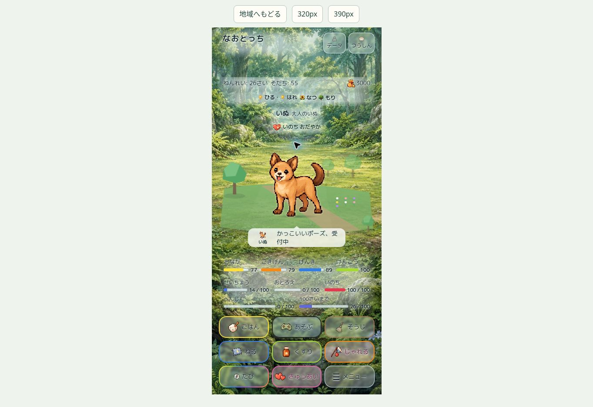

# 箱庭Pilot — 実装・検証・試遊

## 完成範囲

- 正式地域 `forest`（もり）、`river_lake`（みずべ）、`city`（とかい）。既存の旅先背景を維持し、DOMキャラ＋SVG/CSSの足場・遠近の木々・水面・建物・光・接地影を追加。Three.jsの追加読み込みなし。
- めぐるの `REGION3D` / `WORLDS` の植物・水・地面・建物パレットと、既存の季節／天候／時間帯を参照。地形メッシュや探索座標はコピーしない。
- なおぽよ。のPointer Events／pointer capture／ドラッグしきい値の操作設計を適用。パズルエンジン・グリッド・移動ルールは変更しない。
- 既存表示キャラをタップ選択、地面タップまたはドラッグ終了位置まで歩行。足元の選択輪・移動先、キーボード操作も対応。タップやドラッグで瞬間移動しない。
- 仲間・恋人は現在来訪している本人のみ。正式画像／表情／Relationship Expression／結婚指輪を保持。来訪・退出・リサイズ時に配置を調整し、既存キャラと重なって立ち往生しない。これは操作による移動とは別のレイアウト調整。
- 少数の自律行動：散歩、休憩、環境の観察、恋人のそばへ寄る。雨はshelterタグ、夜は頻度と速度を抑える。環境タグはtree / flower / water / building / shelter。
- Motion v2の既存personalityモーションを小さな無言リアクションに再利用。ごはん・じゃれる・掃除・起床・回復・求愛・関係表現・会話は既存側を優先し、移動先をキャンセルする。終了後の古い移動指示の自動再開はしない。
- 位置・選択・自律行動はメモリ内だけ。育成値、好感度、出会い、関係成立、セーブ形式を変更しない。専用ボタンの正式処理を維持。
- `naotocchi:home-reaction` の凍結イベントにactor ID/kind、操作、旅先、環境タグ、周囲のキャラ、関係種別を含む。発話しないイベントを基本としcooldownを持つ。Conversation v2の台詞生成・会話プール・発話処理は変更せず、将来の接続口だけを用意。
- reduced-motionでは自律移動・背景・歩行揺れを停止（指定歩行はゆっくり）。非表示・他画面・育成中はRAF停止。負荷tier 2では15fpsと装飾削減。通常は最大約30fps。

## 自動検証

| 検証 | 結果 |
| --- | --- |
| 新Pilot（model 12 + adapter 7 + actual runtime 5） | 24/24 PASS |
| Pilot + Motion v2 + asset versions/integrity（最終ハッシュ確定後） | 59/59 PASS |
| なおぽよ。全 `*.test.mjs` | 205/205 PASS |
| Relationship / Conversation Director / hygiene | 110/110 PASS |
| individuality | 26/26 PASS |
| social expression / free life | 24/24 PASS |
| npm test 内の大回帰群（めぐる・育成・セーブ・正式表情など） | 3211/3213 PASS。2件は編集中のasset token検査。確定後に該当ファイル全件を再実行しPASS |
| 既存smoke / dialogue / visual QA | PASS |
| 依存allowlistによるランタイムパッケージ検査 | PASS |

全 `npm test` を確定後に再度一括実行したという意味ではない。長時間の回帰群と並行した変更によりハッシュ検査が2件失敗したため、確定状態でその検査と変更対象を再実行した。めぐる・なおぽよ。本体は無変更。

レビューで発見した「来訪時の重なり」「Pilot終了後のpause属性残留」「指輪の移動範囲外へのはみ出し」は、各再現テストのREDを確認して修正。独立再レビューでも24件PASS、実レイアウト300px幅・200/240/300px高で指輪が範囲内に収まることを確認。

## ブラウザ確認とiPhoneでの残確認

実Homeのもり・みずべ・とかい、390px/320px幅、正式画像、選択輪、地面指定、ドラッグ後歩行、既存ボタンの配置をクラウドChromeで確認。保存しない操作見本で複数キャラ、雨・地域変更、来訪終了、動き控えめを確認。操作途中の既存会話による歩行中断も確認。

実機Safariは未検証。本人のiPhoneで以下を確認する：

1. 指での単タップとドラッグの判別、指を離すまで移動しないこと、選択切替。
2. 地面での縦スクロール、キャラ操作中のスクロール抑制、連続操作・画面端・横向き。
3. SafariのCSS translate、pointer capture、端末の「視差効果を減らす」、バックグラウンド復帰。
4. 複数キャラと指輪・装備の接地、育成モーションと選択輪の見え方。
5. 数分間の滑らかさ・発熱・バッテリー。端末fps／消費電力の実測値は未取得。

クラウドChromeではWebGL2が使えず、既存めぐるの2D fallback警告が出た。今回のHome PilotにはWebGL不要。実機のめぐる3D確認は残る。

## 試遊の分離

新しい本人限定Sitesサイトへ公開する。元のGitHub Pagesは更新しない。別originに加え、試遊ビルドのみ保存キーを `naotocchi-home-diorama-preview-v1` とbackup/snapsへ置換する。本番キー `naotocchi-save-v1` は使用しない。

入口の地域ボタンは試遊用の新しい人生を開始する。通常Homeの仲間・恋人の来訪条件を強制しない。「複数キャラの操作見本」は保存しない固定標本であり、ゲーム内の関係成立ではない。入口、seed、操作見本は試遊ビルド専用で、本番indexに含まれない。

再現：`python tools/pages/package.py --out <空の外部dist> --report <report.json>` → `node tools/prepare-home-diorama-preview.cjs <dist>`。パッケージは元repoのallowlistで検証し、その後に試遊専用の変換を行う。

## 未実装・全旅先への展開課題

- Pilot以外は従来表示。全地域の景物配置／安全な足場／環境タグの美術調整は未実装。
- 衝突回避は接近停止と空き場所の候補探索。複雑な障害物の迂回経路探索は未実装。
- 建物・水・草木は軽量表現。地域固有建築の精密再現、全天候専用しぐさ、大量の生物演出は未実装。
- Conversation v2のイベント購読・発話頻度／同文抑制・台詞と表情の同期は将来実装。独立会話システムは追加しない。
- 既存PR #419/#421（会話）、#422（なおぽよ。）、#420（ミニゲーム）との統合は将来mainの確定後に再確認。mainマージは禁止のため実施しない。

## 公開・保存結果

- Draft PR: https://github.com/Naoto214/naotocchi/pull/426
- 本人限定試遊: https://naotocchi-home-diorama-20261022.kerzion214.chatgpt.site/
- Runtime source commit: `74c3e066a9597bddd94dd24de8ab104ffd97fa3b`。GitHub tree SHAがローカル検証済みtreeと完全一致することを確認。
- Sites source commit: `2f27168234b41a8ef773d7495354a38fc4a27f0c`。全4045ファイルを確定ビルドと照合、owner-privateデプロイ `succeeded` を確認。
- アクセスには所有者のChatGPTサインインが必要。クラウドブラウザでは公開URLのログインゲートまで確認、ログイン後の公開画面は未確認。表示・操作QAは同一ビルドのローカルプレビューで実施。
- 本番Pages更新、mainマージは実施していない。GitHub Actionsは記録時点で実行待ち／実行中で、CI完了を主張しない。
- 約213MBの素材に対するSites Git一括送信が上限に達したため、同じサイトのsourceを7回に分けて同期。公開したのは最終完全版だけ。

