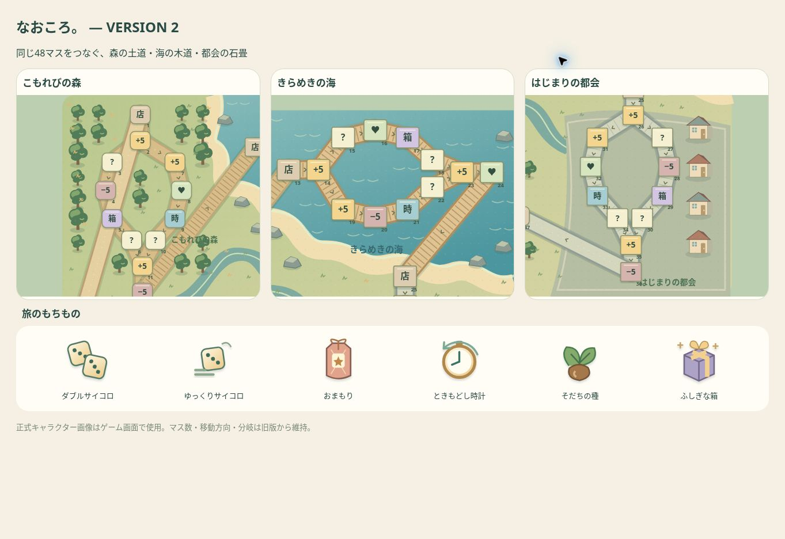
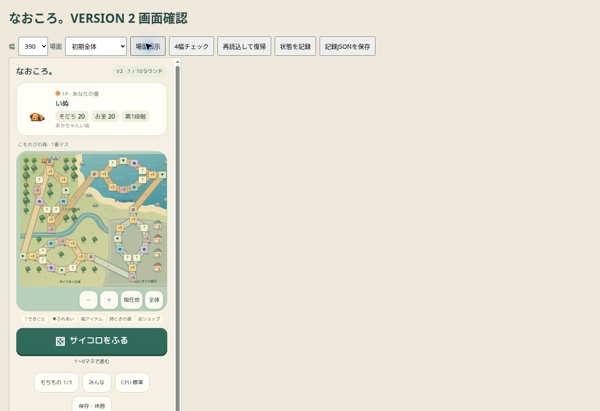

# なおころ。VERSION 2

2026-10-29。WIP `914ebd8`（PR #461 `9642262b`から4コミット先）を引き継いだ版。48マス・既存ルール・正式キャラクター画像を維持する。main/GitHub Pagesへは統合しない。

## 実装

- 初期全体カメラを完成。48マスを枠内に収め、現在地／全体／ドラッグ／拡大縮小を用意。リサイズ時も全体モードでは再計算。
- 出目を一度だけ確定する`roll-start`、1辺だけ進める`step`、分岐選択を継承。各辺を保存し、到着時だけイベント確定。既存一括`roll`は互換検証用に維持。
- 6面のCSS 3Dサイコロが回転・バウンドして確定面へ着地。標準1050ms＋結果保持120ms、高速CPU450ms＋120ms。ダブルサイコロも各出目を表示。動きを減らす設定に対応。
- キャラは1マス350ms（高速CPU150ms）で移動。行き先・通過経路・残り歩数を表示し、分岐では停止。CPUも同じ移動処理を使用。
- CPUの購入・使用予告、出目、移動、分岐、出来事、結果を順番に表示。初期は標準。結果は標準1700ms／高速700ms。
- イベントの事前報酬非表示を維持。選択後に物語の続きと実際の増減を表示。
- 地形と道を同じSVGで構成。森の土道・樹木・小川、海岸の砂浜・木道・岩、都会の舗装路・建物、広場の緑地。48ノード座標・分岐・矢印を保持。
- アイテム6種を専用SVGに統一。所持品・商店・使用表示で共用。
- 進化前後の正式画像・段階表示・光、若返り時計の逆回転。終了したプレイヤーの進化を、次のプレイヤーと混同せず表示。

## 進行と保存の設計

確定済みのゲーム状態（revision、出目、経路、残り歩数、報酬）が正本。画面演出は乱数を引かず、ゲームの報酬を書き換えない。1マスアニメーションの途中で閉じた場合は、その辺の確定前の位置から再開する。サイコロ・進化・若返りの演出自体は再読み込みで省略できる。イベント結果の再読み込みでは適用済みの報酬を再適用しない。

細分化した`step`の数をCPUの判断番号から除き、従来方式と同じseedの判断を維持。古いrevisionの操作は拒否。画面再構築・タブ非表示では進行タイマーとアニメーションを取消し、休憩は明示的な再開まで維持する。

## 検証

- 専用Node **42/42成功**（従来30件を含む）。引き継いだ未コミット経路検証テストも保存。
- 初級・中級の全履歴同値テスト24試合。10/15/20ラウンド各100組、**新旧300組・計600試合**で、プレイヤー全履歴・報酬・最終値・ミニゲーム・RNG一致。新方式は毎操作serialize/restore。
- 標準15ラウンド100試合：そだち平均74.7525、100到達2.5%、第8段階2.25%。10ラウンド平均57.0725、20ラウンド66.8375。これは改善前後のバランス維持確認であり、万人の体感プレイ時間の測定ではない。
- クラウドChromeのiframe幅 **320/375/390/430px**。全体・イベント前・結果・所持品/商店16条件で、48マス枠内・横はみ出しなし・読み込み後の画像欠落なし。
- 同4幅でサイコロ中・移動中・分岐・選択前・結果・若返り・進化・CPUの**32件の再読込復帰**が完全一致。移動中の実アニメーションと行き先強調、分岐操作、CPU休憩と再開を確認。若返りでそだち/お金/位置の不変、進化で段階変更を確認。
- 独立レビューの3件（高速サイコロ未着地、タブ復帰で休憩解除、別対戦の表示持越し）を再現テストで修正。
- 正式キャラメタデータ再生成は差分0。配信861ファイルのパッケージ生成成功。既存配信素材はGitのblob SHAと照合し不一致0。
- 本編`npm test`はsparse checkoutで未展開の`character-3d/runtime.mjs`が原因となり、`social-expression-integration-test.cjs`の「presenter turns body and head only as presentation and reduced motion suppresses it」で停止。本編全回帰成功とは扱わない。初回に不足したtests/helpersは同一blobの正本から復元済み。CI結果はPRの最新HEADで別途確認する。

証拠：`qa/v2-browser-qa.json`（100記録、32復帰一致）、`qa/v2-balance-comparison.json`、`tools/life-sugoroku/compare-v2.mjs`、`qa-v2.html`。

**iPhone Safari実機、実機ピンチ／慣性スクロール、全キャラ全表情の目視は未確認。** クラウドChrome幅検証をSafari実機検証とは呼ばない。標準CPUの読みやすさ・演出時間は本人評価後の調整候補。

## 36・48・60マスの比較（検討のみ）

| 項目 | 36マス案 | 48マス（正式維持） | 60マス案 |
|---|---|---|---|
| 同面積での視認性 | 密度が低く大きく描ける | 全体と地域の両立 | 数字・記号が小さくなりやすい |
| 地域の広がり | 地域ごとの見どころを絞る | 4地域×12マス | 道中の余白と風景を増やせる |
| 再訪頻度 | 高い。似た景色に早く戻る | 中間 | 低い。1回の旅で見切れない可能性 |
| 分岐 | 同数の分岐なら頻繁 | 4分岐、左右同長 | 同数なら分岐間が長い |
| 時間 | ラウンド固定なら必ず短くなるわけではない | 現仕様の基準 | ラウンド固定なら必ず長くなるわけではない |

参考計算：現在の48ノードは分岐の片側だけを通るため1周32歩。分岐比率を同じと仮定した概算では36→24歩、60→40歩。通常サイコロ平均3.5×15回＝52.5歩なので、周回は約2.19／1.64／1.31。アイテム・分岐構成・イベント時間を省略した説明用の値で、別盤面の実測結果ではない。VERSION 2は48マスのままとし、36/60マスは未実装。

## 実機での確認順

1. 新規開始→全体を確認→通常/ダブルサイコロ→分岐で選択。
2. CPU標準の1巡を見る。必要なら高速を比較。
3. 第2段階以降で時計→演出中の再読み込み。
4. イベント前後・移動中で再読み込み→数値と現在地確認。
5. ピンチ・現在地・全体、縦横回転、休憩中のタブ切替。
