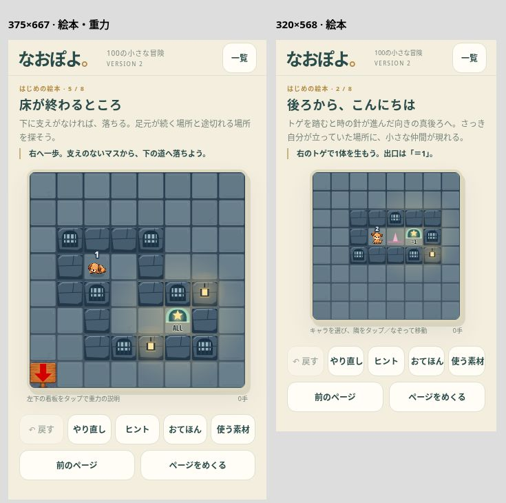
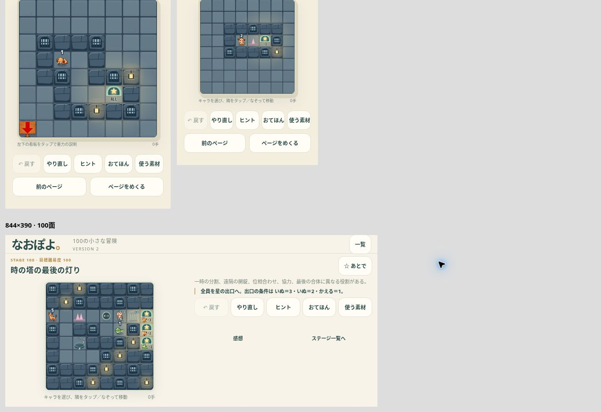

# なおぽよ。全100面 VERSION 2 — 正式仕様の復元・継承

2026-11-09。対象はDraft PR #535。100面の配置・解法・目標難易度はVERSION 1のまま維持し、今回の変更は正式仕様の継承と検証に集中した。main統合・GitHub Pages公開は行わない。

- [本人限定試遊版](https://naopoyo-100-v1-20261109.kerzion214.chatgpt.site)
- [正式版との比較](../../prototypes/naopoyo-100/compare.html)
- [物理ルールの照合詳細](PHYSICS.md)
- [Draft PR #535](https://github.com/Naoto214/naotocchi/pull/535)
- VERSION 1保存点: `93e5bb72bb0eba0ea3453f5a764284d2e71406c6`。元の第1章、第2章、図鑑、V1設計資料は変更していない。

## 根本原因

VERSION 1はゲームを完全に独自実装していたわけではない。正式エンジンとBoardInputは参照していた。しかし、それだけで正式仕様を継承したと判断し、**正式版アプリが担う入力イベントの接続、動作中の表示・つかみ直し、Undoの区切り、描画の呼び出しを別実装に置き換えていた**。

具体的には、100面版の `app.mjs` は `engine.mjs → externalMove` と正式 `BoardInput` を利用する一方、正式アプリにある `motionFrame`、`visualActors`、`pointerActor`、接触演出、pointerupの最終座標処理、coalesced events、単一ポインタ制御を接続していなかった。`render.mjs` は正式な盤面描画関数を呼ばず、図鑑のタイル描画と独自のキャラ描画を組み合わせた。出口・数字・選択時の見た目が変わり、看板も独自データの左上に置かれた。

従来の検証は「旧ソースが変更されていない」「試作が解ける」を中心にしていた。この2点が成功しても、新しい入口が正式な表示・操作経路を使っている保証にはならない。これが今回の見落としである。過去のすべての事象が同じ原因だったとまでは断定しないが、同種の未継承を検出できない検証構造だった。

## 参照基準

| 参照 | 確認点 |
| --- | --- |
| PR #494 / `329645ed` | D「時の針」。真後ろに開始、障害で時計回り90度、曲がった方向を維持、飛び越し禁止、生成済みの1も障害、最大7体。 |
| PR #504 / head `ee9db5a6` / merge `f6498ff4` | 正式第1章、接触v2・重力・足場、タップ／ドラッグ、モーション、ひと筆Undo、星付きアーチ・条件数字、左下A8の木製重力看板と説明。V10およびgravity-helpの承認記録を確認。 |
| PR #523 / `9ebcda6d` | 第2章試作の共通エンジン、入力、モーションの利用経路。既存の城・森拡張と保存版を保護。 |
| PR #532 / `fce9067b` | ひとマス図鑑VERSION 2の素材ID・共通絵柄。新規素材の図鑑描画は維持する。 |
| PR #535 VERSION 1 / `93e5bb72` | 比較・復元用の固定点。100面とその保存形式の比較元。 |

## 正式仕様とVERSION 1との差分・修正

| 項目 | 正式版 | VERSION 1の状態 | VERSION 2 |
| --- | --- | --- | --- |
| タップ／ドラッグ | 選択、隣接タップ、ひと筆移動 | BoardInputは共有、イベント接続が一部省略 | 共通BoardInput継続、最終座標・coalesced events・単一ポインタ・キャンセル境界を復元 |
| 動作中のつかみ直し | 見えている個体位置を判定 | 論理位置中心 | 正式 `pointerActor` を直接利用 |
| 移動・接触演出 | モーション列、合体／交換等の正式経路 | ほぼ即時描画、独自強調 | 正式 `motionFrame / visualActors / contactEffects / GateEffects` を直接利用 |
| 時の針 | 固定D | 共有エンジンで同じ | 変更なし。方向・障害・上限を差分回帰テスト |
| 接触・合体・交換 | contact-v2 | 共有処理、比較試行では一致 | 変更なし。ID・段階・位置・イベント順も比較 |
| 重力・登り・足場 | supported-v1、再合体制御 | 共有処理、比較試行では一致 | 変更なし。落下／門の天面／斜めも検証 |
| 扉 | 条件と開閉、正式描画 | 共有条件、図鑑側の表示 | 正式 `drawGate` と門演出を使用。新規連結スイッチ等は試作拡張を保持 |
| ゴール | 星付きアーチ、種族・=／≥／≤、全員救出 | 条件は継承、描画が図鑑側に置換 | 正式 `drawExit / drawCondition` と正式盤面描画を使用 |
| 看板 | 重力のある部屋のA8、役者の背後、タップ説明 | 左上(0,0)、説明操作なし | 正式木製素材、A8、説明の開閉を復元。番号面のV1データは保存し、表示は重力設定から導出 |
| キャラ | 正式スプライト寸法・選択浮上・接地・重なり | 素材は共有、寸法と強調を独自描画 | 正式 `drawActors` を直接利用 |
| 十字キー | タップ／ドラッグ主体 | 新しい8方向パッド | パッド撤去。正式版のキーボード操作は維持 |
| 戻す | ひと筆単位 | 一手単位 | ジェスチャー開始時点まで復元。再読込後も区切りを保持 |
| おてほん | 前後・最初から・自動再生・自分の盤面へ | ヒントの奥から次の1手のみ | 直接ボタン、前後・最初から・自動再生を復元。テンポは正式 `playbackClock`。クリア記録と分離 |
| 絵本UI | 新規画面だが正式操作を使用すべき | 盤面と操作群が縦に長い | 文章を上、盤面を中央、道具とページ送りを下に整理。横は盤面と道具を左右に配置 |
| 保存 | 既存本編・各試作の専用キー | V1専用キー | V2専用キー。V1や本編のキーを上書きせず、盤面定義一致＋合法な操作履歴からのみ復元 |
| 図鑑・評価 | 100面試作固有の要件 | 全面選択、図鑑、感想、メモ、再確認 | 維持。V1記録のインポートは評価等を引き継ぎ、定義のない途中盤面は再開しない |

## 実際の依存関係

| 層 | VERSION 2の参照先 |
| --- | --- |
| 手の解決 | `naopoyo-100/engine.mjs → naopoyo-time-hand-chapter1/engine.mjs → naopoyo-chapter1/engine.mjs` |
| 入力 | `app.mjs → interaction.mjs → naopoyo-time-hand-chapter1/input.mjs` |
| 表示状態 | `app.mjs → presentation.mjs → naopoyo-chapter2/session.mjs` および `contact-motion.mjs / gate-effects.mjs` |
| 基本盤面 | `render.mjs → naopoyo-time-hand-chapter1/draw.mjs`。追加素材のない盤面は完成済み描画をそのまま呼ぶ |
| 追加素材付き盤面 | 正式の背景・壁・出口・看板・門 → 図鑑素材 → 正式 `drawActors`。追加部分だけ合成 |
| 素材 | `naopoyo-rescue/sprites.mjs / fixtures.mjs / themes.mjs`、採用済み木製看板、PR #532 `tile-art.mjs` |

試作固有の拡張は存在する。波、水流、風、能力、箱、連結スイッチ等は100面版アダプターの範囲であり、正式第1章に存在しないルールまで「正式版と同じ」とは主張しない。100面の内容と独自性・難易度の改善は次段階とする。

## 回帰検証と再発防止

1. **物理の差分検証**：正式10面52手、その途中の全個体8方向688試行（成功201、拒否487）で状態・理由・イベント順が一致。重要境界を追加固定。
2. **操作の実行検証**：最終pointerup座標、coalesced samples、二本目の指の無視、表示位置でのつかみ直し、看板と移動の分離、低減モーション、ひと筆Undoをテスト。
3. **描画比較**：比較ページで正式10面52手を両経路で描画し、物理・イベント一致、ピクセル差分0状態を確認。追加素材のない正式盤面の比較であり、全100面の画像一致ではない。
4. **共有ソース保護**：入力・描画・モーションの推移的な依存23ファイルをSHA-256で固定。既存の物理・盤面保護も継続。原本を保存しただけで合格にせず、上記の呼び出し経路と実行結果を同時に検証する。
5. **100面の保護**：V1のステージ・解法データは不変更。収録解法776手を原本と交換JSONの両方で再生し100面クリア。これは面白さや抜け道不存在の証明ではない。
6. **次回変更の原則**：正式仕様は共有関数を利用する。新しい入力・演出を入れる場合は、比較ページと差分表で変更点を明示してから採用判断を受ける。正式仕様の変更と新規試作拡張を混在させない。

```sh
node --test tests/puzzle-*.test.mjs prototypes/naopoyo-100/tests/*.test.mjs prototypes/naopoyo-time-hand-chapter1/tests/*.test.mjs
```

実行結果：**191 / 191 テスト成功**。独立レビューで操作・モーション・保存・描画に重大な指摘なし。おてほんボタンの幅の指摘を修正。

## ブラウザ表示とiPhone実機確認

クラウドChromeで375×667、320×568、844×390のCSS viewportを確認。8方向パッドなし。盤面、道具、ページ送りが収まる。看板A8のタップで説明が開き、0手のまま。絵本2ページで分裂を含む2手をひと筆で操作し、Undo1回で0手へ戻ることを確認。

100面でも2手のドラッグ後に再読込し、2手の途中状態が復帰、Undo1回で0手へ戻ることを確認。おてほんの前後移動・自動再生4手・終了後の自分の盤面復帰も確認。

これはiPhone Safari実機の合格を意味しない。本人の端末では次を確認する。

- 縦／横回転、Safariの上下バーの伸縮、ホームインジケータ付近で、盤面と操作が隠れない。
- ゆっくり／速いドラッグ、指を離す直前の一歩、移動中のつかみ直しが以前の感触と一致する。
- 時の針の出生順・合体・交換・落下、星アーチと条件数字、A8看板の見た目が正式版と一致する。
- 途中で戻す、やり直し、おてほんを開閉、再読込して続きから、を順に行っても自分の盤面とUndoが保たれる。
- 実機の安全領域・手指の遮蔽・タッチ感の評価を残し、操作継承の確認後に100面の難易度改善へ進む。




