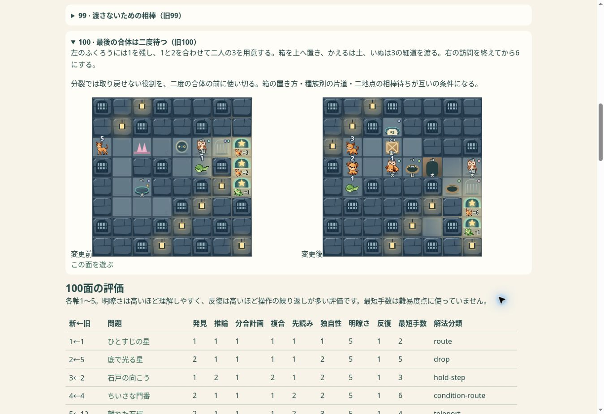

# VERSION 3 回帰確認

2026-11-12。Chromeでのブラウザ確認であり、iPhone Safari実機の確認ではありません。

- Node回帰214件成功。全100面・絵本8ページのおてほん再生、同一盤面の保存／復元、Undo履歴、素材ID交換、正式物理、入力座標、ひと筆Undo、動作中のつかみ直し、280msアーチと採用素材のハッシュ保護を含む。
- Pages依存関係・公開対象21テスト成功。公開allowlistや本番入口は変更なし。V3・図鑑・比較・実験ファイルの混入なし。
- Chromeの実DOMで108盤面×6画面＝648ケース。ヒント／おてほん表示の前後で盤面幅一致、横はみ出しなし、主要操作ボタン高さ44px以上。

|画面幅|盤面幅|画面高さ|
|---:|---:|---:|
|320|304|844|
|375|359|844|
|390|374|844|
|430|414|844|
|568|210|320|
|844|280|390|

- 最終100面は実ブラウザのおてほん21手でクリア表示。390px画面でクリア前後の盤面幅374px一致。アニメーションキュー完了を待って確認した。
- 最終100面で蛙を実際にドラッグ→1手、再読込→1手復元、Undo→0手を確認。おてほんは自分のクリアとして保存しない既存仕様も維持。
- 再現用ブラウザハーネス: `prototypes/naopoyo-100/tests/v3-browser.html`。静的配信した同じオリジンで開き、表示検証／最終面のおてほんの各ボタンを実行する。
- 初回の表示検証後、旧10/15の説明・評価、旧16の風の連続をレビュー修正。レイアウト・入力処理はその間も変更なし。
- 最短解法や手数で面白さを保証しない。iPhoneでは回転、アドレスバー伸縮、連続ドラッグ、つかみ直し、クリア後の説明、メモ再読込を確認する。

CIの過去失敗の原因と最小修正はCI.md。最新実行結果はDraft PR #535へ記録。mainマージ・GitHub Pages本番公開なし。

水中で待機中の魚を新規の水マス進入と誤認しない探索回帰を追加。再探索後も主素材の禁止条件93面は到達状態を全探索、2面は上限未確定、5面は対象外。
