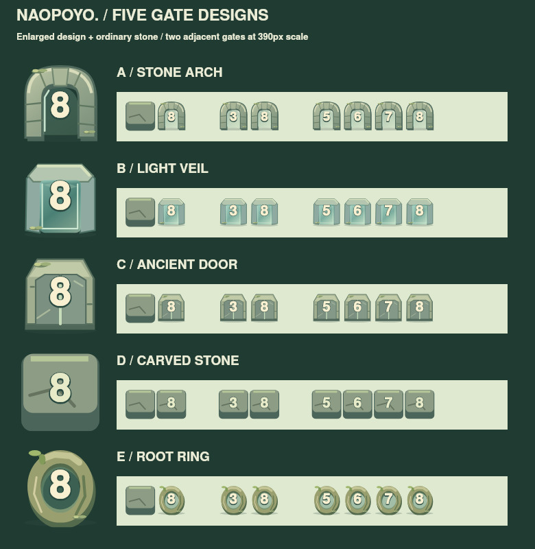
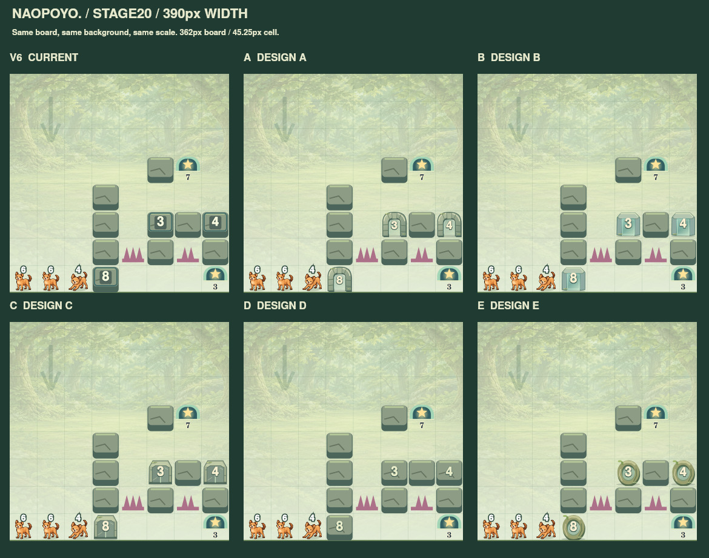
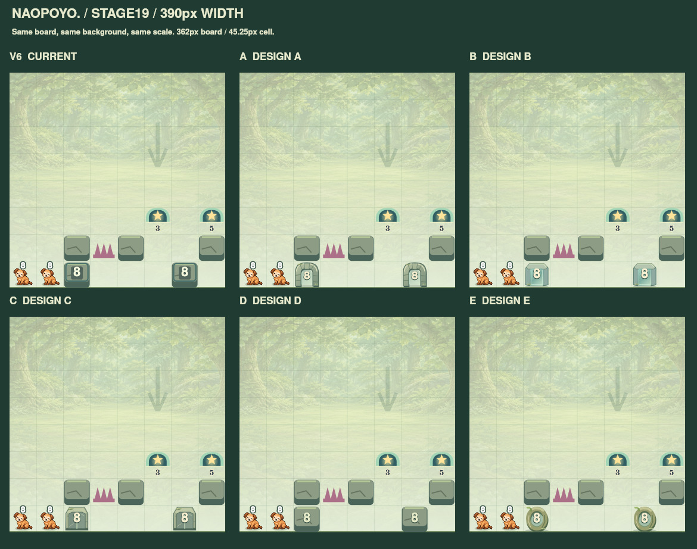
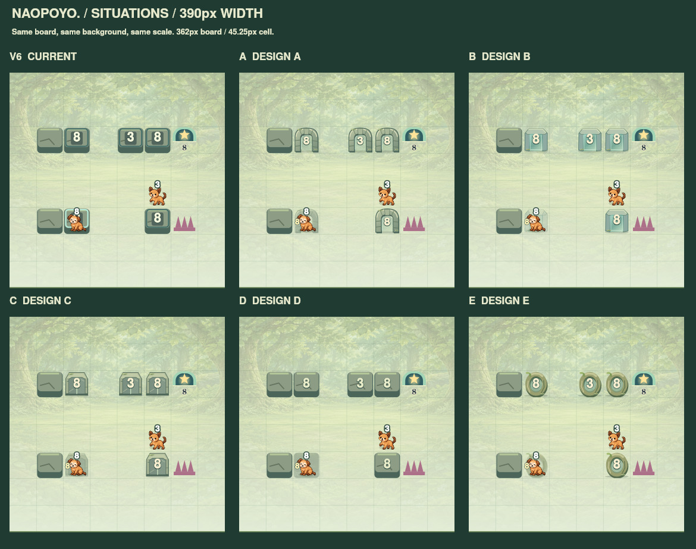
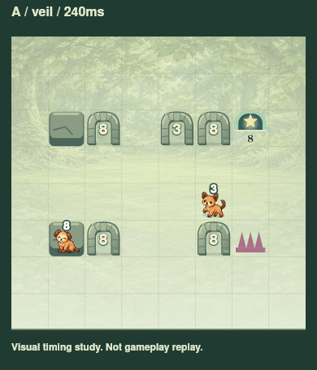

# なおぽよ。数字付き通行ギミック — デザイン比較

2026-10-25 / **デザインのみ・採用未決定・ゲームへの接続なし**

**第一候補 A：苔むした石アーチ。第二候補 B：森の光の結界。** Aは森の遺跡としての存在感と通常岩との調和、Bは数字と通過条件の明快さを重視する場合に有力です。推奨は制作担当による視覚評価であり、本人の採用判断ではありません。

## 最初に見る画像

- [A / 単体・数字1〜8・通常岩との並列](review/A-detail.jpg)
- [B / 単体・数字1〜8・通常岩との並列](review/B-detail.jpg)
- [C / 単体・数字1〜8・通常岩との並列](review/C-detail.jpg)
- [D / 単体・数字1〜8・通常岩との並列](review/D-detail.jpg)
- [E / 単体・数字1〜8・通常岩との並列](review/E-detail.jpg)
- [上位3案・19面の縦画面](review/compare-phones19-390.jpg)
- [上位3案・20面の縦画面](review/compare-phones20-390.jpg)
- [独立HTML](gallery.html)：ダウンロードして開くとA〜E／現行、19・20面／仮配置、375・390・430px、上位3案の縦画面、通過演出を切替できます。ゲーム操作・セーブ機能はありません。GitHubのファイル表示画面ではHTMLは実行されません。

## 正本と範囲

- Repository: `Naoto214/naotocchi`
- PR #436 HEAD: `abed89099d2b548863ab9b7b219891382b43dbda`（開始時にGitHubで確認、指定HEADと一致）
- remote main確認: `0b3bb1fe77f7b9829e94f2284ce2b56eb3fe1e0e`
- 正式19・20面は `prototypes/naopoyo-chapter2/stages.mjs` / `expansion-stages.mjs` から読取。座標、数字、キャラ、岩、トゲ、出口は不変。
- 森背景は `assets/world/forest-v1.webp`、犬3・4・6・8は正式PNGと正式crop値を使用。
- 通常岩の輪郭・影・上面・ひびは既存 `stone.mjs` を使用。Dも同じシルエットを使用し、二重枠と数字プレートのみ撤去。
- 保存する変更は本資料のディレクトリ内のみ。ゲームルール・共通エンジン・11〜20面・解答・保存データ・本編・CARD・原本画像は変更していません。PR #436、version 6、main、Pagesへの書込・デプロイ操作なし。

## 5案の設計

| 案 | 具体的な長所 | 課題・トレードオフ |
|---|---|---|
| **A 石アーチ** | 一目で「森にある通り道」。石の厚み、目地、上面の淡い縁、苔を同じセル内に配置。通常岩から区別でき、遺跡らしいまとまり。 | 中央だけ通れる門と解釈されやすい。上下・斜めでも同じ条件、枠自体も一致時には支持しないことを、枠全体の透過と初回説明で補う必要。数字は他案より少し小さい。 |
| **B 光の結界** | 中央の半透明面と大きな数字で「条件のある障壁」が伝わる。直線の上面は足場として読みやすい。光は面の内側に限定。 | 薄い枠はAほど石の重さがない。四角い発光パネルに近づきやすいため、UIに見えないか本人確認を重視。 |
| **C 古代石扉** | 石の台形上面、中央の合わせ目、左右の扉で重さを示す。通常岩と色調が合う。 | 「開ける操作」「開いたまま」「横方向だけ通行」を連想させる。上下斜めの透過ルールとの意味のずれが大きい。開閉移動を実装する案は推奨しない。 |
| **D 刻印岩** | 通常岩と同じ形・影。数字1〜8は大きく、既存コードからの変更量が少ない。 | 石が条件で透過することを静止画だけで理解しにくい。従来のUI枠問題は減るが、通り道の魅力はAに劣る。 |
| **E ねむり根の輪** | 根が輪を作る、柔らかな森独自の意匠。丸い輪郭で岩や扉から見分けやすい。 | 上面が丸く「上に乗れる」感じが弱い。輪の中だけを通る印象、出口との意味の近さが課題。木の質感のため通常岩との統一は弱め。 |

数字は基本的にクリーム色＋濃い緑の縁。キャラは既存の白い頭上数字を維持します。通過中だけ中央数字を隠し、左支柱側に小さなクリーム色の条件数字を前景表示します。これは重なり対策の**提案**です。数字が移ること、指での遮蔽が気にならないかは実機で判断する必要があります。

## 評価表

5＝非常に良い、4＝良い、3＝課題あり、2＝直感性に大きな課題。主観的な設計比較です。精密な客観測定や利用者テストの点数ではなく、合計による自動採用はしません。

| 評価項目 | 重要度 | A | B | C | D | E |
|---|---|---:|---:|---:|---:|---:|
| 見た目の魅力 | 非常に高い | 5 | 4 | 4 | 3 | 5 |
| 世界観との統一 | 非常に高い | 5 | 4 | 5 | 5 | 5 |
| 数字の読みやすさ | 非常に高い | 4 | 5 | 4 | 5 | 4 |
| 通過ギミックとしての直感性 | 非常に高い | 4 | 5 | 3 | 2 | 3 |
| 通常岩との調和 | 高い | 5 | 4 | 5 | 5 | 3 |
| 小画面での視認性 | 非常に高い | 4 | 5 | 4 | 5 | 4 |
| アニメーションの自然さ | 中程度 | 4 | 5 | 3 | 4 | 4 |
| 実装・保守の容易さ | 高い | 4 | 4 | 4 | 5 | 3 |

Aを第一候補とする理由は、今回の主訴である「UIボタンのように見える」を最も素直に避け、森の地形として成立するためです。Bは読みやすさ・通行条件を優先する第二候補です。A採用の場合はBの枠全体の淡い透過を組み合わせるのが有力です。

## iPhone相当寸法と視覚QA

既存 `app.mjs` は8列、左右padding 10px、arena幅からさらに8pxを引いてcellを計算します。高さが制約にならない縦画面では次の寸法です。

| 画面幅 | 盤面幅 | 1マス | A通常数字の指定サイズ | 重なり時条件数字 |
|---:|---:|---:|---:|---:|
| 375px | 347px | 43.375px | 17.78px | 13.01px |
| **390px** | **362px** | **45.25px** | **18.55px** | **13.58px** |
| 430px | 402px | 50.25px | 20.60px | 15.08px |

比較画像は2倍解像度で出力し、合成比較は1 CSS px＝1画像pxになる縮尺で配置。チャットやGitHubが画像全体を縮小する場合は画像を開いて拡大してください。デバイスの物理mmを保証するものではありません。

確認した画像：全案の1〜8、通常岩の隣、2個の隣接、8が8に重なる仮配置、3が8の上にいる仮配置、正式19・20面。375・390・430pxを出力。390pxで5案の形、岩・トゲ・星との差、数字の識別を重点確認しました。各案はセル内にclipし、隣のマスへ装飾や光を描きません。

### 検証の限界（省略しないこと）

- 配布PNG/JPEG/GIFは **Node/Skia Canvasによる寸法再現画像**。iPhone SafariやChromeのスクリーンショットではありません。
- 通常岩・背景・配置・正式キャラは正本から使用。固定画像ではフォントをArial相当、出口数字を中央配置で再現しており、端末の字形・微細なアンチエイリアスまで同一とは主張しません。現行V6の極小フォント指定は同じ位置とサイズの拡大座標描画に置き換え、Skiaの丸め誤差を回避しています。
- 縦画面の画像は760px高で、既存CSSの行寸法と中央配置を再現した**モックアップ**です。周辺UIは英語の代替文字を使用。独立HTMLの縦画面は既存の日本語UIとCSSを用いますが、ブラウザー実行確認は未完了。
- Cloud Browserはローカルfile URLをセキュリティ規則で拒否しました。別経路で回避していません。ローカルChromium/WebKit実行ファイルもありません。HTMLは構文と静的結合のみ確認済み。
- Safariの端末フォント、safe-area、指の遮蔽、タッチ中の数字認識、実機の演出体感は未検証です。採用案決定後の実装Workで確認してください。
- 通過アニメはルールを走らせない視覚モック。通常岩を含む配置上をキャラが補間移動する部分は合法手順の実証ではありません。

## 通過アニメーション案

各案240ms、比較用GIFは1.5秒間隔でループ。ゲームへの入力制限や待機処理はありません。

| 演出 | 評価 |
|---|---|
| 数字が光る | 分かりやすいが中央の数字がキャラと重なる瞬間は混雑。単独採用は優先しない。 |
| **内側と枠が淡く透過** | **推奨。** 小画面でノイズが少なく、一致時に地形が実体を失う意味が最も伝わる。 |
| 4粒の光 | 可愛さはあるが375pxでは小さく、静止状態の理解には寄与しない。補助としてのみ。 |
| 数字の周囲に光が走る | 綺麗だがループする仕掛けに誤解されないよう短く1回に限定。透過より視線を奪う。 |

[A・数字](review/A-digit.gif) / [A・粒子](review/A-particles.gif) / [A・周囲の光](review/A-halo.gif)

[B・透過](review/B-veil.gif) / [B・数字](review/B-digit.gif) / [B・粒子](review/B-particles.gif) / [B・周囲の光](review/B-halo.gif)

[E・透過](review/E-veil.gif) / [E・数字](review/E-digit.gif) / [E・粒子](review/E-particles.gif) / [E・周囲の光](review/E-halo.gif)

## 採用後の実装方針（今回は実施しない）

1. 本人の選択した1案だけを `drawMagicRock` 相当の描画関数へ移す。デザイン比較用UIと他案はゲームに持ち込まない。
2. 条件は既存の `g.exact` を表示するだけ。ルール判定を描画内に再実装せず、地形支持・通行判定は触らない。
3. 通過演出の発火元は既存 `phase` イベント。一致して入ったゲート1個だけを短く透過させる。数字不一致で上に乗るときは静止の厚みを保つ。
4. 枠も含めて透過する。門が横方向だけ通れるように見えないよう、上から落ちる一致キャラと斜め通過も実機確認。240msは比較案の値で、既存の移動タイムラインを延長する決定ではない。
5. 重なり時の条件数字は前景の左支柱側へ。キャラの白い頭上数字、出口の星、トゲとの識別を確認。移動する数字が分かりにくければ別の描画位置を比較する。
6. reduced-motionは粒子・走光を止め、静止または短い透過のみ。保存フィールド・画像原本・ステージ解答は変えない。
7. 採用案の実装時に375・390・430pxのSafari実機またはWebKitで確認し、version 6を上書きするか別版にするかは次Workの指示に従う。

## 再現用ファイル

`designs.mjs` はA〜Eの独立描画コード。`render-study.mjs` と `finish-images.mjs` は固定画像の生成器、`build-gallery.py` / `gallery-app.js` は独立HTMLの組立器です。`source/` は上記固定SHAから取得した読取専用スナップショットで、SHA検証記録は `verification.json` に保存しています。

既存リポジトリのテスト・CI成功は今回のデザイン評価の証拠に流用していません。今回実施した検証は、ソース一致、出力の寸法と件数、画像の視覚確認、セル外描画のclip、JS構文確認、GitHubへのdocs限定保存です。
