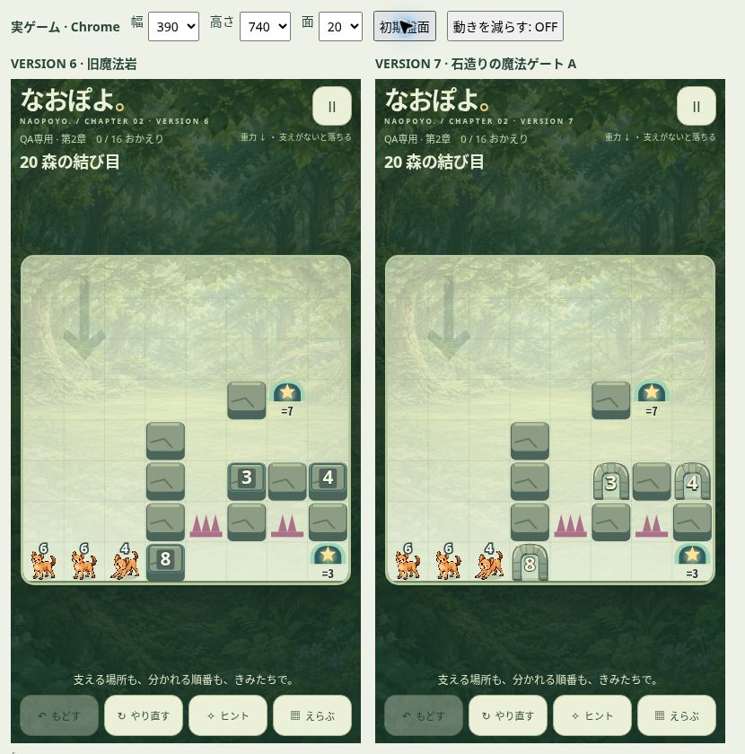
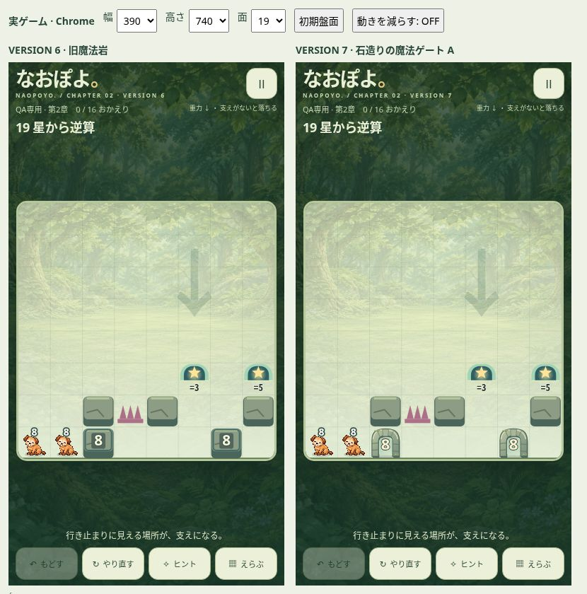

# なおぽよ。第2章 VERSION 7 — 石造りの魔法ゲート A 正式実装

2026-10-26 JST。採用済みA案を第2章の実ゲームへ統合し、既存の本人限定URLへ配信しました。デザイン比較の再制作ではありません。

[本人限定 VERSION 7 試遊](https://naopoyo-komorebi-20261024.kerzion214.chatgpt.site/prototypes/naopoyo-chapter2/qa.html) · [実装 PR #436](https://github.com/Naoto214/naotocchi/pull/436) · [比較資料 PR #445](https://github.com/Naoto214/naotocchi/pull/445)

## 正本と取り込み範囲

|対象|確認SHA|
|---|---|
|remote main（調査時）|`0b3bb1fe77f7b9829e94f2284ce2b56eb3fe1e0e`|
|PR #436 / version 6|`abed89099d2b548863ab9b7b219891382b43dbda`|
|PR #445 / 採用Aの比較資料|`2b50389d81a1b6b667e5ca0fc3d9724181d52d09`|
|PR #436 / version 7 実装commit|`403379e2116225cc2654ae9096f9715715c1ad00`|
|実装tree|`e494398442981e70a5e4df967903826059683edc`|
|本人限定Sites配信ソースcommit|`5a0146f8d1a239e6782e001773a6027444741e12`|

PR #445の `docs/naopoyo-gate-design-20261025/designs.mjs` からAのアーチ形状・石柱・継ぎ目・色調とA-veilの内側透過という表現を再利用。数値・描画を実ゲームのCanvasへ移植し、発火管理は既存phaseイベントに接続しました。B〜Eや比較ページ全体は取り込んでいません。PR #445はそのまま保持しています。

このREADMEと証跡を追加する後続commitは資料のみです。配信の `version.json.sourceCommit` とCI対象は上記の実装commitを指します。資料追加後のHEAD/treeはPR説明に記録します。

## 完成デザインと描画

丸みのあるアーチ、左右の柱、石材の継ぎ目、控えめな苔、通常岩に寄せた明暗を1マス内に描画します。二重の四角い枠はなく、内部に通路が見えます。論理上は従来と同じ1マスの数字条件付き障壁です。

中央数字は比較Aの0.41マスから**0.49マス**へ拡大。390px幅では1マス45.25px、数字は約22.17pxです。クリーム色 `#fff2d0` と暗い縁取りで1〜8を識別できます。キャラの白い頭上数字とは色と位置を分けています。

キャラと重なる間はアーチを淡くし、中央数字を前景の柱側へ移します。前景数字は0.30マス（390px幅で約13.58px）。通常は左柱、斜め移動時にキャラ頭上数字と近づけば右柱、必要なら下部へ逃がします。正式キャラ画像はゲートより前に描画し、原本・サイズ・頭上数字は変更していません。ゲートはマス内でclipするため隣のマスを覆いません。

実装は `gate-art.mjs`（絵）、`gate-effects.mjs`（一時的な演出状態）、`render.mjs`（描画順）に分離。既存 `stone.mjs` は変更していません。

## 通過演出

- A-veil：条件一致の通過時に内側が淡く光る**240ms**の演出。粒子や常時点滅はありません。
- 既存のphaseイベントと実際の描画キャラの重なりを照合して発火。重力、位置交換、一筆書きで連続する通過に対応します。
- 条件不一致では発火せず、操作の待ち時間を追加しません。
- `prefers-reduced-motion: reduce` では発光を抑止。Undo・リトライ・状態復帰時に古い演出を残しません。
- 演出状態は描画側のWeakMap内のみで管理し、セッションや保存データに追加しません。

## 実ゲームの比較画像

以下は**Chromeで実際のゲームCanvasを描画した画像**です。左右は同じ盤面・同じ背景・同じCSS幅。左がV6、右がV7です。静止したイラストモックではありません。比較用外枠の中の各iframeが指定のiPhone相当CSS幅になっています。

### ステージ20 / 390px（重点確認）

### ステージ19 / 390px

|CSS幅|1マス|19面|20面|
|---|---:|---|---|
|375px|43.375px|[比較画像](images/compare-19-375.jpg)|[比較画像](images/compare-20-375.jpg)|
|390px|45.25px|[比較画像](images/compare-19-390.jpg)|[比較画像](images/compare-20-390.jpg)|
|430px|50.25px|[比較画像](images/compare-19-430.jpg)|[比較画像](images/compare-20-430.jpg)|

通常岩との隣接、19面の8ゲート2個、20面の8・3・4ゲート、トゲと出口との区別を確認。幅375pxでも中央数字は読め、余分な枠や発光が盤面を埋めません。

|場面|確認方法・証跡|
|---|---|
|実際の一筆書き通過|19面の8キャラを(1,7)から(3,7)へ実pointer操作、2移動成功。Undo・リトライ成功。[通過フレーム](images/passage-19-390.jpg)|
|不一致キャラの支持|19面既存解答の最初22操作を実セッション再生。3が(6,6)、8ゲートが(6,7)。[支持画面](images/support-19-390.jpg)|
|保存復帰|上記22操作後のページ再読込でstateとhistoryが一致、比較ページに「保存復帰: PASS」。テスト用originの保存で確認|
|短い縦画面|390×570、390×664、390×844へ変更。362px盤面を維持、縦スクロールなし、操作ボタン表示。[570px画面](images/short-20-390x570.jpg)、[寸法記録](evidence/browser-layout.json)|
|1〜8、隣接、斜め、重力、位置交換、連続、不一致支持|実ForestSession・正式描画・正式画像を使う**合成QA fixture**。[通常](images/engine-fixtures-390.jpg)、[reduced-motion](images/engine-fixtures-reduced.jpg)、[イベント記録](evidence/browser-fixtures.json)|

fixtureは場面を再現する検査用盤面です。正式19/20面の画像とは区別しています。通過画像とfixtureは評価のため指定時刻で静止しています。fixtureの一覧スクリーンショットは画面全体表示のため表示時に縮小される場合があり、個別のiPhone全画面比較と同じ用途ではありません。

**未確認**：本人のiPhone Safari実機、Safari固有のセーフエリア実値、実際のアドレスバー伸縮。今回はChromeのCSS幅・高さ変更による近似QAです。既存safe-area/dvh CSSは無変更です。reduced-motionは描画オプション／QA側の設定で再現し、OS設定を変更した実機試験ではありません。

## 回帰結果

既存テストは削除・無効化していません。中央数字の既存テストは変換後座標も追跡し、1〜8を検査する形へ強化。新規9テストを追加しました。

|検査|結果|
|---|---|
|変更前パズル合同検査|731/731成功|
|変更後・第2章／第1章／Insight／World／v2／Rescue|**740/740成功**、失敗・skip・cancel 0|
|ゲート重点検査|12/12成功（斜め重なり2件は修正前失敗→修正後成功）|
|CARD GAME|**412/412成功**|
|本編 `npm test`|**3,432/3,432成功**（26+24+3,223+159）、関連smoke/dialogue/visualスクリプトもexit 0|
|Pagesパッケージunit|16/16成功|
|PagesパッケージHTTP検証（ローカル）|4,053ファイル、欠落0、ハッシュ不一致0、5入口、452カード/904画像、除外7パス404|

通行・支持、重力・上昇、8方向移動／位置交換、条件回避防止、斜め角抜け、トゲ非支持、出口通行／救出、足し算・余剰分離・複数分裂、自動合体、一筆書きB、Undo・リトライ、保存復帰、順次開放は既存テストで回帰確認しています。

### 既存解答の再生

|面|11|12|13|14|15|16|17|18|19|20|
|---|---:|---:|---:|---:|---:|---:|---:|---:|---:|---:|
|受理された移動数|5|5|10|11|23|25|26|20|**62**|**60**|
|全員脱出|成功|成功|成功|成功|成功|成功|成功|成功|成功|成功|

19・20面の解答手数はV6と同じです。15〜20面は最短性未証明の既存解答であり、最短解とは呼びません。[再生ログ](evidence/witness.log)

## 既存ゲーム・保存の保護

V6との差分を確認し、共通エンジン、session、stages/expansion-stages、解答、progress/保存形式、通常岩、正式画像、第1章、本編Runtime、CARD GAMEはバイト単位で無変更です。旧12面の保存、既存クリア記録、QA/通常の独立保存キーも維持します。本人の保存データは操作していません。[差分保護記録](evidence/protection.json)

mainのマージ、GitHub Pagesの本番更新、第1章の直接変更は実施していません。Pages検証はローカル生成・ローカルHTTP試験のみです。

## 配信検証

既存SitesプロジェクトとURLを維持してprivate deploy成功。

- version ID：`appgprj_6adc23fed6a08191946282f35ecfd94a~appgver_d22b8433782c819183c14a191d5657ba`
- deployment ID：`appgdep_6ade24e0f6288191a96be5561e9301cd`
- ownerのみ1名、追加viewer/groupなし、external visitor 0、アクセス設定revision 1を維持。
- 配信**67ファイルすべてHTTP 200、保存版とSHA-256一致**。`version.json` のversionは7、sourceCommitは実装403379e。
- 認証なしのQA URLは403。ブラウザーでもサインイン画面を確認。
- 配信パッケージに比較ページ、fixture、テスト、V6複製を含めていません。
- **認証済み公開URLでのブラウザー操作は未確認**。このブラウザーはサインイン画面で停止。操作・表示・保存復帰は同一ファイルのローカル実ゲームで確認し、配信のバイト一致で対応を確認しました。

[配信ファイル全件検証](evidence/deployment-verification.json) · [秘密情報を含まない公開記録](evidence/release.json)

## GitHub CIとレビュー

実装commit `403379e2116225cc2654ae9096f9715715c1ad00` の **9/9 workflowが完走・成功**（2026-10-25 16:06 UTC確認）。失敗・実行中0。第2章のpuzzle/card/main-regression、Home layoutの両ジョブを含め成功しました。[CI記録](evidence/ci.json) に各runを保存しています。資料だけの後続commitは `[skip ci]` とし、実装SHAと資料HEADを区別します。既存テストや実装CIの停止・無効化はしていません。

[独立コードレビュー](REVIEW.md)：斜め通過時の数字重なり1件を修正し、回帰テスト追加。未対応のコード指摘なし。

## 証跡と再現

[検証ログ一式](evidence/test-logs.tar.gz) に本編・CARD・パズル・Pages・RED/GREENログを保存。画像は上記リンクから直接閲覧できます。`qa/` は比較・fixture再現用HTMLと19面の22操作データです。配信物ではありません。ローカルpreviewルートへ配置し、V6ビルドを `v6/`、V7ビルドをルートに置いて使用します。ゲーム本体の保存形式や正式ステージを編集する必要はありません。

残る確認は、本人のiPhone Safariでの操作感・実際のセーフエリア・アドレスバー伸縮、および本人の認証済み配信画面での最終実機確認です。
