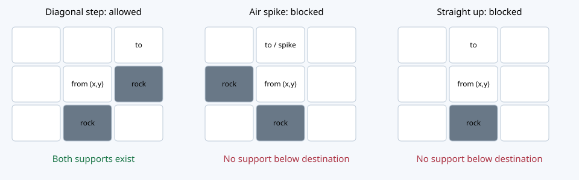

# 重力・トゲ・支持の新しい正式候補

状態: PR #436 の第2章のみで試遊する `gravityRules: supported-v1`。第1章/旧v2/独立飛行比較室の実装は変更しない。

## 移動・滞在・接触

1. `canAscend` は重力下の上昇を段階1〜8共通で判定する。
2. `enter` は移動先の壁・門・出口・地形を検査し、合体/余剰/分裂/救出を処理する。
3. `settle` は同一イベント内で支持される位置まで落下・接触を完了する。

出発 `(x,y)`、移動 `(dx,dy)`（8方向の隣接1マス）、到着 `(x+dx,y+dy)`。`dy=-1` の時、出発直下 `(x,y+1)` と到着直下 `(x+dx,y+dy+1)` の両方に支持が必要。移動中の自分を支持物に数えない。真上の到着直下は自分なので、飛行のない単独キャラは真上へ跳べない。斜め上なら隣の岩/仲間の上へ登れる。横/下は支持がなくても合法進入後に落下する。

支持物は岩・盤外境界・自分以外のキャラ・対象に通行不能な門/出口。出口はもともと条件不一致の落下を止めるため、新ルールでは上昇時の支持も同じ扱いに統一する。条件に合う出口/門は支持せず通常進入・救出対象。トゲそのものには支持能力がない。岩などが直下にあるトゲマスではその岩が支持する。

通行は移動先マスだけを見る。斜め移動の隣接2マスを検査する角抜け禁止は追加しない。能力は今回導入しない。将来の飛行は支持不要の移動/停止を別の能力ポリシーとして判断し、分裂で飛行を失った時は直ちに同じsettleへ渡す。

## 段階8の現象

旧版も上昇条件自体には段階8の分岐がない。8が1〜7の真上へ斜め移動すると、直後に下の仲間へ落下合体する。移動中の8のIDは下側へ移り、余剰1〜7は上側に残る。8＋8は合体を拒否するのでそのまま上に立つ。移動不能に見える現象にはこの上下交換が含まれる。新ルールでも合体/余剰は維持し、表示で説明する。トゲ滞在の無条件落下停止と到着支持の欠落は別の問題として修正した。

## トゲと分裂

合法進入で `k=min(n-1,t,s)`。既存の方向別優先順位・通常空きマス・8近傍BFS最大2歩を維持。部分分裂/不能時の通過も維持。本体をトゲマスに置き、子を配置した後で両者に重力を適用する。正式画像の上向きは変更しない。

新ルールでは「タイル全体で連鎖中1回」の旧制限を撤去し、実際にそのマスへ移動した本体/余剰の進入で判定する。滞在だけ、動かない側へ他キャラが合体しただけでは再発動しない。離れて再進入、別キャラの進入は新たな判定。イベント内の兄弟再合体保護は既存v2のまま。

下から順（y降順、x昇順、ID順）に安定化する。新ルールは物理盤面と一時家族グループを正準化して循環を検出し、通常/外力移動は変更前へ戻して拒否する。無限ループや途中で浮いた盤面を成功扱いしない。Undoは操作前の状態全体を復元。一時イベント状態は保存しない。

## 旧仕様との違いと保存

|項目|旧v2・旧比較室|新しい第2章候補|
|---|---|---|
|トゲ滞在|トゲが支持して落下停止|トゲ非支持、直下に支持がなければ落下|
|上昇|出発下/トゲ滞在＋出発横|出発直下＋到着直下（自分除外）|
|発動制限|1タイル/連鎖1回|実際の進入ごと|
|8の接触|合体/余剰、8+8非合体|維持|
|角抜け|移動先だけ検査|維持|
|保存|旧Pilotキー|新ルール専用キー、旧キーは読取のみ|

新キーは `naopoyo.komorebi.supported.20261024.v1` と `.qa`。旧Pilotのクリア・開放・ヒント・読了を引継ぐ。旧途中盤面/Undoを新ルールとして再解釈しない。旧キー・boardキーをそのまま残す。新旧タブは互いの盤面を上書きしない。新形式の復帰ではgravityRulesも検証。第1章正式キー・旧12面・本編・CARDには書込まない。

## ステージ影響

18: `(4,7)` に岩1マス。門から右上のトゲへ登る支持を作る。出口・門・トゲ・初期数字は維持。
20: `(4,7)` と `(5,4)` に岩2マス。前者は最初のトゲ、後者は上の作業場から星へ登る足場。出口や門を近づけず、全ギミックの位置/数字/初期配置を維持。
15: トゲ自体を足場とする説明を、直下の岩による支持に訂正。
13: 条件不一致の8出口を4の足場にする合法別解が成立するため、「8を先に帰すと解けない」という旧ヒントを訂正。禁止して解を狭めない。

旧26手は旧ルールの結果。新20は実エンジンBFSで36手（16,568状態）。合体・分裂・余剰、下8門/上左3門は無効化すると全探索で解なし。右4門を使わない65手の合法別解あり。全解答数/一意性、人間の最高難度は保証しない。
