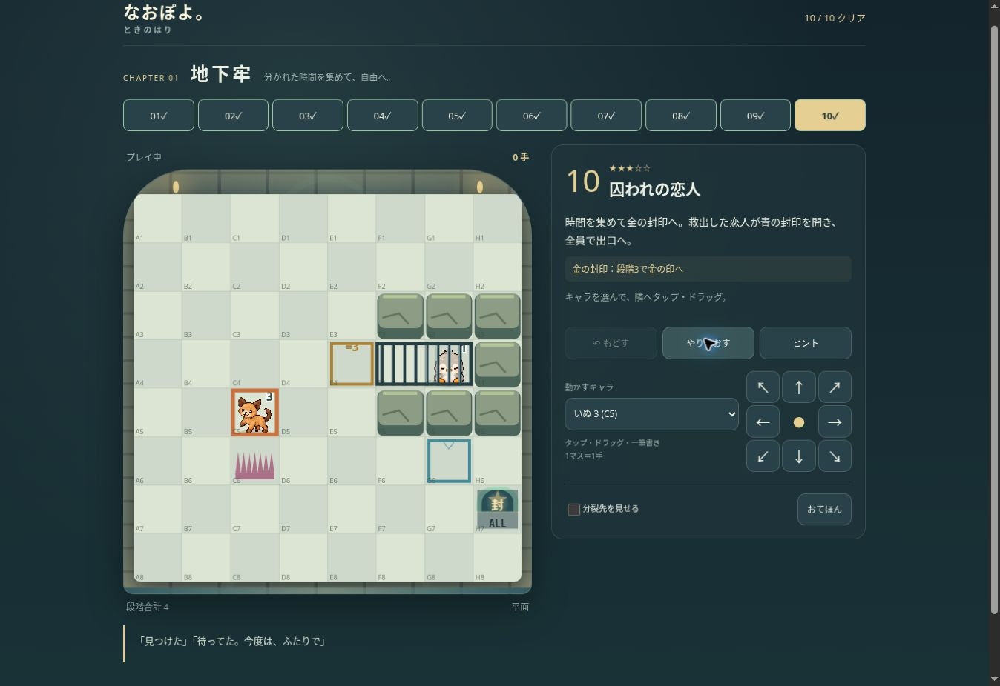

# なおぽよ。時の針 第1章「地下牢」VERSION 1

[本人限定試遊](https://naopoyo-time-hand-chapter1-20261102.kerzion214.chatgpt.site/) · [Draft PR #504](https://github.com/Naoto214/naotocchi/pull/504)

## 1〜9. 全10面・盤面・学習と物語
全盤面8×8。座標は左からA〜H、上から1〜8。全員が条件付き出口に入り、盤面に誰も残っていないことがクリア条件。分裂学習面は記載した目標で出口の封印がほどける。この目標は画面内に明示。最短性は未証明、すべて「確認済み解答」。

|面|タイトル|手数|難易度|学習・クリア条件|
|---|---|---:|---|---|
|01|目覚め|4|★☆☆☆☆|光の出口へ、みんなで進もう。|
|02|最初のトゲ|4|★☆☆☆☆|1体に分裂し、合体して「＝2」の出口へ。|
|03|分かれた時間|7|★☆☆☆☆|3体に分裂し、時間を集めて「＝4」へ。|
|04|曲がる針|6|★★☆☆☆|岩で90度曲がる分裂を使い、全員脱出。|
|05|再会|4|★★☆☆☆|同じ種族の仲間と合体し、「＝4」の出口へ。|
|06|小さな迷路|11|★★☆☆☆|2回以上曲がる分裂。8まで集めて出口へ。|
|07|仲間の力|11|★★★☆☆|かえるで針を曲げ、★に1を届けて全員脱出。|
|08|斜めの道|9|★★★☆☆|仲間を足場に斜めのトゲへ。全員で出口へ。|
|09|閉ざされた扉|10|★★★☆☆|分裂して「＝1」の門を通り、全員脱出。|
|10|囚われの恋人|15|★★★☆☆|時間を集めて金の封印へ。救出した恋人が青の封印を開き、全員で出口へ。|

### 正確な初期配置

**01 目覚め** — 平面

- キャラ：parent（dog・段階1）B5
- 岩：A4、A6、B4、B6、C4、C6、D4、D6、E4、E6、F4、F6、G4、G6、H4、H6
- トゲ：なし
- ゲート：なし
- 出口：F5 ALL

**02 最初のトゲ** — 平面

- キャラ：parent（dog・段階2）D5
- 岩：なし
- トゲ：D6（最大1体）
- ゲート：なし
- 出口：F5 ＝2

**03 分かれた時間** — 平面

- キャラ：parent（dog・段階4）C5
- 岩：なし
- トゲ：C6（最大7体）
- ゲート：なし
- 出口：F3 ＝4

**04 曲がる針** — 平面

- キャラ：parent（dog・段階5）D6
- 岩：D4
- トゲ：D7（最大7体）
- ゲート：なし
- 出口：G4 ＝5

**05 再会** — 平面

- キャラ：parent（dog・段階2）C5、friend（dog・段階2）E5
- 岩：なし
- トゲ：なし
- ゲート：なし
- 出口：G5 ＝4

**06 小さな迷路** — 平面

- キャラ：parent（dog・段階8）D6
- 岩：D4、G5、F8
- トゲ：D7（最大7体）
- ゲート：なし
- 出口：H6 ＝8

**07 仲間の力** — 平面

- キャラ：parent（dog・段階5）D6、friend（frog・段階1）C4
- 岩：なし
- トゲ：D7（最大7体）
- ゲート：なし
- 出口：G5 ALL

**08 斜めの道** — 重力あり

- キャラ：parent（dog・段階2）C7、friend（frog・段階1）D7
- 岩：C8、D8、E7、E8、B6、C5
- トゲ：D6（最大1体）
- ゲート：なし
- 出口：F8 ALL、F6 ALL

**09 閉ざされた扉** — 平面

- キャラ：parent（dog・段階2）C5
- 岩：E1、E2、E3、E4、E6、E7、E8
- トゲ：C6（最大1体）
- ゲート：E5 ＝1
- 出口：G5 ALL

**10 囚われの恋人** — 平面

- キャラ：parent（dog・段階3）C5、partner（penguin・段階1）G4
- 岩：F3、G3、H3、F5、G5、H5、H4
- トゲ：C6（最大7体）
- ゲート：なし
- 出口：H7 ALL
- 恋人の牢：F4の鉄格子、G4の恋人。段階3でE4の金印へ行くと開錠。恋人がG6の青印へ行くと出口H7が開く。開錠前は恋人を動かせず交換で取り出すことも不可。

仲間：07でかえるをD4へ動かし、犬の後方生成を時計回りに曲げF5へ届ける。08でかえるを足場として斜めトゲに進入、異種族交換も使い全員脱出。05では同種族の仲間を合体して必要段階へ。10では恋人が操作可能になった後、青い印を踏む実操作で出口を開く。

恋人は試遊代表のペンギン。性別・恋愛タイプは保存せず、本編プロフィールにアクセスしない。設定はactor IDを参照し、性別による条件分岐なし。近づいた際の短い台詞、開く鉄格子、再会の♡、温かな光で表現。全員脱出後に「牢屋は出られた。でも、まだ地上ではなかった。」を表示。第2章は制作していない。

## 10〜17. 物理・操作・保存
- PR503のengine.mjs / priorities.mjs / abc-priorities.mjsを独立ディレクトリへ再利用。Dの後方連続生成、時計回り90度、曲がった方向維持、最大7体、生成済み1・岩・仲間・特殊マスを飛び越えない処理を維持。
- 合体・余剰分離・8＋8＝8＋8、異種族交換、8方向移動、斜め角抜け、重力・支持・ゲート上面は既存エンジンのまま。
- 学習達成と牢・恋人の協力状態はchapter sessionが管理。通常クリア記録とは別のstateフィールド。Undoは合法な行動履歴を再実行して状態復元。
- タップ、ドラッグ、一筆書き、キャラ選択、8方向ボタン、矢印キー。1マス1手。一筆書き単位でUndo。通常プレイ停止ボタンなし。リトライで初期状態へ。
- 保存キー：`naopoyo.time-hand-dungeon.20261102.v1`。本番キーへの読み書きなし。新origin。保存データは盤面を直接信頼せず、合法な操作履歴を再生して復元。不正データを原子的に拒否。
- 通常面は01から順次開放。クリア済み面はリトライしても開放記録を保持。おてほんは最初から全10面を選べる。
- 全10面のおてほんは独立ChapterSessionで実エンジンを実行。前／次、自動再生、一時停止・再開、最初へ、通常プレイへ。再生位置は解答fingerprintとともに保持し、解答変更時にリセット。通常盤面・手数・Undo・開放・保存には反映しない。
- 正式32枚のキャラクター画像を同梱。数字だけの代替表示なし。正式の岩・ゲート・出口を再利用。背景は石壁・アーチ・灯り・水の反射をCSSで描き、地下牢／苔／回廊／出口の4段階に光を変える。背景画像の新規生成はしていない。

## 18〜26. 検証
- 新章32/32テスト成功。全10面の合法手、段階合計、全員脱出、各手で保存復元／Undo、リトライ、おてほん分離。8方向実進入、90度、連続回転、部分分裂、最大7体、生成済み1、角抜け、200障害物ケース、重力・支持・余剰分離も含む。
- 第10面：救出前操作禁止、金印前の施錠、5手目の開錠、Undoで再施錠、再開錠、恋人の青印、恋人だけ脱出しても未クリア、全員脱出、おてほんの救出から脱出、保存復元・リトライを確認。
- 独立レビュー1件：おてほんによる通常選択キャラの変更。ブラウザーで再現し、通常時だけ選択を補正する修正後に同じ手順で保持を確認。物理・保存・Undoに追加の重要指摘なし。
- [専用CI](https://github.com/Naoto214/naotocchi/actions/runs/41392218102)：新章＋配信build成功、正式パズル1529/1529、CARD GAME572/572成功。本編npm testは最終状況追記を参照。
- Pages：ローカル16/16成功。[Pages CI](https://github.com/Naoto214/naotocchi/actions/runs/41392218009)成功。本番deployはPR条件で実行しない。
- ローカル広範回帰はsparse checkoutで旧資料・一部素材・character-3dが欠けて失敗した試行あり。削除／無効化なし。失敗名・件数はLOCAL-ATTEMPTS.mdに保存。完全checkoutのCI結果と区別する。
- 実ブラウザー（Chrome preview）：通常01〜10面10/10クリア、おてほん01〜10面10/10再生。第10面開錠→Undo→再開錠→reload→恋人操作→全員脱出。おてほん前／次・自動／停止・再生位置14/15保持と通常選択保持を確認。
- 320pxで4マスの実ポインタードラッグ→4手クリア→1回Undoで0手復帰。横向き568×320へ変更後の移動成功。
- 実レンダリングviewport：320×568、375×667、390×844、430×932、390×600、568×320、844×390。iframeで幅を再現し、7条件すべてbody scrollWidth＝clientWidth。縦スクロールあり。これはiPhone SafariやOS回転の実機確認ではない。
- iPhone Safari、実指のタッチ、動的ブラウザバー、実機safe areaは未確認。難易度と景観の評価は本人試遊待ち。Chromeの実ポインターはマウスであり実タッチと同一視しない。

## 27〜32. GitHub・公開・保護
- Branch：`feature/naopoyo-time-hand-chapter1-20261102`
- 実装HEAD：`54beca01a0fb026f15b688affe898872586e7f53`
- 実装tree：`abcddf36603dcf3ea43a4cf10e9ccfe70053357d`
- 基準main：`aafe4abe7842b2fcf57060b207500e5b24f6c7a0`
- PR494：`329645edf89b6d34ef888e833643819296764f36`、PR503：`38454e4fbf96dff3bedf06291a3d916674fdac97`。直接pushなし。
- 差分は独立新規ファイルのみ。正式01〜20・解答・セーブ・本編・CARD GAME・物語・Pages allowlist・既存CIは変更なし。
- Site：`appgprj_6ae818c288a481919e8753bc6e943846`、所有者1・外部0・グループ0。
- Site source：`ced58ac4f015769be470e952b859191dd1ebcb63`
- Version：`appgprj_6ae818c288a481919e8753bc6e943846~appgver_d1b08f5f3a50819199506a9f6d4da0c0`
- Deployment：`appgdep_6ae81bea15848191af925cd403f0cbd4`、succeeded。
- 57配信ファイル、246,511 bytes（manifest自体を除く）。一時QAページは配信に含めない。配信HTTP照合は追記を参照。

## 全100面構想
- 第1章 地下牢：1〜10
- 第2章 地底洞窟：11〜20
- 第3章 古城：21〜30
- 第4章 光の森：31〜40
- 第5章 水の谷：41〜50
- 第6章 雪山：51〜60
- 第7章 砂漠遺跡：61〜70
- 第8章 深海遺跡：71〜80
- 第9章 星の回廊：81〜90
- 第10章 時の塔：91〜100

## 判断した事項
ユーザーの一括承認に基づき途中の設計承認は省略。物理と本番を保護するため新章wrapperで明示的な出口封印と牢の状態を追加。最短性を証明していない。恋人は代表組合せで本編と非連動。視認性優先で正式素材＋手続き描画の地下牢を採用。これらの評価は本人試遊で行う。

## 配信照合の最終結果
57/57ファイルの認証付きHTTP取得・SHA-256が一致。匿名engine.mjs取得は403。公開URLのブラウザーはChatGPTログイン入口まで確認。認証後の公開originでの実操作は未確認、操作QAは同一ソースのChrome previewで実施。本人限定のアクセス設定は維持。
