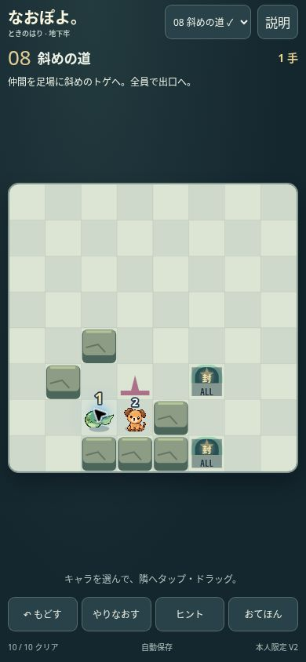

# VERSION 2 実装・本人限定配信報告

## 結果と残件

既存Draft PR #504を更新。新章V2を既存の本人限定Siteに配信。mainマージ、GitHub Pagesデプロイ、正式01–20面変更は実施していない。全資産の「完全継承」ではなく、直接再利用・同等動作・部分対応を[27項目の継承一覧](INHERITANCE.md)で区別した。

本人のiPhone Safari実指QAは未確認。したがって「実機を含む全完成条件を満たした」とは報告しない。Chrome比較は実施したが、正式版とV2の全12操作の同条件動画比較は未完了。VoiceOverも未確認。

## 要求別結果

|要求|結果・証拠|
|---|---|
|正式版からの継承|enteredCells、actorLayout、contactVisualActors、contactEffects、ForestSession.animate、pointerActor、playbackClockを直接使用。正式32キャラ画像・岩・ゲート・出口を共有。|
|継承できない/差分|D用Session/Undo/保存/解答再生は独立実装のまま。牢/協力/封印の状態を持ち、旧正式Sessionへの置換はBFS復帰や保存互換性問題を起こすため。正式章固有台詞/画面全体は流用しない。|
|選択不具合|V1の隣接移動分岐がキャラ選択より先だった。ヒットしたキャラの選択を最優先に修正。|
|選択モーション|正式actorLayout直接使用。倍率1.2、位置/数字の計算値を共有。選択中の表現をタップ後も保持。時間で浮遊する新演出は作成していない。|
|四角枠|キャラ選択枠撤去。なお正式第1章にはheld時の四角枠も存在するが、本人の撤去指定を優先。目標/牢の枠は残す。|
|方向キー|通常画面の8ボタン撤去。矢印キーとHome/PageUp/End/PageDownによる斜め移動は維持。|
|縦画面|44px操作を保ち高さ依存の盤面サイズに変更。ステージselect、短い目標、詳細dialog。320/375/390/430pxでChromeページ溢れ0。|
|通常座標|A1–H8常時表示を撤去。debugCoordinatesのみ残す。|
|新01–10面|全固定解答合法・全員救出。解答長4,4,7,6,4,11,11,9,10,15。盤面・解答ファイル無変更。|
|おてほん|前後、全10面再生、通常プレイ分離、開閉位置保持。Chromeで自動再生を3/4手で停止し、その後3/4保持→再開4/4完了を確認。時計は正式再利用。|
|Undo・保存|3マス一筆→3手→再読込3手→Undo0手をChrome確認。白画面/スタート押し直しなし。専用V1保存キー互換を維持。|
|物理|engine/prioritiesを一切変更せず、Dの真後ろ・連続生成・90度回転・最大7・障害物・支持を保持。protected-hashes.json参照。|
|合体・余剰・交換|Dエンジン無変更。接触試験および正式回帰。単純タップ0手、ドラッグ交換1手を別々に確認。|
|T1–T8|PR503固定HEADを別配置、36/36試験。元PR変更なし。|
|解答再生|10面全てブラウザーUIハンドラ経由で最後まで再生、replay-browser.json。実指操作による全解答試走とは区別。|
|恋人・協力|stage/session無変更、10面全解答試験。救出後にドラッグが別キャラへ移る境界バグは固定IDで防止。|
|正式第1・2章|変更ゼロ。1,529/1,529回帰試験通過。|
|本編/Card/Pages|本編/Cardは完全checkoutのGitHub CIで判定。Pagesローカル16/16、公開allowlist・保存を変更しない。|
|表示サイズ|viewports.json。320×568:盤面296、375×667:351、390×844:366、430×932:406px。|
|短い縦/横|320×480:218px、568×320:263px、844×390:374px。ページ溢れ0。短い画面では1セル約27pxになる制約。実Safari回転は未確認。|
|PR|https://github.com/Naoto214/naotocchi/pull/504 （Draft維持）|
|実装HEAD/tree|2c7900ea3c7cfaf08f1e32fb16bac92a6714b266 / 483f9e38afb2203671d4737d32a409dcfc822cb5。以降の証跡追記はコード無変更。最終HEAD/treeはPR本文に記載。|
|本人限定URL|https://naopoyo-time-hand-chapter1-20261102.kerzion214.chatgpt.site/|
|配信|Sites版番号2、source 069415b9d9826f484c38d0b54ddcfa0f0ae44728。owner一人、groups0、external0。匿名ブラウザーではサインイン画面。|
|配信照合|delivery-hashes.jsonに63ファイルのSHA256を記録。|

## コード再利用の範囲

- `N/input.mjs`：`V/input.mjs::enteredCells`全関数をimport。`ForestSession.travel`の指カーソル相対移動の考え方を移植、gestureActor固定・合法タップを追加。
- `N/draw.mjs`：`W/render.mjs::actorLayout`（51行以降）全関数をimport。`F1/render.mjs`24–30行の影・sprite・数字の式を盤面座標へ変換して再利用、枠は除外。
- `N/app.mjs`：`F2/session.mjs::animate`（41–47行）をそのまま呼び出す。`pointerActor`（51–55行）も直接import。`ForestSession`インスタンスは作らず、begin/travel/policyは一切呼ばない。
- `N/app.mjs`：`F2/contact-motion.mjs::contactVisualActors/contactEffects`、`F2/example-clock.mjs::playbackClock`の全関数を直接import。
- `N/draw.mjs`：`R/sprites.mjs::drawSprite`、`F2/stone.mjs::drawStone`、`F2/gate-art.mjs::drawGate`、`R/fixtures.mjs::drawExit/drawCondition`を直接import。

N等の略記は継承一覧と同じ。依存先の正式コードは無変更。新章を増やすたびにこれらを複製せず、同じ共有関数を使用する。

## 最終ブラウザー再確認

配信と同じ最終ファイルで隣接犬↔蛙の連続タップ0手、蛙→犬のドラッグ1手、Undo0手を再確認。320×568でscrollWidth=320、scrollHeight=568、盤面296px。全10解答・同一面の開閉位置保持・通常保存非干渉を再検証した。検証ページは初め別の面の位置を比較してfalseとなったため、同一面を再選択する正しい手順へ修正（ゲームの変更は不要）。プレビューの配信ルート切替後はサーバー再起動も行った。

