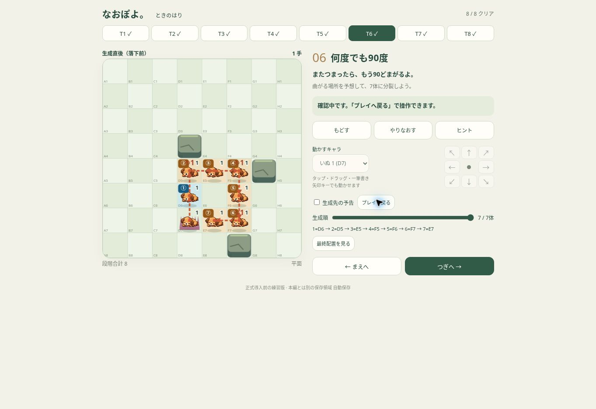

# なおぽよ。時の針 — 操作型チュートリアル VERSION 1

2026-11-02。正式導入前の独立試遊。mainマージ禁止。

- [本人限定で遊ぶ](https://naopoyo-time-hand-tutorial-20261102.kerzion214.chatgpt.site/)
- [Draft PR #503](https://github.com/Naoto214/naotocchi/pull/503)
- ブランチ: `experiment/naopoyo-time-hand-tutorial-20261102`
- 実装HEAD: `fbb6c97c98242b4b8c6abb6109854b9e6a681ec8`
- 実装tree: `5d372a1ba5fadb25a86d3f65e396eeca1c3e5854`
- 基準main: `aafe4abe7842b2fcf57060b207500e5b24f6c7a0`
- 再取得したPR494: `329645edf89b6d34ef888e833643819296764f36`
- Site version 1。Site source commit: `51aef634a6e89226163167dcd4d06e7b06db63b8`。
- owner 1、外部訪問者0、グループ0、customアクセス。匿名のengine取得403。

## T1〜T8

盤面は8×8、列A〜H・行1〜8。すべて正式画像・岩・トゲ・出口の描画を再利用。

|面|盤面と学ぶこと|実エンジンの成功例・クリア条件|
|---|---|---|
|T1|いぬ2がD4からD5のトゲへ|↓1手。D4に1体。親の分裂1体を確認してクリア|
|T2|いぬ5がD6からD7へ。後方に空間|↓1手。D6→D5→D4→D3の4体でクリア|
|T3|D4に岩。D6からD7へ|↓1手。D6→D5→E5→F5。時計回りの曲がりを含む4体でクリア|
|T4|かえるC4・いぬD6・トゲD7・目標F5|かえる→、いぬ↓の2手。かえるが実際に生成経路を塞いで曲げ、F5へ1を生成するとクリア。無関係な仲間移動では不可|
|T5|いぬE6→トゲF7。C5/D4の岩で角を閉じる|↘1手。E6→D5→E4→F3。右下進入・閉じた角の拒否・4体生成でクリア|
|T6|岩D4/G5/F8。D6→トゲD7|↓1手。D6→D5→E5→F5→F6→F7→E7。7体・2回以上の曲がりでクリア（成功例は3回）|
|T7|重力あり。C4/D5の岩・いぬ4 D4→トゲE4|→1手。D4/D3/D2へ生成後、落下と同種族合体。最終はいぬ1 E8・いぬ3 D4。分裂3体＋fall＋mergeでクリア|
|T8|いぬ8 B7→トゲB8・出口C1（=8）|↓、↑×7、→の9手。B7〜B1へ7体分裂、回収で8、出口へ。未分裂の8を出口へ運ぶだけではクリアしない|

固定入力の一致ではなく実際の生成・合体結果を評価するため、条件を満たす別の合法操作も受理する。T4では仲間の実際の妨害を生成traceで検証。誤った分裂はUndo/リトライから再試行できる。

## 物理・非干渉

PR494のengine.mjsはバイト一致で複製。D prioritiesは依存パスのみ変更、ABC prioritiesはバイト一致。正式engine・01〜20・解答・保存形式への変更はない。git差分は新規ファイルのみ。新しいモジュールを正式ゲームからimportしていない。

後ろへ連続生成・時計回り90度・曲がった方向を維持・生成済み1を障害物・特殊マスを飛び越さない・最大7体・本体最低1を検証。8方向は実際のmoveからトゲへ進入して確認。閉じた斜め角とゲート上面、空き不足、循環防止、段階合計、支持、トゲ1手1回も確認。200個のseed固定障害物ケースを含む。

合体は既存contact-v2。8+8=8+余剰8、異種族のみ交換。時計回りの回収制限はない。T7は既存supported-v1重力・recombine-once-v1再合体を使用。

## UI・保存

タップ選択／隣マスタップ／ドラッグ／一筆書き／8方向ボタン／Undo／やりなおす／まえへ／つぎへ／全8面選択／手数。小さな縦画面では操作欄を省略し、盤面タッチで操作。長い画面・横向きではキャラ選択と8方向ボタンも利用できる。

予告はT1〜T3のみ初期ON、後半は任意。実エンジンの同じmoveから予告を生成する。「生成経路を見る」で①〜⑦と矢印、生成順スライダー。「最終配置を見る」で落下・合体後の状態を確認。確認中は操作不可と明示し「プレイへ戻る」で再開。T7は生成直後を約0.95秒表示してから最終配置へ。

独立キー `naopoyo.time-hand-tutorial.20261102.v1` と独立origin。保存は盤面値でなく合法操作列、復帰時に実エンジンで再生し検証。破損保存・別面の保存・不合法な操作列を拒否。Undoは最後の合法1マスを取り消す。中断・失敗・Undo・リトライ・サイズ変更で古いポインター経路を破棄。1面500手の上限に達したら再試行案内。

## ブラウザーQA

クラウドChromeのローカルpreviewでT1〜T8を実UI操作し、全8面のクリアを確認。リロード後8/8とT8の9手を復元。T1 Undo→再クリア、生成経路画面、T4キャラ選択で配置、T5の320px斜めドラッグ、T8の390px分裂ドラッグ→上へ7マス連続ドラッグ→844×390へ変更→出口クリアを確認。

viewportは実ブラウザー内iframeで指定寸法に設定。iOS端末・Safariエンジン・実指タッチの検証ではない。

|画面寸法|盤面幅|横にはみ出す操作要素|文書高さ（T5クリア時）|
|---|---:|---:|---:|
|320×568|248|0|688|
|375×667|334|0|870|
|390×844|349|0|885|
|430×932|358|0|932|
|320×480|248|0|688|
|568×320|206|0|440|
|844×390|276|0|440|

短画面は縦スクロールで全ボタンへ到達可能。スクロール不要の仕様ではない。サイズ変更後の状態と操作を維持。Safariセーフエリア／アドレスバー伸縮は未確認。

## 自動テスト・独立レビュー

- 専用36/36成功。全8面の解答・生成座標・質量・Undo・再開、誤クリア2種、入力、予告一致、破損保存、物理を含む。
- 独立レビュー2件を修正：T4の無関係な仲間移動による誤クリア、失敗pointerdown後の経路継続。コールバック中のキャンセル復活も含め3つのRED→GREEN回帰を追加。
- [専用CI](https://github.com/Naoto214/naotocchi/actions/runs/41384801717)：tutorial/build、正式パズル1,529/1,529、CARD GAME572/572成功。
- [Pages CI](https://github.com/Naoto214/naotocchi/actions/runs/41384801677)：build成功、deployはskipped。本番Pages未更新。
- Runtime/Home/Worldは最終追記を参照。
- ローカル広範回帰はsparse checkoutの依存欠落あり。パズル1,447/1,473、CARD566/572、Runtimeは2番目のテスト群23/24で停止、Pages15/16。初回パズルは起動ディレクトリも不適切だった。失敗名は[LOCAL-ATTEMPTS.md](LOCAL-ATTEMPTS.md)に保持し、成功扱いしていない。パズル・CARD・Pagesは完全checkoutの上記CIで成功を確認。

## 公開・照合・未確認

Siteのprivateデプロイ成功。53配信対象ファイル・229,108 bytes、ローカルmanifestおよびGitHubソースとのバイト一致確認済み（入口indexは生成物）。HTTP配信照合はdelivery-hashes.jsonを参照。公開URLのブラウザーはChatGPTログイン入口を確認。認証後ブラウザー操作は未確認で、ローカルpreview QAと区別する。

未確認：iPhone Safari実機、実指・OS回転・セーフエリア・アドレスバー伸縮、本人が感じる分かりやすさ。正式導入と01〜20面再制作は行っていない。

### 最終配信照合

本人限定HTTP取得53/53ファイルのSHA-256がmanifestと一致。公開した53ファイルすべてを取得して照合した。認証ヘッダーの最初の試行はBearer形式不足で401、正しい形式で再実行して53/53成功。秘密値は保存・報告していない。バイト不一致は0。

### CI残件（報告保存時）

実装HEADのRuntime smoke-test（full npm test）、Home layoutのhome-layout、World visual qualityの6ジョブは実行中。Home layoutのpad-sizeは成功。これらを成功扱いしていない。記録のみの最終コミットは`[skip ci]`とし、上記実装HEADのCIへのリンクを保持する。

[Runtime](https://github.com/Naoto214/naotocchi/actions/runs/41384801748) / [Home](https://github.com/Naoto214/naotocchi/actions/runs/41384801739) / [World](https://github.com/Naoto214/naotocchi/actions/runs/41384801678)

### 今回の実装判断

- 正式物理を保護し、Dエンジンを複製。将来正式物理が変わる場合は同期監査が必要。
- 短画面は縦スクロールを許容。操作領域を大きく保つ一方、全ボタンが同時に見えるとは限らない。
- 斜めゲートテストは実際に横切る上面へ配置を修正。正式の角抜け判定自体は変更なし。
- 独立レビューが保留した実機レイアウト・実指操作は、Chrome寸法確認で代替できない部分として未確認に残す。

PR494は最終再確認でも`329645ed`・Draftのまま。mainへのpush/merge、本番Pagesのdeployは一切行っていない。
