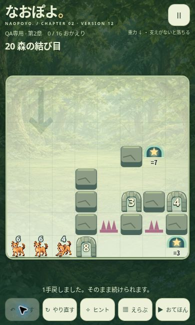

# VERSION 12 最終検証・本人限定配信

2026-10-30 JST。独立Draft PR [#482](https://github.com/Naoto214/naotocchi/pull/482)。

## 1. GitHub正本と保護

- 最終照会main: `46349c362fae4bae99fbaddd2f94d10e7179479d`。
- VERSION 11実装起点: `5284d5e42cab98c9c6d7080e04d04c0aadcb3d51`。
- PR436最新HEAD: `ab937a22e2ae246b87b58932815dad2c4e8a2d87`、tree `cfb002a419d8874f04f8e04e340ee81f3e49564f`。
- V12実装HEAD: `f08b7de2679fe0dc3e9f7d31a1ea47a71181397f`、tree `0f7a1dceec63b8cad02af95b01875eeb6f4fe25b`。
- base `feat/naopoyo-chapter2-gravity-pilot-20261024`、head `feature/naopoyo-v12-quality`。積み重ね型によりV11全体を差分に重複させない。
- この報告を追加した最終HEADはPRに記録する。実装HEAD以降は検証資料のみで配信コードは同一。この追補は[skip ci]とし、コード・テスト・workflowを変更せず、実装treeで完了した上記CIを証跡とする。
- このWorkからPR436へのpush、mainマージ、本番GitHub Pages更新は一切行っていない。他Workの作業ディレクトリも変更していない。

## 2. 解答最適化

|面|旧手数|新手数|
|---|---:|---:|
|11|5|5|
|12|5|5|
|13|10|10|
|14|11|11|
|15|23|23|
|16|70|38|
|17|26|26|
|18|19|19|
|19|91|78|
|20|156|97|
|合計|416|312|

20面は59手（約37.8%）短縮、斜め移動47→25。19面の斜め37→33、12面3→2、17面10→9、18面10→8。手数が同じ候補でも同じ到達状態へ直接進めるものを優先した。

旧全操作・操作対象・方向・各盤面を`original/`と`traces/*-v11.json`、新しい全操作を`traces/*-v12.json`へ保存。深さ3までの局所探索で将来の同等状態への短絡を探し、複数回の候補を比較。全体を実ForestSessionで再生してから採用した。候補比較は`optimization.json`、再現スクリプトは`prototypes/naopoyo-chapter2/optimize-examples.mjs`。

全員脱出・段階合計保存・合法性・通常入力とおてほんの盤面一致を検証済み。**探索は限定的で、数学的な最短性の証明はない。「検証済み短縮版」とする。**

## 3. 再生位置保持と保存保護

ステージ別の独立キー`naopoyo.example.position.v1.<stageId>`へ保存する。解答は全操作の座標・段階・方向を正規化したJSONで厳密に識別し、手数が同じでも内容が変われば0手目へ戻す。解答内容が同一でメタデータだけが変わった場合は保持する。

前へ・次へ・自動再生・一時停止・最初から・閉じるに対応。再読込でも保持し、再度開いたときは保存手数の盤面で一時停止する。範囲外・破損・ストレージ書込失敗も単体検証した。

通常プレイの盤面、履歴、保存形式、クリア記録、ステージ開放状態は変更しない。別オリジンのV12比較URLなのでV11のブラウザー保存を読み書きしない。V11の80手目を新解答の80手目へ移植する処理もない。

## 4. Undoの原因と修正

共有WorldSession.undo()が`paused=true`へ変更し、第2章appも`userPaused=true`にしていた。そのため盤面を覆う半透明白い`#paused`と▶再開案内が表示されていた。調査したコードではナビゲーションやゲーム再初期化ではなく、Undoに結び付いた強制一時停止が原因だった。

ForestSessionだけUndo前のpause状態を保ち、第2章appの強制pauseを撤去。CSSで被覆を隠す修正ではない。共有WorldSessionと物理エンジンは無変更。既存の盤面・数字・救出数・履歴の復元、motion消去、保存処理を維持する。

各解答の全手でUndo・保存復帰を検証し、split/merge/overflow/swap/rescue/fallを網羅。連続Undo、おてほん閲覧後、reload後、Undo後の次移動も検証した。

## 5. ブラウザーQA

クラウドChrome上の実ページで320×480、375×667、390×650、430×750、844×390のiframe寸法を確認。操作ボタン高さ44px、画面内に収まることを計測（`browser-layouts.json`）。320pxで「おてほん」の文字が欠けないよう、小画面時だけラベルを二段にした。

390×650では80手目までの再生、通常盤面と履歴保護、再度80手目から表示、前後移動、自動再生と停止、連続Undo、Undo後の移動、再読込後の盤面・履歴・再生位置、最初からを見る操作を確認した。テストハーネスの13チェック成功。終了時の追加撮影で開発プレビューの解答URLが一時404となったが、プレビューを同じSiteルートで再起動すると正常に97手のJSONが返った。再起動後に13チェックを再実行して全成功（`browser-functional.json`）。公開配信の85ファイル照合とは別のローカル開発環境の問題として記録する。

実ポインターのドラッグで1手動かし、ゲーム内「もどす」をクリックした後、盤面復元・pause被覆なし・再開操作不要を確認した画像:

**iPhone Safari/WebKit実機・実指操作は未確認。** 上記はChromeでの画面寸法・操作確認であり、実機成功と読み替えない。公開先は確認用ブラウザーでは認証画面となるため、認証後の公開URL上での実操作は未確認。ローカルQAと配信ハッシュ照合を組み合わせた検証である。

## 6. 回帰・CI

- 第1章、第2章、Insight、World、共通v2、Rescue: 947/947成功（ローカル・GitHub CI）。
- CARD GAME: GitHub CI 494/494成功。
- Pages単体: 16/16成功。
- 旧解答audit/design verify・比較版ビルド成功。
- 本編Runtime: GitHub CIの単一npm test成功。32＋24＋3289＋159＝3504/3504、fail/skip/cancel 0。smoke/dialogue/visualも成功。2026-10-29 16:25 UTC完了。
- CI: [Naopoyo Chapter 2 Pilot / 40907523703](https://github.com/Naoto214/naotocchi/actions/runs/40907523703)。3ジョブすべてcompleted/success。対象は実装HEAD `f08b7de2`。CI合成HEAD `4496028322cc8368741e96e48db10a561f017d22` の両親はab937a22/f08b7de2、treeは配信実装と同一。集計は`ci-summary.json`。

ローカルのnpm testは2918中2894成功・24失敗。sparse checkoutの未展開資料のENOENT/MODULE_NOT_FOUNDとファイル単位のプロセス失敗を含む。すべてを資料不足と断定せず、失敗一覧を`local-runtime-failures.txt`へ保存した。ローカル全成功とは報告しない。CARD GAMEの初期ローカル実行にも未展開fixture不足があり、完全checkoutのCI結果を採用した。テスト削除・無効化は行っていない。

独立コードレビューでCritical/Important指摘なし。共有engine・WorldSession・盤面・第1章・本編Runtime・CARD GAMEのコードに変更なし。

## 7. 本人限定VERSION 12

[VERSION 12比較版を開く](https://naopoyo-v12-quality-20261030.kerzion214.chatgpt.site/prototypes/naopoyo-chapter2/qa.html)

- アクセス対象: 本人1名、外部0、グループ0。
- ゲーム表示VERSION 12、第2章11〜20全10面。
- Site project: `appgprj_6ae36a1741e88191a2b40e79fc883eb6`。
- Site source commit: `debaaf88addb54236e48537042ce93907b8dd1f2`。
- Deployment: `appgdep_6ae36eeb963c819182a2547071e15761`、2026-10-29 16:06 UTC成功。
- 配信version.jsonのsourceCommit: `f08b7de2679fe0dc3e9f7d31a1ea47a71181397f`。
- 全85ファイルが認証付きHTTP200・SHA-256一致。未認証qa.htmlは403。詳細`delivery-hashes.json`。
- [既存VERSION 11](https://naopoyo-komorebi-20261024.kerzion214.chatgpt.site/prototypes/naopoyo-chapter2/qa.html)は上書きしていない。

## 8. 競合・依存・未確認事項

PR436の並行Workによるab937a22追加を確認し、物理変更がなく接触調査の資料と109テストのみであることを確認して継承した。V12解答に依存するテストの手数固定値のみ91/156→78/97へ更新。分裂・重力・合体・位置交換・魔法ゲート・トゲ1手1回・8方向移動・11〜20面の配置を変更していない。

将来の物理変更は今回取り込んでいない。最終統合時には新ルールに対して旧新全解答を再検証する必要がある。PR436がmainへ統合された後のbase変更やmain最新取り込みはこの作業では実施していない。

残る確認は本人のiPhone Safariでの比較、元の実セーブ・操作履歴での再現、自然さの主観評価、数学的最短性。ブラウザーがlocalStorage全体を拒否する場合、既存アプリ初期化側の非ガード参照は残る（新しい再生位置の読み書きは例外を捕捉する）。この既存制約をアプリ全体で解消する変更は含めていない。
