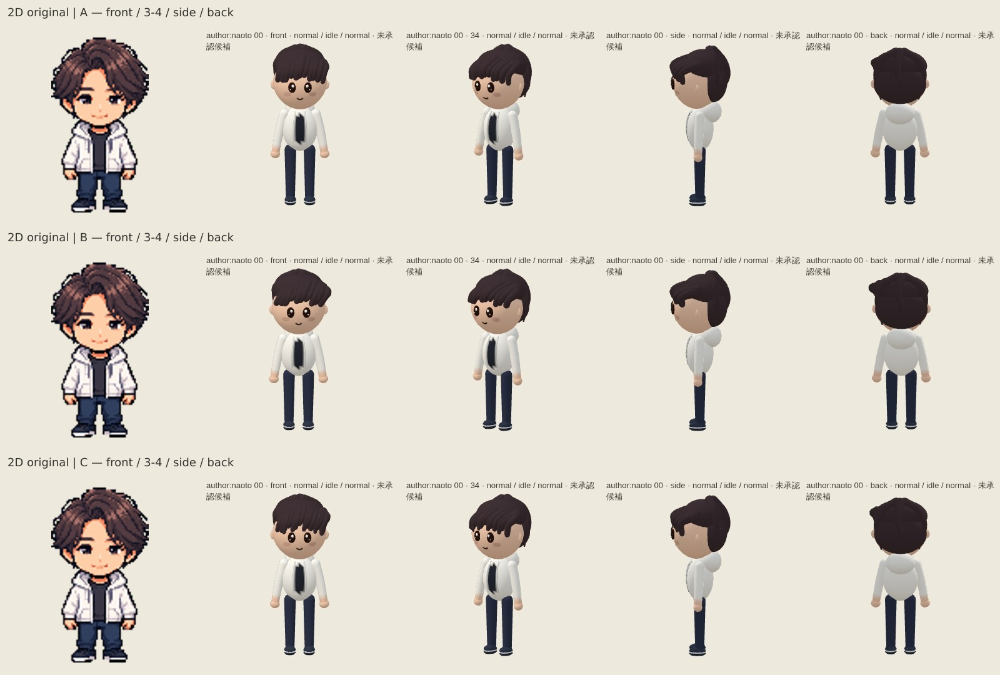

# Naoto — three unadopted hairstyle options

**HUMAN REJECTED: all A/B/C. Superseded by the D/E side-part comparison; none adopted.** Original design master: `assets/characters/author/naoto.png`. Loose7:3 / bangs-down natural mash-wolf is only the user’s direction shorthand.

| Option | Intended difference | Four-view comparison |
| --- | --- | --- |
| A | Fuller lowered fringe, restrained side flow | [Original + A](../export/e4c85576e96cfbeb7f8b83e66fd99f936178b0bd/author-hair-options/author-naoto-A-views.jpg) |
| B | Stronger loose one-way flow, shorter lower edge | [Original + B](../export/e4c85576e96cfbeb7f8b83e66fd99f936178b0bd/author-hair-options/author-naoto-B-views.jpg) |
| C | Lower uneven edge, finer overlapping locks | [Original + C](../export/e4c85576e96cfbeb7f8b83e66fd99f936178b0bd/author-hair-options/author-naoto-C-views.jpg) |

The original has one supplied view, repeated in each row; no side/back original has been invented. All12candidate frames and the3comparison boards were actually inspected. No exposed middle part, isolated centralV or comb edge was observed in round2. Fine original tousled texture remains simplified into rounded locks. These are alternatives for Human judgment, not likeness approval.

Only the QA generator overrides hair in the capture page. Production runtime/specs/assets remain byte-identical to baseline1b8ef62. Existing crown/rear volumes and last3posterior paths are retained exactly; face, clothes, deer and all other292characters are unchanged. No architecture, Expression, Motion, fallback, save/schema or Pages changes. No formal adoption.

Capture source: e4c85576e96cfbeb7f8b83e66fd99f936178b0bd. Character run38136126011 SUCCESS; capture job114460238257 SUCCESS. [Raw17files, manifest and provenance](../export/e4c85576e96cfbeb7f8b83e66fd99f936178b0bd/author-hair-options/README.md). All17bytes/size/SHA256 checks and three captured candidate spec hashes matched. Browser errors0. Existing wave renderer and artifact recovery reused.

Shape2 + workflow8 =10PASS/0FAIL. Checks include distinct assembled geometry, face/rear/production protection, front projection, forehead coverage/eye clearance and closed-surface connectivity. [Test result](final-tests.txt). Initial control failure retained in red.txt. Static independent pre-capture review C0/I0. No production mutations rerun or claimed for QA-only variants. Runtime38136132370/Home38136132439 were still IN_PROGRESS at the fresh check, not counted as PASS.

Round1 cd32a105882f6582039285418dbfe19f229dfb73 was actually inspected and internally REJECTED for comb-like uniformly spaced ends. Its17hash-verified originals remain in its source-scoped export directory. Round2 uses fewer, wider, overlapping and varied-height locks. See [visual review](visual-review.json).

STOP for Human selection. Overall Human QA and iPhone device QA remain OPEN. PR376 Draft/open/unmerged; no Ready/main merge/main import/Pages changes.
