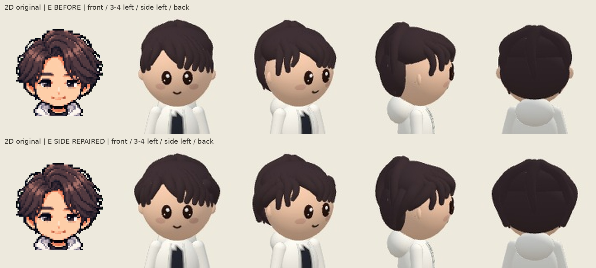

# Selected E — side-layer completion, Human approved

**2026-10-11: the user formally approved E plus side layers. Its exact captured shape is now adopted and frozen unless a confirmed defect is found.** [Current approval record](../human-approvals-20261011.json).

The capture/review details below are historical evidence from before this approval. Existing assets/characters/author/naoto.png remains the sole design master. F in raw metadata is an internal tag for E with side layers, not a new hairstyle choice.

[Full-body four-view comparison](author-naoto-comparison.jpg). Front, three-quarter left, side left, back. Before E originals are reused from sourcea6096121897b3d93a05733cc5049539218ea27c4, not recaptured. One original2D view is repeated; side/back source art is not invented. Head crops are deterministic crops of original screenshots; comparison-provenance.json records source/crop/camera details.

Six new closed paths form three bilateral layers from temple roots through ear-top/ear-back into posterior hair. First10Efringe paths, existing2crown/rear volumes and last3posterior paths are exact. Original E hash matches saved capture metadata. No face/clothes/other292/production/architecture/Expression/Motion/fallback/save changes. The existing QA-only override, common builder and artifact recovery are reused.

Four repaired frames plus before/after full/head comparisons were actually inspected. The large upper-ear exposed patch is covered; three-quarter and side show continuous front-to-rear coverage. Existing seven-three part and fringe directions remain. Added side volume increases lateral silhouette as intended, including when seen from the back; existing posterior geometry is unchanged. Fine original texture remains simplified. No final Human likeness approval is claimed.

Capture source5b85b2048a0a28ca74a51bca1fcc6c6059c50d41; Character38138489668 SUCCESS, capture114467218917 SUCCESS. [Raw7newfiles / manifest / metadata](../export/5b85b2048a0a28ca74a51bca1fcc6c6059c50d41/author-side-layer/README.md). Saved before12files and new7files were verified byte-size/SHA256. Captured repaired spec hash exact; browser errors0; left-side camera metadata exact.

Shape4+workflow8=12PASS/0FAIL; tests.txt. Side-coverage regression failed before repair; red.txt. Removing the6sidepaths is detected with exact restoration; control.json. CI runs the final12tests. Fresh approval-time check: Runtime38138495980 SUCCESS; Home38138496002 FAILURE (CSS substitution route.fetch ECONNRESET in chromium-landscape-safe-area; job114467238299). Home is not PASS. No repeated all-character photography/full-npm claim; production unchanged.

The targeted hair Human gate is now APPROVED; the historical capture itself changed no production files. The approval revision promotes the exact captured row, with no redesign. PR376 Draft/open/unmerged; no Ready/main import/merge/Pages change. OverallHuman/iPhoneQA remain OPEN; deer approval preserved.

## Exact approval adoption

The production row now hashes to `9da8617f42a408ae8eed51b69738fbfd7ad1e1a9da1b9ca6f1d3e3f188471aec`, identical to captured F. Face/clothes and all other292 characters are unchanged. Four original frames were copied byte-for-byte into this directory and linked from full coverage. The old symmetric-temple probes were updated to the approved asymmetric fringe: short side x=-.18/y=.14, long side x=.18/y=.10; rear/face clearance checks remain. A fixed captured-row hash protects the entire approved shape.

[Adoption verification](adoption-verification.json):38 unique focused tests pass after correcting two obsolete symmetric probes (initial36/38 result and focused5/5 rerun retained); final author11-test baseline passes after18/18 mutations. Fringe2/2 and feedback4/4 controls also detected/restored. Protected groups/save3/3 pass. This does not claim a fresh full npm run. Latest production CI is tracked in the checkpoint.
