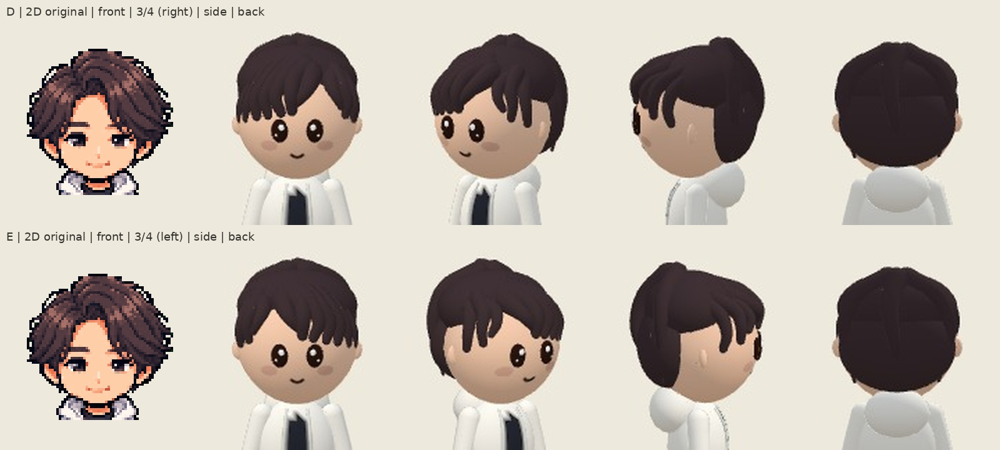

# Naoto D/E — natural off-center seven-three part candidates

**E selected as direction; side-layer revision requested. Not final-approved or runtime-adopted.** Previous A/B/C all HUMAN REJECTED; the no-part condition is withdrawn. Existing assets/characters/author/naoto.png remains the sole design master.

- **D:** viewer-right part; large group flows left/down, smaller group right/down.
- **E:** viewer-left part; large group flows right/down, smaller group left/down.

[Full body comparison](author-naoto-options.jpg). Four views each: front, three-quarter, side and back. Three-quarter/side cameras face the part: right for D, left for E; labels and raw metadata make this explicit. The single supplied2D view is repeated; side/back source art is not invented. Head comparisons are deterministic crops of original screenshots, not retouched/generated images; see crop-metadata.json.

The two groups use actual closed3D paths in seven/three groups; root-to-tip directions diverge. The visible gap shows the existing skull rather than a painted line or added skin patch. Shape checks include off-center scalp visibility, hair on both root flanks, center coverage, eye clearance, bounded forward extent, closed-surface connectivity and outward boundary flow. Original crown/rear volumes and last3posterior paths are exact; face/clothes/deer/other292 and all production code/assets remain unchanged from8daf05fe93fadc095e30bc6b79117afae6dfcd2d. Only capture-time overrides are used. No runtime registration or formal adoption.

All8final frames, full board and head crops were actually inspected. Final boundary tips flow away from the root opening rather than inward. Fine original tousled detail remains simplified into rounded locks. The visual review supports presenting alternatives, not source-likeness or Human approval.

Source a6096121897b3d93a05733cc5049539218ea27c4; Character38137800237 SUCCESS; capture114465160643 SUCCESS. [Original12files, SHA256 manifest, raw metadata and direct D/E images](../export/a6096121897b3d93a05733cc5049539218ea27c4/author-sidepart-options/README.md). All12bytes/size/SHA256 and both captured spec hashes matched. Browser errors0. Existing renderer/capture/export machinery reused.

Shape3+workflow8=11PASS/0FAIL. Final2destructive controls detect broad-notch and inward-hook reversions; exact restoration verified. Source Character CI passed with the final11tests. Runtime38137806535/Home38137806537 were still IN_PROGRESS at the fresh check and are not counted as PASS. No claim of rerunning full production mutations or device QA.

First03d0fd1 internally REJECTED for broad round notch; second3d14dc0 internally REJECTED for keyhole hooks after real image/head-crop review. Their original12files each are retained with source-scoped manifests. [Development record](development-notes.md), [final visual review](visual-review.json), [controls](round3-controls.json).

STOP for Human selection. PR376 Draft/open/unmerged; no Ready/main import/merge/Pages change. OverallHuman/iPhoneQA remain OPEN. Deer approval remains intact.
