# human-feedback — 4faa3e3f5293c6993bad8e385a8fc2156d82e056

PENDING_VISUAL_REVIEW — export success is not image approval. Chromium/SwiftShader is not Human/iPhone acceptance.

[All original selected evidence](raw-evidence.zip) · [SHA256 manifest](manifest.json)

## author-naoto-0-34.jpg

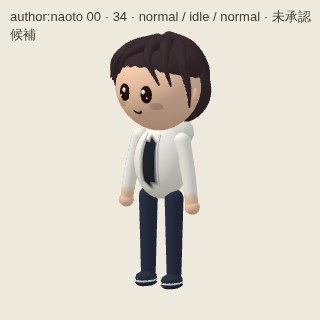

## author-naoto-0-back.jpg

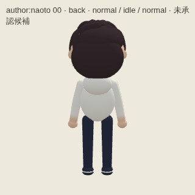

## author-naoto-0-front.jpg

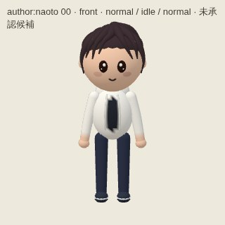

## author-naoto-0-side.jpg

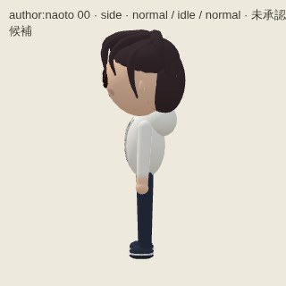

## author-naoto-distance-back.jpg

## author-naoto-distance-front.jpg

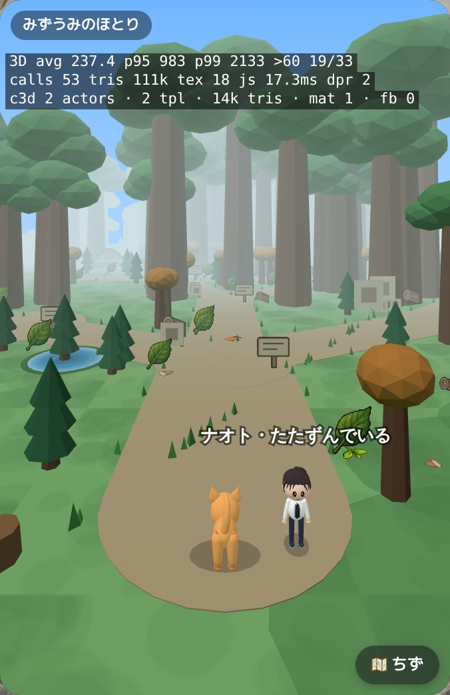

## author-naoto-motion.jpg

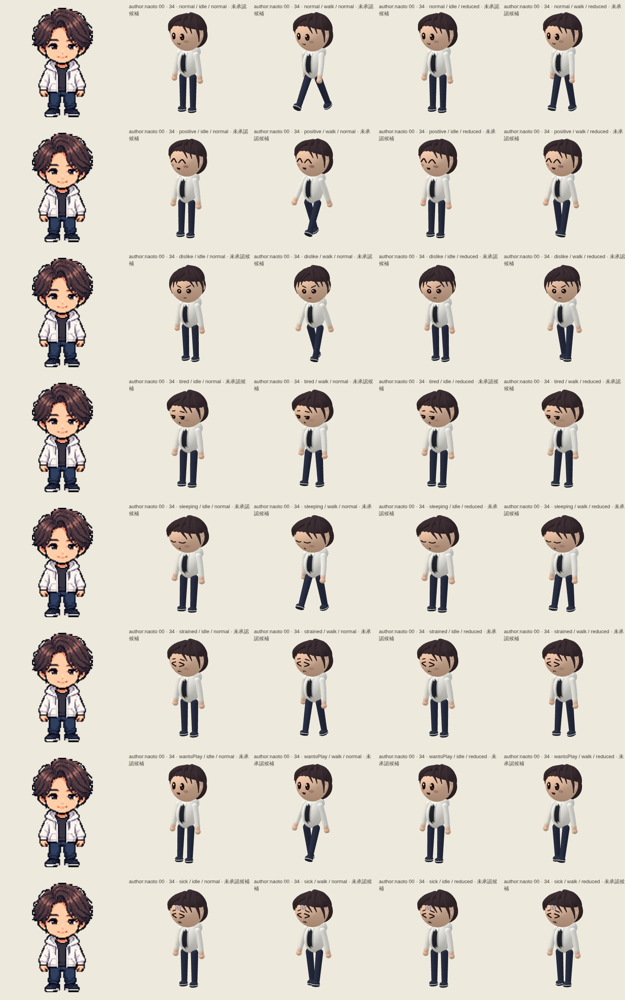

## author-naoto-views.jpg

## partner-grove_deer-0-34.jpg

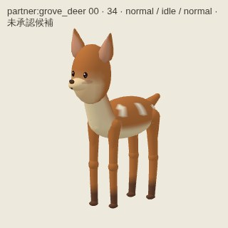

## partner-grove_deer-0-back.jpg

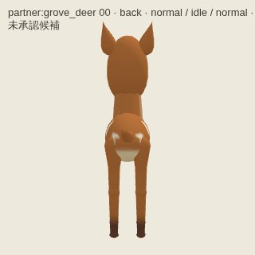

## partner-grove_deer-0-front.jpg

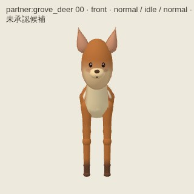

## partner-grove_deer-0-side.jpg

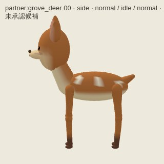

## partner-grove_deer-distance-back.jpg

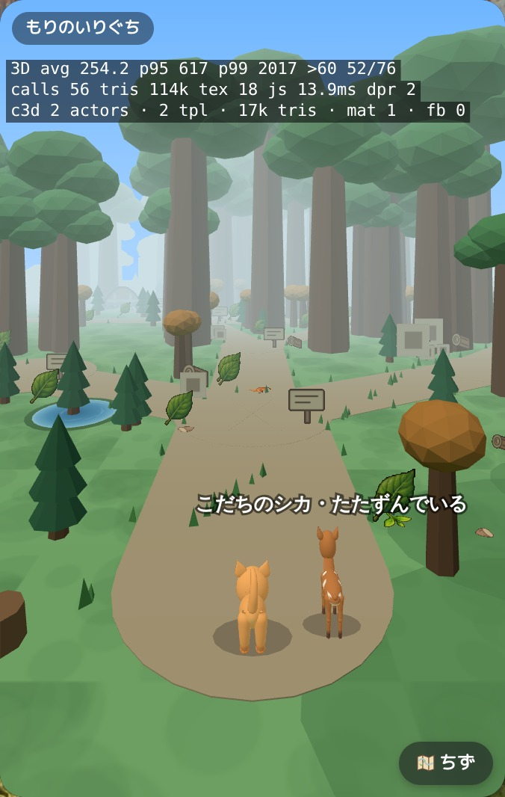

## partner-grove_deer-distance-front.jpg

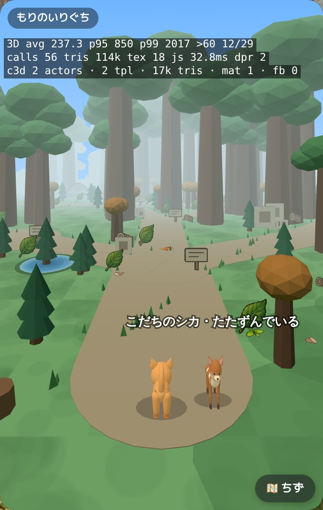

## partner-grove_deer-motion.jpg

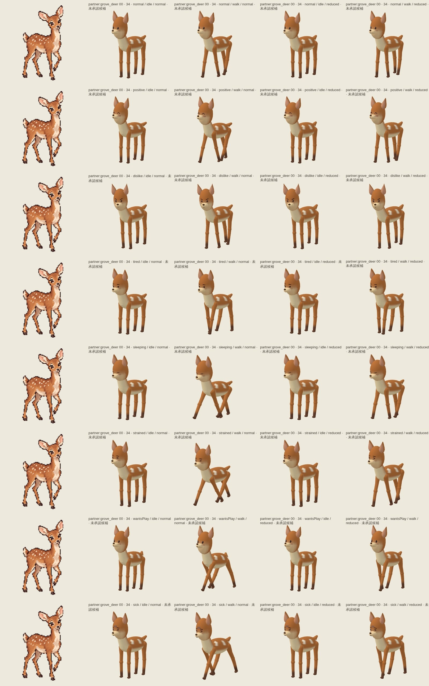

## partner-grove_deer-views.jpg

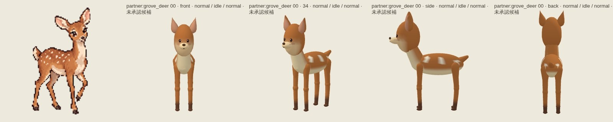
