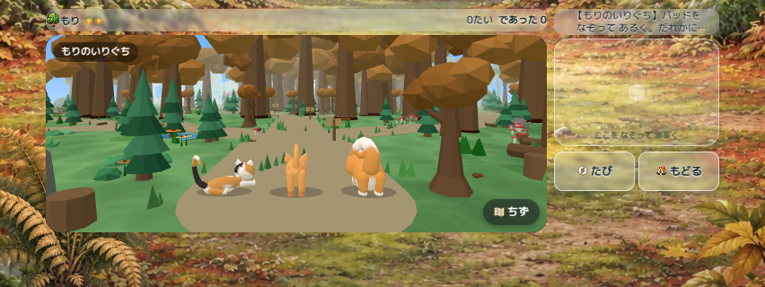
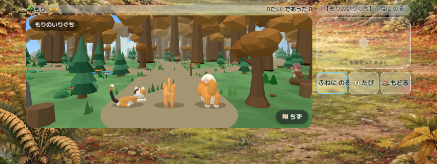
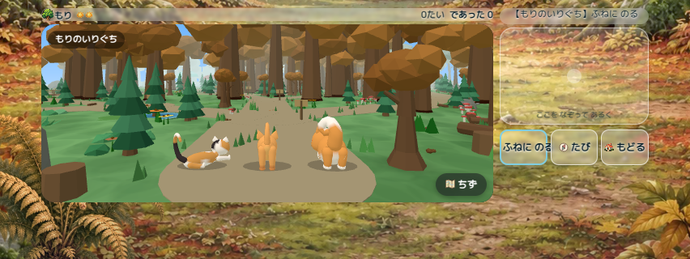
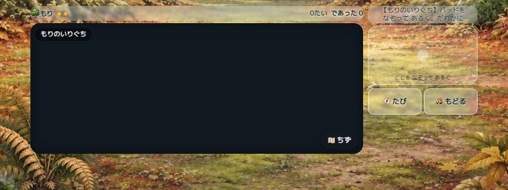
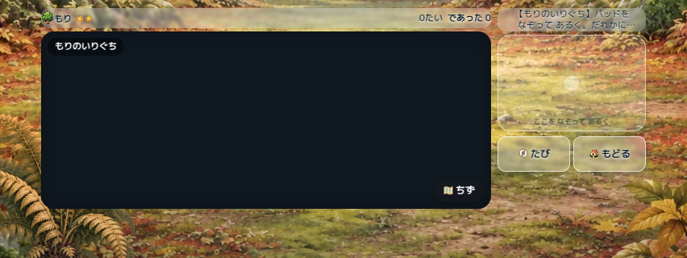
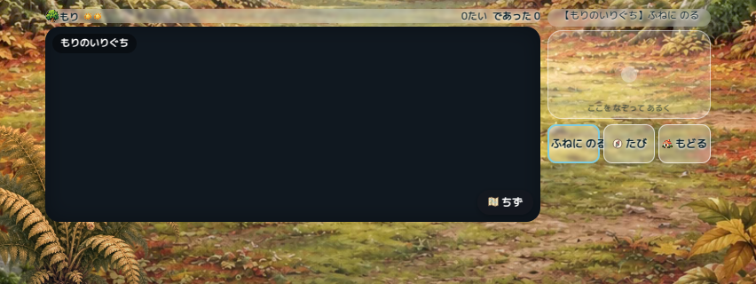
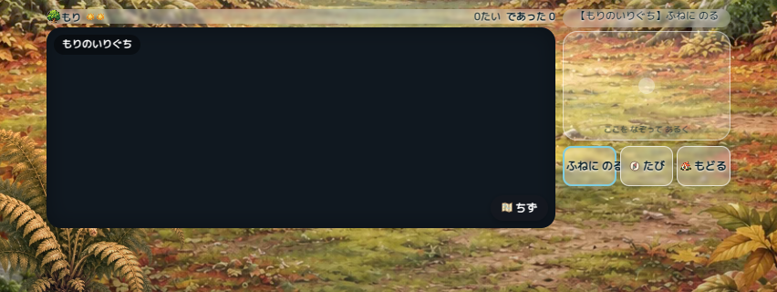

# Landscape pad: 184 × 120 CSS px

**HUMAN_ACCEPTED — 2026-10-13 (Asia/Tokyo).** The user formally approves the current 184×120px landscape pad, position and input method on candidate `7521848`. Keep the lower whitespace; adaptive sizing and 140/160px enlargement are not requested. Camera appearance was already accepted.

PR #379 Ready/main merge is explicitly authorized after final automated gates and protection checks. Full physical QA is not implied: see the [authoritative status table](../README.md). Earlier pending/hold text and machine-generated physicalIPhone:NOT_RUN in saved results describe the historical automated run; preserve those artifacts unchanged.

Baseline: `e9932859c1479b2c1e53d77b20bb3b8f104343df`.
Fresh main: `e98b35e148ba6fa84a1013946f29ec2b3a0f585b`.
Other active PR #380 changes only its independent prototype/docs, with no overlap.

## Implementation

Only the existing short-landscape Meguru CSS rules change (width ≥560, height
≤500, landscape). Pad width remains 184px, actual DOM hit element height changes
100 → 120px (+20% area). The shared input implementation, 4px initial movement
threshold, 8px direction threshold, sticky movement and release handling stay intact.
Portrait and other games use their existing rules.

A height-only change failed the canvas-preservation check at 960×500 with a context
button. Both existing canvas sizing routines subtract the pad row's offsetHeight;
one also conditionally caps available space at 220px. A larger row can therefore
change the world height even when no camera code changes.

The actual enlarged pad uses margin-bottom:-20px and the actions use relative
top:20px. This preserves the old row measurement while consuming the free space
below it. The visible 6px pad/action gap and minimum 44px buttons are retained.
This is scoped CSS, with no changes to sizing algorithms, camera, gameplay or save.
The comparison checks the actual visible buttons and hit tests, not just row bounds.

## Verification method

`tests/meguru-pad-size-browser.cjs` substitutes the complete pinned baseline CSS
and candidate CSS in the same live world and frozen pose. Fonts and layout are
settled before comparison; resize uses the existing application handler. The test
retains the same player, world, simulation and yaw, and compares canvas CSS size,
backing buffer, application dimensions, camera position/rotation/FOV/aspect and
projection matrix exactly. Synthetic notch insets are left/right 47px, bottom21px.

Viewports: 393×760 → 960×500 → 852×320 → 667×300 → 568×300 → 852×390 →
932×430 → 393×760. Each has normal/はなす/ふねに のる/もぐる layout cases.
Context labels are fixture inputs to the existing context-slot renderer; this
checks layout/hit areas, not new gameplay actions. The world is frozen only for
paired layout capture. Real simulation resumes for CDP touch start/move/end input.

The lower added strip (110px below pad top) must hit the real pad, initiate movement,
ignore a 2px movement, continue while held, and stop after release. This runs in
World3D, explicit same-world Canvas, and actual context-loss Canvas fallback.

Mutation controls must reject the old pad height, loss of canvas-footprint
protection, and disabled touch hit testing. Mutations are in browser CSS only;
the checkout is not mutated.

`red-old-size.log` records the original 100≠120 failure. `red-canvas-change.log`
records the rejected height-only approach. These are expected RED evidence, not
passing tests. `focused.log` contains 35 passing cache/startup/touch/viewport tests.
`startup-mutation.log` contains 12/12 detected existing startup/fallback mutations.

## Existing CI issue

At baseline e993285, Runtime 38269513572 and Home 38269513635 succeeded.
World 38269505837 failed its startup/fallback mutation job because its isolated
copy omitted the Three.js file now imported by camera tests. The other five World
jobs succeeded. The runner now copies that existing dependency as well; no test
assertions or production renderer were changed. The original failure is retained
as a failure, not relabelled PASS.

New Home CI runs the paired pad gate in its own job so the existing Home job keeps
its 30-minute budget. Runtime uses the unchanged full npm test command.

## Human QA

Pad size/placement/input method are accepted. Remaining optional scenario coverage: check the pad in Safari
landscape, normal and contextual buttons, small browser viewport, repeated rotation,
long press/drag/release and Canvas fallback. Physical comfort, performance, heat and
memory are not inferred from desktop Chromium software WebGL.

## Comparison gallery

| Mode/state | Before | After |
|---|---|---|
| 3D normal |  |  |
| 3D boat action |  |  |
| Canvas normal |  |  |
| Canvas boat action |  |  |

All gallery images use 852×320 viewport with synthetic safe area. The 3D images
come from the combined verification; Canvas images from the separately completed
32-case Canvas run with the same shipped CSS, save, pose and viewport.

| Viewport | World canvas before → after (normal state) | Pad height before → after |
|---|---|---|
| 393×760 portrait | 279×432 → unchanged | 112 → 112 |
| 960×500 | 666×225 → unchanged | 100 → 120 |
| 852×320 / 852×390 | 558×220 → unchanged | 100 → 120 |
| 667×300 | 373×220 → unchanged | 100 → 120 |
| 568×300 | 274×220 → unchanged | 100 → 120 |
| 932×430 | 638×220 → unchanged | 100 → 120 |

The 184px landscape width stays fixed. Visible action buttons move down 20px;
the pad/action gap remains 6px. Context layouts are also checked independently;
canvas heights can differ between *states*, so equality is required for each
matched state rather than assuming every state has the normal-state dimensions.

## Local result at checkpoint

- Combined browser run: 64 matched layout cases, 3 real touch-input cases PASS.
- New pad mutations: 3/3 detected, candidate restored and GREEN.
- Focused Node regressions: 35 + 46 PASS, 0 FAIL.
- Existing startup/fallback mutations: 12/12 detected.
- Full npm test was launched and is still running at this checkpoint; no full-suite success claim yet.
- New-commit Runtime/Home CI pending; current status is tracked in PR #379.
- Physical iPhone pad QA: NOT RUN.
