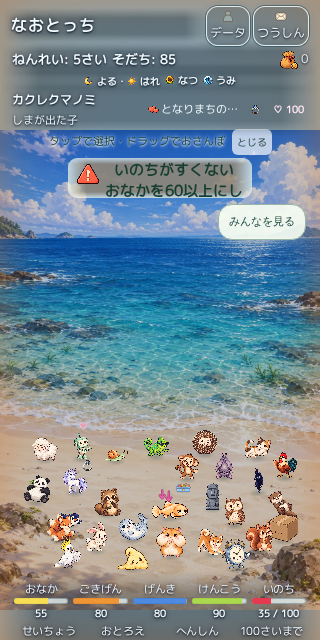
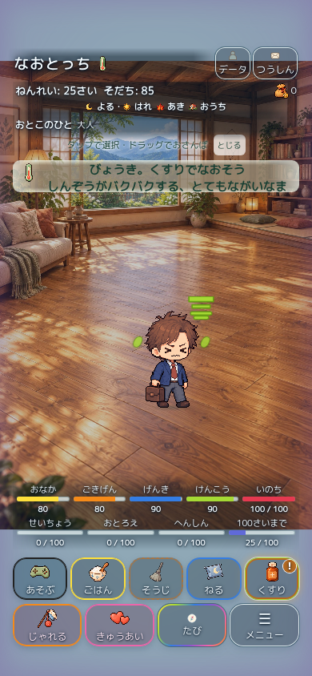

# 正式統合の公開中止記録 — 2026-10-30

**重大な未解決の表示・操作問題があるため、本人の停止条件に従いmainマージ・GitHub Pages公開を中止。**

統合成果: Draft PR https://github.com/Naoto214/naotocchi/pull/490

統合候補HEAD: `bb644d75e577cb68f8b0c2f66bf8cbb66e068c3c`。

証拠保存専用ブランチ: `evidence/home-25d-release-blocked-20261030`。このブランチは統合候補の親にQA証拠だけを追加し、実装は変更しない。

## 公開を止めた問題

既存Home layout CI run https://github.com/Naoto214/naotocchi/actions/runs/41036064960 の `home-core-layout` が失敗。検証SHAは `75a81de547be726f90ddcf45e2fc9d07c4b0ef9e`。当該SHAから最終候補までの本番HTML、script、ホームモデル/プレゼンター/manifest/world、CSS、Pages allowlistに差分はない。その後の変更はQAと記録のみで、この本番問題を修正したとは扱わない。

**確認済み実害:** 320×640、低い「いのち」、多人数の既存保存フィクスチャで育成ボタンが画面外。上段 y=673.75–722.75、下段 y=727.75–776.75。viewport height=640、`medicineClickable=false`。画像でもボタンが消えている。背景の歩行床最小高と既存の小画面レイアウトの競合が疑われるが、原因確定・修正・全地域再検証は未完了。接地・衝突判定を緩めて修正しない。

測定値: [chromium-care-measurements.json](blockers/chromium-care-measurements.json)

他の未解決: safe-area時のspeechSlotのフレーム外（bottom702/frame687）、小画面ヘッダー、クマノミの状態変更通知、会話検証タイムアウト等。22のトップレベル失敗分類（テスト個数とは異なる）。会話タイムアウトの待機式は旧ホーム内のspeechSlot配置を前提とし、固定76pxレーンとは一致しない。また旧dialog判定はキャラクターとの距離48px以内を要求する。これらは旧レイアウト前提との不一致を含むため、実害と分けて再設計・再検証が必要。判定削除・閾値緩和は行っていない。

同runの `home-layout` も既存会話・dialog検証で失敗。`home-v20`、`home-v21`、`pad-size` は成功。全体成功とはしない。

## 要求30項目への結果

| # | 項目 | 結果 |
|---|---|---|
| 1 | 開始main | `851cf09a80c7ed41ba7293888084272917e4582c` |
| 2 | 開始#426 | `8ba4ef1cb2030979664589d2e36423f58c4dedbd` |
| 3 | 開始#462 | `e0c5c52671666e8ab06b37afabf3eeae29f530fa` |
| 4 | 統合方式 | 最新mainに#462を一度だけ履歴統合。#426は祖先として継承。force pushなし |
| 5 | 統合用branch/PR | integration/home-25d-release-20261030 / Draft #490 |
| 6 | #426の機能 | 28体、タップ/ドラッグ、自由生活、影・奥行き・遮蔽、会話/Reaction/育成UIを候補へ継承 |
| 7 | #462の機能 | 13地域の2.5D背景、歩行領域、観察点、v8回転接地、v9水辺Gを候補へ継承 |
| 8 | 競合 | index/package/allowlistを最新main保護で解消。小画面の動作回帰は未解決 |
| 9 | 13地域 | REPORT.mdの採用一覧のとおり、候補manifestで確定。本番への反映は未実施 |
| 10 | 水辺G・海B2 | 候補既定値を自動確認 |
| 11 | 特別2地域 | star-new/lake-newを自動確認 |
| 12 | おうちC | home-interior-c、卵モジュールを接続 |
| 13 | 正式2D画像 | 開始mainとバイト不変の検証成功 |
| 14 | 最大28体 | 単体契約検証成功。13地域全ケースの実ブラウザー検証は未完了。小画面操作に失敗 |
| 15 | 会話/Reaction/育成UI | 本番アダプター契約365件成功。ただし既存ブラウザーUI失敗があり完全保護とは報告しない |
| 16 | セーブ互換 | 実旧保存6形式の読込全状態一致、キー/スキーマ変更なし。本人端末内の実データは未操作 |
| 17 | 12メニュー/他ゲーム | バイト保護、メニュー3件、本番アダプター経由ミニゲーム/クイック等の契約を検証。全実ブラウザー遷移は未完了 |
| 18 | 自動件数 | 本番接続/保存12成功、契約365成功、Pages Python16成功、メニュー3成功、元v9歴史比較8成功。各0失敗/skip。試行失敗や全体未完了は別記 |
| 19 | マージ前CI | 最終候補SHA: 照会時9workflow中1成功/3実行中/5待機中。先行SHAのHome layoutに重大失敗。全件成功ではない |
| 20 | マージ後CI | マージ未実施につき該当なし |
| 21 | 最終main | `851cf09a80c7ed41ba7293888084272917e4582c`、開始時と同一 |
| 22 | Pages deploy | 今回の公開は未実施。既存公開を維持 |
| 23 | 本番操作 | 公開前の卵・12メニュー・各リンクをクラウドChromeで確認。新ホーム公開後QAは未実施 |
| 24 | 配信整合 | 候補SHAのローカルHTTP成果物4119件/220182097bytes、欠落0/ハッシュ不一致0。新本番配信との比較は未実施 |
| 25 | 本番セーブ保護 | 消去/初期化なし、main/本番コード未変更。ユーザーのlocalStorageを読み替えていない |
| 26 | 本人限定v9 | サイト未更新・未削除、キー分離を維持。比較素材も保持 |
| 27 | 元PRの状態 | #426/#462ともOpen Draft・未マージ・未削除。統合関係を両PRへコメント済み |
| 28 | 復旧 | REPORT.md、開始main SHA、元PR固定SHA、#490、証拠ブランチ。今回は公開していないため復旧操作不要 |
| 29 | iPhone実機 | 新統合版のタッチ、回転、背景復帰、保存再開、描画負荷は未確認。クラウドWebKitとは区別 |
| 30 | 未完了 | 小画面UI回帰修正、旧レイアウト判定との切り分け、全体回帰/最終CI完走、全13地域実入力/視覚QA、mainマージ、Pages公開、公開後QA |

## 失敗試行を隠さないための記録

最初の完全回帰は前段32+24成功、大グループ3291中3284成功/7失敗/skip0。その7件はトークン修正前2件とsparse checkoutの不足資料5件。該当再検証は成功、クリーン全体再実行はこの停止判断時も実行中で、完走成功とは扱わない。

本番契約runner初期試行365件はDOM fixtureのImage API不足等で359成功/6失敗。Canvas fixture準備中の試行にも失敗。必要なDOM APIを整えた最終試行は365/365成功で、元テストの条件を変更していない。背景読み込みの実確認は別のブラウザーCIが担当する。

初期本番ブラウザーCIはQA初期化・会話準備の不足で失敗した。修正版の最終13地域CIは未完了。成功した部分だけで合格扱いしない。

**最新mainの既存機能は失われていない。今回mainへ一切マージしておらず、公開中のコードは開始時のまま。ただし統合候補の全機能保護が証明されたという意味ではない。**
