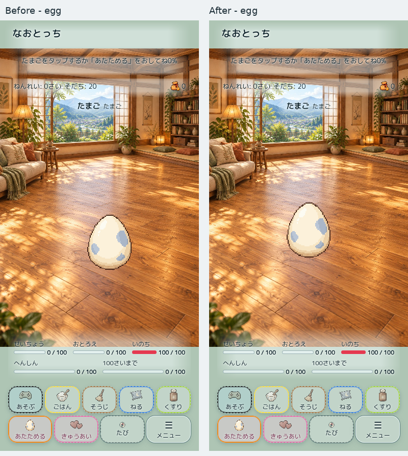
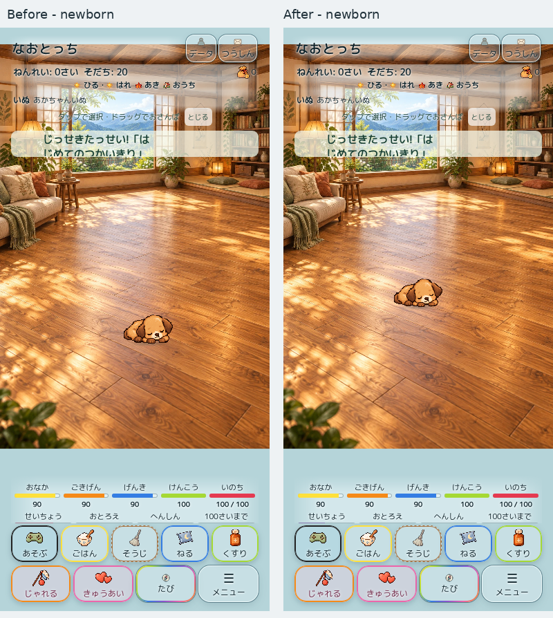
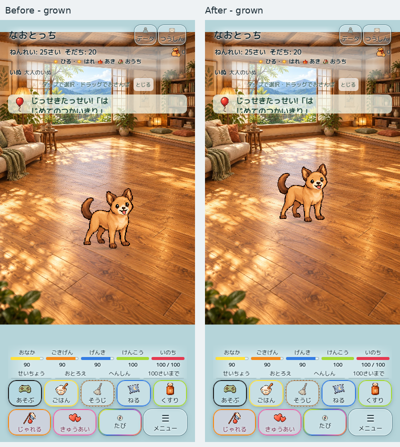

# 卵・孵化直後の中央配置（2026-10-31）

対象はDraft PR #490。開始HEAD `3272ac6d8ab2bb538f7fee674842a67186835ca3`、main `7c1f18c77b902d06159157899c36104e5d8c4a8d`。mainマージ・本番Pages更新なし。

## 原因と最小修正

背景は中央配置され、幅を保った等倍比率の射影を使用している。一方、卵の接地点とおうちCの主役seatは背景正規化座標 `(x=.55,z=.74)`。画面中心 `.50` に対して幅の5%右へずれる。390pxでは画像の不透明部分中心が214.48px、中央195pxとの差は約19.5pxだった。透明余白・接地点の既存alpha bounds処理は正常。

- 卵：中央表示stageの中心へ不透明部分の中心を合わせる。接地点は身体中心から画像の半分の高さだけ下に置く。保存値の読み書きなし。
- 孵化直後：実際の `hatchEgg()` から一度だけ表示コントローラーに要求する。背景navigationの非同期準備完了を待ち、stageとスクロール表示欄の交差領域中心から候補を作る。奥行き縮尺を反映した身体半高を加えて接地点にする。
- 候補は既存のbounds・nearest・可視性・衝突回避配置処理を通る。歩行領域、exclude、前景、接地、衝突、経路探索は変更なし。安全な中央がない場面では既存solverが合法な近傍を選ぶ。
- 新しい要求は初回の主役だけ。既存のnavigation上の主役には適用しない。仲間seed・成長時の接地点維持・移動処理は変更なし。
- セーブスキーマ・キーに新しい値を追加しない。保存からの通常起動では孵化イベントを再実行せず、従来の配置を保つ。もともと自由生活の表示座標は一時的なものでセーブ対象ではないため、新規孵化後も再読込した際の表示は従来の初期seatへ戻る。この挙動を今回変更していない。
- 背景・カメラ射影・CSS・safe-area指定・上部UI・通知42px/会話76px・5+4ボタンは変更なし。4つの変更済みscript参照だけ既存hash方式でキャッシュトークンを更新した。依存追加なし。allowlistの対応5ファイルのSHA256を更新し、検証ゲート自体は維持。

## 390px比較（WebKit、390×844 CSS px）

Safari実機写真ではなく、同じコードをWebKitで実行した比較。ゲーム画面内に測定線や開発UIは追加していない。画像は左右にそのまま並べ、タイトルだけ外側に付加したlossless WebP。

### 卵

### 孵化直後

### 成長後

成長時は接地点を維持するため、身体が大きくなると身体中心は上へ移動する。主役を強制的に再中央配置していない。

## 幅別実測：不透明部分の横中心（px）

| 幅 | 卵 前 | 卵 後 | 孵化直後 前 | 孵化直後 後 |
|---|---:|---:|---:|---:|
|320|175.99|159.99|175.70|159.73|
|375|206.25|187.50|206.61|187.85|
|390|214.48|194.98|214.86|195.35|
|430|236.50|215.00|236.86|215.35|
|390 safe-area|214.48|194.98|214.86|195.35|

縦位置は上部UI、通知、下部固定ボタン、スクロール表示欄を計測して判定。320×568ではstage全体と見えている中央欄が一致しないため、その交差領域を使用する。390pxのsafe-areaは上59px/下34pxをCSSのenv値に代入して検証（実機Safariの動的ツールバーそのものを再現したという意味ではない）。

## 検証記録

- 修正前：両engine×5画面条件の10ケースを保存。中央配置assertが320pxの卵 `175.99 != 160` で失敗。unitも中央配置と安全boundsでredを確認。後から追加した「crowd reflow時に要求が残っても既存主役を再中央配置しない」テストもred→green。
- 修正後：新規unit5件成功。孵化10件・実セーブ6形式・起動依存・本番保護等を含むfocus28件成功。本番関連契約365件成功。
- 両engine×320/375/390/430px＋390safe-areaの10ケース：卵／孵化直後の中心、合法な接地、成長時の接地点維持、保存復帰、固定UIを確認。JavaScript pageerror 0。
- おうちC既存ブラウザー回帰：24表示ケース（両engine×4幅×1/6/28体）、通常入力8件、会話中停止2件、画面回転と保存再開成功。
- clean配信：4,123ファイル、220,198,010bytes。HTTP全件、7導線、CARD GAME452ID/904画像、除外7パス404、欠落0・ハッシュ不一致0。
- 新unitを `npm test`、新ブラウザー試験をProduction 2.5D homeの両engineへ追加。従来のテスト・閾値・assertionは削除/緩和していない。
- 最終GitHub CI・本人限定公開版のSHA/URL/公開後確認はPRコメントに追記する。過去HEADのCI成功を本変更のCI成功とは扱わない。

## 調査中の失敗と扱い

1. 最初の配信構築はreviewed_runtime_sourcesが旧hashだったため正しく拒否。依存を確認し該当hashのみ更新して成功。
2. QA補助ファイルを加えたディレクトリを厳密inventory検証へ渡すと拒否される。補助ファイルのないclean配信を別に作り、全件成功を確認。
3. ローカルの浅いcheckoutにorigin/mainの履歴がなく保護テストを実行できなかった。既存checkoutのオブジェクトを読み取り専用で参照し、main祖先と旧成果の比較を含む28件を再実行して成功。テスト条件は変更なし。
4. 失敗した構築先に対する初回ブラウザー実行は起動待ちでtimeout。成功した配信への実行と区別し、成功数へ含めない。

## 本人確認・保留

本人のiPhone Safariで、卵→孵化→成長の位置、320px相当、セーフエリア、回転、主役tap/dragを再確認する。既存セーブを消さず、必要なら本人限定URLの独立したプライベートタブで新規の卵から試す。main・本番は引き続き保留。
