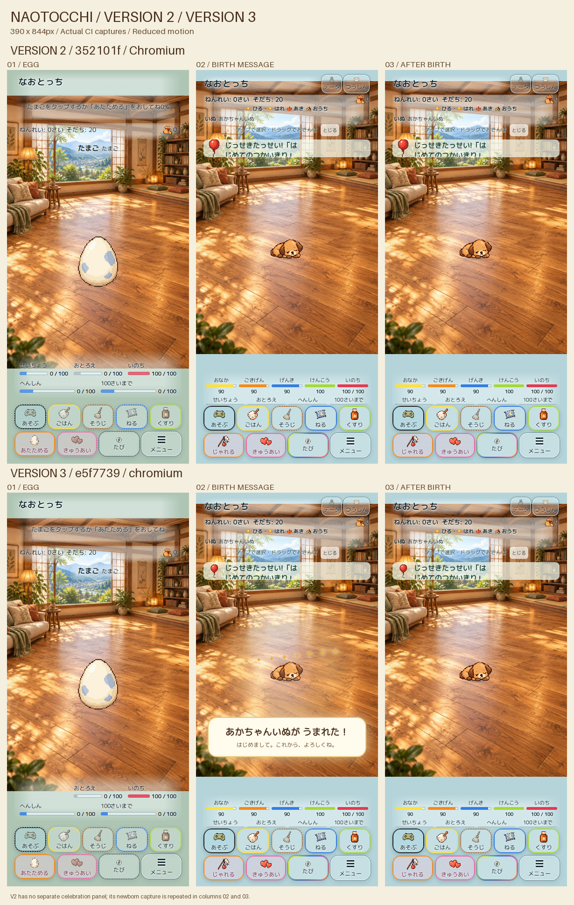

# PR #490 VERSION 3 — 孵化文章・祝福表示

開始HEAD: 352101f5edcefd418e706a875427c95c488c97b3。main読み取り: aec03c20ae8b064c6c2f8aca5537f1938df6439f。新規cloneはclean。Draft維持、mainマージ・本番公開なし。

## 表示のみの変更

温める1〜4回は「たまごが、ほんのりあたたかい。」「なかで、なにかがうごいた気がする。」「たまごが、こつんとゆれた。」「もうすぐ、あえそうだ。」。操作案内の率も削除。卵の間は下部せいちょうの数値・棒だけ非表示、スロットの寸法を保持する。内部HATCH_GROWTH=20、applyGrowth(4)、5回目の孵化はそのまま。

誕生時は正式な初期段階名＋「が うまれた！」、クリーム色パネル、濃茶色文字、柔らかい金色の光、星8個。キャラクター中心を白く覆わないよう光の中央は透明。既存の殻・900msの登場モーションを維持。祝福は2800msで消え、pointer-events:none。CSSのopacity/transformのみ。reduced-motionは静的表示。状態・セーブに演出フィールドを追加しない。リロードは孵化を再実行しない。リセット時は古い演出を除去。

背景、正式画像、キャラ座標、歩行領域、接地、衝突、自由生活モデル、育成効果、会話、恋愛、セーブキー/スキーマは変更なし。通知42px/会話76px・5+4操作ボタンも既存値。メーター内部値は従来どおり計算する。

## VERSION 2のCI失敗

元CI: run 41196403628, job 124523344327, artifact 13040858319。
添付v2-failed-native.jsonは390×844・home・28体の原票。tapは成功、次のdragで失敗。drag開始時の主役(203,274.3333435)は直前のtap目的地(203,274.3333333)と一致。HomeReleaseQA.scene()のsyncは意図どおり既存actorを保持するため、同じscene呼び出しだけでは入力fixtureを初期化できない。

記録された28体と既存createArtNavigation/routeをそのまま再計算: 主役自体は合法かつfree、候補1103、到達経路0。元ログの候補1123との差は記録取得までの自律移動時差であり混同しない。同じ寸法と28体をcreateModel.syncで新規作成すると候補のうち260に到達経路あり。

修正はテストだけ。各tap/drag前に新documentでQAセーブを初期化し、egg状態をassertしてからcastを構成。候補取得と物理イベント配送の間だけPlaywright時計を停止し、配送後に再開。実際のtouchイベント、source、5px超移動、全員safe、移動完了assertは維持。pointer-target探索条件、モデル、navigationには変更なし。最終CIで再確認する。

## 検証の履歴と限界

- 変更前の基準15テスト成功。文章テストは旧20%表示でred→green。
- 追加文章・誕生テスト＋既存孵化・中央配置17件成功。
- セーブ/卵アイテム/起動25件成功。本番関連365件成功。
- clean配信4123ファイル・7導線・除外7パス404、ハッシュ不一致0（初期V3 66020abf）。
- 初期V3両engineのブラウザー試験で20条件の文章/パネル/8星/非遮断/静的reduced-motion/2800ms後除去/保存復帰を実行。最後の通常モーション卵の静止中心assertで失敗。新規追加したno-preferenceでは従来のswayが画像の外接矩形を約2.9px動かす。元からあるreduced-motion全5条件の中心誤差は卵0.02px以下、新生児0.35px以下。静止中心assertを通常の揺れる卵に適用したテストの誤りを修正し、旧静止条件と全条件の新生児・成長接地点assertは維持。
- ローカルChromium導入はZIP取得失敗、WebKitは共有ライブラリ不足、依存導入も環境の権限制約で失敗。ローカル両engine成功とは記録しない。
- Cloud Chromiumで390px iframeの実ボタンを操作。文言変更、率の非表示、5回の孵化、正式名を確認。静止比較用に祝福を保持するQAコピーも使用したため、その比較画像を演出時間の証拠としない。
- 最終HEADのCI結果、最終画像、本人限定公開の整合性はPRの最終検証コメントに記録。iPhone Safari実機QAは本人待ち。

## 追加CIで確認した起動待ち

e5f7739の深海job 124583795159は、再読込直後のworld生成前にテストがworld.loadedを読んでTypeErrorで停止した（tests/home-production-browser.cjs:60）。worldは非同期生成であり、同ファイルの初期表示やスクロール試験では既に存在待ちをしている。残る入力・回転・native入力の待機条件にも存在ガードを揃えた。生成後のloaded、region、actor数、非停止条件は不変。実行中のゲーム処理・歩行・衝突に変更なし。

e5f7739でWebKitの孵化10条件、スクロール312条件、失敗0・pageerror0を確認。artifact 13049011999のSHA256 b3009a6cdc5564b860eaced5248d4f8dce285faa0a8399292080badc4dc12b77。配信後のindex.html（ルート応答）・script.js・egg-hatching.cssはローカル最終配信とSHA256一致。全4123ファイルは配信アーカイブ内の全件一致であり、公開先全件取得とは区別する。未認証401／サインイン画面を確認、所有者1名・外部共有0。認証後ブラウザーと実機Safariは未確認。

Chromiumのe5f7739初回は新設のfresh egg検査が24条件で停止。primaryだけを消す親fixtureにbackupが残り、既存の正しい保存復旧がgrowing/28体を再開していた（artifact 13049840078、SHA256 d9aab7f99ddb6bbe59fad2a7b4347d4e8cf8eb86bf8027824ab5ea997029f72e）。QA専用のprimary/backup/snapsの3キーを新documentの開始時に初期化するよう修正。fresh egg検査を維持して復旧持越しを検出し、実セーブの回復処理は変更しない。初回は入力配送前に停止しているため、28体入力成功とは数えない。誕生後には実際のじゃれるボタンでactionCounts.petの増加も検査する。

実scriptのharnessでbackupのみからgrowing復旧を再現し、同3キー初期化後はeggへ戻ることを確認。比較画像はe5f7739のChromium孵化テスト成功時の実キャプチャ（今回の追補はテストのみで配信runtimeは同一）。

操作検査のレビューで、新生児はpoopCount=0のためそうじが正しくdisabledと判明。検証対象を新生児が自然に操作できる「じゃれる」に訂正し、actionCounts.petの増加を確認する。ゲーム状態・disabled条件は変更しない。

## 物理dragの開始点と足元の差

a114246eで新生児操作を含む両engineの孵化20条件成功。Chromium nativeは47/48入力成功、390×844/home/28体のtap・dragはいずれもfresh egg/0体から開始して5px超移動・安全接地・移動完了を確認（v3-390-28-passed.json）。唯一430×932/home/6体dragが停止（v3-430-drag-failed.json）。artifact 13050205956 SHA256 4845d9a76af561c340950ade4b81d17cb75a420f5cf5e30018e34c8377083883。

後者はfoot=(220.5,315), h=112に対しpointer from=(236.5,464.2), to=(236,464)。足元距離45.0028pxでも指の実移動は0.5385px。配送された10個のpointermoveも全て8px未満で、既存controllerは正しく選択のみを行いmoveを呼ばなかった。候補探索へdragのみ物理移動>=12pxの前提を追加し、既存8pxのドラッグ閾値を確実に超える。衝突・接地・可視・経路・5px超実移動・source・完了検査はそのまま。成功した他23dragの最小物理移動は24.008pxであり、この追加条件は既存成功候補を除外しない。独立レビューで実navigationと記録6体から代替候補(176,322)（指68.29px、足元45.05px、経路あり）を確認。最終CIで再検証。
