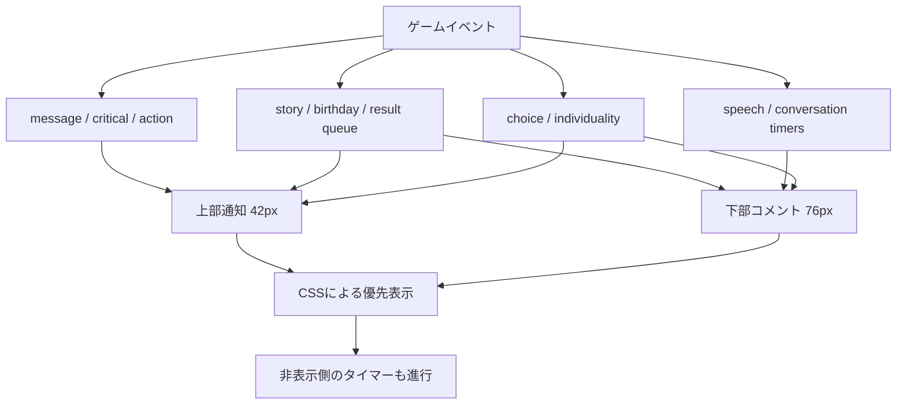
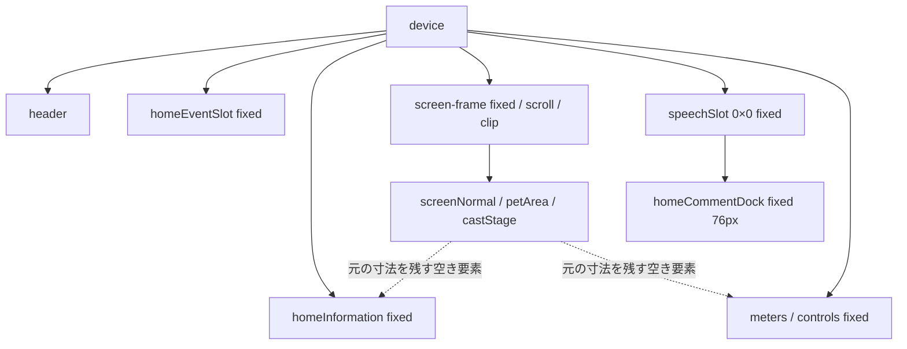

# 2. 縦横UI構造図と確定仕様との差分

監査基準: PR #490 / VERSION 10 / `bdb95499133b6f37065c6c815e4be21d4a0b6fb1`。2026-11-02 JST。
調査と設計整理のみ。ゲームコード、テスト、配信物、本人限定Site、mainは変更しない。Draftを維持し、修正着手は本人判断後。

## 実行時の所有関係

表示を隠す処理と、イベント状態・タイマーの終了は別々に管理されている。

初期DOMに対し、terrain controllerがmessage/story/個性dialog/いのちメーターを移動し、V7 dockがspeechSlotの子を吸収し、V10 viewportがnotice/info/meters/speechSlotをdevice直下へ移す。storyFlashはイベントのたびに上下を移動する。V10 applyはrestore→元DOM実測→reserve→移動を行うため、静的HTMLだけでは最終のCSS適用と祖先関係を判定できない。

## 縦向き配置

上からヘッダー、通知42px、情報40px、中央表示窓、4px間隔、コメント76px、4px間隔、全9パラメーター80px、4px間隔、操作5＋4、画面下8px。中央の世界自体は高さ380px以上を維持し、表示窓のみを切り取る。

375×667の実測: 中央y137–388（251px）、コメント392–468、メーター472–552、ボタン556–659。画面全体のスクロールは不要だが、中央窓・通知・コメントには内部スクロールがある。「ページのスクロールなし」と「キャラクター表示のスクロールなし」は同じでない。

## 横向き配置

左に通知42px、中央表示窓、その下に前／次住民。右は幅min(260px,表示幅×0.46)の簡易欄。右の情報パネル内にメーターをstaticで移し、その下にコメント76px、操作80px（38pxボタン×2段＋4px）。**通知は右欄ではなく左上**に残る。横配置の寸法計算はV9と同じ。

568×320で左窓268×190、右欄260px。844×280で左窓524×150、右情報59px内に自然高70pxのメーターがあり、情報とともに内部スクロールが必要。右欄でメーター全体が常時見える保証はない。

## 配置・描画・スクロール所有者

|領域／処理|position / overflow / transform / z-index|寸法・safe-area・注意|
|---|---|---|
|html/body/device|body overflow:hidden、device grid。旧home-diorama.cssにはcrowded時overflow:autoの規則も残る|ui.css:17–26のenv(safe-area-inset-*)、100dvh／--app-height。V10 active条件付きで上書き|
|ヘッダー|deviceのgrid先頭。V10は実測bottomを使用|通知位置の基準。横向き判定はvisualViewport width>height、ボタンCSS側はorientation media query|
|通知|fixed、上端header.bottom+3、overflow:auto、z-index1201。V10でdevice直下へ移動|高さ42px、内容幅fit-content。align-items:flex-start / margin:0で左寄り。V5の追加余白測定は存続するがactive V10はmargin-bottom:0!important|
|情報|fixed、overflow:auto / x hidden、z-index1201、背景transparent（V10）|縦40px、横は可変高。status/substatus/cast-namesの白い疑似背景のみ解除|
|中央表示窓|fixed、overflow:auto、clip-path:inset(0)、touch-action:pan-x pan-y pinch-zoom|世界ではなく表示窓をスクロール。actorはtouch-action:none。stageは元寸法を維持|
|背景home-living-world|fixed z0、overflow:hidden、transform:translate(-scrollLeft,-scrollTop)|paintScrollが同じ窓のscroll量とoverflowをCSS変数へ。地形投影自体を変更しない|
|speechSlot / dock|slot fixed 0×0 overflow:visible。dock fixed z1200、overflow:auto、76px、transparent|祖先移動でスクロール窓のclipを避ける。V7のbottom変数更新も併存するがV10 inline top/bottomが優先|
|下部バブル|relative、transform:none、max-content、max-width100%、通常16px、画像20px|V10 dock align-items:flex-start。通常Sは明色、Tは旧黒背景。Qの選択パネルはwidth100%|
|メーター|縦fixed、横info内static。z1201、overflow:auto（横visible）|縦80px。**inline background:#fff9e8c9が残る**。world-scene.cssの::before霞もある。9値は既存CIで縦hit判定済み|
|ボタン|fixed、z1201、縦既存高、横80px／ボタン38px|5＋4を維持。bottomの計算はvisualViewport.offsetTop+height−8でsafe-area-bottomを直接差し引かない|
|選択名|stage内、z1100、V10 fixed top/left|1体非表示は描画actor数で判断。clip-pathの子孫であり、fixed指定だけでviewport直下とは限らない|
|画面回転・resize|script.js:20104のsyncHomeViewportとtouch.js:202のapply、複数ResizeObserverが連動|applyはrestoreして実測し直す。visualViewport scale!=1なら新配置を止める。V10のapplyはvisualViewport scrollを購読しない（V7 placeは購読）|
|追従カメラ|apply後2requestAnimationFrameでselectedをreveal。縦V10はfollowUntil=Infinity|空白pointerdown／wheel／pointercancelで追従解除。解除後に住民が歩いて窓外へ出ても常時追従は復帰しない。pointerup後は選択者を追従|
|入力ロック|homeDioramaBlockedはspeechActive、conversationBusy、storyのhidden class、Reaction等を見る|CSSのdisplay:noneとは別。見えない会話が操作不能時間だけ残すことがある。現行仕様を変更しない|

参照: `home-production-touch.js:1–91,95–149,158–261`、`home-production-layout.css:1–183`、`home-diorama.css`、`world-scene.css:170–184`、`script.js:15155–15161,20104–20119`。

## 既存V10原票の実測（今回の再テストではない）

Run [41382784338](https://github.com/Naoto214/naotocchi/actions/runs/41382784338)、HEADは上記確定V10。

- Chromium artifact [13114141598](https://github.com/Naoto214/naotocchi/actions/runs/41382784338/artifacts/13114141598): 18/18 passed、errors0。
- WebKit artifact [13114332159](https://github.com/Naoto214/naotocchi/actions/runs/41382784338/artifacts/13114332159): 18/18 passed、errors0。
- ZIP SHA-256: Chromium `b9698c9eae10903101abb4603ef97a31a24454e00aca109f3c031d047ae4f3c9`、WebKit `01c081adf11e03efa1964416bb58352a42e6e827a86a49ee86b6e0186ac4d0c1`。取得したZIPと一致。
- `chromium.json`／`webkit.json`のinitial矩形を以下へ転記。単位CSS px、表記x,y,w,h。各ケースのボタン数9／hit判定、document heightも原票で確認。initialのstage矩形は非同期reveal前後の差を含むため、座標差だけで消失と判定しない。

|Engine|表示幅×高 / 人数|通知|情報|中央窓|コメント|メーター|操作|document高|
|---|---|---|---|---|---|---|---|---|
|chromium|320×568 / 1|9,49,302,42|9,94,302,40|9,137,302,152|9,293,302,76|9,373,302,80|9,457,302,103|568|
|chromium|320×568 / 6|9,49,302,42|9,94,302,40|9,137,302,152|9,293,302,76|9,373,302,80|9,457,302,103|568|
|chromium|320×568 / 28|9,49,302,42|9,94,302,40|9,137,302,152|9,293,302,76|9,373,302,80|9,457,302,103|568|
|chromium|375×667 / 1|16,49,343,42|16,94,343,40|16,137,343,251|16,392,343,76|16,472,343,80|16,556,343,103|667|
|chromium|375×667 / 6|16,49,343,42|16,94,343,40|16,137,343,251|16,392,343,76|16,472,343,80|16,556,343,103|667|
|chromium|375×667 / 28|16,49,343,42|16,94,343,40|16,137,343,251|16,392,343,76|16,472,343,80|16,556,343,103|667|
|chromium|390×664 / 1|16,49,358,42|16,94,358,40|16,137,358,248|16,389,358,76|16,469,358,80|16,553,358,103|664|
|chromium|390×664 / 6|16,49,358,42|16,94,358,40|16,137,358,248|16,389,358,76|16,469,358,80|16,553,358,103|664|
|chromium|390×664 / 28|16,49,358,42|16,94,358,40|16,137,358,248|16,389,358,76|16,469,358,80|16,553,358,103|664|
|chromium|430×740 / 1|16,53,398,42|16,98,398,40|16,141,398,312|16,457,398,76|16,537,398,80|16,621,398,111|740|
|chromium|430×740 / 6|16,53,398,42|16,98,398,40|16,141,398,312|16,457,398,76|16,537,398,80|16,621,398,111|740|
|chromium|430×740 / 28|16,53,398,42|16,98,398,40|16,141,398,312|16,457,398,76|16,537,398,80|16,621,398,111|740|
|chromium|568×320 / 1|16,49,268,42|292,49,260,99|16,94,268,190|292,152,260,76|292,89,260,70|292,232,260,80|320|
|chromium|568×320 / 6|16,49,268,42|292,49,260,99|16,94,268,190|292,152,260,76|292,89,260,70|292,232,260,80|320|
|chromium|568×320 / 28|16,49,268,42|292,49,260,99|16,94,268,190|292,152,260,76|292,89,260,70|292,232,260,80|320|
|chromium|844×280 / 1|26,49,524,42|558,49,260,59|26,94,524,150|558,112,260,76|558,89,260,70|558,192,260,80|280|
|chromium|844×280 / 6|26,49,524,42|558,49,260,59|26,94,524,150|558,112,260,76|558,89,260,70|558,192,260,80|280|
|chromium|844×280 / 28|26,49,524,42|558,49,260,59|26,94,524,150|558,112,260,76|558,89,260,70|558,192,260,80|280|
|webkit|320×568 / 1|9,49,302,42|9,94,302,40|9,137,302,152|9,293,302,76|9,373,302,80|9,457,302,103|568|
|webkit|320×568 / 6|9,49,302,42|9,94,302,40|9,137,302,152|9,293,302,76|9,373,302,80|9,457,302,103|568|
|webkit|320×568 / 28|9,49,302,42|9,94,302,40|9,137,302,152|9,293,302,76|9,373,302,80|9,457,302,103|568|
|webkit|375×667 / 1|16,49,343,42|16,94,343,40|16,137,343,251|16,392,343,76|16,472,343,80|16,556,343,103|667|
|webkit|375×667 / 6|16,49,343,42|16,94,343,40|16,137,343,251|16,392,343,76|16,472,343,80|16,556,343,103|667|
|webkit|375×667 / 28|16,49,343,42|16,94,343,40|16,137,343,251|16,392,343,76|16,472,343,80|16,556,343,103|667|
|webkit|390×664 / 1|16,49,358,42|16,94,358,40|16,137,358,248|16,389,358,76|16,469,358,80|16,553,358,103|664|
|webkit|390×664 / 6|16,49,358,42|16,94,358,40|16,137,358,248|16,389,358,76|16,469,358,80|16,553,358,103|664|
|webkit|390×664 / 28|16,49,358,42|16,94,358,40|16,137,358,248|16,389,358,76|16,469,358,80|16,553,358,103|664|
|webkit|430×740 / 1|16,53,398,42|16,98,398,40|16,141,398,312|16,457,398,76|16,537,398,80|16,621,398,111|740|
|webkit|430×740 / 6|16,53,398,42|16,98,398,40|16,141,398,312|16,457,398,76|16,537,398,80|16,621,398,111|740|
|webkit|430×740 / 28|16,53,398,42|16,98,398,40|16,141,398,312|16,457,398,76|16,537,398,80|16,621,398,111|740|
|webkit|568×320 / 1|16,49,268,42|292,49,260,99|16,94,268,190|292,152,260,76|292,89,260,70|292,232,260,80|320|
|webkit|568×320 / 6|16,49,268,42|292,49,260,99|16,94,268,190|292,152,260,76|292,89,260,70|292,232,260,80|320|
|webkit|568×320 / 28|16,49,268,42|292,49,260,99|16,94,268,190|292,152,260,76|292,89,260,70|292,232,260,80|320|
|webkit|844×280 / 1|26,49,524,42|558,49,260,59|26,94,524,150|558,112,260,76|558,89,260,70|558,192,260,80|280|
|webkit|844×280 / 6|26,49,524,42|558,49,260,59|26,94,524,150|558,112,260,76|558,89,260,70|558,192,260,80|280|
|webkit|844×280 / 28|26,49,524,42|558,49,260,59|26,94,524,150|558,112,260,76|558,89,260,70|558,192,260,80|280|

### 原票画像の確認と検査の抜け

- WebKit375×667/1体、Chromium375×667/1体、WebKit320×568/28体、WebKit568×320/6体の保存画像を今回目視した。左寄りバブル、白いメーターパネル、質問文＋選択欄の内部クリップが見える。これらの画像も既存テストではpassed。
- `tests/home-production-v10-browser.cjs`は枠高、ボタンhit、縦9値、1体ラベル非表示、上下順、上部へのA/R移動、下部可視数を検査する。**背景色、中央位置、通常発言の意味分類、実際に読めた秒数、全actorの可視性／ドラッグは検査しない。**
- 下部件数のセレクタは4つの直下要素のみ。個性dialogや全子孫を含む総合的な一件性ではない。質問の文＋選択肢を一件として扱う定義も別途必要。
- QA生成元`tools/home-production-qa.cjs:3`は通常の`setInterval(loop,TICK_MS)`を除去する。自然生活中の発生競合はこの36ケースの成功から保証できない。
- V10短文は375pxの既存managed記録で結果150px／行動114px（枠343px）。通常短文の全幅化は現行全経路の必然ではない。旧V6/V8ルール、質問width100%、白い親パネル、入口違いを分ける。
- V8では375×667の窓377px、568×320で213px。V10はそれぞれ251px／190px。既存V8の成功値をそのままV10の可視余裕として扱えない。

### CI失敗の区別

同じV10 HEADのProduction 2.5D homeワークフロー全体はfailure。失敗は[fixed-controls (webkit) job125076994366](https://github.com/Naoto214/naotocchi/actions/runs/41382784338/job/125076994366)の`Natural long notices and isolated special-region resume`。
ログのassertionは `webkit/430/true/memory_lake/short fixed controls`、`tests/home-production-notice-browser.cjs:33`（操作ボタンy/heightがbaselineと厳密一致しない）。これはv5-qa.html経由の互換検査であり、V10専用入口の36ケースとは別。ズレ量・発生順序の原因までは取得ログから確定できない。再実行・修正はしていない。

## 確定仕様との照合

|仕様|V10実態|判定|
|---|---|---|
|上部に結果・実績・誕生|N/A/R/T/Y/Gで概ね上。ただしconv2の選択返答はS、行動描写はT下|分類不一致あり|
|通常発言は上部に出さない|友達としての恋人候補の返答もAを使用し、V10は一律上へ移動|原因確認済み。分類判断D1|
|通知・コメントとも内容幅／中央|fit-content/max-contentは存在。V10はalign-items:flex-start、margin:0|中央仕様と不一致確認済み|
|ブラウザー標準折返し|white-space:normal、word-break:normal、overflow-wrap:anywhere。旧noticeChunksは現行setCommentText経路で使わない|基本適合。ただし42/76px超は内部スクロール|
|コメント76px・メーター直上|全36ケースの領域矩形で確認|領域は適合。長文／選択肢の全文同時表示は不可|
|同時コメント1件|CSSで質問／dialog／storyを優先。状態とタイマーは複数生存|見かけ上の抑制のみ。ユーザーの複数重なりの正確な実機経路は未特定|
|明るい共通背景|SとRは明色、下部Tにはstyle.cssの黒背景が残る|不一致確認済み|
|正式画像＋名前／本文2段|S/Tは共通描画あり。A/RはV10上部で画像・名を隠す|キャラクター発言の誤分類時は画像・名も欠落|
|全9メーター・白パネルなし|縦9値は既存hit確認。inline背景と疑似霞が残る|背景仕様不一致確認済み|
|縦ページスクロールなし|36原票のdocument高＝viewport高。中央は内部スクロール|ページ条件は確認。内部スクロール不要という意味ではない|
|キャラクターと固定UIを重ねない|V10は窓のclipで遮る。世界上のactorとUIの矩形は重なり得る|描画クリップ方式。全身表示・全員同時アクセスの保証とは別|
|横右側簡易操作欄|実装済み。通知は左上、情報／メーターは右内スクロール|現行承認範囲の配置。低い画面では表示制約あり|
|1体選択名非表示、2体以上表示|描画actor数<=1を毎frame判定|1体は既存検査済み。全人数・来訪切替・回転時の実機確認は未完|

## 原因未特定と画面寸法上の制約

スクロール後／回転後の「消えた」は、(1)世界モデルから消えた、(2)窓外にいる、(3)clipされた、(4)DOM/描画座標の同期が遅れた、を区別する必要がある。今回、(2)(3)が起こり得る構造と、追従解除の条件は確認したが、本人実機の個別症状を一つの原因に断定しない。sleepも入力停止と描画消失を分ける。

V10計算式では、headerBottom46・ボタン103・表示高480pxなら窓64px（layoutV10に同条件を入れた値）。既存成人画像全身をそのまま64pxへ同時表示することはできない。世界／接地／大きさ不変、全固定領域維持、全身常時表示の3条件を小さい画面で同時に満たす保証はできない。これをCSSの個別ずれと分け、判断D2へ送る。

今回ローカルの追加ブラウザー検証は実行エンジン不在のため行わず、上記既存CI原票を再利用した。iPhone Safari実機の再測定、safe-areaの実値、動的バー／ズーム中のoffset変化は未取得。
