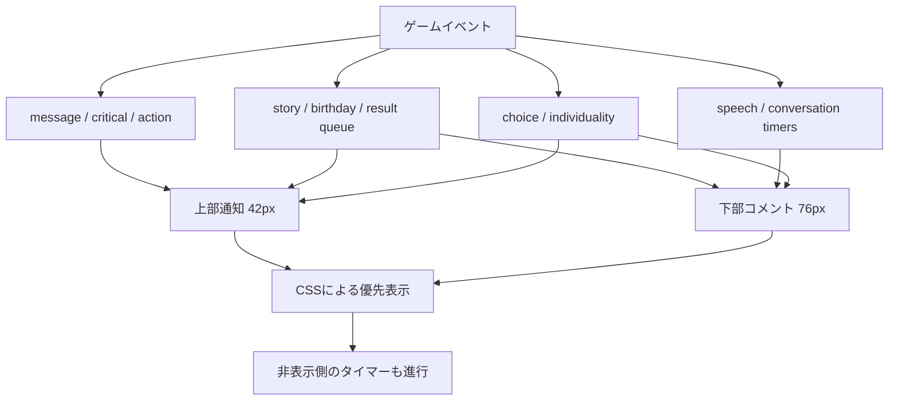
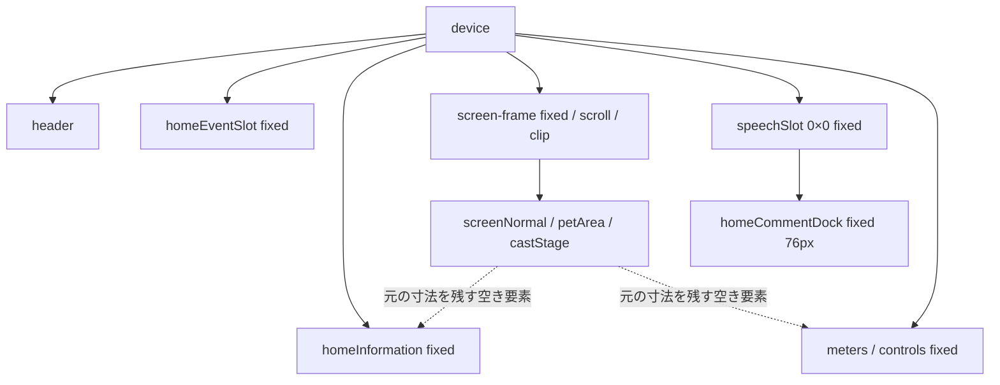

# 2. 縦横UI構造・実測寸法・競合原因一覧

監査基準: PR #490 / VERSION 10 / `bdb95499133b6f37065c6c815e4be21d4a0b6fb1`。2026-11-02 JST。
調査と設計整理のみ。ゲームコード、テスト、配信物、本人限定Site、mainは変更しない。Draftを維持し、修正着手は本人判断後。

## 第2段階の結論

前回の36ケースの実測はそのまま再利用。追加はWebKit26.5の代表1体・通知/コメント/スクロール系列17観測点と、未補足の4画面寸法の可視・hit確認のみ。**左寄せ、下部Tの黒背景、白メーターパネル、上部R/Tの同時表示、追従解除後の窓外クリップを実行時に確認した。** 通常短文の全幅化、76px外への描画侵入、通知だけによる固定UI移動は今回のV10条件では再現していない。

下段「第2段階：適用順序と追加実測」が最終判断。以下の元資料・CI36件は既存証拠であり、新規全体再テストの成功数に合算しない。

## 実行時の所有関係



表示を隠す処理と、イベント状態・タイマーの終了は別々に管理されている。



初期DOMに対し、terrain controllerがmessage/story/個性dialog/いのちメーターを移動し、V7 dockがspeechSlotの子を吸収し、V10 viewportがnotice/info/meters/speechSlotをdevice直下へ移す。storyFlashはイベントのたびに上下を移動する。V10 applyはrestore→元DOM実測→reserve→移動を行うため、静的HTMLだけでは最終のCSS適用と祖先関係を判定できない。

## 縦向き配置

上からヘッダー、通知42px、情報40px、中央表示窓、4px間隔、コメント76px、4px間隔、全9パラメーター80px、4px間隔、操作5＋4、画面下8px。中央の世界自体は高さ380px以上を維持し、表示窓のみを切り取る。

375×667の実測: 中央y137–388（251px）、コメント392–468、メーター472–552、ボタン556–659。画面全体のスクロールは不要だが、中央窓・通知・コメントには内部スクロールがある。「ページのスクロールなし」と「キャラクター表示のスクロールなし」は同じでない。

## 横向き配置

左に通知42px、中央表示窓、その下に前／次住民。右は幅min(260px,表示幅×0.46)の簡易欄。右の情報パネル内にメーターをstaticで移し、その下にコメント76px、操作80px（38pxボタン×2段＋4px）。**通知は右欄ではなく左上**に残る。横配置の寸法計算はV9と同じ。

568×320で左窓268×190、右欄260px。844×280で左窓524×150、右情報59px内に自然高70pxのメーターがあり、情報とともに内部スクロールが必要。右欄でメーター全体が常時見える保証はない。

## 配置・描画・スクロール所有者

|領域／処理|position / overflow / transform / z-index|寸法・safe-area・注意|
|---|---|---|
|html/body/device|body overflow:hidden、device grid。旧home-diorama.cssにはcrowded時overflow:autoの規則も残る|ui.css:17–26のenv(safe-area-inset-*)、100dvh／--app-height。V10 active条件付きで上書き|
|ヘッダー|deviceのgrid先頭。V10は実測bottomを使用|通知位置の基準。横向き判定はvisualViewport width>height、ボタンCSS側はorientation media query|
|通知|fixed、上端header.bottom+3、overflow:auto、z-index1201。V10でdevice直下へ移動|高さ42px、内容幅fit-content。align-items:flex-start / margin:0で左寄り。V5の追加余白測定は存続するがactive V10はmargin-bottom:0!important|
|情報|fixed、overflow:auto / x hidden、z-index1201、背景transparent（V10）|縦40px、横は可変高。status/substatus/cast-namesの白い疑似背景のみ解除|
|中央表示窓|fixed、overflow:auto、clip-path:inset(0)、touch-action:pan-x pan-y pinch-zoom|世界ではなく表示窓をスクロール。actorはtouch-action:none。stageは元寸法を維持|
|背景home-living-world|fixed z0、overflow:hidden、transform:translate(-scrollLeft,-scrollTop)|paintScrollが同じ窓のscroll量とoverflowをCSS変数へ。地形投影自体を変更しない|
|speechSlot / dock|slot fixed 0×0 overflow:visible。dock fixed z1200、overflow:auto、76px、transparent|祖先移動でスクロール窓のclipを避ける。V7のbottom変数更新も併存するがV10 inline top/bottomが優先|
|下部バブル|relative、transform:none、max-content、max-width100%、通常16px、画像20px|V10 dock align-items:flex-start。通常Sは明色、Tは旧黒背景。Qの選択パネルはwidth100%|
|メーター|縦fixed、横info内static。z1201、overflow:auto（横visible）|縦80px。**inline background:#fff9e8c9が残る**。world-scene.cssの::before霞もある。9値は既存CIで縦hit判定済み|
|ボタン|fixed、z1201、縦既存高、横80px／ボタン38px|5＋4を維持。bottomの計算はvisualViewport.offsetTop+height−8でsafe-area-bottomを直接差し引かない|
|選択名|stage内、z1100、V10 fixed top/left|1体非表示は描画actor数で判断。clip-pathの子孫であり、fixed指定だけでviewport直下とは限らない|
|画面回転・resize|script.js:20104のsyncHomeViewportとtouch.js:202のapply、複数ResizeObserverが連動|applyはrestoreして実測し直す。visualViewport scale!=1なら新配置を止める。V10のapplyはvisualViewport scrollを購読しない（V7 placeは購読）|
|追従カメラ|apply後2requestAnimationFrameでselectedをreveal。縦V10はfollowUntil=Infinity|空白pointerdown／wheel／pointercancelで追従解除。解除後に住民が歩いて窓外へ出ても常時追従は復帰しない。pointerup後は選択者を追従|
|入力ロック|homeDioramaBlockedはspeechActive、conversationBusy、storyのhidden class、Reaction等を見る|CSSのdisplay:noneとは別。見えない会話が操作不能時間だけ残すことがある。現行仕様を変更しない|

参照: `home-production-touch.js:1–91,95–149,158–261`、`home-production-layout.css:1–183`、`home-diorama.css`、`world-scene.css:170–184`、`script.js:15155–15161,20104–20119`。

## 既存V10原票の実測（今回の再テストではない）

Run [41382784338](https://github.com/Naoto214/naotocchi/actions/runs/41382784338)、HEADは上記確定V10。

- Chromium artifact [13114141598](https://github.com/Naoto214/naotocchi/actions/runs/41382784338/artifacts/13114141598): 18/18 passed、errors0。
- WebKit artifact [13114332159](https://github.com/Naoto214/naotocchi/actions/runs/41382784338/artifacts/13114332159): 18/18 passed、errors0。
- ZIP SHA-256: Chromium `b9698c9eae10903101abb4603ef97a31a24454e00aca109f3c031d047ae4f3c9`、WebKit `01c081adf11e03efa1964416bb58352a42e6e827a86a49ee86b6e0186ac4d0c1`。取得したZIPと一致。
- `chromium.json`／`webkit.json`のinitial矩形を以下へ転記。単位CSS px、表記x,y,w,h。各ケースのボタン数9／hit判定、document heightも原票で確認。initialのstage矩形は非同期reveal前後の差を含むため、座標差だけで消失と判定しない。

|Engine|表示幅×高 / 人数|通知|情報|中央窓|コメント|メーター|操作|document高|
|---|---|---|---|---|---|---|---|---|
|chromium|320×568 / 1|9,49,302,42|9,94,302,40|9,137,302,152|9,293,302,76|9,373,302,80|9,457,302,103|568|
|chromium|320×568 / 6|9,49,302,42|9,94,302,40|9,137,302,152|9,293,302,76|9,373,302,80|9,457,302,103|568|
|chromium|320×568 / 28|9,49,302,42|9,94,302,40|9,137,302,152|9,293,302,76|9,373,302,80|9,457,302,103|568|
|chromium|375×667 / 1|16,49,343,42|16,94,343,40|16,137,343,251|16,392,343,76|16,472,343,80|16,556,343,103|667|
|chromium|375×667 / 6|16,49,343,42|16,94,343,40|16,137,343,251|16,392,343,76|16,472,343,80|16,556,343,103|667|
|chromium|375×667 / 28|16,49,343,42|16,94,343,40|16,137,343,251|16,392,343,76|16,472,343,80|16,556,343,103|667|
|chromium|390×664 / 1|16,49,358,42|16,94,358,40|16,137,358,248|16,389,358,76|16,469,358,80|16,553,358,103|664|
|chromium|390×664 / 6|16,49,358,42|16,94,358,40|16,137,358,248|16,389,358,76|16,469,358,80|16,553,358,103|664|
|chromium|390×664 / 28|16,49,358,42|16,94,358,40|16,137,358,248|16,389,358,76|16,469,358,80|16,553,358,103|664|
|chromium|430×740 / 1|16,53,398,42|16,98,398,40|16,141,398,312|16,457,398,76|16,537,398,80|16,621,398,111|740|
|chromium|430×740 / 6|16,53,398,42|16,98,398,40|16,141,398,312|16,457,398,76|16,537,398,80|16,621,398,111|740|
|chromium|430×740 / 28|16,53,398,42|16,98,398,40|16,141,398,312|16,457,398,76|16,537,398,80|16,621,398,111|740|
|chromium|568×320 / 1|16,49,268,42|292,49,260,99|16,94,268,190|292,152,260,76|292,89,260,70|292,232,260,80|320|
|chromium|568×320 / 6|16,49,268,42|292,49,260,99|16,94,268,190|292,152,260,76|292,89,260,70|292,232,260,80|320|
|chromium|568×320 / 28|16,49,268,42|292,49,260,99|16,94,268,190|292,152,260,76|292,89,260,70|292,232,260,80|320|
|chromium|844×280 / 1|26,49,524,42|558,49,260,59|26,94,524,150|558,112,260,76|558,89,260,70|558,192,260,80|280|
|chromium|844×280 / 6|26,49,524,42|558,49,260,59|26,94,524,150|558,112,260,76|558,89,260,70|558,192,260,80|280|
|chromium|844×280 / 28|26,49,524,42|558,49,260,59|26,94,524,150|558,112,260,76|558,89,260,70|558,192,260,80|280|
|webkit|320×568 / 1|9,49,302,42|9,94,302,40|9,137,302,152|9,293,302,76|9,373,302,80|9,457,302,103|568|
|webkit|320×568 / 6|9,49,302,42|9,94,302,40|9,137,302,152|9,293,302,76|9,373,302,80|9,457,302,103|568|
|webkit|320×568 / 28|9,49,302,42|9,94,302,40|9,137,302,152|9,293,302,76|9,373,302,80|9,457,302,103|568|
|webkit|375×667 / 1|16,49,343,42|16,94,343,40|16,137,343,251|16,392,343,76|16,472,343,80|16,556,343,103|667|
|webkit|375×667 / 6|16,49,343,42|16,94,343,40|16,137,343,251|16,392,343,76|16,472,343,80|16,556,343,103|667|
|webkit|375×667 / 28|16,49,343,42|16,94,343,40|16,137,343,251|16,392,343,76|16,472,343,80|16,556,343,103|667|
|webkit|390×664 / 1|16,49,358,42|16,94,358,40|16,137,358,248|16,389,358,76|16,469,358,80|16,553,358,103|664|
|webkit|390×664 / 6|16,49,358,42|16,94,358,40|16,137,358,248|16,389,358,76|16,469,358,80|16,553,358,103|664|
|webkit|390×664 / 28|16,49,358,42|16,94,358,40|16,137,358,248|16,389,358,76|16,469,358,80|16,553,358,103|664|
|webkit|430×740 / 1|16,53,398,42|16,98,398,40|16,141,398,312|16,457,398,76|16,537,398,80|16,621,398,111|740|
|webkit|430×740 / 6|16,53,398,42|16,98,398,40|16,141,398,312|16,457,398,76|16,537,398,80|16,621,398,111|740|
|webkit|430×740 / 28|16,53,398,42|16,98,398,40|16,141,398,312|16,457,398,76|16,537,398,80|16,621,398,111|740|
|webkit|568×320 / 1|16,49,268,42|292,49,260,99|16,94,268,190|292,152,260,76|292,89,260,70|292,232,260,80|320|
|webkit|568×320 / 6|16,49,268,42|292,49,260,99|16,94,268,190|292,152,260,76|292,89,260,70|292,232,260,80|320|
|webkit|568×320 / 28|16,49,268,42|292,49,260,99|16,94,268,190|292,152,260,76|292,89,260,70|292,232,260,80|320|
|webkit|844×280 / 1|26,49,524,42|558,49,260,59|26,94,524,150|558,112,260,76|558,89,260,70|558,192,260,80|280|
|webkit|844×280 / 6|26,49,524,42|558,49,260,59|26,94,524,150|558,112,260,76|558,89,260,70|558,192,260,80|280|
|webkit|844×280 / 28|26,49,524,42|558,49,260,59|26,94,524,150|558,112,260,76|558,89,260,70|558,192,260,80|280|

### 原票画像の確認と検査の抜け

- WebKit375×667/1体、Chromium375×667/1体、WebKit320×568/28体、WebKit568×320/6体の保存画像を今回目視した。左寄りバブル、白いメーターパネル、質問文＋選択欄の内部クリップが見える。これらの画像も既存テストではpassed。
- `tests/home-production-v10-browser.cjs`は枠高、ボタンhit、縦9値、1体ラベル非表示、上下順、上部へのA/R移動、下部可視数を検査する。**背景色、中央位置、通常発言の意味分類、実際に読めた秒数、全actorの可視性／ドラッグは検査しない。**
- 下部件数のセレクタは4つの直下要素のみ。個性dialogや全子孫を含む総合的な一件性ではない。質問の文＋選択肢を一件として扱う定義も別途必要。
- QA生成元`tools/home-production-qa.cjs:3`は通常の`setInterval(loop,TICK_MS)`を除去する。自然生活中の発生競合はこの36ケースの成功から保証できない。
- V10短文は375pxの既存managed記録で結果150px／行動114px（枠343px）。通常短文の全幅化は現行全経路の必然ではない。旧V6/V8ルール、質問width100%、白い親パネル、入口違いを分ける。
- V8では375×667の窓377px、568×320で213px。V10はそれぞれ251px／190px。既存V8の成功値をそのままV10の可視余裕として扱えない。

### CI失敗の区別

同じV10 HEADのProduction 2.5D homeワークフロー全体はfailure。失敗は[fixed-controls (webkit) job125076994366](https://github.com/Naoto214/naotocchi/actions/runs/41382784338/job/125076994366)の`Natural long notices and isolated special-region resume`。
ログのassertionは `webkit/430/true/memory_lake/short fixed controls`、`tests/home-production-notice-browser.cjs:33`（操作ボタンy/heightがbaselineと厳密一致しない）。これはv5-qa.html経由の互換検査であり、V10専用入口の36ケースとは別。ズレ量・発生順序の原因までは取得ログから確定できない。再実行・修正はしていない。

## 確定仕様との照合

|仕様|V10実態|判定|
|---|---|---|
|上部に結果・実績・誕生|N/A/R/T/Y/Gで概ね上。ただしconv2の選択返答はS、行動描写はT下|分類不一致あり|
|通常発言は上部に出さない|友達としての恋人候補の返答もAを使用し、V10は一律上へ移動|原因確認済み。分類判断D1|
|通知・コメントとも内容幅／中央|fit-content/max-contentは存在。V10はalign-items:flex-start、margin:0|中央仕様と不一致確認済み|
|ブラウザー標準折返し|white-space:normal、word-break:normal、overflow-wrap:anywhere。旧noticeChunksは現行setCommentText経路で使わない|基本適合。ただし42/76px超は内部スクロール|
|コメント76px・メーター直上|全36ケースの領域矩形で確認|領域は適合。長文／選択肢の全文同時表示は不可|
|同時コメント1件|CSSで質問／dialog／storyを優先。状態とタイマーは複数生存|見かけ上の抑制のみ。ユーザーの複数重なりの正確な実機経路は未特定|
|明るい共通背景|SとRは明色、下部Tにはstyle.cssの黒背景が残る|不一致確認済み|
|正式画像＋名前／本文2段|S/Tは共通描画あり。A/RはV10上部で画像・名を隠す|キャラクター発言の誤分類時は画像・名も欠落|
|全9メーター・白パネルなし|縦9値は既存hit確認。inline背景と疑似霞が残る|背景仕様不一致確認済み|
|縦ページスクロールなし|36原票のdocument高＝viewport高。中央は内部スクロール|ページ条件は確認。内部スクロール不要という意味ではない|
|キャラクターと固定UIを重ねない|V10は窓のclipで遮る。世界上のactorとUIの矩形は重なり得る|描画クリップ方式。全身表示・全員同時アクセスの保証とは別|
|横右側簡易操作欄|実装済み。通知は左上、情報／メーターは右内スクロール|現行承認範囲の配置。低い画面では表示制約あり|
|1体選択名非表示、2体以上表示|描画actor数<=1を毎frame判定|1体は既存検査済み。全人数・来訪切替・回転時の実機確認は未完|

## 原因未特定と画面寸法上の制約

スクロール後／回転後の「消えた」は、(1)世界モデルから消えた、(2)窓外にいる、(3)clipされた、(4)DOM/描画座標の同期が遅れた、を区別する必要がある。第1段階では構造確認に留まった。第2段階でwheelによる追従解除＋scrollTop端の(2)(3)をWebKitで再現した。本人実機の個別症状すべてを同じ原因とは断定しない。sleepも入力停止と描画消失を分ける。

V10計算式では、headerBottom46・ボタン103・表示高480pxなら窓64px（layoutV10に同条件を入れた値）。既存成人画像全身をそのまま64pxへ同時表示することはできない。世界／接地／大きさ不変、全固定領域維持、全身常時表示の3条件を小さい画面で同時に満たす保証はできない。これをCSSの個別ずれと分け、判断D2へ送る。

第1段階は実行エンジン不在のため追加ブラウザー検証をせず既存CIを再利用。第2段階ではWebKit実行環境を準備でき、下記の追加検証を行った。iPhone Safari実機の再測定、safe-areaの実値、動的バー／ズーム中のoffset変化は未取得。


## 第2段階：適用順序と追加実測

### 証拠の条件と限界

- 対象ソースは引き続きV10 `bdb95499133b6f37065c6c815e4be21d4a0b6fb1`。ローカル既存生成器`node tools/home-production-v10-qa.cjs <scratch出力先>`で隔離QAを再生成。テスト／ゲームソースは編集せず、HTTPサーバーはscratch QAと確定ソースを読み取り配信した。公開Siteへの書込・操作はなし。
- 再生成した`v10-qa-script.js`／`v10-qa-diorama.js`／`v10-qa.html`は前回のV10配信準備物とbyte一致。54個の参照runtime/CSSも確定ソースと一致。QAは既存どおり通常loopを停止し、別の保存領域を使用する。
- Playwright1.62.1 / WebKit26.5、hasTouch:true、reducedMotion:reduce、主役dog 1体、おうち。3 requestAnimationFrame後にgetComputedStyle／getBoundingClientRect／scrollHeight／elementFromPoint／既存QA.modelを記録。回転・窓サイズ変更は300ms後。CSS pxを使用。
- 17観測点系列は最後まで採取できたが、主役タップを含めた実行で`InvalidStateError: Failed to start the audio device`が1件発生し、errors=0の最終assertionは失敗した。**この系列全体をテスト成功と表示しない。** 以下は取得できた配置・hit・イベントtraceの証拠。音声開始失敗と描画問題の因果は未調査。
- 追加4寸法の観測はpageerror0。既存`tests/home-production-v10-test.cjs`の配置式検査1件、runtime-harnessの追加状態検査2件は成功。途中、状態probeでspeaker引数を省略してno-opになった失敗を修正し、有効なpet speakerで再実行した。ゲームソースに修正なし。
- Chromium本体の取得は失敗。新規Chromium結果はない。WebKitは取得・依存環境準備後に実行できた。desktop WebKitはiPhone Safari実機ではない。safe-area実値・動的アドレスバー・ピンチ・タッチ慣性は未検証。

### CSS・JSの勝敗（V10 active時）

indexの読込順は`style.css → ui.css → design.css → egg-hatching.css → care-status.css → ui-illustrations.css → home-diorama.css → world-scene.css → care-attention.css → pet-expression.css → home-care-colors.css → movie.css → item-memories.css → home-art.css → home-v8.css → home-production-layout.css`。後勝ちだけでなく、詳細度・!important・移動後の祖先条件を照合した。

|対象|旧指定→最終勝者|実行時の確認・原因判定|
|---|---|---|
|通知幅|layout:53–55のV6 width:100% → 同:162–164のV10属性を含む、より詳細なwidth:fit-content|max-width100%は残るが常時全幅ではない。375px画面でN158.02、A90.02、R150.02px、外枠343px。旧100%だけを原因とする説は否定|
|左右位置|旧margin:0 auto → V10子margin:0、親align-items:flex-start（layout:161,169）|N/A/R/S/Tの左端が親と同じ16px。S幅98.02なら中央配置の左端は138.49pxになるはず。**原因確定**|
|下部T背景|style:1676の黒 → home-diorama:79の明色は上部の直下限定 → Tをdockへ移動すると非該当|T下rgba(10,15,10,.82)、T上rgba(245,252,240,.72)。下部layout:86–94は寸法を指定するだけで背景を置き換えない。**原因確定**|
|ドック高さ／位置|V7 fixed＋height:auto＋bottom変数 → touch:214,223のinline important height/min/max-height76px、top、bottom:auto|枠76pxを全追加観測で維持。V7 placeがbottom変数を更新してもV10のtop/bottomは変わらない。予約枠とfixedドックが別にあるだけで76px外侵入とはいえない|
|本文の高さ|旧max-height72px → layout:86–94のmax-height:none、height:auto、flex-shrink0|長文S本文258.91px、dock clientHeight76/scrollHeight259。**本文超過は確定、枠超過は否定**。overflow:autoにより下部は内部スクロール。全文同時表示は仕様上の制約|
|短い質問の横幅|Sはmax-content、`#speechChoices`と個性popupはlayout:108–110のwidth100%|質問文222.73pxに対し選択肢343px。選択肢パネルが全幅なのは確定。通常短文Sの全幅症状とは別|
|メーター背景|world-scene:170背景none → touch:225 inline important background:#fff9e8c9|rgba(255,249,232,.79)を実測。V10透明化はinfoとdockだけ。疑似霞も独立。**原因確定**|
|通知追加余白|V5 measureが--home-notice-extraを更新 → touch:212 inline important margin-bottom:0、高さ42、overflow:auto|R＋T上で--home-notice-extra:19px、scrollHeight61になっても枠42。frame/controls/info/meters/dock矩形は変化なし。通常V10通知で余白が画面を押す説は今回否定|
|下部排他|V9/V10の:has()とdisplay:none!importantがSを隠す。質問時はspeechBubbleをdisplay:flex!important|overlapでSはclass上active、computed none、T下はflex。状態タイマーは停止しない。下部複数描画の本人症状はこの系列では未再現|
|上部排他|V10はRがA/N、AがNを隠す。T/Y/Gを同じ排他へ含めていない|R上とT上は同時にflex/grid。42px内に28.80＋gap2＋30=60.80px。**上部競合の原因確定**|
|キャラの投影とスクロール|frameスクロールはDOMを移動。paintScrollのCSS変数は別のhome-living-world背景を移動|scroll209→0でactorのYも+209。今回二重移動ではない。stage380pxを中央窓251pxでclip。追従解除後に窓外へ出ることを再現|

### スクロール消失の再現条件（原因確定した範囲）

375×667、主役1体、QA上のblockersなし。開始時に主役中央をクリックし、既存InputTraceで`select result:true`を確認。その後`.screen-frame`へwheelイベントを送り、scrollTopを0／最大値へ変更した。これは物理iPhoneのフリック再現ではなく、**同じ追従解除ハンドラーとスクロール描画経路の限定検証**。

|状態|scrollTop|中央窓Y|actor上端–下端|世界モデルx,y|表示・hit|
|---|---:|---|---|---|---|
|開始／主役選択後|209|137–388|196.50–330.49|190.25,267.50|全体が窓内、hit可、select成功|
|追従解除後、先頭|0|137–388|405.50–539.49|190.25,267.50|窓との交差0、hit不可。DOMは存在、display:flex|
|同じ状態300ms後|0|137–388|405.50–539.49|190.25,267.50|自動復帰せず|
|末尾へスクロール|428|137–388|-22.50–111.49|190.25,267.50|交差0、hit不可|
|横568×320へ回転|180|94–284|窓内へ再配置|投影の再計算あり|hit可|
|縦375×667へ戻す|209|137–388|196.50–330.49|190.25,267.50|hit可、復帰|

原因鎖：`wheel`（touch:258）／空白pointerdown・pointercancelの解除処理 → followKey空 → trackのrevealが止まる → 予約要素を含むscrollHeight679pxを251px窓でスクロール（範囲0–428） → actorがclip-pathの外へ。座標やDOMを削除する経路は観測していない。静止したこの主役が全身で収まるscrollTopは約151.49–268.50だが、現行のスクロール範囲はこれに制限されない。

同じ条件で回転だけによる消失は再現しなかった。本人実機の消失がこの経路と一致するか、動的バー・慣性・睡眠・描画同期を伴う別経路かは未特定として残す。

### 寸法別の最終判定

通知42、縦情報40、コメント76、縦メーター80、縦操作103（430幅では111）を既存実測と再照合。横は右欄幅260、操作80、コメント76。以下の「操作可」はhitと既存選択traceの限定証拠であり、全住民のドラッグ／自然生活中の操作保証ではない。

|画面|中央窓高|主役DOM高（追加測定）|ページスクロール|9メーター値／9操作のhit|判定|
|---|---:|---:|---|---|---|
|320×568|152|117.98|不要|9/9、9/9|初期主役全身は窓内。内部スクロール端では見失い得る|
|375×667|251|133.99|不要|9/9、9/9|初期全身・選択操作を確認。scroll端で交差0を再現|
|390×664|248|138.62|不要|9/9、9/9|初期主役全身は窓内|
|430×740|312|138.62|不要|9/9、9/9|初期主役全身は窓内|
|568×320 横|190|138.62|不要|5/9、9/9|主役全身は窓内。右簡易欄の全9値は同時に見えない|
|844×280 横|150|139.97|不要|0/9、9/9|主役全身は窓内。59px情報窓内の値はスクロールが必要|
|320×480 低い縦|64|117.98|不要|9/9、9/9|主役が上下に約26px/28px欠ける。窓内部分はhit可だが全身表示は不可|

※横の「0/9」は各数値要素の中心点hitによる判定であり、全メーター要素がDOMから消えたという意味ではない。横向きは本人指定の簡易欄として、縦と同じ全項目常時表示を保証していない。

**高さ不足の境界（現行式）**：offsetTop0、headerBottom46、controlsHeight103なら中央高=max(0,H−416)。したがってH480で64、H550で134、H568で152。H≤416では中央高0となる。320px幅の今回の主役117.98pxだけでもH≥533.98が必要（端余白を含めない下限）。stage全体380pxにはH≥796。430幅のheaderBottom50・controls111では中央高=max(0,H−428)、stage380pxにはH≥808。全キャラ寸法が同じとは仮定しない。

safe-areaは追加実行のenv4方向が0pxであり、iPhoneの実測値ではない。現行bottomはoffsetTop+height−8、safe-area-bottomを直接差し引かない。仮に表示保護のため下端に追加S pxを確保するなら上記中央高からSが減る（上側header増分も別途減る）。実機Sを推定値で埋めず、未取得とする。

### 追加観測原票（抄録）

矩形は[x,y,w,h]、小数2桁。17点系列の音声エラー1件は上記のとおり。幅/色/親DOMと表示競合、actor窓外化に必要な値をここに保存し、4番目の成果物や画像は追加しない。

<details><summary>21観測点の配置・表示原票</summary>

```json
[{"case":"initial","viewport":[375,667],"docH":667,"frame":{"parent":"device","rect":[16,137,343,251],"display":"block","bg":"rgba(0, 0, 0, 0)","scroll":[343,679,0,209]},"dock":{"parent":"speechSlot","rect":[16,392,343,76],"display":"flex","bg":"rgba(0, 0, 0, 0)","scroll":[343,76,0,0]},"shown":{"#storyFlash":{"parent":"homeEventSlot","rect":[16,49,251.88,30],"display":"grid","bg":"rgba(245, 252, 240, 0.72)","scroll":[252,30,0,0]}},"actor":{"rect":[139.24,196.5,133.99,133.99],"intersection":17953.38,"hit":true},"hits":{"meters":[true,true,true,true,true,true,true,true,true],"buttons":[true,true,true,true,true,true,true,true,true]}},{"case":"short-speech","viewport":[375,667],"docH":667,"frame":{"parent":"device","rect":[16,137,343,251],"display":"block","bg":"rgba(0, 0, 0, 0)","scroll":[343,679,0,209]},"dock":{"parent":"speechSlot","rect":[16,392,343,76],"display":"flex","bg":"rgba(0, 0, 0, 0)","scroll":[343,76,0,0]},"shown":{"#message":{"parent":"homeEventSlot","rect":[16,49,158.02,22.8],"display":"block","bg":"rgba(245, 252, 240, 0.72)","scroll":[158,23,0,0]},"#speechBubble":{"parent":"homeCommentDock","rect":[16,392,98.02,57.39],"display":"flex","bg":"rgba(250, 253, 250, 0.82)","scroll":[98,57,0,0]}},"actor":{"rect":[139.24,196.5,133.99,133.99],"intersection":17953.38,"hit":true},"hits":{"meters":[true,true,true,true,true,true,true,true,true],"buttons":[true,true,true,true,true,true,true,true,true]}},{"case":"short-story-lower","viewport":[375,667],"docH":667,"frame":{"parent":"device","rect":[16,137,343,251],"display":"block","bg":"rgba(0, 0, 0, 0)","scroll":[343,679,0,209]},"dock":{"parent":"speechSlot","rect":[16,392,343,76],"display":"flex","bg":"rgba(0, 0, 0, 0)","scroll":[343,76,0,0]},"shown":{"#message":{"parent":"homeEventSlot","rect":[16,49,158.02,22.8],"display":"block","bg":"rgba(245, 252, 240, 0.72)","scroll":[158,23,0,0]},"#storyFlash":{"parent":"homeCommentDock","rect":[16,392,95.69,54.8],"display":"flex","bg":"rgba(10, 15, 10, 0.82)","scroll":[96,55,0,0]}},"actor":{"rect":[139.24,196.5,133.99,133.99],"intersection":17953.38,"hit":true},"hits":{"meters":[true,true,true,true,true,true,true,true,true],"buttons":[true,true,true,true,true,true,true,true,true]}},{"case":"story-upper","viewport":[375,667],"docH":667,"frame":{"parent":"device","rect":[16,137,343,251],"display":"block","bg":"rgba(0, 0, 0, 0)","scroll":[343,679,0,209]},"dock":{"parent":"speechSlot","rect":[16,392,343,76],"display":"flex","bg":"rgba(0, 0, 0, 0)","scroll":[343,76,0,0]},"shown":{"#storyFlash":{"parent":"homeEventSlot","rect":[16,49,308.02,30],"display":"grid","bg":"rgba(245, 252, 240, 0.72)","scroll":[308,30,0,0]}},"actor":{"rect":[139.24,196.5,133.99,133.99],"intersection":17953.38,"hit":true},"hits":{"meters":[true,true,true,true,true,true,true,true,true],"buttons":[true,true,true,true,true,true,true,true,true]}},{"case":"overlap","viewport":[375,667],"docH":667,"frame":{"parent":"device","rect":[16,137,343,251],"display":"block","bg":"rgba(0, 0, 0, 0)","scroll":[343,679,0,209]},"dock":{"parent":"speechSlot","rect":[16,392,343,76],"display":"flex","bg":"rgba(0, 0, 0, 0)","scroll":[343,76,0,0]},"shown":{"#homeActionComment":{"parent":"homeEventSlot","rect":[16,49,90.02,26.8],"display":"flex","bg":"rgba(255, 255, 255, 0.96)","scroll":[86,23,0,0]},"#storyFlash":{"parent":"homeCommentDock","rect":[16,392,102.02,54.8],"display":"flex","bg":"rgba(10, 15, 10, 0.82)","scroll":[102,55,0,0]}},"actor":{"rect":[139.24,196.5,133.99,133.99],"intersection":17953.38,"hit":true},"hits":{"meters":[true,true,true,true,true,true,true,true,true],"buttons":[true,true,true,true,true,true,true,true,true]}},{"case":"choice-result","viewport":[375,667],"docH":667,"frame":{"parent":"device","rect":[16,137,343,251],"display":"block","bg":"rgba(0, 0, 0, 0)","scroll":[343,679,0,209]},"dock":{"parent":"speechSlot","rect":[16,392,343,76],"display":"flex","bg":"rgba(0, 0, 0, 0)","scroll":[343,76,0,0]},"shown":{"#homeChoiceResult":{"parent":"homeEventSlot","rect":[16,49,150.02,28.8],"display":"flex","bg":"rgb(248, 255, 245)","scroll":[148,27,0,0]},"#storyFlash":{"parent":"homeCommentDock","rect":[16,392,102.02,54.8],"display":"flex","bg":"rgba(10, 15, 10, 0.82)","scroll":[102,55,0,0]}},"actor":{"rect":[139.24,196.5,133.99,133.99],"intersection":17953.38,"hit":true},"hits":{"meters":[true,true,true,true,true,true,true,true,true],"buttons":[true,true,true,true,true,true,true,true,true]}},{"case":"upper-story-plus-choice","viewport":[375,667],"docH":667,"frame":{"parent":"device","rect":[16,137,343,251],"display":"block","bg":"rgba(0, 0, 0, 0)","scroll":[343,679,0,209]},"dock":{"parent":"speechSlot","rect":[16,392,343,76],"display":"flex","bg":"rgba(0, 0, 0, 0)","scroll":[343,76,0,0]},"shown":{"#homeChoiceResult":{"parent":"homeEventSlot","rect":[16,49,150.02,28.8],"display":"flex","bg":"rgb(248, 255, 245)","scroll":[148,27,0,0]},"#storyFlash":{"parent":"homeEventSlot","rect":[16,79.8,308.02,30],"display":"grid","bg":"rgba(245, 252, 240, 0.72)","scroll":[308,30,0,0]},"#speechBubble":{"parent":"homeCommentDock","rect":[16,392,130.02,57.39],"display":"flex","bg":"rgba(250, 253, 250, 0.82)","scroll":[130,57,0,0]}},"actor":{"rect":[139.24,196.5,133.99,133.99],"intersection":17953.38,"hit":true},"hits":{"meters":[true,true,true,true,true,true,true,true,true],"buttons":[true,true,true,true,true,true,true,true,true]}},{"case":"long-speech","viewport":[375,667],"docH":667,"frame":{"parent":"device","rect":[16,137,343,251],"display":"block","bg":"rgba(0, 0, 0, 0)","scroll":[343,679,0,209]},"dock":{"parent":"speechSlot","rect":[16,392,343,76],"display":"flex","bg":"rgba(0, 0, 0, 0)","scroll":[343,259,0,0]},"shown":{"#message":{"parent":"homeEventSlot","rect":[16,49,158.02,22.8],"display":"block","bg":"rgba(245, 252, 240, 0.72)","scroll":[158,23,0,0]},"#speechBubble":{"parent":"homeCommentDock","rect":[16,392,343,258.91],"display":"flex","bg":"rgba(250, 253, 250, 0.82)","scroll":[343,259,0,0]}},"actor":{"rect":[139.24,196.5,133.99,133.99],"intersection":17953.38,"hit":true},"hits":{"meters":[true,true,true,true,true,true,true,true,true],"buttons":[true,true,true,true,true,true,true,true,true]}},{"case":"question","viewport":[375,667],"docH":667,"frame":{"parent":"device","rect":[16,137,343,251],"display":"block","bg":"rgba(0, 0, 0, 0)","scroll":[343,679,0,209]},"dock":{"parent":"speechSlot","rect":[16,392,343,76],"display":"flex","bg":"rgba(0, 0, 0, 0)","scroll":[343,211,0,0]},"shown":{"#homeActionComment":{"parent":"homeEventSlot","rect":[16,49,114.02,26.8],"display":"flex","bg":"rgba(255, 255, 255, 0.96)","scroll":[110,23,0,0]},"#speechBubble":{"parent":"homeCommentDock","rect":[16,392,222.73,58.59],"display":"flex","bg":"rgba(250, 253, 250, 0.82)","scroll":[223,59,0,0]},"#speechChoices":{"parent":"homeCommentDock","rect":[16,454.59,343,148],"display":"grid","bg":"rgb(248, 255, 245)","scroll":[343,148,0,0]}},"actor":{"rect":[139.24,196.5,133.99,133.99],"intersection":17953.38,"hit":true},"hits":{"meters":[true,true,true,true,true,true,true,true,true],"buttons":[true,true,true,true,true,true,true,true,true]}},{"case":"scroll-before","viewport":[375,667],"docH":667,"frame":{"parent":"device","rect":[16,137,343,251],"display":"block","bg":"rgba(0, 0, 0, 0)","scroll":[343,679,0,209]},"dock":{"parent":"speechSlot","rect":[16,392,343,76],"display":"flex","bg":"rgba(0, 0, 0, 0)","scroll":[343,76,0,0]},"shown":{},"actor":{"rect":[139.24,196.5,133.99,133.99],"intersection":17953.38,"hit":true},"hits":{"meters":[true,true,true,true,true,true,true,true,true],"buttons":[true,true,true,true,true,true,true,true,true]}},{"case":"actor-tap","viewport":[375,667],"docH":667,"frame":{"parent":"device","rect":[16,137,343,251],"display":"block","bg":"rgba(0, 0, 0, 0)","scroll":[343,679,0,209]},"dock":{"parent":"speechSlot","rect":[16,392,343,76],"display":"flex","bg":"rgba(0, 0, 0, 0)","scroll":[343,76,0,0]},"shown":{},"actor":{"rect":[139.24,196.5,133.99,133.99],"intersection":17953.38,"hit":true},"hits":{"meters":[true,true,true,true,true,true,true,true,true],"buttons":[true,true,true,true,true,true,true,true,true]}},{"case":"scroll-top","viewport":[375,667],"docH":667,"frame":{"parent":"device","rect":[16,137,343,251],"display":"block","bg":"rgba(0, 0, 0, 0)","scroll":[343,679,0,0]},"dock":{"parent":"speechSlot","rect":[16,392,343,76],"display":"flex","bg":"rgba(0, 0, 0, 0)","scroll":[343,76,0,0]},"shown":{},"actor":{"rect":[139.24,405.5,133.99,133.99],"intersection":0,"hit":false},"hits":{"meters":[true,true,true,true,true,true,true,true,true],"buttons":[true,true,true,true,true,true,true,true,true]}},{"case":"scroll-top-later","viewport":[375,667],"docH":667,"frame":{"parent":"device","rect":[16,137,343,251],"display":"block","bg":"rgba(0, 0, 0, 0)","scroll":[343,679,0,0]},"dock":{"parent":"speechSlot","rect":[16,392,343,76],"display":"flex","bg":"rgba(0, 0, 0, 0)","scroll":[343,76,0,0]},"shown":{},"actor":{"rect":[139.24,405.5,133.99,133.99],"intersection":0,"hit":false},"hits":{"meters":[true,true,true,true,true,true,true,true,true],"buttons":[true,true,true,true,true,true,true,true,true]}},{"case":"scroll-bottom","viewport":[375,667],"docH":667,"frame":{"parent":"device","rect":[16,137,343,251],"display":"block","bg":"rgba(0, 0, 0, 0)","scroll":[343,679,0,428]},"dock":{"parent":"speechSlot","rect":[16,392,343,76],"display":"flex","bg":"rgba(0, 0, 0, 0)","scroll":[343,76,0,0]},"shown":{},"actor":{"rect":[139.24,-22.5,133.99,133.99],"intersection":0,"hit":false},"hits":{"meters":[true,true,true,true,true,true,true,true,true],"buttons":[true,true,true,true,true,true,true,true,true]}},{"case":"landscape","viewport":[568,320],"docH":320,"frame":{"parent":"device","rect":[16,94,268,190],"display":"block","bg":"rgba(0, 0, 0, 0)","scroll":[536,679,162,180]},"dock":{"parent":"speechSlot","rect":[292,152,260,76],"display":"flex","bg":"rgba(0, 0, 0, 0)","scroll":[260,76,0,0]},"shown":{},"actor":{"rect":[81.07,119.96,138.62,138.62],"intersection":19216.49,"hit":true},"hits":{"meters":[true,true,true,true,true,false,false,false,false],"buttons":[true,true,true,true,true,true,true,true,true]}},{"case":"portrait-return","viewport":[375,667],"docH":667,"frame":{"parent":"device","rect":[16,137,343,251],"display":"block","bg":"rgba(0, 0, 0, 0)","scroll":[343,679,0,209]},"dock":{"parent":"speechSlot","rect":[16,392,343,76],"display":"flex","bg":"rgba(0, 0, 0, 0)","scroll":[343,76,0,0]},"shown":{},"actor":{"rect":[139.24,196.5,133.99,133.99],"intersection":17953.38,"hit":true},"hits":{"meters":[true,true,true,true,true,true,true,true,true],"buttons":[true,true,true,true,true,true,true,true,true]}},{"case":"low-portrait","viewport":[320,480],"docH":480,"frame":{"parent":"device","rect":[9,137,302,64],"display":"block","bg":"rgba(0, 0, 0, 0)","scroll":[302,679,0,327]},"dock":{"parent":"speechSlot","rect":[9,205,302,76],"display":"flex","bg":"rgba(0, 0, 0, 0)","scroll":[302,76,0,0]},"shown":{},"actor":{"rect":[117.0,111.01,117.98,117.98],"intersection":7550.48,"hit":true},"hits":{"meters":[true,true,true,true,true,true,true,true,true],"buttons":[true,true,true,true,true,true,true,true,true]}},{"case":"320x568","viewport":[320,568],"docH":568,"frame":{"parent":"device","rect":[9,137,302,152],"display":"block","bg":"rgba(0, 0, 0, 0)","scroll":[302,679,0,283]},"dock":{"parent":"speechSlot","rect":[9,293,302,76],"display":"flex","bg":"rgba(0, 0, 0, 0)","scroll":[302,76,0,0]},"shown":{},"actor":{"rect":[117.0,155.01,117.98,117.98],"intersection":13918.4,"hit":true},"hits":{"meters":[true,true,true,true,true,true,true,true,true],"buttons":[true,true,true,true,true,true,true,true,true]}},{"case":"390x664","viewport":[390,664],"docH":664,"frame":{"parent":"device","rect":[16,137,358,248],"display":"block","bg":"rgba(0, 0, 0, 0)","scroll":[358,679,0,204]},"dock":{"parent":"speechSlot","rect":[16,389,358,76],"display":"flex","bg":"rgba(0, 0, 0, 0)","scroll":[358,76,0,0]},"shown":{},"actor":{"rect":[145.17,192.36,138.62,138.62],"intersection":19216.49,"hit":true},"hits":{"meters":[true,true,true,true,true,true,true,true,true],"buttons":[true,true,true,true,true,true,true,true,true]}},{"case":"430x740","viewport":[430,740],"docH":740,"frame":{"parent":"device","rect":[16,141,398,312],"display":"block","bg":"rgba(0, 0, 0, 0)","scroll":[398,688,0,166]},"dock":{"parent":"speechSlot","rect":[16,457,398,76],"display":"flex","bg":"rgba(0, 0, 0, 0)","scroll":[398,76,0,0]},"shown":{},"actor":{"rect":[167.17,228.36,138.62,138.62],"intersection":19216.49,"hit":true},"hits":{"meters":[true,true,true,true,true,true,true,true,true],"buttons":[true,true,true,true,true,true,true,true,true]}},{"case":"844x280","viewport":[844,280],"docH":280,"frame":{"parent":"device","rect":[26,94,524,150],"display":"block","bg":"rgba(0, 0, 0, 0)","scroll":[792,679,0,150]},"dock":{"parent":"speechSlot","rect":[558,112,260,76],"display":"flex","bg":"rgba(0, 0, 0, 0)","scroll":[260,76,0,0]},"shown":{},"actor":{"rect":[394.2,99.92,139.97,139.97],"intersection":19590.66,"hit":true},"hits":{"meters":[false,false,false,false,false,false,false,false,false],"buttons":[true,true,true,true,true,true,true,true,true]}}]
```

</details>

### 追加検証の再現用スクリプト（非配信・非テスト登録）

以下をscratchに保存し、同階層の`review/`に確定V10、`phase2-qa/`に既存生成器の出力を置いて実行する。実行先はlocalhostのみ。ゲームソースは変更しない。`phase2-probe.json`は上記17点系列の詳細出力。音声デバイスのない環境では記載した最終assertion失敗が発生し得る。追加4寸法は同じinspect関数を用い、初期化後clearComment、320×568→390×664→430×740→844×280へresizeして300ms後に採取した。

<details><summary>限定probeの全ソース</summary>

```javascript
const fs=require('fs'),path=require('path'),http=require('http'),assert=require('assert/strict');
const root=path.resolve('review'),qa=path.resolve('phase2-qa'),records=[],errors=[];
const server=http.createServer((req,res)=>{const name=decodeURIComponent(new URL(req.url,'http://local').pathname).slice(1);const p=path.join(fs.existsSync(path.join(qa,name))?qa:root,name);if(!fs.existsSync(p)||!fs.statSync(p).isFile())return res.writeHead(404).end();res.setHeader('Content-Type',({'.js':'text/javascript','.mjs':'text/javascript','.css':'text/css','.html':'text/html','.png':'image/png','.webp':'image/webp','.svg':'image/svg+xml'})[path.extname(p)]||'application/octet-stream');fs.createReadStream(p).pipe(res)});
const inspect=()=>{
 const selectors=['#homeEventSlot','#message','#homeActionComment','#homeChoiceResult','#storyFlash','#speechSlot','#homeCommentDock','#speechBubble','#speechChoices','#individualityDialog','#homeInformation','.home-meters','#careActions','.screen-frame','#castStage'];
 const properties=['display','position','width','height','max-height','align-items','justify-content','flex-direction','background-color','color','overflow-x','overflow-y','transform','clip-path','z-index','margin-bottom'];
 const rect=e=>e.getBoundingClientRect().toJSON();const nodes=Object.fromEntries(selectors.map(sel=>{const e=document.querySelector(sel),s=getComputedStyle(e);return [sel,{parent:e.parentElement.id,class:e.className,rect:rect(e),client:[e.clientWidth,e.clientHeight],scroll:[e.scrollWidth,e.scrollHeight,e.scrollLeft,e.scrollTop],style:Object.fromEntries(properties.map(k=>[k,s.getPropertyValue(k)])),inline:e.getAttribute('style'),text:e.textContent.slice(0,100)}]}));
 const f=nodes['.screen-frame'].rect;
 const actors=[...document.querySelectorAll('[data-diorama-actor]')].map(e=>{const r=rect(e),x=Math.max(0,Math.min(r.right,f.right)-Math.max(r.left,f.left)),y=Math.max(0,Math.min(r.bottom,f.bottom)-Math.max(r.top,f.top));const ix=(Math.max(r.left,f.left)+Math.min(r.right,f.right))/2,iy=(Math.max(r.top,f.top)+Math.min(r.bottom,f.bottom))/2;const hit=document.elementFromPoint(ix,iy);return {key:e.dataset.dioramaActor,rect:r,intersection:x*y,hit:!!(hit&&(hit===e||e.contains(hit))),display:getComputedStyle(e).display,transform:getComputedStyle(e).transform};});
 const hit=(e)=>{const r=rect(e),h=document.elementFromPoint(r.x+r.width/2,r.y+r.height/2);return !!(h&&(h===e||e.contains(h)))};const hits={meters:[...document.querySelectorAll('.home-meters .bar-value')].map(hit),buttons:[...document.querySelectorAll('#careActions>button')].map(hit)};const safe=document.createElement('div');safe.style.cssText='position:fixed;visibility:hidden;padding:env(safe-area-inset-top) env(safe-area-inset-right) env(safe-area-inset-bottom) env(safe-area-inset-left)';document.body.append(safe);const safeArea=getComputedStyle(safe).padding;safe.remove();return {hits,safeArea,viewport:{width:innerWidth,height:innerHeight,visual:{width:visualViewport.width,height:visualViewport.height,offsetTop:visualViewport.offsetTop,scale:visualViewport.scale},documentHeight:document.documentElement.scrollHeight},body:{...document.body.dataset},nodes,actors,model:HomeReleaseQA.detail().actors,blocked:HomeReleaseQA.blockers(),centerScroll:getComputedStyle(document.body).getPropertyValue('--home-center-scroll')};
};
(async()=>{await new Promise(r=>server.listen(0,'127.0.0.1',r));let browser;try{
 browser=await require('playwright').webkit.launch();const page=await browser.newPage({viewport:{width:375,height:667},hasTouch:true,reducedMotion:'reduce'});page.on('pageerror',e=>errors.push(e.message));
 const settle=()=>page.evaluate(()=>new Promise(r=>requestAnimationFrame(()=>requestAnimationFrame(()=>requestAnimationFrame(r)))));
 async function snap(name){await settle();const value=await page.evaluate(inspect);records.push({name,...value});console.log(name,JSON.stringify({frame:value.nodes['.screen-frame'].rect,dock:value.nodes['#homeCommentDock'].rect,actors:value.actors.map(a=>({key:a.key,intersection:a.intersection,hit:a.hit})),blocked:value.blocked}));}
 await page.goto(`http://127.0.0.1:${server.address().port}/v10-qa.html?region=home&count=1`);await page.waitForFunction(()=>document.body.dataset.homeViewportV8==='true'&&HomeReleaseQA.detail().world?.loaded);await page.waitForTimeout(300);await snap('initial');
 await page.evaluate(()=>HomeReleaseQA.commentCase('pet','うれしいな'));await snap('short-speech');
 await page.evaluate(()=>HomeReleaseQA.commentCase('pet','うれしいな','',true));await snap('short-story-lower');
 await page.evaluate(()=>HomeReleaseQA.noticeCase('story'));await snap('story-upper');
 await page.evaluate(()=>HomeReleaseQA.overlap());await snap('overlap');
 await page.evaluate(()=>HomeReleaseQA.choiceReply());await snap('choice-result');
 await page.evaluate(()=>HomeReleaseQA.noticeCase('story'));await snap('upper-story-plus-choice');
 await page.evaluate(()=>HomeReleaseQA.commentCase('pet','きれいな景色を見て、しばらく立ちどまっていた。'.repeat(8)));await snap('long-speech');
 await page.evaluate(()=>HomeReleaseQA.questionOverlap());await page.waitForFunction(()=>!document.getElementById('speechChoices').classList.contains('hidden'));await snap('question');
 await page.reload();await page.waitForFunction(()=>document.body.dataset.homeViewportV8==='true'&&HomeReleaseQA.detail().world?.loaded);await page.waitForTimeout(300);await snap('scroll-before');
 const a=records.at(-1).actors[0].rect;await page.mouse.click(a.x+a.width/2,a.y+a.height/2);await snap('actor-tap');records.at(-1).inputTrace=await page.evaluate(()=>HomeReleaseInputTrace.slice(-6));
 await page.evaluate(()=>{const f=document.querySelector('.screen-frame');f.dispatchEvent(new WheelEvent('wheel',{bubbles:true,deltaY:-500}));f.scrollTop=0;});await snap('scroll-top');await page.waitForTimeout(300);await snap('scroll-top-later');
 await page.evaluate(()=>{const f=document.querySelector('.screen-frame');f.scrollTop=f.scrollHeight;});await snap('scroll-bottom');
 await page.setViewportSize({width:568,height:320});await page.waitForTimeout(300);await snap('landscape');
 await page.setViewportSize({width:375,height:667});await page.waitForTimeout(300);await snap('portrait-return');
 await page.setViewportSize({width:320,height:480});await page.waitForTimeout(300);await snap('low-portrait');
 console.log('DONE',records.length,'errors',errors);fs.writeFileSync('phase2-probe.json',JSON.stringify({engine:'webkit',version:browser.version(),records,errors},null,2));assert.equal(errors.length,0);
 }finally{await browser?.close();server.close();}})().catch(e=>{console.error(e);process.exitCode=1;server.close()});

```

</details>
