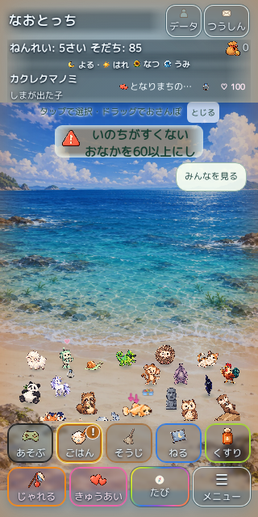
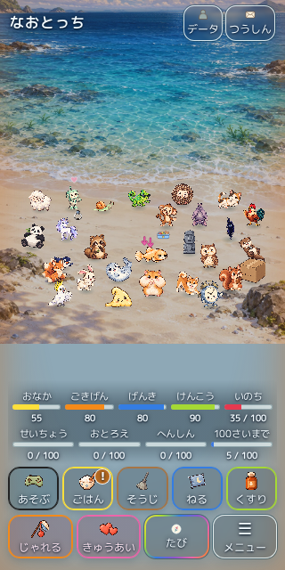
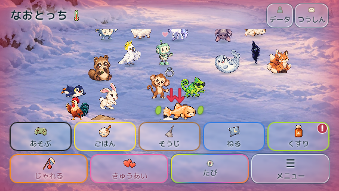

# 操作ボタン固定 — 検証記録・公開保留

対象PR: [#490](https://github.com/Naoto214/naotocchi/pull/490)。最終コードHEADは `59a5ea7e16dd865f622aee5914e35d06f716ae92`、ツリーは `4e22b082e73027d979103bbec8e578d05e572c9b`。ローカル検証コミット `af08b077` とリモートHEADのツリー一致を確認した。

**mainマージ・本番公開は実施していない。既存のみずべの連続操作・通知ブラウザー回帰が未解決で、必要な検証全体は未合格。** mainは `851cf09a80c7ed41ba7293888084272917e4582c`。元PR #426/#462は元のHEAD・Open Draftを維持し、本人限定v9サイトも変更していない。

## 修正内容

- 本番専用CSSでヘッダーと5＋4の育成ボタンを固定し、中央をスクロール可能にした。ボタンは44px以上、フォント・全体倍率は維持した。
- 既存380pxステージ、通知42px・会話76pxを維持し、会話とメーターの重なりを解消した。余白・ガイドの余白を整理した。
- 背景とキャストを同じ表示スクロール量で動かす。歩行領域、接地判定、モデル座標への代入、セーブ仕様は変更していない。
- 狭い横向き画面では、起動・回転時に既存の主人公DOMが見える中央スクロール位置へ移す。会話選択肢・個性選択肢の表示中は会話欄を優先する。通常の再描画は手動スクロールを戻さない。
- 長い会話・選択肢の最寄りのスクロール要素を使用し、横並びバッジの横スクロールも維持した。
- 歴史的プレビューは専用エントリーで分離し、既存テスト・判定閾値を削除・緩和していない。

変更は本番用レイアウト/タッチ処理、エントリー、配信リスト、追加テスト/CIに限定した。`script.js`、`home-production-model.js`、`home-production-diorama.js`、`home-production-world.mjs`、地形/接地関連モジュール、13地域の採用マニフェストは今回の開始点 `bb644d75` とバイト一致する。

## 成功した検証

| 検証 | 結果・証拠 |
|---|---|
| 固定レイアウト | Chromium 11/11。[layout-report.json](layout-report.json)、[ログ](focus-green.log.gz) |
| 画面サイズ | 320×640、320×568、375×667、390×844、430×932、568×320、667×375、844×390、932×430、390×844/844×390のセーフエリア設定 |
| 基本寸法・操作 | 9ボタンの実ヒット判定・44px以上・画面内配置、42/76px、380px以上のステージ、メーターとの非重複、ページ全体のはみ出しなし、zoom=1 |
| スクロール | 中央スクロール後も全操作ボタン位置不変。ChromiumのCDPタッチ入力で背景から中央をスクロール可能。会話/個性ポップアップ/バッジの境界処理も回帰テスト成功 |
| 起動・回転 | 主人公の可視性、手動スクロール維持、表示中の個性選択肢の可視性を追加確認 |
| 既存契約 | 365/365。[ログ](production-contracts-final.log.gz)。本番プレゼンター/モデルを使う既存契約群 |
| 互換性・資産 | 本番接続/旧セーブ/配信資産18件と、補完した既存画像資材256件、計274/274。[ログ](protected-visibility-final.log.gz) |
| パッケージ | テスト16/16。4,121ファイル、220,190,056 bytes。HTTP欠落0・ハッシュ不一致0。[集計](package-summary.json)、[HTTP検証](http-report.json) |

セーフエリアの検証は既存CSSの `env(safe-area-inset-*)` に値を与えた自動検証であり、iPhone Safari実機確認ではない。長文内部スクロールの回帰はキャンセル可否を確認するDOMイベントテストで、WebKit/iPhoneのネイティブジェスチャー成功とは区別する。

## 地域・体数・入力の再検証

最終312ケースの結果は [最終マトリクス](scroll-final-report.json) と [ログ](scroll-isolated-final.log.gz) に記録する。13地域×縦横8画面×1/6/28体を検証し、座標・接地・背景位置・固定ボタン・会話選択を確認する。おうちの各サイズ/体数では追加でネイティブタッチイベントのタップ/ドラッグを試す。途中の移動失敗で後続の会話/入力まで到達しなかったケースを合格扱いしない。

**最終独立マトリクス: Chromium 312/312成功、終了コード0。** おうちの24ケースでは実タッチイベントによるタップ/ドラッグも成功した。他地域の同マトリクスはモデルが認める経路と会話選択を確認し、物理入力の地域連続性は別の既存テストで扱う。

最終実行の後に先行プロセスが共通出力先の個票JSONを上書きしたため、そのJSONを成功実行の証拠として使わない。先行プロセスは停止した。最終結果の集計は、観測した終了コード0・`PASS ... 312` のログ・対象HEADのテストソースに基づく。

最終マトリクスでは各ケースのQA専用保存をリセットし、同一の初期条件から読み込む。横向きは、そのページで地域・体数を設定してから回転する。各ケースは独立した状態の検証であり、地域をまたぐ長時間セッション継続の合格を示すものではない。連続実行中に個性ポップアップが残った旧試行は [中断時の記録](scroll-sequential-interrupted.json) に保存した。既存の地域連続・物理ポインタ検証は変更していない。

既存 `tests/clownfish-romance-browser.cjs` を現行コードで単独再実行し、変化通知を期待するassertionに対して「84さいになった！\n群れのリーダーのメス」が表示される失敗を再現した。開始点のHome layout CIでも同じ失敗が記録されていた。今回のレイアウト修正では通知の内容や抽選を変更していない。[ログ](clownfish-current.log.gz)、[失敗画像](clownfish-notice-failure.png)。さらに、既存 `tests/home-production-browser.cjs` を最終ランタイムのみずべで再実行し、4幅×3体数の12ケース通過後、28体の物理ポインタ操作で `No physical-pointer destination` を再現した。歩行/接地判定を緩めずに失敗として保持した。[現行みずべ結果](river-lake-current.json)、[ログ](river-lake-current.log.gz)。これらの失敗と未完了CIを残したままマージしない。

既存の物理ポインタ検証は13地域中12地域成功、みずべで操作後の移動待ちがタイムアウトした。[集計](physical-summary.json)、[みずべ](physical-river_lake.json)。これは初回固定レイアウト版・Chromiumの結果であり、最終HEADの全ブラウザー成功を示すものではない。

初回195ケースおよび表示位置調整前の312ケースも保存した。後者は291成功/21失敗で、移動系に加えて568×320/もり/28体で背景とステージの相対位置検証が1件失敗した。旧結果を削除して再試験成功と混同しない。[195件](scroll-195-report.json)、[調整前312件](scroll-312-before-visibility.json)。

## 全体回帰・CI

ローカル全体回帰の初回は最初の32件/24件が成功し、次の3,291件は3,281成功/10失敗だった。2件は作業途中の未登録資産/トークン、8件は部分チェックアウトに不足したQA資材だった。資材をGitから復元し、該当グループの再試験（34件および上記274件）は成功した。初回の失敗で未実行となった後続159件/238件も別途成功した。**単一のクリーン全実行成功とは扱わない。** [初回ログ](full-regression.log.gz)、[資材補完後](restored-fixtures.log.gz)、[後続397件](regression-remaining.log.gz)。

最終HEADのCIは [Production 2.5D home](https://github.com/Naoto214/naotocchi/actions/runs/41059940785) と [全ワークフロー](ci-status.json) を参照。Chromium/WebKitの固定操作UIジョブを追加した。既存の全13地域ジョブ、Home layout、全体回帰等を維持した。待機中・実行中・キャンセル済みを成功として扱わない。iPhone Safari実機QAは未確認。

## レビューと回帰確認

独立した読み取りレビューで、長文スクロール先、横バッジ、再描画による自動スクロール、個性選択肢の回転時表示を指摘・修正した。手動スクロール維持は修正前527→220へ戻る失敗を再現し、修正後に成功した。[RED](focus-red.log.gz)。レビューで残る具体的な指摘はなくなったが、移動や実機操作の承認を意味しない。

GitHub認証を使う通常のgit pushが利用できなかったため、GitHub連携のblob/tree/commit APIで保存した。全blobとツリーをローカルGitハッシュと照合し、期待する直前HEADを指定した非強制の参照更新を行った。履歴の二重統合・main更新・本番配信は行っていない。
