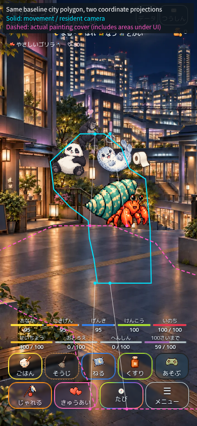

# ホーム移動 VERSION 4：左右非対称の原因調査

Draft PR: https://github.com/Naoto214/naotocchi/pull/557

保存コミット: 調査 `5fae97ea`、受付修正 `2f020ab7`、比較・検証記録 `4a9690c0`。

基準 Draft PR #556 (`23b19aaf`)。既存PR #554/#555/#556、main、本番サイト、既存比較サイトは変更しない独立ブランチ `codex/home-movement-v4-audit`。

## 原因分析

**右への拡張と引き換えに、左の描画保護境界を狭めたわけではありません。しかし、見えている床と歩行判定が一致しておらず、4体配置では左側の拡張をほぼ使えていません。** 今回はその原因を分離し、別に確認された操作拒否の小さな不具合だけを試作修正しました。主要方向の追加拡張に成功したという報告ではありません。

1. **背景と歩行領域が異なる投影。** 同じ背景点が、歩行系では実背景より182～249 CSS px上に現れます。横幅も実画像側の約40.35%へ圧縮されています。これは従来版からの表示設計で、V1～V3の新しいカメラずれではありません。下左の舗装が空いて見えても、別の場所に投影されたポリゴンで止まる構造です。単純に実背景へ合わせると下部UIへ移るため、そのまま変更できません。[座標の証拠](coordinates.md)
2. **右側は旧版の装着物余白が大きかった。** 描画保護の足元限界は従来x=132.703～245.885、V3は109.924～280.072。左も22.778px、右は34.187px拡張。V3の中心194.998は画面内保護枠の中心と一致しています。[描画・装着物の証拠](extents.md)
3. **4体では左のポリゴンと他個体が通路を制約。** 同じカメラで他個体を除くと、実際の左到達点はV3で175.340→110.082になります。左右余白だけを広げても、この通路の制限は解消しません。
4. **約1.17pxの反転描画ずれも存在。** 本体のalpha中心を指定したCSSが、優先度の高い旧CSSに上書きされています。これは従来版からあり、足元・接触中心は動きません。大きな左右差の主因ではないため今回は未変更です。
5. **比較ページにも横切れ。** V3の固定390px iframeを390pxの親画面内に余白付きで配置すると、初期状態で右32pxが隠れます。ゲーム内座標とは別の問題です。今回の比較資料はiframeを使わず同じ操作結果を重ねます。既存公開ページは変更していません。



水色＝歩行系。赤紫破線＝同じ頂点を実背景coverへ投影。後者はUI下にも入り込むので、そのまま安全な歩行領域とは扱えません。V3の追加三角形ではなく同一の旧ポリゴン頂点を比較し、投影だけを分離しています。

## 実到達値

390×844 CSS px、都市・夜、ヤドカリ大きな貝、トイレットペーパー、ゴリラ・パンダ・アザラシの4体。Safe Area下34px模擬。同一開始配置から同じ外周48px刻みのドラッグ候補群を実ポインターハンドラーへ入力。最端値の入力先は版によって異なることがあります。全連続操作の数学的限界ではありません。

| 対象 | 従来版 | V1 | V2 | V3 | V3−従来の改善量 |
|---|---:|---:|---:|---:|---:|
| ヤドカリ 左 足元x |178.489|175.881|175.881|175.340|3.149px|
| ヤドカリ 右 足元x |245.885|280.072|280.072|280.072|34.187px|
| ヤドカリ 上 足元y |433.741|422.017|422.017|418.140|15.601px|
| ヤドカリ 下 足元y |531.868|535.113|535.113|535.113|3.246px|
| アザラシ 上 足元y |288.884|294.333|288.884|279.746|9.139px|
| ゴリラ 上 足元y |274.448|271.738|269.573|269.573|4.876px|

これらは従来版と既存V3の比較で、V4試作による追加改善量ではありません。今回の試作でヤドカリ4方向・アザラシ上の最良値は変わっていません。V3報告の精細探索535.123pxと本表535.113pxの約0.01px差は候補操作の刻みによるものです。

本体・貝殻の左描画端は116.329→113.420px、改善2.908pxです。足元の大きな理論拡張を、そのまま見た目の改善量としていません。装着なし、固定カメラ単独、他個体を安全な別配置へ移した結果は[全測定表](measurements.md)に記録しました。

[同一操作の重ね合わせ比較](comparison.html)（ローカルHTML、静止画、12組）。版ごとに異なる最良操作を重ねず、同じ入力先で撮影した結果です。装着ありの比較画像を収録し、装着なしを含む全測定データは[diagnostics.json.gz](diagnostics.json.gz)、比較画面の足元・本体・装着物・経路は[matched.json.gz](matched.json.gz)。

## 方向別の診断

実行ログでは、選ばれた目的地への到達、受付拒否、途中キャンセルを区別。さらに到達点から指定方向へ0.25px刻みで延長し、最初に不許可になる条件を記録しました。**この延長検査は停止イベントや迂回不可能の証明ではありません。**

| 条件 | 到達点の先の局所制約 | 解釈 |
|---|---|---|
| ヤドカリ左・4体 | 0.75px先で歩行ポリゴン | 描画保護の左限界まで65.42px残っている |
| ヤドカリ左・単独／カメラ固定 | 0.25px先で描画保護 | 接触を除くと左の拡張を実際に使える |
| ヤドカリ右 | 0.25px先で描画保護 | 旧装着物余白の解消が実到達へ反映 |
| ヤドカリ上・4体 | 0.75px先でアザラシ接触 | 他個体の配置依存 |
| ヤドカリ上・単独／カメラ固定 | 0.25px先で描画保護 | 装着物上端と動きの余裕が必要 |
| ヤドカリ下 | 0.25px先で描画保護 | 保護枠下端まで約10.86px。既存の下方向描画余裕8×深度＋揺れ3px |

足元は本体alpha矩形の中央下端、接触は足元中心の個体ペア楕円、選択判定は別の矩形です。上下中心が違うこと自体は不具合ではありません。今回の代表最端では遮蔽が最初の局所制約ではありませんが、全領域で遮蔽が無関係とは主張しません。

## 確認できた退行と限定修正

### 採用した小さな試作

V3の補助探索が、開始点から3 native px未満の「近い候補」で既存経路を置き換えた後、最終受付条件 `<3` で操作全体を拒否していました。補助候補にも同じ `>=3` 条件を適用し、受け付けられる経路を保持します。接触・遮蔽・境界・カメラ・サイズの条件は変更していません。

装着なし・元4体配置・ゴリラ左の同一入力 `(1,482)`：V3では不受付で足元 `(179.101,295.794)`、試作では受付して `(180.413,303.293)`へ到達。従来版の足元x=181.382より右へ後退していません。ただし指の左方向へそのまま移動した例ではなく、障害物を考慮した代替目的地です。**左端が拡張したと数える結果ではありません。**

### 採用しなかった変更・残る退行

装着あり・元4体配置・ゴリラへ入力 `(2,545)` または `(50,545)`：従来版の足元 `(181.382,294.951)` に対しV2/V3は `(162.711,269.573)`。下方向が25.378px後退しています。これは右寄り候補への平行移動ではなく、到達不能な拡張候補から別候補へ切り替えた後、古い安全な経路を再検討しないためです。

古い経路はV3でも安全で到達できます。しかしそれを常に優先すると、この斜め入力の左成分がV2/V3より18.671px戻ります。両方を保持できる経路は現行探索で見つかりませんでした。接触を緩めたり、一方を改善しただけで全面改善と扱ったりせず、この優先順変更は採用していません。`(98,545)`・`(146,545)`にも従来版より下へ届かないケースが残ります。[詳細な候補・経路記録](../../../tools/home-movement-v4-audit/fallback-tradeoff.json)

従って、**全方向・全個体で従来版から後退がないとは言えません**。主要5方向の今回の操作群には後退を検出しませんでしたが、追加したゴリラ検証で上記を発見しました。

## 検証・限界

- 従来/V1/V2/V3、装着あり/なし×3配置、44方向条件、1,760ポインター試行。カメラ一致と各試行の開始位置を確認。途中停止ログ・計画経路を4版すべて同じ方法で記録。
- 試作Eへ390pxの440操作、375pxの135操作、430pxの126操作、320pxの34操作、計735操作を再入力。375/430/320はV3の保存済み同一開始配置・操作を再生。V2/V3で受け付けた操作について受付喪失・方向別後退0件（許容0.8 CSS px）。従来版に対するゴリラ下の4ケースは残存。これは有限の操作集合の結果で、全入力保証ではありません。[集計](counts.json)・[基準を含む試作の全記録](prototype-evidence.json.gz)。
- [13地域×4時間帯の52画面](regions.json)で背景読込、通知・76pxセリフ表示中のドラッグ、描画枠内を確認。[自律移動](autonomy.json)は4体・28体各1,200秒で新規接触・既存接触の悪化0、V3追加地面への訪問あり。全配置・全装備の保証ではありません。
- 比較HTMLは320/375/390/430pxで画像読込、12条件の選択、枠と濃さの切替、横はみ出しなしを確認（[comparison-qa.json](comparison-qa.json)）。
- 新規5件を含む移動・境界・V2/V3の29テスト成功。3pxのドラッグ／自律移動2件は修正前に失敗することを確認。
- iPhoneの5枚は人数・装着物・配置変化・横切れの調査資料として参照しました。正確なSafari viewport、ズーム、親iframeスクロール、各個体のnative保存位置は画像だけでは復元できません。スクリーンショット座標をこの測定値と同一だとは扱っていません。
- **実機iPhone Safariでの再検証は未実施。** Chromiumモバイル設定のmouse由来ポインター操作であり、実タッチ・Safariツールバー伸縮・実Safe Areaは未検証です。
- 本体・装着物・52背景・通知・セリフ・UI・保存形式に変更なし。背景投影、ポリゴン、接触楕円、反転CSS、既存比較ページも未変更。

## 再現

```sh
# 出力は新規ディレクトリを指定（既存出力は上書きしない）
node tools/home-movement-v4-audit/build.cjs /tmp/v4-audit
REACH_DIST=/tmp/v4-audit REACH_OUT=/tmp/v4-equipped node tools/home-movement-v4-audit/measure.cjs
V4_ITEM=0 REACH_DIST=/tmp/v4-audit REACH_OUT=/tmp/v4-none node tools/home-movement-v4-audit/measure.cjs
V4_SOURCE=/tmp/v4-equipped/diagnostics.json REACH_DIST=/tmp/v4-audit REACH_OUT=/tmp/v4-matched node tools/home-movement-v4-audit/matched.cjs
V4_SOURCE=/tmp/v4-equipped/diagnostics.json REACH_DIST=/tmp/v4-audit REACH_OUT=/tmp/v4-prototype node tools/home-movement-v4-audit/prototype.cjs
REACH_DIST=/tmp/v4-audit REACH_OUT=/tmp/v4-coordinates node tools/home-movement-v4-audit/coordinates.cjs
node --test tests/home-movement-v4-test.cjs tests/home-movement-v3-test.cjs tests/home-movement-v2-test.cjs tests/home-movement-bounds-test.cjs tests/home-production-model-test.cjs
python -m http.server 8000 --directory docs/qa/home-movement-v4
# http://localhost:8000/comparison.html
```

A/B/C/Dは固定版、Eが本ブランチの限定試作です。QAのモデル復元・計測フックは生成物だけに入り、本編保存データへは書き込みません。
