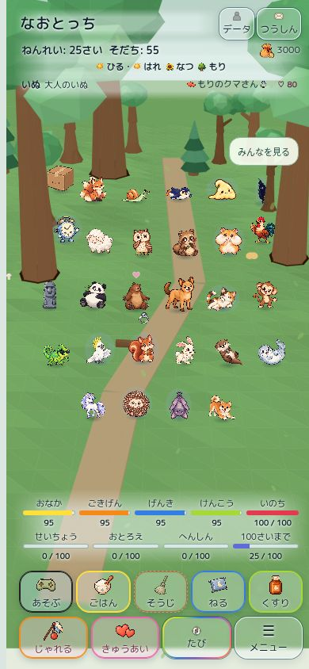

# version 15 継続作業（2026-10-25）

初回本体 `1fc96db7`、依存照合補正 `10a14f53`、通常ホーム回帰修正 `67c835cb`、無限モード実表示補正 `2ec45ab8`。

## 原因と修正

1. Pages runtime package CI は `runtime source changed: index.html` で停止。v15で変更された index.html / script.js / home-diorama.js / home-diorama.css の照合用ハッシュがv14のままだった。差分内の静的依存61/41/1/0件はすべて変更なし。計算されたURL・正式画像boundsの利用にも新規素材依存はない。4つのレビュー済みハッシュだけ更新し、allowlistの範囲・上限・除外・検査を保持した。
2. Home layout CI のChromium/WebKit双方で320×568・large textの通常Homeが `meters clipped`。HTMLでいのちゲージを恒久的に移したため、通常ホームの従来CSSと食い違った。共通HTMLは元の4+5を保ち、3Dホームの表示ライフサイクルだけが同じDOMノードを5+4へ移動する。非対応地域への切替・画面終了・destroyで元の順番へ復元する。既存のブラウザ境界チェックは変更していない。

3. 独立レビューで、移動後のいのちゲージに `.hidden` は付くがCSS規則がなく、無限モードで実表示が残る点を発見。`#deathMeterItem.hidden` だけを非表示にし、QA判定をclass名からcomputed styleへ変更。5サイズすべてで実際の非表示を確認した。

## 検証記録

- 誤った初期HTML順とterrainだけの移動/復元について先に失敗を確認。
- 修正後、新規ライフサイクル試験を含むv15＋asset version 12件成功。forest/home/city/mountain/river_lake切替、反復render、destroy、単一ノードの順番、無限モードを検査。
- 初回の105画面マトリクス・上部20ケースのJSONはerrors=0で、画像も保存済み。今回の修正では3Dホームの表示順・内容を保持し、通常画面へ戻す責務を補正した。
- 依存ハッシュ補正後の配布物4,062ファイルをHTTPで検査。missing_files=0 / hash_mismatches=0、452カード・904画像、非公開対象7経路の404を確認。最終ライフサイクル補正後も静的1,695／動的2,954参照の検証成功。

本番Pagesのdeployとmainマージは実行していない。本人iPhone Safari QAは未実施。

## 継続作業の追加検証

- 最終コード `2ec45ab8ba03a0fb4aef169e454faf5ee13951e6` のv15・asset token・v12レイアウト・home information関連19件成功（[followup-focused.log](followup-focused.log)）。
- Pages配布検査のPython 16件成功。最終配布物は4,062ファイル / 213,585,307 bytes、missing=0 / hash mismatch=0。静的1,695・動的2,954参照、452カード・904画像と7つの除外経路404を検証。
- 修正後の上部境界20条件も問題0（[header-edges-reviewed.json](header-edges-reviewed.json)）。無限モードはclassだけでなく実際の`display:none`を5サイズで確認。
- 継続作業の独立レビューでDOM移動・復元順・重複・destroy・cache tokenを確認し、指摘された無限モードの実表示を修正。

## 本人限定試遊への反映

- [同じ試遊URL](https://naotocchi-home-diorama-20261022.kerzion214.chatgpt.site)へv15を反映。Sitesの保存番号は **19**（UIの機能版 **v15** と別の番号）。
- Sites source: `21e52c37d2cf6ac470c8324fcce7e09612d84420`。保存・デプロイは2026-10-25 03:56 UTCに成功。
- 公開範囲は本人のみを保持。通常試遊save key / QA save key / 本番save keyは引き続き分離。
- 公開後URLはこのクラウドブラウザではChatGPTサインイン画面まで確認。公開後のゲームUIをログイン越しに検証したとは扱わない。同じソースの管理プレビューで追加のブラウザ検証を実施。
- 本番Pages更新、mainマージ、PR Ready化は実行していない。実機Safariと長時間性能は未確認のまま。

## ローカル一括回帰の確定結果

今回の一括再実行は **3,634件成功 / 失敗0 / exit 0**。197＋26＋24＋3,225＋138＋9＋15件と既存smoke/dialogue/visual検査を完走した。[集計](full-test-followup-summary.json)、[全ログ（gzip）](full-test-followup.log.gz)。

一括実行は追加修正前の `1fc96db7` で開始し、長時間の実行中に表示層の追加修正を行っている。最終SHA全体を新規に一括実行した結果とは表記しない。最終 `2ec45ab8` に対する関連19件とブラウザ再検証を併記する。前回の資料欠落によるexit 1とは別の今回の結果である。

修正後の同一ソースで再実行した[105画面マトリクス集計](browser-matrix-reviewed-summary.json)（[全データgzip](browser-matrix-reviewed.json.gz)）も **105件 / 問題0**。3地域・7人数・5サイズで固定会話欄、ゲージ5＋4、人数保持、通知の排他表示、主要領域の不変を再確認した。

これは管理プレビューの固定QAデータによるクラウドChromium描画で、公開URLのログイン後画面やiPhone実機の証跡ではない。

## GitHub CI（追跡中）

対象は最終ゲームコード `2ec45ab8`。5系統成功、残り3系統は実行中・待機中。小画面の既存home-layout-regressions検査は修正後に通過し、Home layout全体の後続検査が進んでいる。完了していない系統を成功扱いにはしない。

| 系統 | 状態 |
| --- | --- |
| [Naopoyo integration](https://github.com/Naoto214/naotocchi/actions/runs/40159873110) | success |
| [Naopoyo slide series](https://github.com/Naoto214/naotocchi/actions/runs/40159873093) | success |
| [Home layout](https://github.com/Naoto214/naotocchi/actions/runs/40159873099) | in_progress |
| [Naopoyo official release](https://github.com/Naoto214/naotocchi/actions/runs/40159873077) | success |
| [Runtime smoke test](https://github.com/Naoto214/naotocchi/actions/runs/40159873229) | in_progress |
| [Naopoyo Chapter 1](https://github.com/Naoto214/naotocchi/actions/runs/40159873076) | success |
| [Pages runtime package](https://github.com/Naoto214/naotocchi/actions/runs/40159873068) | success |
| [World visual quality](https://github.com/Naoto214/naotocchi/actions/runs/40159873073) | queued |
