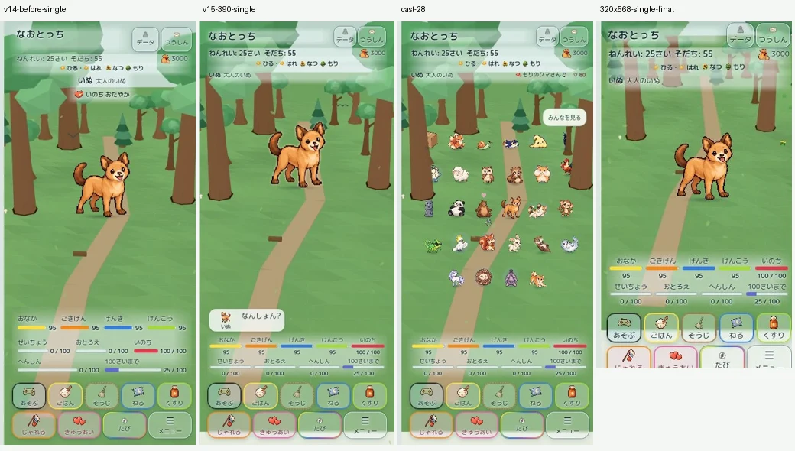
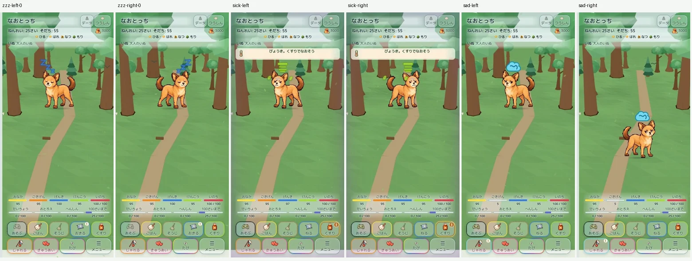

# Home version 15 — 表示システム統合

対象は既存 Draft PR #426。基準は v14 `d8dd63c116cfc0bffb6595b86548c9aebea4a93c`。mainへマージせず、本番GitHub Pagesと本番セーブは更新しない。本人のiPhone Safari実機QAは未実施。

## 実装と監査

[全81要素・10項目の監査](AUDIT.md)と[通知・会話生成経路](notification-sources.csv)を収録。状態、イベント、会話、正確な数値、操作をそれぞれの表示領域へ整理した。

- 上部はタイトル＋獲得バッジ＋メニュー／太字の年齢・そだち＋右端のお金／環境4項目／主役＋恋人の4行。温度計の正体は獲得実績ではなく病気バッジ。上部の重複をなくし、病気警告と身体状態表現を残した。
- 獲得バッジ5種は既存条件・昇順・全件表示を維持。狭い場合はタイトル横で横スクロール。長い恋人名は名前部分のみ省略し、親密度・指輪を残す。タップで既存データ画面を開き全文を確認できる。
- 通知領域は常時42px、内容は最大40px。空の背景は透明。イベントの既存キューを再利用し、終了後は現在の病気・生命/健康警告へ戻る。複数の重要状態は優先状態と病気を同じ欄に並べ、長文は欄内で読める。空腹・疲労・睡眠は表情とゲージへ。
- 9パラメーターの通常差分はHome adapterの表示境界で除外する。`careFeedback`、履歴、イベント本文、実際の値・報酬・ペナルティを削除しない。誤投薬の説明やコイン報酬、重要イベントは残す。
- 通常会話は中央生活領域の下、パラメーター直前の固定76px。正式画像24px＋名前＋基本14pxの本文。短文は可変幅、長文は最大3行で欄内スクロール。選択肢は同領域の直上、既存の二重送信防止を維持。選択結果中に別のセリフが出た場合は結果22px＋会話最大48pxで両方を表示する。
- パラメーターは日々5（おなか・ごきげん・げんき・けんこう・いのち）＋人生4（せいちょう・おとろえ・へんしん・100さいまで）。名前／ゲージ／数値の順。正式な色・数値・範囲を維持。無限モードでは従来どおり人生系といのちを隠す。育成ボタン5＋4の機能・並び・注意マークは維持。
- 小Zの頭部アンカーを保ち、各Zの横距離と浮動方向を別々に制御。右は右上、左は左上。文字を鏡像化しない。病気・しょんぼり・喜び等は正式画像bounds中心と既存頭部アンカーから左右座標を共通変換。汗は左右の発生位置を交換し、グリフの向きと縦アニメーションを維持。
- Relationship Expressionのpositive＞lonely＞normal、ハート、指輪、選択マーカー、Motion v2の所有する身体変換は保持。新しい食事・箒・投薬アニメーションは制作していない。
- 通知と会話を地形stage外に確保し、全役共通の安全地形・経路探索を維持。エフェクト分の上端余白を一定にし、通知/会話の出入りでカメラ・縮尺・移動範囲を変えない。短画面は縦スクロールを許可し、ゲージとボタンの重なりを防ぐ。

390×844・28体の既存v14測定とv15測定では、stage上端は234.9→170px（約64.9px上へ）、高さは334.9→374px（約39.1px増）。下部76pxの会話領域を確保しながら、生活領域も増やした。通知やセリフの文字数による増減ではない。

## 視覚証跡

[画像一覧](images/)には、v14基準、上部4行、恋人なし/あり/結婚、長い名前/全バッジ、320px、各通知・短中長文/英語・実選択と返答、左右Zzz/病気/しょんぼり/喜び、極値/100歳進捗、1/2/6/13/20/28体、森/水辺/都会を保存。`.png`は操作パネル込みのブラウザ原本、`.webp`は同じ画像のゲーム部分切り出し。`images/index.json`に切り出し座標を保存。

画像はクラウドChromiumの実描画。物理iPhoneの画面ではない。通常プレイ版と、時間/状態を固定したQA版は区別する。QAの選択結果は撮影のため延長しているが、通常プレイ版の時間は変更していない。ランダムな仲間勧誘モーダルは撮影専用版で停止し、通常版では維持している。

## 自動検証

- 新規v15テスト9件。通常差分の全9系列、重要文/報酬の保持、状態不変、病気復帰、タイトル病気重複なし、ゲージ順、長い名前の詳細導線、左右アンカー、248以上の正式段階画像×4代表状態、無限モード、選択結果中の薬の既存セリフを検査。
- 独立レビューの2件（無限モードの移動後いのちゲージ、結果表示中の会話消失）は失敗テストで再現後に修正。既存テストを削除・弱体化していない。
- [browser-matrix.json](browser-matrix.json)：3地域×7人数×5サイズ＝105画面。1/2/3/6/13/20/28体、320/375/390/430pxと320×568。各画面で8状態を切替、人数・5＋4段組・横はみ出し・会話欄とゲージ非重複・病気・通常数値除外・主要領域の位置/高さ不変を検査。
- [final-display.log](final-display.log)：最終表示/asset token/既存レイアウト契約15件成功。
- [review-final.log](review-final.log)：v15/会話選択/asset token20件成功。
- [naopoyo.log](naopoyo.log)：growth-chain全unit130件成功。その他なおぽよプロトタイプの新規ブラウザ試験は未実施。
- [card-game.log](card-game.log)：正式ルール・保存対戦UI・iPhone UI契約44件成功。

全回帰・CIの確定結果は本書末尾の実行結果を参照。台詞・抽選・頻度・44体掛け合い、Relationship、Motion、地形、セーブの正本データは変更していない。QA画像不足で失敗した過去資料はGit正本から取得して検証し直した。

## 性能と限界

[observation.json](observation.json)は1/13/28体を各30秒、通知と会話を切り替えた短時間観測。描画モードはクラウドの`canvas-3d`。RAF中央値は約1016ms、背景draw平均8〜10ms。約1fpsという観測条件のため、iPhone性能の合否や実機60fpsを主張しない。13体/28体で既存の散歩・休憩・観察等の活動と座標移動を記録。主役のみの試料では通知/会話中の既存停止条件が多く、自律移動は記録されなかった。

`sameScene:false`はupdateが毎回作る軽量なscene記述子の比較であり、3D rendererの再生成回数ではない。既存`ensureWorld`の単一world保持と、`projectionRevision:1`、描画オブジェクト数の維持を確認。エフェクト更新はWeakMapでDOM/向きが変わる時だけ書き込む。30秒観測は長時間メモリ安定性の証明ではない。

iPhone Safariで最終確認する項目：左右Zzzの見え方、320pxのバッジ横スクロール/恋人名タップ、長文の欄内スクロール、選択肢の連打、28体のドラッグ/自律生活、画面回転、バックグラウンド復帰、WebGL復帰、長時間発熱・メモリ。ブラウザ自動検証を本人実機QA完了扱いにはしない。

## 試遊版と保存境界

[既存本人限定試遊URL](https://naotocchi-home-diorama-20261022.kerzion214.chatgpt.site)を継続。通常試遊キー`naotocchi-home-diorama-preview-v1`、QAキー`naotocchi-home-v15-qa-v1`、本番キー`naotocchi-save-v1`を分離。既存試遊データの互換性を保持。

再現用`tools/home-v15-qa.cjs`は、既存Sites source v14 `9cfbc2c9d7365a35ae4376dc06f11d5392bf320e`のdistを入力として、ゲーム本体とv15固定fixtureを更新する。GitHub本体にはQA APIを混入しない。

[Draft PR #426](https://github.com/Naoto214/naotocchi/pull/426)を継続。新規PR作成、Ready化、mainマージ、本番Pages更新は行わない。

正式な睡眠Zzzは既存仕様では主役に実装されている。仲間/恋人には既存rest/sit等を維持し、新しい睡眠ルールを足していない。全画像/役割の座標変換検査と、実際の睡眠スクリーンショットを区別する。

追加の[上部境界20ケース](header-edges.json)では、5画面サイズで通常/全5バッジ＋長い恋人名/恋人なし/無限モードを確認し問題0。最終の320pxバッジ画像は `images/320-badges-final.webp`。`320-long-name-badges` は修正前のはみ出しを記録した画像で、最終採用画像とは区別する。

[睡眠→左右切替→起床の観測フレーム](images/sleep-sequence.gif)は操作の連続静止画で、高FPS動画ではない。マトリクスの25msサンプル2件にcritical表情画像の読み込み途中が記録されている。ファイル欠落ではなく、後続の極値画像と正式PNGのテストで描画を確認した。

最終補正後の[表示・通知・会話関連41件](final-runtime.log)成功。通知queue自体はv14と同一で、ゲーム結果などの別イベントを文章の一致だけで落とさない。重複の解消は状態文の表示先統一と単一slotの排他表示で行う。

## ローカル実行結果

`npm test`に列挙された全コマンドをNode test並列数4で実行。前半197＋26＋24件、主回帰3,225件、後半138＋9＋15件（計3,634対象）、既存smoke/dialogue/visual検査を実行した。最後の一括実行は過去資料`compare.html`が疎な取得対象から再び外れたため1件失敗し、exit 1。これを成功とは表記しない。

不足ディレクトリを取得対象に固定した後、当該検査・PNG正本・めぐるを含む285件を[補完再検証](fixture-recheck.log)し全件成功。&&で未実行になった後半162件も[独立実行](tail-final.log)で全件成功。最終表示・runtimeの41件も成功。現時点で未解決の再現するテスト失敗はない。一括の最終成否はGitHub完全checkoutのCI結果で確認する。

途中の別実行では、無seedのめぐる住民nearest検査が1回失敗した。v14/v15各8回の単独実行では再現せず、その後の全体実行と補完検査でも成功。シミュレーションや既存テストを変更して合格させていない。
