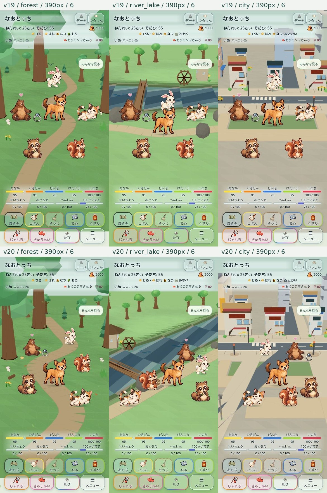

# Home v20 — validation and handoff

Start: PR426 open Draft, `d9586c7ea6cbfffaf0d6d2bf3ee0ca688df51759`. Main `f16e0f372a3171b3576d5746d1ade4cc90c64d79`. No merge or production Pages action.

## Why v19 still looked alike
Small casts used the same screen-space ellipse/cross, with terrain correction only afterwards. A distant horizontal river and road left a shared open foreground. Home v20 projects regional world seats through the same camera/terrain used for navigation. Main stays at the focal seat even with28; companions occupy distinct depths, then use the existing visibility/separation solver. Screen resize reprojects previous world positions.

## Changes
- Forest: a narrower winding trail, near/mid giant trees and a log, existing relief/shade/flowers and ambient fauna.
- River: diagonal broad channel through the near-left view, aligned bridge and bank path, waterwheel/cottage, rocks/reeds, fish positions transformed into that same river.
- City: connected foreground avenue, sidewalks/pocket-park paths, near houses/lamps/trees; roads excluded by actual segment distance.
- Perspective: camera-depth ratio clamped0.8–1; official DOM art and accessories scale about their shared foot point. Existing triangle masks and shadows remain aligned. No art replacement.
- Navigation now checks the resident/visibility predicate along a complete route, not only at the goal. Crowded seating examines nearest candidates first without changing the chosen safe seat.
- Environmental gaze/rest approaches point toward actual trees, water, bridge and traffic. Dialogue, eligibility, frequency, growth effects and save schema are unchanged.
- All13 region descriptors remain extensible; the other10 remain planned, not silently implemented.

## Visual evidence
Matched390×844, summer/sunny/day, adult dog age25, six official actors. Baseline is exactv19 runtime geometry/model/CSS with the same synthetic fixture. Cloud Chromium uses canvas-3d fallback; these are not iPhone screenshots.

[Region-label-free scenery](scenery-without-region-labels.jpg). Main focal visibility and six-depth spread checked; 28forest actors visible and on valid terrain at390px. Other width/cast combinations and interaction reports are recorded below as available; do not infer unmeasured device success.

## Verification ledger
- Failing-first v20 tests: regional seats, perspective bound, diagonal river/foreground road, delayed navigation seating; review regressions for bridge transverse alignment and crowded resize; route-predicate obstacle regression RED→GREEN.
- Independent review found bridge-part shear and resize fallback; both fixed and independently verified. Nearest-first seating reviewed for equivalent tie behavior.
- Final focused home/navigation/adapter/artifact-integrity:60 passed,0 failed. Separate conversation/motion/save/shared-terrain protection:89 passed,0 failed. Counts overlap conceptually and are not a full-suite claim.
- v19 CI direct failure: Home layout run40469917932/job122074277607 timed out waiting for #rawReport after240s. Later strictv18 checks were skipped. This is distinct from the documented40→34px header shrink.
- Header min-height34 allowed a40px button row to shrink after compact landscape. Candidate minimum is40px, with existing strictv18 assertions retained; v20 asserts ≤1px rotation displacement. No tolerance widened.
- Early cloud stress run reported0px rotation in completed cases, but stalled during repeated transitions. It also caught a320px river/6 movement blocked by a resident; route predicate fix followed. These incomplete runs are not passes.
- Final48-case harness reloads the isolated game for each independent condition and still rotates every case. Legacyv19 stress matrix remains intact; its runner now has a per-case60s watchdog instead of a silent aggregate timeout.
- Full npm suite was first resource-aborted; an identical bounded-concurrency4 run is tracked separately. Never treat an interrupted run as success.

## Protected and pending
Notice42px/speech76px, upper4 rows,5+4 meters/buttons, v18 typography and100-year progress unchanged. Formal cast registry/relationships, Motionv2, Conversation Director/v2,44-character dialogue and save schema are untouched.

Owner-private preview keeps its existing access and `naotocchi-home-diorama-preview-v1`. v20 QA uses `naotocchi-home-v20-qa-v1`; baseline uses its own comparison key. Neither reads production saves.

Owner iPhone Safari QA still required: touch/drag, small-width28 visibility and scrolling, repeated rotation/background return, save resume, real GPU/reduced-motion behavior, thermal/battery/long-session performance. Cloud timing is not an iPhone benchmark. Remaining10 regions follow only after owner review of these3. Draft/main/Pages restrictions remain.

## Final local follow-up
- Existing-overlap escape preserved: route forbids new/worsening overlaps, destination must be free, each movement step still requires improvement. Regression and independent reviewer reproduction pass.
- Individually verified390px/6 forest: tap selects main, drag moves it across terrain with safe/visible=true; rotation header40→40, stage top delta0, slots42/76. [DOM record](manual-390.json).
- Cloud continuous48-case attempts remain incomplete/stalled; no full browser-matrix pass claimed. Fresh WebKit/CI and actual iPhone remain required.

## Full-suite completion
The bounded-concurrency4 command (same package.json test list, no skipped tests) exited0:3,659 Node tests across7 blocks, all0 failures, plus smoke/dialogue/visual scripts. It started before the final Home route/escape follow-ups; the final affected Home/navigation/adapter/asset suite was rerun separately:60/60. Therefore final-HEAD CI is still required; this is not a fresh full-suite run of that final HEAD. [Full log](full-suite.log.gz) · [Final focused log](focused.log).

## Crowded river follow-up
A synchronous hotspot was isolated: nearest-seat queries eagerly constructed every routing edge for each different actor bound. Nodes are now cached independently; edges are materialized only for an actual route. The exact320px river/28-bounds benchmark dropped115,108→4,916 terrain checks and2,570→138ms with identical seat outputs (Node development environment, not iPhone). New regression failed before and passes after. Final focused suite61/61.

320px river28 now renders; all28 are on valid terrain. Two conservative visibility probes report partial occlusion near the wheel/rock, while the protagonist remains central and visible. This dense view needs owner QA. [Screenshot](river-320-28.jpg). Continuous48-case validation is rerunning; do not infer a pass until its final report.

## 2026-10-27 continuation: crowded main-character exit

Resumed from `bed67365980af90af5e5695111a813d54fb8b267`. Its final CI had seven successful workflows and one failed Home layout workflow. The separate v20 job completed successfully in Chromium and WebKit (48 cases each); the legacy v19 continuous matrix failed at 375px / river / 28 actors. That fixture uses the older dog body, whereas v20 fixes the dog at age 25. These are distinct fixtures, so the v20 pass did not resolve the legacy failure.

The failed CI's exact 28 actor positions reproduce the blocked movement in Node with the same camera/terrain coordinates. Individually valid, separated seats formed a closed ring around the main character; narrowing the path grid alone did not solve it. Initial/cast-change/viewport seating now reserves a short safe walking corridor for the main character and places surrounding residents outside it. The corridor is selected among eight terrain/visibility-safe directions, preferring the fewest displaced residents. Ordinary unchanged syncs do not reserve a new corridor. Collision distances, route checks, step checks, UI, dialogue and save data are unchanged.

The stored-coordinate regression fails before the fix and passes after it, including actual movement beyond 10px and safe terrain for all 28 actors. Focused home/model/navigation/adapter/cache checks: 58 passed, zero failed. Independent read-only review found no actionable issue; it additionally verified stable ordinary sync, zero overlaps, and movement through 28→27→28→26→28 population changes. Browser/CI follow-up results are reported in PR #426; actual iPhone performance is still unmeasured.

Cloud Chromium follow-up of the legacy continuous matrix: **24/24 cases, errors=[]**, all rotation deltas **0px**, including 375px river/28. Four widths (320/375/390/430), three regions, counts 1/28. The browser's synthetic fixture is isolated from production and preview player saves. Package dependency review found only the modified model logic and the matching index cache token; no new runtime URL or dependency was introduced. Updated exactly these two reviewed source hashes and rebuilt the unchanged allowlist.
