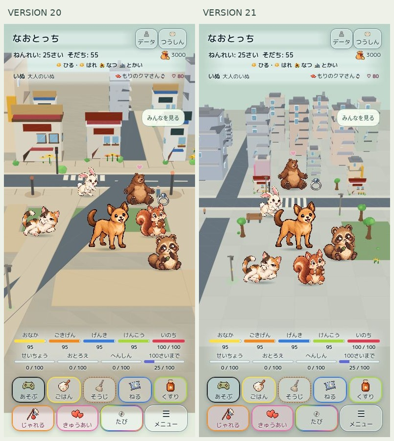

# Home v21 — high-rise city, owner device QA pending

Start PR426: `a77fd1e3888acd6a2cd46076bf64a66e6357af28`, Draft/open. Actual live main at start: `132e39a7aeccfa5e1706b510f29d649d3aab4518` (PR metadata had an older base). Start CI: 7 success, Home layout cancelled. No merge or production deployment.

## Root cause and repair
The visible beige rectangle was the exposed end of the v20 park-walk strip at z110–370, not an unknown texture. That strip, the foreground diagonal road and sidewalks were independent boxes with overlapping top faces at y1.2. Convex polygon intersection reproduces overlap in the old composition; it fails before and passes after. Identical depths are ambiguous for the GPU, and the fallback's triangle-depth painter visibly produces diagonal wedges. City relief is zero. Actual iPhone GPU pixels have not been remotely measured; do not infer a GPU device pass from the cloud image.

City paving is now one disjoint partition: sidewalk/plaza tiles, park lawn, curbs and crosswalk stripes share cut boundaries. No cover object masks the old rectangle; its generating strips are removed. Home city uses top faces rather than ground boxes. Logical street geometry remains separate from tessellation, with exact road-rectangle distance plus the existing45-unit margin. A raised pavement crossing preserves the formal pedestrian route at z1150. Cars retain z1400. The source shared Meguru world is unchanged.

The first partition implementation exposed a review-found bug: treating every rectangular paving row as a capsule blocked safe sidewalk. A regression at x=-450/z300,500,900 fails before and passes after. Logical road geometry also removes unnecessary per-step tests against hundreds of paving pieces. Existing tests are retained unchanged.

## Scenery
13 formal tower variants at staggered depths, two low buildings, park trees, six-part low-poly benches, lamps, signals and formal car. High buildings repeat the formal window-frame pair within a bounded part budget. Windows retain the established Home glass palette and emissive day/night behavior; Canvas fallback now honors only the explicitly marked Home night material. Camera widened only for city so visible rooftops sit below the top information UI. Forest/river descriptors and camera values are unchanged.

No actor/model, dialogue, growth, relationship, recruitment/departure or save-schema changes. Formal2D art, 28-cast capacity, main escape, motion/reactions, fixed42/76 slots and4-row UI retained.

## Same-condition visual comparison
390×844, summer/sunny/day, age25 adult dog, six actors, cloud Chromium Canvas3D fallback. Both screenshots are actual rendered app images. Ambient animation phases may differ. This is not iPhone Safari/GPU evidence.

## Verification and reproducibility
- Baseline Home/navigation tests23/23.
- New regressions7/7; focused existing/new checks19/19. RED→GREEN logs captured during work; no old test deleted or relaxed.
- Packaging16 Python tests pass; runtime allowlist remains4063 files, unchanged asset set. Modified source hashes reviewed.
- Full unchanged npm test list is run with Node test concurrency4 (resource bound only).
- `tools/home-v21-qa.cjs OUTPUT` builds independent synthetic QA. New32-case city matrix: four widths × day/night ×1/3/6/28; movement, safe terrain, glyphs,42/76 slots and ≤1px rotation.
- `tests/home-v21-browser.cjs` runs Chromium and WebKit in CI, captures all32 conditions per engine and checks reduced-motion and save roundtrip. Existing v19/v18/v17/v20 browser gates remain.
- `tools/home-v21-baseline.cjs OUTPUT` reconstructs exact a77fd1e geometry, renderer, and software fallback for comparison. Independent v20 comparison key. Baseline scripts never ship through production allowlist.
- Final CI completion and any incomplete cloud/device checks are recorded in PR426; pending or cancelled runs are not passes.

## Independent review
No Critical issue. Important rectangle/capsule navigation mismatch fixed with failing-first regression. Minor: synthetic navigation-away QA is not background-process/device resume proof; retained as an explicitly limited check. Real background/Safari behavior remains owner QA. Reviewer did not independently judge screen framing, hardware performance or deployment/CI; these require separate evidence.

## Private preview and remaining owner QA
Same owner-only Site, no external visitors/groups; normal key `naotocchi-home-diorama-preview-v1`, synthetic `naotocchi-home-v21-qa-v1`, comparison `naotocchi-home-v20-comparison-v1`. No production save read/write/reset.

Owner iPhone Safari must confirm real GPU ground/skyline, touch/drag and28 movement, rotation/background return/save resume, reduced-motion, heat/battery/FPS and extended play. Owner-device QA is distinct from publication success. Remain Draft; no main merge or production Pages until separate explicit adoption.
