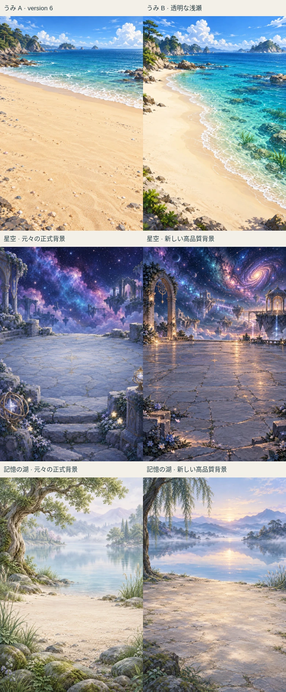
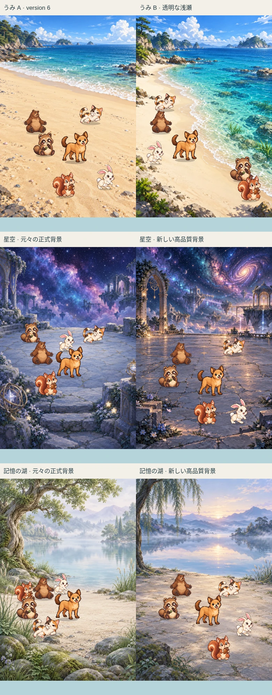
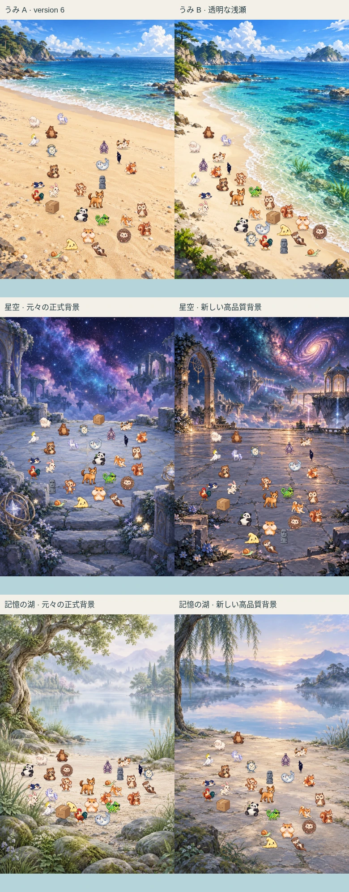

# version 7 — 海と特別2地域の新旧比較

2026-10-29。独立Draft PR [#462](https://github.com/Naoto214/naotocchi/pull/462)。新背景の正式採用は保留。本人のiPhone Safari比較後に判断する。

## 成果と比較画像

| 比較 | 左 | 右 | 結果 |
|---|---|---|---|
| 海 | version 6の海A | 透明な浅瀬の海B | Aを保持。Bは斜めの岸線、広い水平線、透ける海底の岩・砂・魚・海藻を追加。キャラクターは乾いた砂浜に配置 |
| 星空の停留所 | 元々の正式画像 | 新規高品質画像 | 元画像を回収。新案は渦巻銀河、光る石畳、浮島とアーチ。両方を独立した候補として保持 |
| 記憶の湖 | 元々の正式画像 | 新規高品質画像 | 元画像を回収。新案は青銀色の霧、柔らかな朝の光、静かな湖と石の岸辺。宇宙景観と区別 |

画像は比較ページからブラウザで書き出したもの。各行は同じ390px・同じ主役と仲間・同じ昼設定。新旧の地形に応じて接地位置は異なる。合成画像は背景・正式キャラクター・接地影・前景遮蔽を示し、UIは操作画面で確認する。

## 元背景の回収

| 地域 | GitHub内の元ファイル | Git blob SHA | 容量 |
|---|---|---|---:|
| 星空 | `assets/world/star_stop-v1.webp` | `f36093795da9cadc10140c90777b5c15f0d9c9d3` | 331,246 B |
| 記憶の湖 | `assets/world/memory_lake-v1.webp` | `4bfc480940c3451ec2aab02a091531f1028f423e` | 388,912 B |
| 記憶の湖・冬 | `assets/world/memory_lake_winter-v1.webp` | `cf894ba206c501e6f1dd117dcfc335d8cc5928e8` | 372,132 B |

正式ホームの `world-scene.js` → `SCENES` / `resolveScene` → `createRenderer.update` → `#worldBackdrop.style.backgroundImage` という表示経路を確認。いずれも1024×1536の静止画像で、光・天候・粒子等の別演出が重なる。星空は夜固定、湖は冬差分がある。v6の簡素な3D地形とは別物である。

今回の「元背景」は同じ画像そのものを2.5Dへ接続した比較。正式ホームの全CSS演出・季節差分・拡大率まで同一に再現したものではない。元画像は変更せず、冬差分も保存済みのまま。詳しい来歴は [回収報告](../../design/home-v7-original-recovery.md)。

## 新しい画像と接続

原寸PNGは `assets/home-v7-20261029/{sea-b,star-new,lake-new}.png`。制作直後にそれぞれ独立したコミットでGitHubへ保存した。配信時は同ディレクトリの `runtime/*.webp` を使用。

| 配信画像 | 寸法 | 配信容量 | デコード後のRGBA相当 |
|---|---|---:|---:|
| sea-b.webp | 1024×1536 | 353,298 B | 6 MiB |
| star-new.webp | 1024×1536 | 476,172 B | 6 MiB |
| lake-new.webp | 1024×1536 | 350,506 B | 6 MiB |

配信用3画像の合計は1,179,976 B。6 MiBは画像1枚の推定値であり、ブラウザ全体の実測メモリではない。

`home-v7-manifest.mjs` に候補ごとの ground / foreground / seats / forbidden / points / depth を定義した。ground外と前景遮蔽範囲を歩行不可として扱う。海Bは斜めの砂浜、星空の元・新案は石の広場、湖の元・新案は水際より手前の岸辺を使用。魚・海藻は背景演出で、海底は歩行対象にしない。奥行き縮尺はおおむね0.76〜1（湖0.78〜1）で、実表示の安全補正も既存ランタイムが担当する。

共通の `home-art-navigation.mjs`、v6の描画・2.5D自由生活を再利用した。28体の主役退出テストで新星空375pxの初期位置が詰まる問題を検出し、主役の初期座標を広場中央側へ調整して解消。共通の移動・会話・育成ルールは変更していない。

## 検証の実績と範囲

| 項目 | 状態・証拠 |
|---|---|
| 新規ローカルテスト | 19/19 pass。[ログ](v7-local.log)。6候補×4幅×1/6/28体のモデル検証、実測画面寸法の28体退出経路、禁止領域、既定候補・他10地域保護、追加ビルドとセーブ分離、比較画像の左右向き、読み込み中の候補切り替え |
| 既存保護テスト | 319/319 pass。[ログ](protection-regression.log)。v22〜v19、v6、自由生活・地形経路、Motion v2、Relationship Expression、Reaction、Conversation Director/v2/postgame、セーブ互換・整合性、卵孵化を含む |
| クラウド表示マトリクス | 72/72条件で全員safe/visible、人数一致、通知42px・会話76px。[実測JSON](cloud-display-matrix.json)。6候補×320/375/390/430px×1/6/28体。Chromeで昼設定を検証 |
| 背景単体・6体・28体の新旧視覚比較 | 上記3枚を実際の比較ページから出力。元画像はトリミングなし。キャラクター合成は390px、正式画像、接地影と前景遮蔽あり |
| 手動操作 | 海B・390px・6体で主役選択のaria-pressed=true、自由生活中の歩行、地面タップとドラッグ後の位置変化を観察。全候補にわたる厳密な物理ポインター入力検証はCI待ち |
| 画面回転 | 海Bで横→縦の復帰後、全員safe、42px/76px維持を確認。全候補の回転マトリクスはCI待ち |
| 自律散歩・休憩・観察・交流・衝突回避 | 共通モデルの回帰テストと新規候補の経路・自律テストがpass。海Bのクラウド自由生活も観察。長時間の実機動作は未確認 |
| 会話・質問・選択・返答・Reaction | 共通コード無変更、関連保護テストpass。クラウドで質問から返答までの全経路を完了したとは扱わない |
| reduced-motion・復帰・セーブ再開 | 共通コードと分離キーを保持。新候補のWebKit/Chromiumブラウザ検証をCIへ追加したが、CI待機中は未完了。実機OS復帰は未確認 |
| 読み込み・描画負荷 | 全候補で読み込み完了を確認。比較用iframeは逐次生成して終了後に解放。FPS、ピークメモリ、電池・発熱・長時間安定性の合格判定はしていない |
| 全npm test | この環境では完了していない。並列実行中にsparse checkoutの既存QA資料欠落に関連する失敗とテストプロセス停止が発生。資料のgit遅延取得もProxy CONNECT abortedで停止。既存テストを削除・弱体化していない。上記319件を同時実行数2で別途完走 |
| クラウド長時間一括検証 | 星空新案の昼夜24条件ランナーは途中まで進んだが、ブラウザ制御タイムアウトのため完走を確認できていない。その後、比較画面の72表示条件を別途完走。原因をアプリの不具合またはブラウザのみと断定していない |
| GitHub CI | 最終HEADの状態をPR本文で報告。待機・実行中・失敗・キャンセルは成功扱いしない。6候補それぞれにChromium/WebKitの既存同等ランナーを追加 |

## 公開と保護

- 比較URL: https://naotocchi-art-25d-20261028.kerzion214.chatgpt.site/home-v7.html
- 通常育成: https://naotocchi-art-25d-20261028.kerzion214.chatgpt.site/home-v7-play.html
- 全13地域のv6一覧・v6通常育成・背景素材・比較資料を維持。新規v7ファイルを追加するビルドで、既存配信ファイルを上書きしない。
- 操作比較は初期静止。「自由生活」で開始する。操作QAと比較生成と通常育成は `naotocchi-home-v7-{qa,sheet,play}-v1` に分離。v6・v22・本番の保存領域を変更しない。
- 公開は既存の本人限定Siteだけ。アクセス制御を変えない。配信の `release-v7.json` にGitHub成果HEADと配信ファイルSHA-256を記録。公開成功・配信照合の最終結果はPR本文で報告する。
- おうちC、森の滝、水辺の清流、都会の夕暮れ、田舎、山、雪国、ジャングル、砂漠、深海の10地域はv6の画像・設定をそのまま使用。正式キャラクターも無変更。
- PR #426はHEAD `8ba4ef1cb2030979664589d2e36423f58c4dedbd` のままDraft。#462もDraftを維持し、どちらもマージしていない。
- 開始時PR #462: `3e7955ee055242ba1ba0cc762899b1f140676236`。今回の最終HEADはPR本文と配信release-v7.jsonで確認できる。
- 開始時main: `7a59eff0dbde6700efc0e21a4ccf9ca0785b5dc1`。作業中に別作業のPR #460マージで `97551371496225993e93025a7e9817fb1a25cd63` に進んだことを読み取り確認した。本作業からmain・GitHub Pages・v22 Siteを更新していない。

## 本人のiPhone Safariで必要な確認

新旧の美しさ、キャラクターとの調和、海Bの水面境界と魚・海藻の見え方、28体の混雑感、タップ／ドラッグの感触、横向き復帰、長文会話・選択肢・Reaction・頭上効果、reduced-motion、セーブ再開、バックグラウンド／OS復帰、読み込み時間、長時間の発熱・電池消費を確認する。元背景より新背景がよいと本人が判断するまでは採用候補を変更しない。未完了CI・性能・実機QAを完了扱いにしない。
