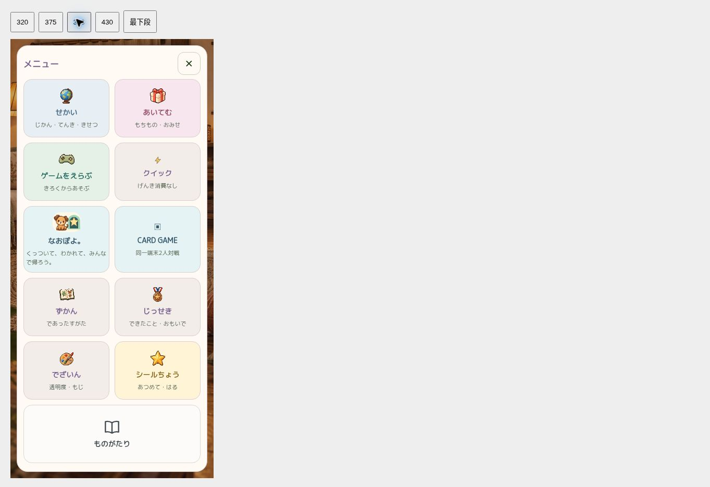
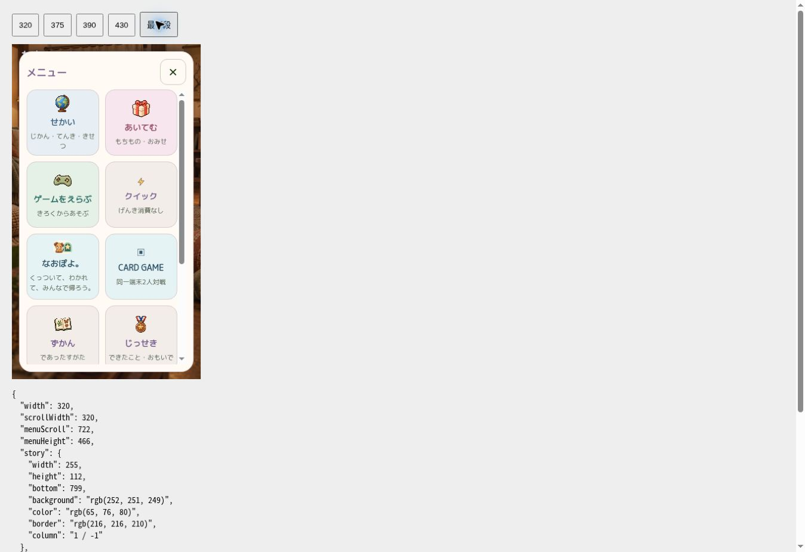
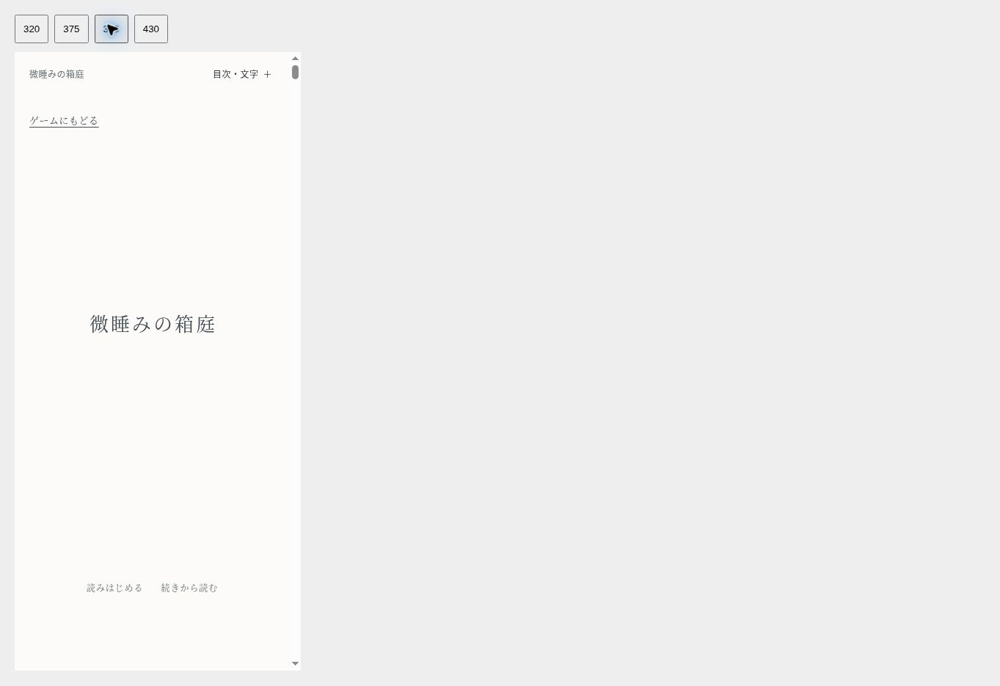

# メニュー再配置・ものがたり統合

Base: `55c33221571faf16cea518cb9d91fc033d018631` (PR #453 version 19 merged).

## 変更
- 2列の既存10項目を指定順へ配置。既存の各要素は全文一致、既存ゲームJSに変更なし。
- 最下段に2列分の「ものがたり」。本の線画・背景 #FCFBF9・文字/アイコン #414C50・枠 #D8D8D2、高さ112px・角丸16px。
- 正式パス `prototypes/madoromi-white-reader-20261027/dist/?from=game#top`。公開後は `https://naoto214.github.io/naotocchi/prototypes/madoromi-white-reader-20261027/dist/?from=game#top`。
- ゲーム経由のみ表紙から入り、表紙左上に「ゲームにもどる」を追加。保存済み位置は「続きから読む」で復元。直接閲覧、reload、back/forwardの既存動作を維持。
- 本文・装丁CSS・white-reader.jsは変更なし。読書HTMLの変更は任意ナビゲーションスクリプト読込み1箇所のみ。
- mainに存在した読書ページがPages配信リストから漏れていたため、正式HTML/CSS/JSと接続スクリプトを配信対象へ追加。本人限定URLへの依存なし。

## 検証
- 関連25件、新規ナビゲーション3件、セーブ/メニュー/時計/キャッシュ等59件成功（重複を含む）。
- 既存npm testのNode集計: 26 + 24 + 3238 + 159 = 3447件。最初の全件実行では疎なチェックアウトに検証用画像5枚とCSV1枚がなく7件失敗。Git正本と一致する資料を復元後、該当3ファイルを再実行: 6/6・33/33・256/256成功。後続159件も独立実行成功。アプリの不具合修正やテストの弱体化はなし。全コマンドの一括再実行は重複となるため実施せず。
- 新規3件をpackage.jsonへ追加し、今後のnpm test/CIに組込み。
- Pagesユニット16件成功。公開パッケージ4057ファイル・213529473 bytes・452カード/904画像を `/naotocchi/` 配下でHTTP確認。欠落0・ハッシュ不一致0。
- Chromium 320/375/390/430px、横はみ出し0。320/375ではメニュー内スクロール、最下段まで操作可能。指定3色・2列幅・112px高を計測。
- ゲーム→表紙→読書→ゲーム→表紙→続きから読む: 段落86、scrollY6599、段落top146.09375pxが完全一致。reload復元も確認。
- Chromiumの幅固定iframeでレイアウト確認、読書保存はtop-levelページで実操作。iPhone Safari実機の最終確認は本人QA。
- 独立レビュー: Critical/Importantなし。新規テストのCI組込み指摘は反映済み。

## 本人限定試遊
https://naotocchi-menu-story-20261027.kerzion214.chatgpt.site
Sites version 1, owner-only deployment succeeded. 最新mainベースの専用試遊版。進行中のPR #426試遊版は変更しない。

## スクリーンショット

mainへのマージ・GitHub Pages本番公開は未実施。

## 表紙への復帰リンク移動
- ユーザー指定により目次内から表紙左上へ移動。目次を開かず、スクロールなしで復帰できる。
- 320/375/390/430px幅でリンクのtop70px・高さ44pxを確認。表紙作品名と重ならず、本文のレイアウトは不変。
- 表紙リンクのタップでゲームへ戻ることをChromiumで確認。ナビゲーション・読書位置の既存6件、Pagesユニット16件成功。
- 本文・white-reader.css・white-reader.jsは引き続き変更なし。

