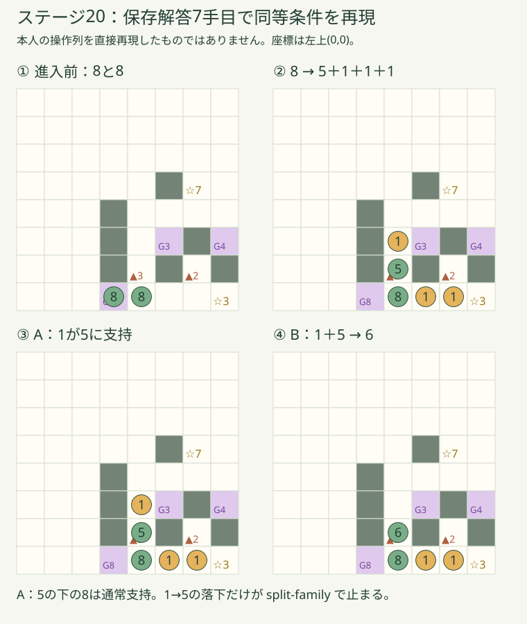
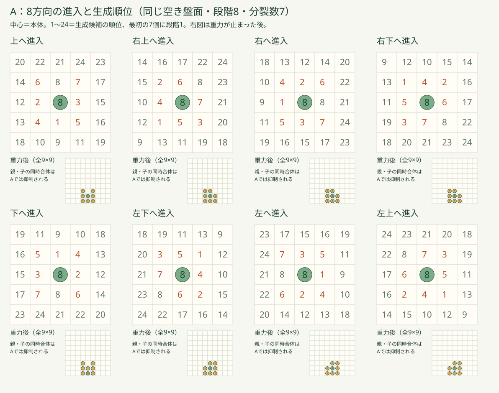
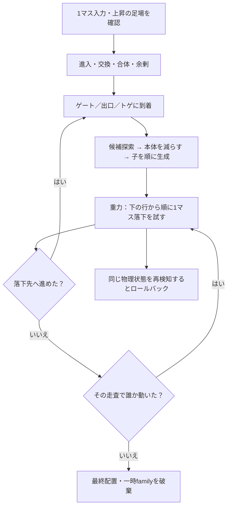

# なおぽよ。分裂・重力・再合体ルール比較（2026-10-28）

**結論：今回の「1が5の上に残る」は、重力未適用ではなく、同一分裂グループへの落下合体を一時的に拒否する現行ルールで再現する。** 最も自然な接触はB。配置を読みやすくするのはC。ただしBをそのまま採用すると循環するため、第一推奨は **B＋「各トゲは1マス操作につき一度だけ分裂させる」**。比較実験までで、正式採用は本人の判断を待つ。

- [本人専用の独立比較ページ](https://naopoyo-split-compare-20261028.kerzion214.chatgpt.site/)（配信結果は `DELIVERY.md` を参照）
- [全8方向の生成順位と重力後](figures/eight-directions.svg) / [ステージ20の再現図](figures/stage20.svg) / [同盤面A/B/C](figures/abc.svg)
- [再現イベントと拒否理由](evidence/reproduction.json) / [全監査](evidence/audit.json) / [40解答の再検証](evidence/final-witnesses.json)

## 1. 調査対象と変更範囲

| 項目 | 固定した正本 |
|---|---|
| 最新remote main（開始時） | `132e39a7aeccfa5e1706b510f29d649d3aab4518` |
| PR #436 | open / Draft / 未マージ |
| VERSION 9 HEAD | `1e1e04661e2f59b7ad6bd3e56dc3cef7c2d623c5` |
| VERSION 9 tree | `2573837799118f74e9d548ea2bd399bca28733cb` |
| 保存時に再確認したremote main | `0e0354b15ee8c29ad7e52dd0ba8c6993df80e643` |
| 保存先 | mainから独立した `research/naopoyo-split-rules-20261028` |
| 変更対象 | 本ディレクトリの新規追加だけ |

mainとVERSION 9の共通v2エンジンのblobは異なる。混ぜず、VERSION 9のエンジン・盤面・予告・探索・保存解答を `baseline/` に固定した。[provenance.json](provenance.json) に各ファイルのSHA256を記録し、生成時に照合する。`generated/` はそのソースに限定差分を適用した比較用複製。既存エンジン、PR #436、第1章、本編、CARD GAME、既存試遊版、本番Pagesには変更を加えない。ステージの再設計もしていない。

今回、元スクリーンショットの画像データと本人の操作列は提供されていない。以下は**保存解答から到達できる同等条件の再現**であり、本人の実入力を直接再現したとの主張ではない。

## 2. ステージ20の原因：実エンジンの7手目

座標は左上 `(0,0)`、右が+x、下が+y。[repro-source.json](evidence/repro-source.json) に初期盤面からの7手を保存。

| 段階 | 実測内容 |
|---|---|
| 進入直前 | 操作する8 (`b`) が `(3,7)`、足場の8 (`a`) が `(4,7)` |
| 入力 | `b` を右上 `(dx=1,dy=-1)`、トゲ `(4,6)` へ |
| 分裂前 | 段階8、トゲpower=3 |
| 本体 | 同じID `b`、段階5に減り、進入先 `(4,6)` に残る |
| 子の生成順 | `child1=(5,7)`、`child2=(4,5)`、`child3=(6,7)`、すべて段階1 |
| グループ | `b` と3体の子に同じfamily=1を付与。下の8は別グループ |
| 重力走査 | 下の行から、同じ行なら左から。今回 `a → child1 → child3 → b → child2` |
| 5→8の接触 | 下が段階8なので `saturated`。通常の支持条件で停止 |
| 1→5の接触 | 同種、5は未飽和。しかしfamily一致で **`split-family`** を返す |
| 安定 | 誰も落下に成功せず終了。トゲが支持しているのではない |



`reproduction.json` のAのtraceには、`child2` が `(4,5)→(4,6)` へ落下を試み、family一致で拒否される記録がある。通常イベント列は `split` 一件だけで `fall` はゼロ。これは「重力を検討していない」のではなく「落下要求を拒否した」ため。

Bでは1＋5が6になる。この場面では操作中の本体 `b` が合体後も残るため `entered=false`。同じトゲで再分裂せず、6として止まる。Cでは `(5,7),(6,7),(5,4)` に生成し、最後の1はゲート `(5,5)` の上面に支持される。今回の真上の1は消えるが、Cの縦穴テストでは真上にしか置けず、同じ例外が再現する。

## 3. 現行の生成アルゴリズム

正本：[固定engine.mjs](baseline/prototypes/naopoyo-v2/engine.mjs) の `splitCandidates`、`split`、`enter`、`settle`、`arrival`。

1. 進行方向を時計回りの8方位配列から見つける。
2. 相対順序 `[180度, -90度, +90度, -135度, +135度, -45度, +45度, 0度]` を使う。
3. 本体のマスを根とする幅優先探索。通過できる**普通の空きマス**だけをたどり、最大2歩まで。
4. 1歩の候補をすべて列挙してから2歩の候補。同距離では親候補の列挙順、その中で上記8方向順。座標は重複しない。
5. `k=min(元の段階−1, トゲpower, 候補数)`。本体からkを引き、先頭kマスへ段階1を順に生成する。
6. 全生成位置は生成前の盤面で決める。先に生まれる子を見て候補探索をやり直すわけではない。
7. 本体と子の重力を解決して最終位置が決まる。初期出現位置と最終位置は別物。

### 8方向の順位

「上へ進入」は下から上へ移動する意味。表は隣接8方向の順位。2歩先は単に同じ8方向へ2倍移動ではなく、空きマスを経由するBFS順になる。

| 進行方向 | 1 | 2 | 3 | 4 | 5 | 6 | 7 | 8 |
|---|---|---|---|---|---|---|---|---|
| 上 | 下 | 左 | 右 | 左下 | 右下 | 左上 | 右上 | 上 |
| 右上 | 左下 | 左上 | 右下 | 左 | 下 | 上 | 右 | 右上 |
| 右 | 左 | 上 | 下 | 左上 | 左下 | 右上 | 右下 | 右 |
| 右下 | 左上 | 右上 | 左下 | 上 | 左 | 右 | 下 | 右下 |
| 下 | 上 | 右 | 左 | 右上 | 左上 | 右下 | 左下 | 下 |
| 左下 | 右上 | 右下 | 左上 | 右 | 上 | 下 | 左 | 左下 |
| 左 | 右 | 下 | 上 | 右下 | 右上 | 左下 | 左上 | 左 |
| 左上 | 右下 | 左下 | 右上 | 下 | 右 | 左 | 上 | 左上 |



図は全方向共通の9×9空き盤面、中央の段階8から7体生成。番号は全24候補の順位、右下の小図は実エンジンの重力後。全データは [probes.json](evidence/probes.json) の `directions`。実ステージではトゲpowerが小さいので先頭k個だけ使う。

| 地物・条件 | 生成時の扱い | 落下・支持との違い |
|---|---|---|
| 岩・盤外 | 候補にも探索経路にも不可 | 岩と盤外の床は支持 |
| 魔法ゲート | 段階1が通れるゲートでも候補・経路から除外 | 上面は全段階を支持。内部通過は条件付き |
| トゲ | 候補・経路から除外 | トゲ自体は非支持。落下で進入すれば分裂しうる |
| 出口 | 候補・経路から除外 | 出口自体は非支持。数字が合えば救出、合わなければ通過 |
| 他キャラ | 候補・経路から除外 | 通常は同種を合体、下が8/別種などなら支持。A/Cはfamily例外あり |
| 斜め | 直交2経路が両方閉じていれば不可 | ゲート上面を含む角抜け禁止を共用 |
| 2歩先 | 空きマスを通る合法な2歩経路が必要 | 壁や特殊マス越しの直接出現ではない |
| 空き不足 | kを減らす。本体を余分に削らない | 空き0なら分裂0、質量保存 |
| 段階1 | 分裂しない | 通常落下・通常合体は行う |
| 最大数 | 段階8から最大7体、本体は最低1 | 8が8体に増えるルールではない |

決定的・再現可能ではあるが、進入方向で順位が回転し、さらに2歩先の順位が障害物に依存する。**「ランダムでない」ことと「暗算できる」ことは別**。特に最後の1〜2体の配置は予告への依存が強い。

## 4. 処理順序と隠れた条件



上図の到着処理は、出口が条件一致すれば先に救出。トゲは実際に進入した場合だけ反応する。重力走査中に生まれた新たな子は、その走査開始時のsnapshotには含まれないので、次の走査から落下を試す。本体は、その走査でまだ番が来ていなければ同じ走査で処理される。

- `ctx.families` は **1回の `move` / `externalMove` / `externalSplit` の解決中だけ**。セーブやUndoには入らず、次の1マス入力では消える。長いドラッグ1本の全期間ではない。
- family拒否は `fall=true` の場合だけ。次操作の手動接触で合体できる。
- 合体・交換・救出などでfamilyを削除する。新たな分裂では新しいfamilyに上書きする。「分裂由来ならずっと合体しない」ではない。
- 合体後のIDは操作中のキャラを優先して残す。そのため下の本体が操作対象なら、上から合体しても `entered=false`。別IDが落ち込めば `entered=true` になり、同じトゲを再発動しうる。
- **supported-v1では旧 `ctx.fired`（同トゲ1回）は使われていない。** 「既に一回制限があるからBでも安全」とは言えない。
- `settle` の再訪検知は反復を例外として扱い、`move` は操作前へ戻す。無限に画面が固まる前に拒否されるが、プレイヤー視点では理由不明の無効手になりやすい。

## 5. A・B・Cの独立比較

`build.mjs` が正本のコードを検査付き置換し、各案に独立したエンジン・予告・探索を作る。Aの計測追加は通常のイベント配列や盤面を変えないことを、正本との全分岐比較で確認した。

- **A**：現行そのまま。診断ログのみ追加。
- **B**：落下時の `split-family` 拒否を一行だけ除去。生成順・到着条件・トゲ発動・循環検知はAと同じ。
- **C**：family拒否を維持。候補の方向順を固定の左→右→左下→右下→左上→右上→下→上とし、同じ親の列で上にある候補を全候補の最後へ。残りは1歩→2歩、同距離では親の列以外を優先してBFS列挙順。支持の有無による重み付けはしない。
- **補助実験B-once**：Bに「同じトゲで成功する分裂は1マス操作に1回」を追加。k=0は消費しない。3方式を混ぜた比較ではなく、Bの循環要因を切り分ける追加実験。循環キーには発動済み集合も含める（独立レビューの反例をRED→GREEN修正、[REVIEW.md](REVIEW.md)）。

Cの初期検討では距離優先を真上より強くしたが、ステージ20の現象が残ったため採用候補から外した。現Cは**距離優先の唯一の例外が真上**。比較案としてのこちらの設計判断であり、本人が決定した仕様ではない。

| 評価軸 | A：現行 | B：通常合体 | C：生成改善 |
|---|---|---|---|
| 自然さ | 親子だけ合体しない例外が見えない | 接触は最も自然。ただし循環無効手が残る | 今回は改善、縦穴では例外が残る |
| 予測可能性 | 方向回転＋BFS＋一時familyが必要 | 接触の予測は容易。配置はAと同じ | **生成位置は最も読みやすい**が2歩先とfamilyは残る |
| 単純さ | トゲ進入・操作ID・familyの複合条件 | familyを除けるが循環対策が必要 | 固定順にできるが真上後回しの例外はある |
| 分裂の成立 | 縦積みも維持できる | 即再合体で一部/全部が戻りうる | 横への分散が増える。狭い場所の挙動はA同様 |
| 循環 | 今回の監査0。全称の不存在証明ではない | **89入力で循環検知・ロールバック** | 今回の監査0。全称の不存在証明ではない |
| 重力との整合 | 支持あり。ただし支持条件が一時属性依存 | 通常接触と整合 | Aと同じ一時属性依存 |
| 旧解答 | 全10面成立 | 6面成立、16/18/19/20は不成立 | 5面成立、15〜19は不成立 |
| 解答可能性 | 全10面確認 | 全10面を新旧の解答で確認 | 全10面を新旧の解答で確認 |
| 難易度 | 現状維持、配置暗記の負担 | 再組立ての計画が変化、難化の断定不可 | 15/17/19で保存解答より短い証人。難度の校正が必要 |
| 100面以上 | 一時familyを前提に作問すると学習負担が蓄積 | 一回制限を正準化すれば推論・作問が単純 | 回転規則は減るが親子例外を100面へ持ち越す |

## 6. 循環の実証と正準ルール案

縦穴fixtureでは、下の2がトゲ上、真上に1、別の場所の仲間を操作する。Bは `1+2=3 → トゲで2+1 → 1+2=3 → …`。段階合計と座標が繰り返され、循環検知で全体を取り消す。これは概念図だけの推測ではなく [probes.json](evidence/probes.json) の `inactive-spike-cycle` に実ログがある。実ステージ16からも別の循環を採取した（`audit.json/cycleExamples/B`）。89は検知した試行数で、89種類の相異なる循環を意味しない。

| 要求されたケース | A/C | B | B-once |
|---|---|---|---|
| 分裂直後の親子再合体 | 同familyの落下を拒否 | 通常合体 | 通常合体 |
| 再合体後の同トゲ再発動 | 操作ID/entered依存。familyで多くを止める | 非操作IDが落ちると再分裂可能 | その手の同じトゲは再分裂なし |
| 同一トゲへ連続進入 | 別の1マス入力では再発動 | 同左 | 次の1マス入力で再び一度可能 |
| 重力による再接触 | familyなら止める | 循環fixtureで再合体を反復 | 合体して安定 |
| 余剰分離 | 元マスに余剰を置き、到着処理を行う | 同左。循環条件の一部になりうる | 各トゲの一回制限が余剰にも適用 |
| 同じ一手の複数分裂 | 同トゲへの別進入もありうる | 同左 | **別のトゲはそれぞれ一度**。2個のトゲで確認 |
| 次の操作の通常合体 | familyは消えるので合体可能。トゲなら再分裂もありうる | 通常合体 | 通常合体、一回制限もリセット |

**第一推奨のプレイヤー向け説明：**

> 同じ仲間は、落ちて触れたら合体する。トゲは一手に一度だけ分裂させる。分かれた仲間も、支えがなければ落ちる。

ここで一手は**隣の1マスへの入力1回**。ドラッグ中も各マスごとに解決する。段階1/空き不足などで分裂しなかった接触は「一度」を消費しない。複数トゲは別々に反応する。トゲの発動を控えめに光らせるなど、例外を暗記させるのでなく原因を見せる。

停止性の理由：有限個のトゲがそれぞれ成功分裂1回なので、上方へ質量を生成し直すイベント数が有限になる。分裂と分裂の間は、成功する通常落下/合体が `Σ(段階×(盤面高さ−y))` を必ず減らし、救出も減らす。下が8の無変化接触は拒否する。整数の非負量なので、分裂なしの重力は有限回で止まる。これは今回の盤面・標準policy・下向き重力の範囲での構造的な根拠であり、将来の外力/ポータルまで無条件に保証する主張ではない。

B-onceの追加監査26,504入力で循環0、分裂予告662件一致。40解答中の10本として全10面を再生済み。**Bの素の実装を採用する提案ではない**。B-onceでも配置はAのままであり、Cの生成改善との組合せは今回未検証。組合せを完成済み仕様として採用しない。

## 7. 重力・支持の検証

専用テストで、岩/ゲート上面の段階1〜8支持、トゲ/不一致出口の非支持、下8/異種の支持、通常の下5への合体、8方向の位置交換、角抜け禁止、ゲート入場条件、候補の特殊マス排除、空き不足、最大7体、余剰、複数トゲ、次操作の合体を確認。

A/B/Cの79,691入力（各方式の固定シード到達walk＋共通V9解答上の分岐＋保存解答再生）では、成功後の支持なし・質量違反・不正状態を検出しなかった。拒否手は操作前と一致。Aは正本と盤面・通常イベント列が全て一致。これは有限監査の結果であり、全盤面の不存在証明ではない。

「他キャラに支持されているので論理的に正しい」だけでは、体験として自然とは限らない。見た目が同じ1と5なのに、直前の履歴だけで合体する/しないが変わる点が今回の根本問題。

## 8. 11〜20面への影響と難度

以下は今回確認した解答長。11〜14はBFSで最短を証明。18のB/B-onceの19手もBFS最短。それ以外の15〜20は最短未証明。

| 面 | A | B | C | B-once（追加） | 旧解答B | 旧解答C |
|---|---:|---:|---:|---:|---|---|
| 11 | 5 | 5 | 5 | 5 | 成立 | 成立 |
| 12 | 5 | 5 | 5 | 5 | 成立 | 成立 |
| 13 | 10 | 10 | 10 | 10 | 成立 | 成立 |
| 14 | 11 | 11 | 11 | 11 | 成立 | 成立 |
| 15 | 23 | 23 | 15 | 23 | 成立 | 不成立 |
| 16 | 25 | 70 | 36 | 70 | 不成立 | 不成立 |
| 17 | 26 | 26 | 20 | 26 | 成立 | 不成立 |
| 18 | 20 | 19 | 25 | 19 | 不成立 | 不成立 |
| 19 | 71 | 91 | 59 | 91 | 不成立 | 不成立 |
| 20 | 71 | 131 | 71 | 156 | 不成立 | 成立 |

`shortened-*.json` の解答を別プロセスで再実行し、**40/40で全員脱出**。C16は追加greedy探索の36手、C19は61手を連続部分削除で59手へ短縮。保存解答が壊れた時点は `audit.json` に残す（B:16の18手目、18の6手目、19の4手目、20の8手目。C:15の4手目、16の18手目、17の7手目、18の6手目、19の4手目）。

分裂を含む遷移を除いたBFSは、15〜20でそれぞれ4 / 76 / 4 / 34 / 69 / 80状態で探索完了し、クリアなし。全方式で同じ結果。**現盤面では15〜20に分裂が必要**。ルールの変化だけで分裂を完全に省略する短絡解は生じなかった。11〜14は分裂なしで解ける。

Cの15面15手、17面20手、19面59手は現保存解答23/26/71手より短い。ただしAの最短性を証明していないので、「Cだけに存在する最短短絡」とまでは主張しない。Cの15〜19の新経路はAでそのまま再生できない（`final-witnesses.json/crossReplay`）。配置への依存を示す一方、手数削減だけで発想難度は決められない。

### 19・20の重点評価

| 面・方式 | 解答長 | 分裂イベント | 子の総生成数 | 評価 |
|---|---:|---:|---:|---|
| 19 A | 71 | 8 | 21 | 現状。最短未証明 |
| 19 B | 91 | 9 | 23 | 新解答成立。長い証人だけで難化と断定しない |
| 19 C | 59 | 18 | 47 | 手数は短いが分裂回数は増える。配置理解の負担が自動的に減るとは限らない |
| 20 A | 71 | 19 | 45 | 今回の上の1を含む現解答 |
| 20 B | 131 | 28 | 59 | 旧解答8手目から不一致。別解で全員脱出 |
| 20 C | 71 | 19 | 44 | **旧71手を維持**。ただし生成位置・子数・途中イベントは完全同一ではない |
| 19 B-once | 91 | 9 | 23 | 循環対策込みで成立 |
| 20 B-once | 156 | 30 | 66 | 循環対策込みで成立。解答の最適化は未完 |

解答不能と確認された面はない。探索上限に当たった試行は「解なし」と扱わず、追加探索で解答を得た。今後100面へ広げる場合は、1ステージの必要分裂数と配置への依存を作問時に管理する。今回の19/20で何十体も生成する証人を、そのまま良い難しさの根拠にはしない。

## 9. 一手予告との整合

VERSION 9の `simulateSplit` を複製し、import先だけ各方式の実エンジンへ差し替えた。**独自の予告用物理エンジンは作っていない。** A/B/Cの分裂を伴う2,073入力で予告の盤面・イベント列が実結果と一致し、入力元のJSONが変わらないことを検証。数字も実エンジンの最終levelを使う。循環拒否されたBでは予告はnull、実操作も取り消しになる。

- 解答ルートを予告には渡さない。配信用ファイルから保存解答・探索コードを除外。
- 初期生成点（births）と重力後の最終actorsを区別。
- 元のstate・保存・Undo履歴を変更しない設計を維持。
- 正式V9のapp/input/ドラッグ操作は未変更。比較ページは仲間選択と8方向ボタンで、同一入力を見比べる専用UI。
- 本人のiPhone Safariで長いドラッグ、高速入力、Undo/復帰、予告の体感まで再確認したとは主張しない。

## 10. 正式採用する場合の実装計画（今回は未実装）

1. 本人が比較ページのステージ20と縦穴を確認し、接触ルールを決定する。
2. 第一推奨を採るなら新しいバージョン付きruleを追加。既存のsupported-v1を無言で上書きしない。
3. family拒否をそのruleだけで外し、各トゲの「分裂成功済み」を一手contextへ記録。k=0は消費せず、次の1マス入力で消去。保存には含めない。
4. 生成規則は当初Aを固定して物理変更の効果を切り分ける。Cと組み合わせるなら別途全10面・同じfixtureで検証する。
5. 循環検知は非常用ガードとして残し、signatureに将来の発動済み集合/操作対象の役割が必要か整理する。ロールバックを正常な遊びのルールとして頼らない。
6. 予告も同じrule・同じ実エンジンで解決。ルート探索は予告に接続しない。
7. 保存は盤面revision/ruleの不一致を扱い、旧進行の消失や未検証の自動移行を避ける。正式保存の移行・旧解答差替えは別承認の実装範囲。
8. 11〜20の全員脱出、分裂必要性、短絡、家族例外への依存を再評価。19/20の解答を短縮し、iPhone Safari実機で自然さを確認する。
9. 採用ruleで100面用の作問制約を作る。短い説明で解けず予告必須な配置を多用しない。
10. PR #436/正式V9から独立してレビュー・試遊し、本人が採用決定してから統合する。

## 11. 再実行

Node.js 24.22.1。追加npm依存なし。本ディレクトリ内で：

```sh
node build.mjs
node --test compare.test.mjs
node audit.mjs
node probes.mjs
node search-all.mjs A
node search-all.mjs B
node search-all.mjs C
node search-all.mjs B-once
node search-followup.mjs
node shorten.mjs A
node shorten.mjs B
node shorten.mjs C
node shorten.mjs B-once
node verify-witnesses.mjs
node diagrams.mjs
node package-site.mjs
```

探索は時間・状態数上限を明記しており、マシン負荷で訪問数/発見経路が変わりうる。固定済み解答の `verify-witnesses.mjs` は探索不要で再現可能。状態キーは位置・段階・種・救出量を使い、終了した一手のfamilyは含めない。ゲートopenは表示用なのでキーから除外。IDは座標で操作対象を解決でき、異なる座標間の落下順にもID比較は不要。シード43628の監査自体は固定的。

## 12. 残る確認事項

- 本人の正確な操作列・元画像との完全照合。
- iPhone Safari実機の見た目、一筆書き、予告の体感。今回のブラウザーQAはChrome。
- 15〜20の大半の最短性と、人が感じる難易度。探索証人が長いことは難化の証明ではない。
- あらゆる盤面でのA/Cの循環不存在。今回の監査0件と区別。
- B-onceとCを組み合わせた場合、非標準policy/外力を加えた場合の検証。
- 正式採用の決定・保存移行・作問調整・本番反映は今回の対象外。

第一推奨はルールの一貫性を重視した設計判断であり、面白さの実機評価まで測定済みという意味ではない。
