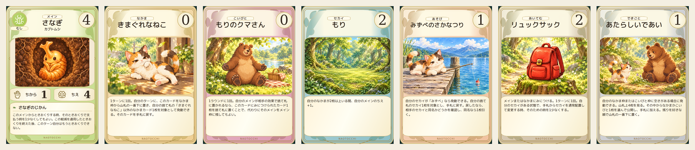

# 制作完了：452／452枚

2026-10-19。残り406枚の制作・品質確認が完了。未完成0、修正待ち0。既存46枚と修正履歴を保持。

[全452枚プレビュー・31種族8段階・最終品質記録](rollout/final-452-20261019/README.md)。専用原画1536×1024、完成600×900、縮小80×120／110×165 PNG。正式配色の採用プレビューは最終deck-manifest.jsonを参照。

PR #393はDraft・open・未マージ。ゲーム本体組み込み・mainマージは別承認。iPhone実機Safariは未検証。

以下は各時点の制作履歴です。過去の停止・未着手・未完成の記述は上記の完成状態で更新されます。

---

> 成長表現レビュー：対象24枚のうち7枚を修正、17枚維持。旧版保持・全体46枚。残り406枚は今回制作停止。[比較・検証・制作基準](growth-review/README.md)

> 最新制作状況：46/452枚完成、406枚未着手。クマノミ8段階を追加。詳細は [rollout/README.md](rollout/README.md)。

# 本格制作：38/452枚

既存23枚は正式承認済み。カブトムシ7枚＋ネコ8枚を追加制作。未着手414枚。詳細・再開地点は [rollout/README.md](rollout/README.md)。この承認状態と進捗を以下の制作履歴より優先する。

# 配色正本：2026-10-18 正式採用

改善案14色と、明るい背景で分類マークを濃色線にする方針をユーザーが正式承認。
共通配色正本は [approved-colors.mjs](approved-colors.mjs)。全452枚を分類から解決し、個別カードやイラストに色を焼き込まない。PilotのHTMLプレビューはこの正本を使用する。

詳細：[採用記録](COLOR-APPROVAL.md)。既存PNGプレビューとcolor-studyは比較当時の記録として保存し、再生成・上書きしない。現在の配色はHTMLプレビューで確認する。

対戦UIの正式カラー変更・本体組み込み・mainマージは別承認。以下は制作履歴で、旧配色・承認待ちの記述についてはこの採用記録を優先する。

---

# 第2段階：追加16枚・分類マーク・縮小表示

2026-10-18。代表7枚の画風・キャラクター・情景はユーザー正式承認済み。原本7PNGは前回HEADとバイト一致。追加16枚はレビュー対象。全23枚の専用絵は1536×1024 PNG、完成600×900、縮小80×120／110×165。文字・数値・属性は画像へ焼き込まずテンプレートで描画。

## 今回の16枚

| ID | カード名 | 成長形態 |
|---|---|---|
| M-dandelion-01 | タンポポ① | 芽ぶきのたね |
| M-dandelion-02 | タンポポ② | ふたば |
| M-dandelion-03 | タンポポ③ | 地面に広がる葉 |
| M-dandelion-04 | タンポポ④ | 葉がしげるタンポポ |
| M-dandelion-05 | タンポポ⑤ | つぼみ |
| M-dandelion-06 | タンポポ⑥ | 花咲くタンポポ |
| M-dandelion-07 | タンポポ⑦ | わたげ |
| M-dandelion-08 | タンポポ⑧ | 旅立つたね |
| C-otter | あそびずきカワウソ | — |
| C-owl | ものしりふくろう | — |
| P-grove_deer | こだちのシカ | — |
| W-sea | うみ | — |
| G-dragDecorate-cake | ケーキのかざりつけ | — |
| G-beach-volley | ビーチバレー | — |
| I-naoto_lantern | なおとのランタン | — |
| E-midlife-flower | 庭に小さな花を植えた | — |

## レビュー画像

- [メイン8段階・専用絵](previews/main-eight-art.png) / [完成カード](previews/main-eight-overview.png)
- [その他8枚・専用絵](previews/other-eight-art.png) / [完成カード](previews/other-eight-overview.png)
- [23枚の80／110比較](previews/all23-small-comparison.png)
- [原画／SVG比較](previews/symbols-comparison.png)
- [余白改善前後：上が前、下が後](previews/spacing-before-after.png)
- [独立ブラウザプレビュー](index.html)（リポジトリルートでHTTP配信）

## 属性と余白

8属性は原画の人／足跡／水滴と波紋／貝／甲虫／双葉／四方向星と小星／三日月と星に準拠。32×32 viewBox、stroke 1.7、統一した丸い線端、確定8色。SVG化した形状はレビュー対象。6カテゴリーは既存名称・色・実装を維持し、新しいマークを正式採用していない。非メインへの属性追加なし。

非メインのPilot画像枠を3:2へ変更、左右paddingを4%から3%へ縮小。object-fit:containで全景を保持し上下レターボックスを解消。縮小表示の非メインにも本文付き共通テンプレートを利用し、余剰領域を能力欄に配分。80pxの本文は読解用途ではなく拡大カードで読む。主役拡大は枠幅の小幅な改善にとどめ、トリミングなし。メインの縮小構造は維持。

## 品質と検証

全16枚で本編正本画像を参照。タンポポはたね→双葉→低い葉→繁った葉→つぼみ→黄色い花→白い綿毛→旅立つ5体の形態差を照合。顔・色・部位所見とimmutable source blobはprovenance.json。あそび・できごとは本文題材と既存キャラクターを組み合わせた新規情景で、本編に存在した場面の復元ではない。

複数登場の料理・スポーツ・庭仕事、海中風景、夕暮れの灯りを含む。明らかな余分な手足や外周切れなし。料理は机による自然な脚の遮蔽あり。タンポポは同じ生息地の連続性が強く、今後は必要に応じてカメラ位置や季節の幅を増やす。

Chromium 153実描画23/23：600×900、本文一致・可視・収容、画像と本文非重複、属性はメインのみ。320／390／430pxで横はみ出しなし、読み込み・JSエラー0。23画像重複なし、全PNGデコード・寸法確認。小画像はブラウザ端数丸めを出力時に指定寸法へ正規化。物理iPhone／Safari実機は未検証。evidence/browser-qa.jsonとstage2-assets-qa.jsonを参照。

## 保護・次段階

変更はart-pilot内のみ。効果・数値・ルール・state/save/schema・エンジン・Python・固定400戦・本編2D/3D・World 3D・現行対戦UIは変更なし。既存4PRはDraft/open/未マージを維持、新PRなし。

残り429枚は未着手（メイン239、なかま23、こいびと16、セカイ11、あそび97、あいてむ24、できごと19）。次回承認後、種族8段階、その他10〜16枚を単位として参照確認→生成→照合→縮小QA→保存。既存452対応表を継続利用し、欠ける正本は未確定として止める。今回の16枚、SVGの縮小表現、非メインの余白調整を確認いただき、その後の範囲を別途承認。429枚の生成・正式組み込み・mainマージは今回実施しない。

---

## 初回7枚制作時の履歴（当時の承認待ち記述は上記で更新）

# カード専用アート · 代表7枚 Pilot

2026-10-18。7枚の専用イラスト・既存UI完成プレビュー・452枚の実務対応表を保存。**すべてユーザー承認待ち。残り445枚は未着手。ゲームへ未接続、mainへ未マージ。**

## 代表カード

|カテゴリー|カード名|正本ID|文字なしアート|完成プレビュー|
|---|---|---|---|---|
|メイン|さなぎ（カブトムシ④）|M-beetle-04|[PNG](illustrations/M-beetle-04.png)|[PNG](previews/M-beetle-04.png)|
|なかま|きまぐれなねこ|C-cat_friend|[PNG](illustrations/C-cat_friend.png)|[PNG](previews/C-cat_friend.png)|
|こいびと|もりのクマさん|P-forest_bear|[PNG](illustrations/P-forest_bear.png)|[PNG](previews/P-forest_bear.png)|
|セカイ|もり|W-forest|[PNG](illustrations/W-forest.png)|[PNG](previews/W-forest.png)|
|あそび|みずべのさかなつり|G-fishing-river|[PNG](illustrations/G-fishing-river.png)|[PNG](previews/G-fishing-river.png)|
|あいてむ|リュックサック|I-travel1|[PNG](illustrations/I-travel1.png)|[PNG](previews/I-travel1.png)|
|できごと|あたらしいであい|E-new-encounter|[PNG](illustrations/E-new-encounter.png)|[PNG](previews/E-new-encounter.png)|

各カテゴリー1候補のみ、全7回生成。バリエーション量産なし。選定理由は正本画像が確認できること、単体・情景・道具・2体の交流を試せること。あそびとできごとは専用画像が未確認のため、本編の確認済み猫・熊・水辺画像を参照して新しい情景を制作。

## 実務棚卸し

[CSV](inventory-452.csv) / [JSON](inventory-452.json) は452ID、表示名・内部カテゴリー・既存UI画像・最新mainの正本画像パスとgit blob・制作分類・3D補助参照・正本本文の出典・Pilot状態を保持。

|分類|枚数|判断|
|---|---:|---|
|background_add|318|メイン248＋なかま26＋こいびと18＋あいてむ26。外見の正本を再利用し背景を追加。画像をそのまま貼っただけでは専用情景にならない。|
|direct_reuse|13|セカイ13の風景画像。直接再利用可能だが、横長構図と統一画風の調整は個別判断。Pilotの森は新たに描画。|
|new_scene|121|あそび100＋できごと21。カード専用ラスタ画像の対応は未確認。本文・既存ゲームや道具・登場人物を根拠に新しい情景を作る。|

対応画像331件は最新mainのtreeで存在・blobを確認した。全画像の目視監査をしたという意味ではない。目視照合はPilotに必要な正本に限定。

最新mainには `assets/items/unified/manifest.json` と26アイテムの統一画像がある。古いUIブランチの `CARD_ART` はメイン・なかま・こいびと292件のみで、アイテム等の未登録を資産不存在と誤認しないこと。`game-symbol-art.js` はゲーム用の24×24ベクターモチーフ、`assets/ui/*atlas*` はUI部品であり、完成カード情景とは区別。`script.js` の fishing-river は釣り竿・浮きによる遊びの根拠。

Character 3Dは最新mainの `character-3d/spec.js`、`rollout-spec.js`、`nonplayer-spec.js` を参照。31×8段階、なかま26、こいびと18の役割別対応と、猫の三毛・横臥、熊の役割別形状を確認。3D実装自身も2D画像をデザイン正本と明記しており、今回は2Dを画像生成の直接参照に使用。3D全293体の再監査・再レンダリングは行っていない。

既存カード専用候補として `ui-assets/pupa-reference-approved.png`、裏面として `card-back-approved.png` を確認。今回の参照原画と既存UI版はバイトハッシュが異なるが、デコード後のピクセルが同一であることを確認。既存ファイルは変更していない。

## 美術・素材契約

- 2D本編の種族・段階・顔・体型・色・特徴が正本。3Dは補助。さなぎはユーザーが最重要基準として指定した採用済みカードの丸い顔・目を優先。
- やわらかく、かわいく、繊細な絵本風。自然光・生態・暮らしで個性を出す。主役と顔の周囲は読みやすくする。
- 専用アートは **1536×1024 PNG、3:2横長**。文字・数値・マーク・カード枠・能力本文は含めない。
- カード完成プレビューは **600×900 PNG、2:3**。縮小版は **80×120 / 110×165 PNG**。ブラウザで既存 `cardMarkup` と `style.css` を描画し撮影。一覧はそのPNGを並べたもの。
- `index.html` はレビュー専用で既存rendererをimportし、返されたマークアップの `.card-art` だけを専用画像に置換。`object-fit:contain` で主役・角・尾・浮き等を切らない。ゲームの `CARD_ART` やrendererは変更しない。
- ファイル名は `illustrations/<card-ID>.png`。個別の参照画像・immutable ref/blob・生成意図・SHA-256・照合所見は [provenance.json](provenance.json)。将来の差し替え候補はこのmanifestから扱い、承認前のruntime登録は禁止。
- カテゴリー別配色・8属性色は既存 `ATTRIBUTES` / `CATEGORIES` の値が依頼の確定色と一致。非メイン6カテゴリーには属性を追加していない。
- 画像生成は初候補を維持し、細部の模様の画素一致までは主張しない。正本からの翻案の可否はユーザーの美術承認で確定する。

## 分類マーク：再利用と差異

[採用原画](references/approved-attribute-sheet.png) を改変せず保存。既存 `ui-presentation.mjs` のMOTIFSをそのまま使用し、新しいマークを生成していない。

|属性|添付原画|既存SVG|
|---|---|---|
|ひと|手を広げた人|胸像に近い人型|
|けもの|足跡|足跡|
|みずべ|水滴と波紋|水滴と波|
|うみ|貝|波|
|むし|甲虫|線画の昆虫|
|くさ|双葉|1枚の葉|
|げんそう|四方向の星と小星|四方向の星と小星|
|ふしぎ|三日月と星|三日月と小星|

原画とSVGは同一ではない。今回のプレビューは既存SVG維持であり、原画との最終統一が済んだという扱いにはしない。原画の抽出・置換か既存SVG継続かは別途ユーザー確認。6カテゴリーのSVGも実装には存在するが、原画の最終承認は未確認。今回それを再設計していない。

## 品質確認

- 7枚すべて正本を画像として確認し、その画像を生成時に参照。三毛猫の配色・耳・尾・表情、熊の体型・腹・耳・肉球、リュックの色・金具・ポケットを照合。
- さなぎは第4段階で成虫の黒い翅はなく、黄金色・節・折り畳んだ脚を維持。採用カードの可愛いデフォルメを優先しており、本編ドット画像との完全な形状一致ではない。
- 各画像は全文字なし。目視で主役の余分な頭・手足・融合を認めず。猫の寝姿で一部の脚が重なるのは正本同様。出会いでは猫の目が開き、表情が変化している。
- [ブラウザ検証](evidence/browser-qa.json)：7/7で正本能力本文一致・可視・全文領域内、メインだけ属性あり、画像と本文非重複、600×900。320/390/430px画面幅で全7枚の2:3と横はみ出しなし。画像読み込み・JSエラー0。
- [80px見本](previews/iphone-width-80.png) / [110px見本](previews/iphone-width-110.png)：全主役を識別。80pxの釣り糸など細部は小さくなる。非メイン縮小カードの上下余白は画像全体を切らずに収める結果で、量産前の確認事項。
- **Chromiumの画面幅シミュレーションであり、物理iPhone・Safari・タッチ・色再現の実機QAではない。** 原画とUIの金縁・植物装飾の密度にも差があり、既存テンプレートを保った状態でのレビュー。
- ブラウザ初回検証でレビュー用HTMLの参照解決と本文非表示を検出し、レビュー用HTMLだけを修正して再実行。最終検証は全項目合格。既存ゲームCSS・rendererは非変更。

再現手順：リポジトリrootでHTTP serverを起動し、`node prototypes/card-game/art-pilot/verify-browser.cjs`。Playwright・sharp・Chromiumが必要。`PILOT_CHROMIUM`で実行ファイル、`PILOT_URL`でURLを指定可能。描画環境の日本語フォントは本編のM PLUSフォントを使用。パッケージ依存はこのPRに追加していない。

## GitHub開始時点と保護範囲

|対象|HEAD|tree|状態|
|---|---|---|---|
|main|5d950d1b88751b202ac2fe2fcb2f3ea7ef0598af|ccca80d3796cf91cfcc9e03962f8d0315f3c9dfc|読み取りのみ|
|#259|0a9df8f09b5ad657730f29d14e2d357241dace8c|78677b98fdc229c7acf10e9112ca9744ae0fa7ba|Draft/open/未マージ|
|#381|3a987044513fdb6d5e69b52b8af40add5a45ccd4|e86f089e6778061d7acd39492e96286656455702|Draft/open/未マージ|
|#384|e30b2fed1f5e9143089cec389b2ef183df6c02aa|26705a0cefd064eb4c50821821b68caad6c70190|Draft/open/未マージ|

独立ブランチ `art/card-pilot-seven-20261018` は#384の上記HEADから派生。Draft PRのbaseも#384のbranchとし、将来統合可能な追加ファイルだけの差分に限定。変更は `prototypes/card-game/art-pilot/` の新規ファイルのみ。効果・数値・ルール・state・save/schema・Python・固定400戦・本編画像・既存PRは変更しない。

## 残り445枚

メイン247、なかま25、こいびと17、セカイ12、あそび99、あいてむ25、できごと20。既存正本＋背景追加314、風景再利用12、新規情景119が残る。承認後に種族ごと8段階をまとめて参照し、段階取り違えを防ぐ。なかま・こいびとは役割別に管理。遊び・できごとは世界観を本文から選び、確認済みキャラだけを出演させる。

Pilotは1カード1回生成で成立したが、複雑な生物・複数キャラ・成長段階は修正が必要になりうるため、445回で完了すると保証しない。所要日数・費用は今回の7枚だけから断定せず、承認後に小ロット単位で実績を更新する。残り445枚の生成は開始していない。

ユーザー確認：①7枚の画風と同一性、特にさなぎの採用カード準拠、②カテゴリ代表としての選定、③原画と既存SVGの統一方針、④縮小時の全景維持と余白、⑤iPhone Safari実機での見え方。今回の承認を受けても量産は別段階、正式組み込みとmainマージは別承認。
