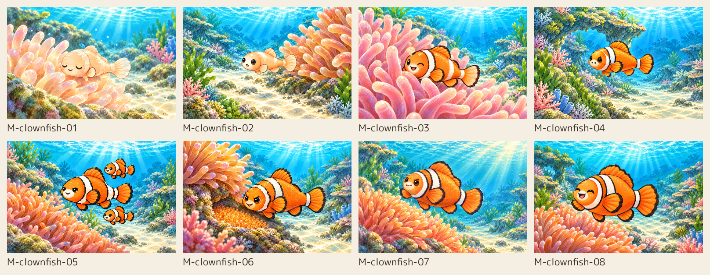
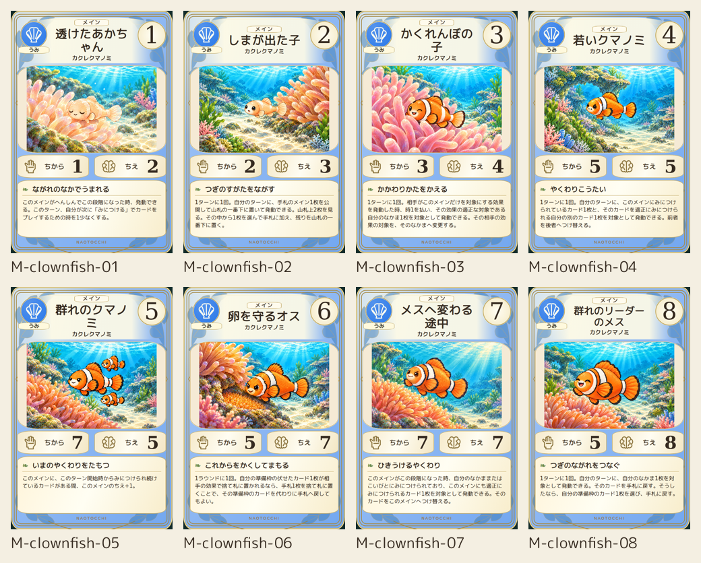
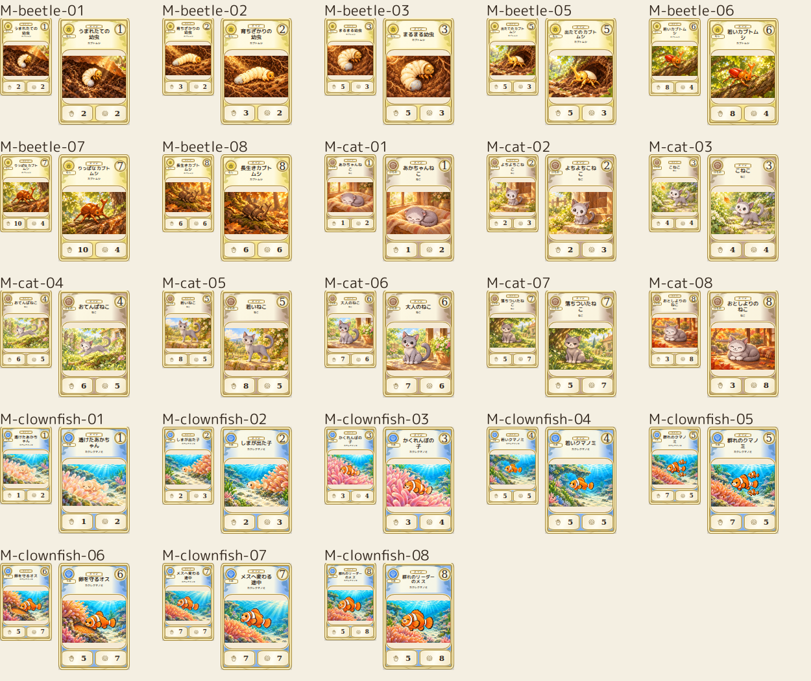

# 制作完了：452／452枚

2026-10-19。残り406枚の制作・品質確認が完了。未完成0、修正待ち0。既存46枚と修正履歴を保持。

[全452枚プレビュー・31種族8段階・最終品質記録](final-452-20261019/README.md)。専用原画1536×1024、完成600×900、縮小80×120／110×165 PNG。正式配色の採用プレビューは最終deck-manifest.jsonを参照。

PR #393はDraft・open・未マージ。ゲーム本体組み込み・mainマージは別承認。iPhone実機Safariは未検証。

以下は各時点の制作履歴です。過去の停止・未着手・未完成の記述は上記の完成状態で更新されます。

---

## 第3ロット：クマノミ8段階

累計46/452枚、未着手406枚、修正待ち0枚。今回の本格制作はカブトムシ7枚・ネコ8枚・クマノミ8枚の計23枚。承認済み23枚は保持。

クマノミ M-clownfish-01〜08：半透明の幼魚から群れのリーダーまで、正本8段階と照合。05は正本と同じ3匹構成、06は卵を守る場面。各画像1536×1024 PNG、完成600×900、縮小80×120/110×165。Chromiumの本文一致・全文収容・非重複・採用色・貝SVG・320/390/430px表示を確認。実機iPhone Safari未検証。

次回はprogress.json記載のなかま10枚。未着手を完成扱いせず、全452IDの存在検査結果をasset-coverage.jsonに記録。

---

# 本格制作 checkpoint 01–02

2026-10-18。残り429枚の連続制作・品質確認・保存はユーザー承認済み。ロットごとの再承認は不要。今回は2種族15枚を新規制作し、制作済み累計38/452、未着手414。全452枚完成ではない。

## 完成範囲

- カブトムシ：M-beetle-01/02/03/05/06/07/08を追加。既存04を保護し8段階完成。
- ネコ：M-cat-01〜08を追加し8段階完成。
- タンポポ：承認済み8段階を継続利用。

|カテゴリー|制作済み|未着手|
|---|---:|---:|
|メイン|24|224|
|なかま|3|23|
|こいびと|2|16|
|セカイ|2|11|
|あそび|3|97|
|あいてむ|2|24|
|できごと|2|19|
|合計|38|414|

## 品質と参照

本編2D原本を各段階ごとに目視確認し、専用のimage_gen呼出しで制作。指示はbeetle-prompts.json、cat-prompts.json、cat-06-revision.txt。正本パス・ref・blob・絵のsha256と照合所見はprovenance.jsonに保存。内蔵画像生成ツールを使用し、CLI代替は使用していない。

幼虫の体型、灰白の尾、開眼/閉眼、成虫の白/赤橙/銅褐色/低彩度茶を区別。ネコは眠る赤ちゃん、座る幼齢、片足上げ、跳躍、細身の若年、成人、半眼の成熟、丸い老齢を区別。ネコ06の顔が初稿で白くなりすぎたため、目周囲・上頬を灰色に戻す1回の修正を実施。奥側の脚が自然に隠れる構図はあるが、明らかな余分な四肢・尾・角の欠落・外周切れは目視上なし。色調は共通画風に合わせた表現で、元スプライトの画素一致を意味しない。

15枚の専用絵1536×1024、完成600×900、縮小80×120/110×165 PNG。Chromiumで本文正本一致・全文収容・非重複・採用色・採用マークを確認。ネコ07の長文のみPilot内で本文文字サイズを2.9cqwへ調整（能力本文は無変更、カード枠/画像領域は維持）。320/390/430px横はみ出しなし。物理iPhone/Safariの確認は別工程。

asset-coverage.jsonは452IDすべてを調べ、完成38枚の4種画像の存在・PNG形式・寸法・デコードを確認。残る414枚は未着手として明示し、未検証画像を合格扱いしていない。38アートの完全一致重複0、既存23アートはSHA256一致。修正待ち0。

## 一覧

- [カブトムシ8段階の絵](beetle-eight-art.png) / [カード](beetle-eight-cards.png)
- [ネコ8段階の絵](cat-eight-art.png) / [カード](cat-eight-cards.png)
- [新規15枚80/110px比較](new15-small.png)

カブトムシ04の完成PNGは保護対象の過去プレビューをそのまま使用（旧配色）。現在の採用色はPilot HTMLへ共通適用済み。過去23枚のアート・完成PNGは再生成・上書きしていない。

## 再開

次はM-clownfish-01〜08の8段階。最新正本8枚の見た目と段階名を確認してから生成する。続いて未完成メインを8段階単位、その他を10〜20枚単位で進める。progress.jsonとinventory-452.csvのnot_started行を使用し、完成IDは再生成しない。production-cards.jsonは完成IDのプレビュー一覧。

残工程は414枚の生成→正本照合→完成/縮小描画→台帳・provenance更新→保存。追加承認待ちではなく制作時間を要する未完了作業。iPhone実機QA、本体への組み込み、mainマージは別工程。

## 開始時GitHub

main HEAD e56e77877cb066ca6adc38b8002e9fba68d9aaa3 / tree 113bad6ee11cac37189b7a9dd478788b6ec281cf。
PR393 HEAD 7c52352e4c711acb36d4b49ee181c23064ca4072 / tree 312fc688e0ec446e9223e06d7babec2657f47f62。base feat/card-game-approved-ui-20261015。Draft/open/未マージ。
PR259・381は別Workによるmerged/closed、PR384は開始時Draft/open。状態を戻す操作は行わない。
変更はart-pilotのみ。PR393のbaseは変更しない。既存ゲーム・効果・ルール・Python・固定400戦・state/save/schema・本編2D/3D・World3D・対戦UI・mainを変更しない。
