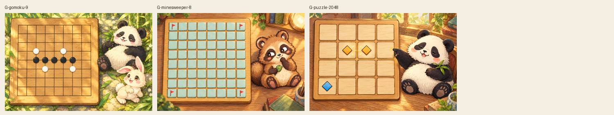
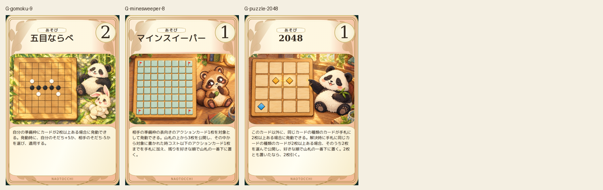
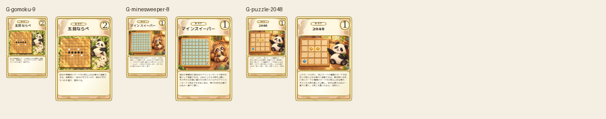

# board-repairs-20261019

All three revised candidates visually inspected with exact geometry guides: gomoku has nine lines each axis, five black stones in one line and four white at intersections; mine board has8x8 coveredtiles with four cornerflags; merge puzzle has4x4 cells with matching symbol pair. Character identities and paws consistent. Failed earlier candidates retained in prior lots. No letters/numerals.

完成ID: G-gomoku-9, G-minesweeper-8, G-puzzle-2048

Chromium幅320/390/430、本文・数値、4サイズPNG検証済み。iPhone実機Safari未確認。既存46枚の184ファイル変更なし。ゲーム本体への組み込み・mainマージ未実施。
