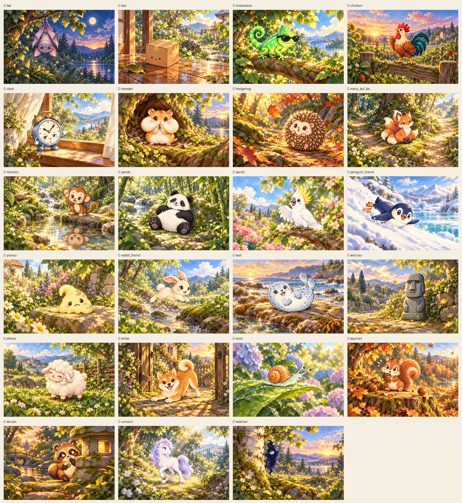
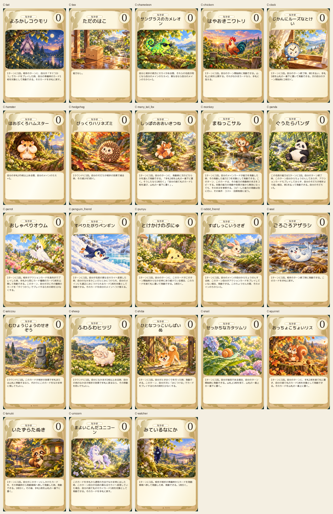
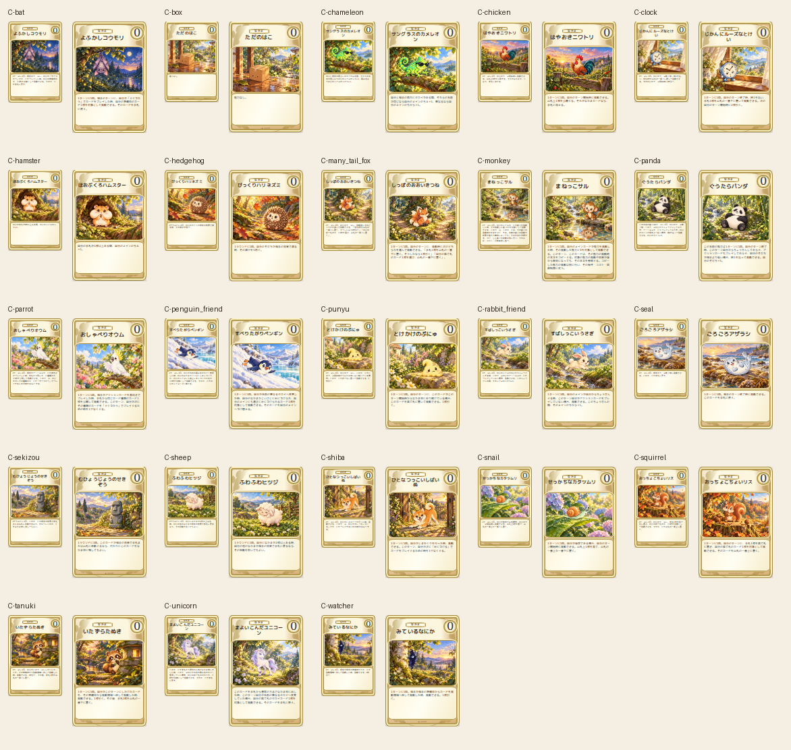

# 連続制作再開：なかま23枚

2026-10-18の残り406枚制作承認に基づき、PR #393を継続。開始HEAD `aba67da04c91db70744fc6a4d03334ab5635ba3c`、tree `a5107dcaba2713bb8aeda7d6833bb7211ff8986e`。Draft/open/未マージ、base変更なし。

累計69/452枚、残り383枚。なかま26/26枚。その他はメイン32/248、こいびと2/18、セカイ2/13、あそび3/100、あいてむ2/26、できごと2/21。

23枚すべてを本編2D正本と照合して個別の内蔵image_gen呼出しで制作。コウモリの初稿にあった足の不自然な接続のみ1回修正し、初稿も保存した。生成プロンプト・場面・参照特徴はcompanions-prompts.json、出典ref/blobとSHA256は共通provenance.jsonへ保存。

専用絵1536×1024、完成カード600×900、縮小80×120/110×165の92PNGを生成。Chromium153で23件の本文・カード名・コスト・全文収容・画像非重複・採用色#C68A32・既存分類ラベル・植物装飾一致、320/390/430px横はみ出しなし、JS/画像エラー0。非メインは元テンプレート同様、分類名の表示であり、存在しない属性SVGを追加していない。

全69枚の4サイズPNGの寸法・形式・デコード・ID対応を検証。アートの完全一致重複0。開始時46枚のアートと3種類のプレビュー、計184ファイルはGit blob一致。過去の比較資料・旧版・配色・マーク・裏面も変更なし。

## 再開

次はprogress.jsonのこいびと16枚。ロット承認待ちは不要。以後はセカイ11、あいてむ24、できごと19、あそび97、メイン216枚。全452枚完成ではない。制作済み一覧と未着手一覧はprogress.jsonを参照。

旧46枚のPNGプレビューの一部は配色採用前の版で、バイト保護のため維持。HTMLは採用14色を適用済み。全452枚完成時には旧版保持のまま採用色の最終プレビュー一式を別出力で用意する必要がある。

iPhone実機Safariは未実施。ゲーム正式組み込み、mainマージ、ルール・本文・数値・本編資産の変更は行っていない。
