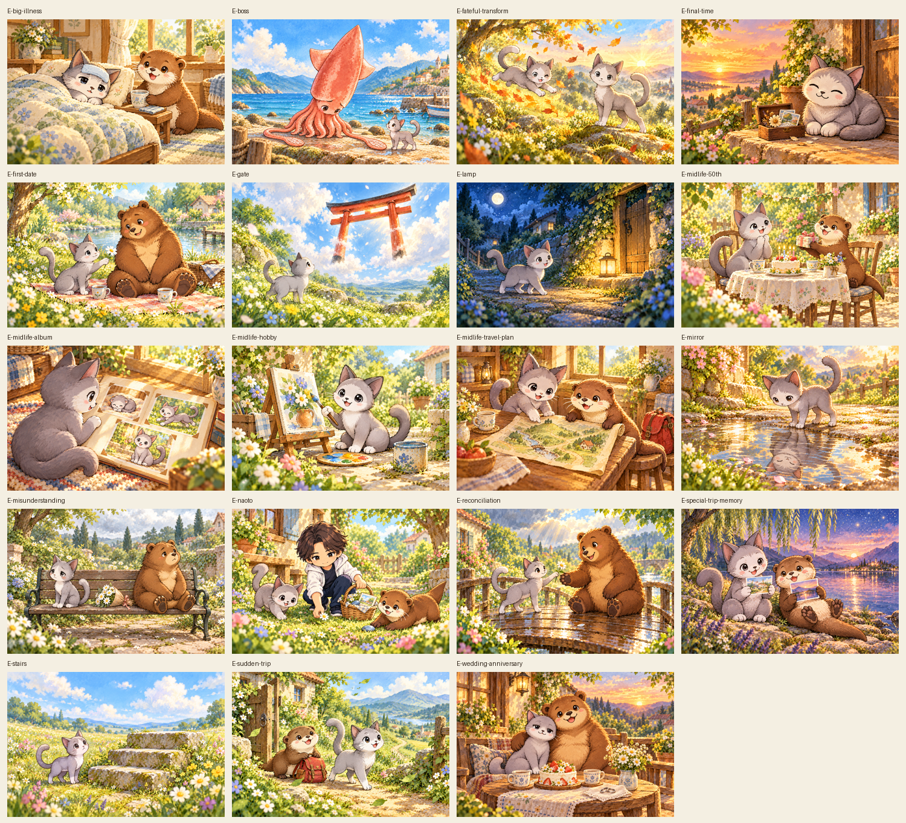
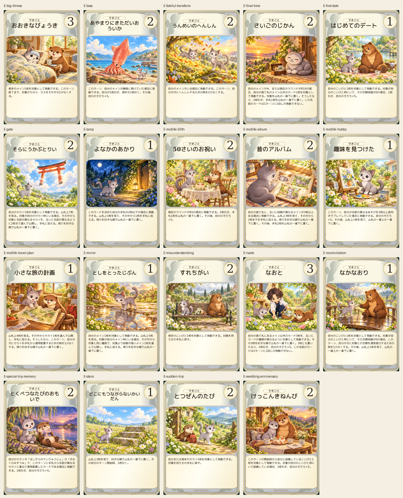
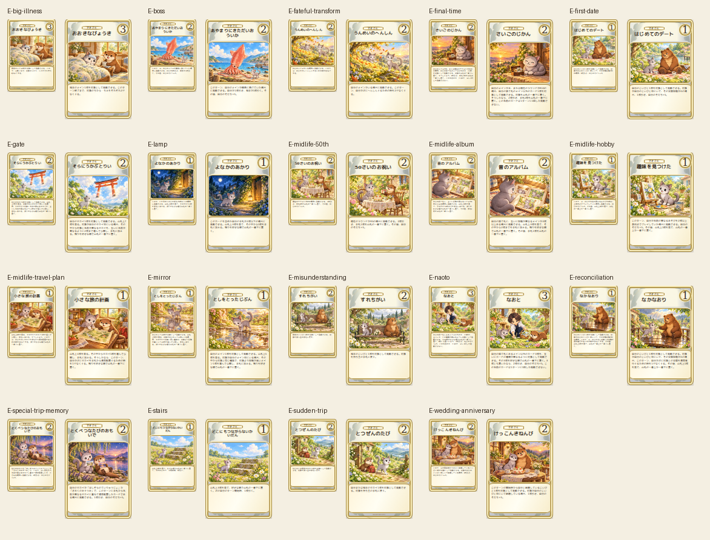

# できごと19枚 — 2026-10-18

累計139/452枚、残り313枚。できごと21/21枚、なかま26/26・こいびと18/18・セカイ13/13・あいてむ26/26。残りはあそび97とメイン216。

本編2Dキャラクター・カード名/本文・script.jsの伝説イベント記述を参照。ネコの異なる成長段階をアルバムや水たまりの未来像に反映。だいおういかは本編の専用2D画像がない物語登場者として新規造形し、全身の画面内収容と触腕の付け根を2回修正。水たまりの年老いた姿は反射の向きを1回修正。初稿と途中版は保持。その他の候補は維持。

19枚の専用絵1536×1024・完成600×900・80×120/110×165 PNGを確認。Chromium153でカード名/本文/コスト一致・全文収容・画像非重複・採用色#9298A5・分類表示・植物装飾、320/390/430px横はみ出しなし。全139枚4サイズのデコード/寸法/対応とアート重複なし、元46枚184ファイルのハッシュ一致を確認。

再開はprogress.jsonのあそび未制作IDから。全452枚完成ではない。未検証画像を完成扱いしない。量産一括承認済みでロット承認待ちは不要。

ゲーム本体・main・PR base・ルール・カード効果本文数値・本編資産は変更なし。PR #393 Draft/open/未マージを維持。実機iPhone Safariは未実施。旧46枚の配色前プレビューは保護、最終プレビューは別出力が必要。
