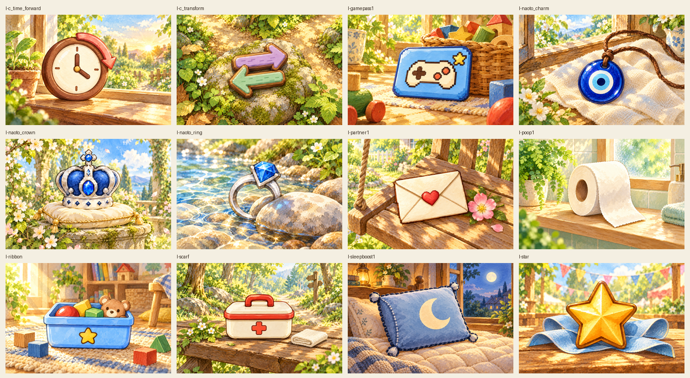
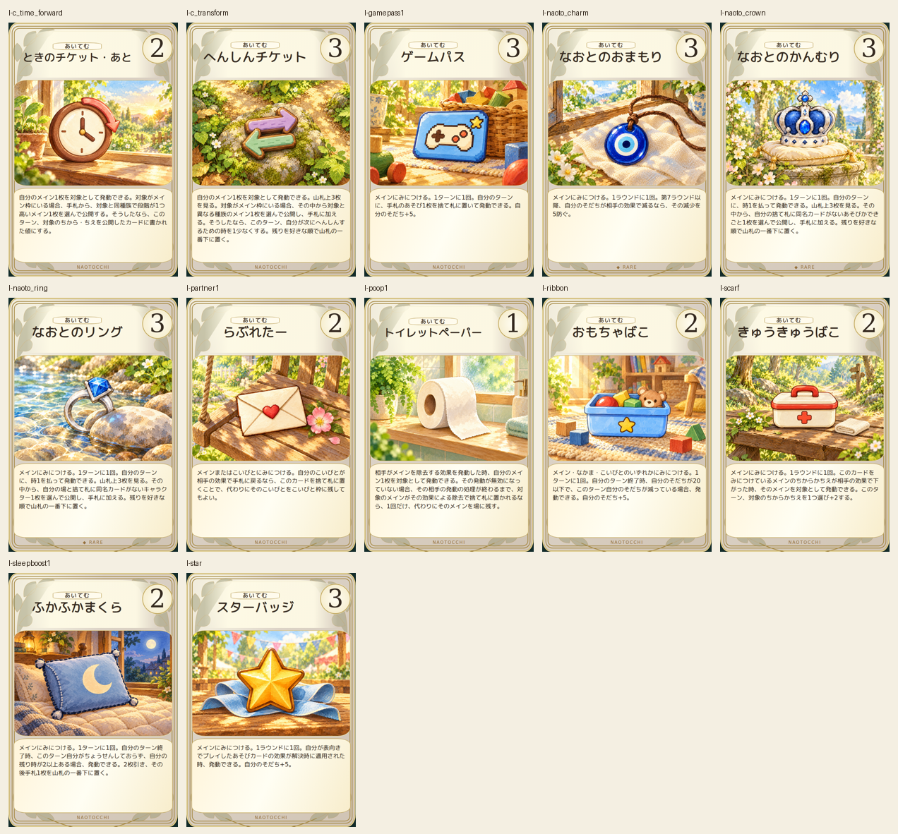
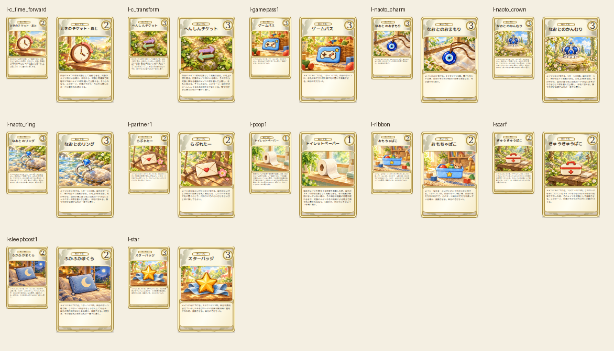

# あいてむ12枚 — 2026-10-18

累計120/452枚、残り332枚。統一アイテム2D正本の形・色・特徴を照合し、専用情景を制作。内部IDの旧名称に惑わされず現在のカード名と正本画像を使用。プロンプトはitems-prompts.json。全12枚目視確認済み。

専用絵1536×1024、完成カード600×900、縮小80×120/110×165 PNG。Chromium153で本文・コスト・名前・全文収容・非重複・採用色#B7A48C・分類表示・植物装飾一致。320/390/430px横はみ出しなし。元46枚184PNGのハッシュ一致、全完成画像の寸法・デコード・ID対応・重複なしを確認。

旧Work一時領域の消失により共有Gitオブジェクト参照が失効したため、元46枚の検証はcheckout時のGit索引に残る184blob SHAを保存したrollout/protected46-baseline.jsonへ移行。前3ロットでは元commitとの照合済み。既存画像を書き換えず検証を継続。

再開IDはprogress.json。残り制作は一括承認済み。main・base・ゲーム本体・ルール・カード本文数値は変更しない。PR #393 Draft/open/未マージを維持。旧46枚の旧色プレビューは保持し最終版は別出力。iPhone実機Safari未実施。
