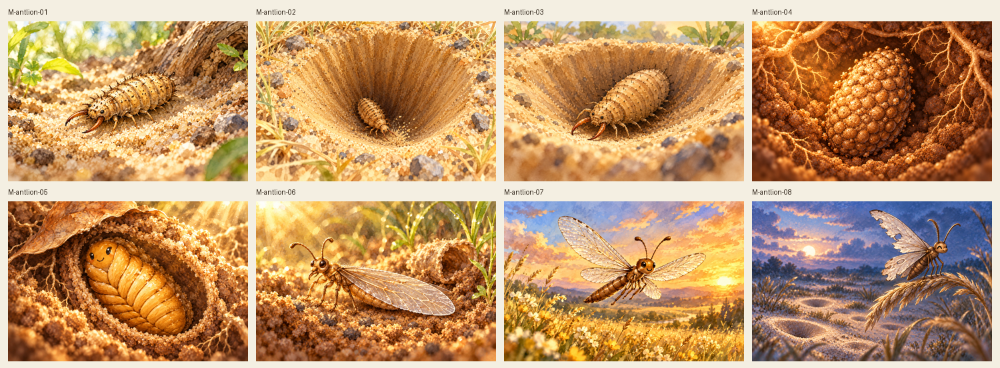
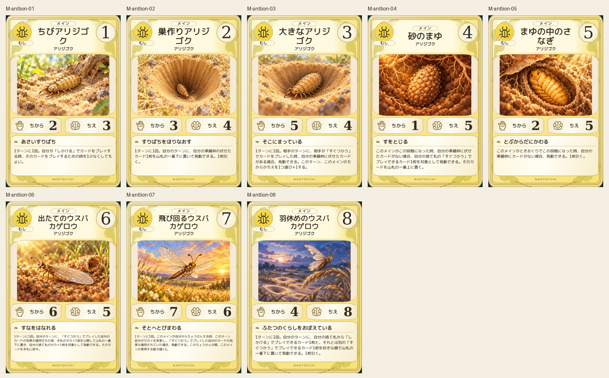
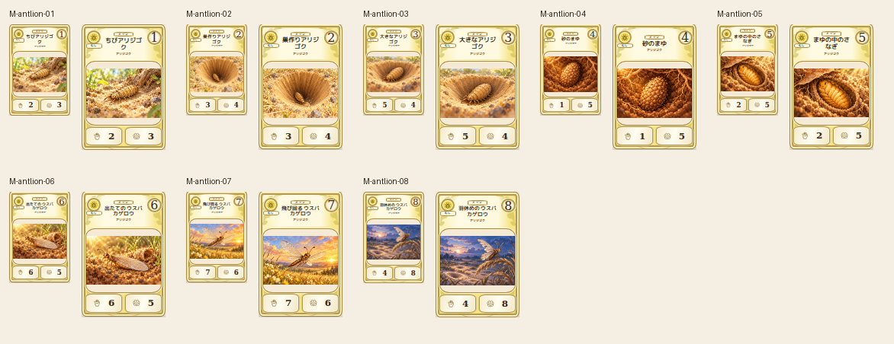
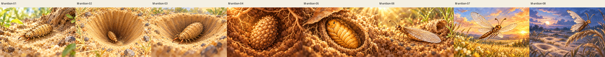

# main-antlion-20261019

Eight stages inspected against canonical 2D. Stages1-3 revised to tan spiny antlion larvae and long mandibles; rejected beetle-like first candidates preserved. Shape changes, direction, camera and habitat form a growth story; stages6-7 preview font adjusted for full original text.

完成ID: M-antlion-01, M-antlion-02, M-antlion-03, M-antlion-04, M-antlion-05, M-antlion-06, M-antlion-07, M-antlion-08

修正待ち: G-gomoku-9, G-minesweeper-8, G-puzzle-2048, G-ski-jump

Chromium: 600×900 /80×120 /110×165、幅320/390/430検証済み。iPhone実機Safariは未確認。本文・数値・本編資産変更なし。
