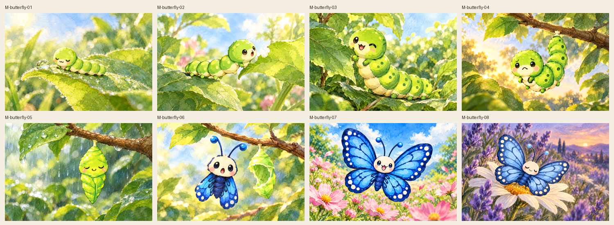
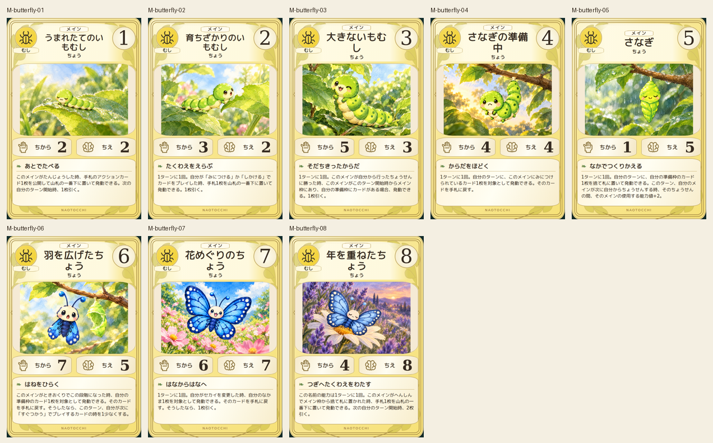
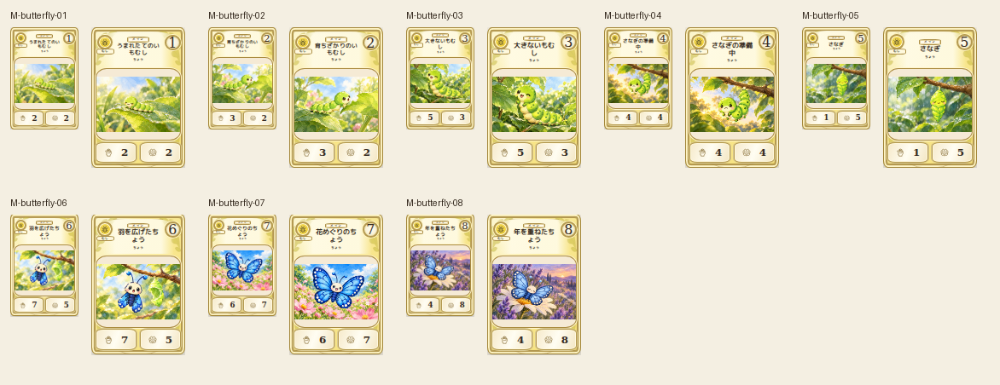
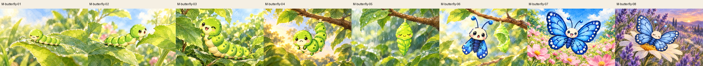

# main-butterfly-20261019

Eight stages inspected against canonical2D. Tiny, young and mature caterpillars, J-hanging larva, green chrysalis, freshly emerged small-wing butterfly, bright mature butterfly and faded resting older butterfly remain distinct. No invented torn wings.

完成ID: M-butterfly-01, M-butterfly-02, M-butterfly-03, M-butterfly-04, M-butterfly-05, M-butterfly-06, M-butterfly-07, M-butterfly-08

修正待ち: G-gomoku-9, G-minesweeper-8, G-puzzle-2048

Chromium: 600×900 /80×120 /110×165、幅320/390/430検証済み。iPhone実機Safariは未確認。本文・数値・本編資産変更なし。
