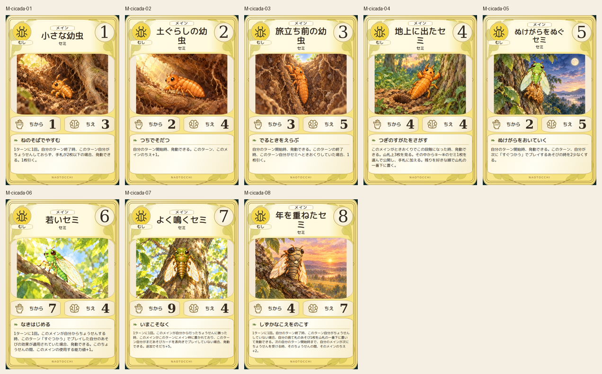
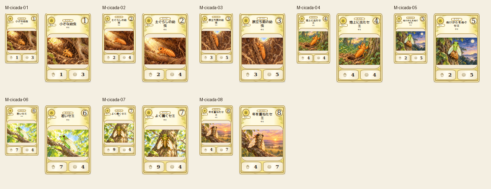

# cicada — 8段階

Canonical2D and all eight illustrations visually compared. Two nymph candidates revised for leg clarity and differentiated side/vertical composition, retained first candidates. Underground growth, surface emergence, fresh green adult, young green, mature olive and older gray are distinct. Whole-text preview fit limited to art-only page.

Chromium幅320/390/430、本文・数値、4サイズPNG検証済み。iPhone実機未確認。
