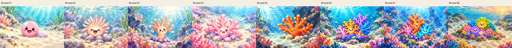
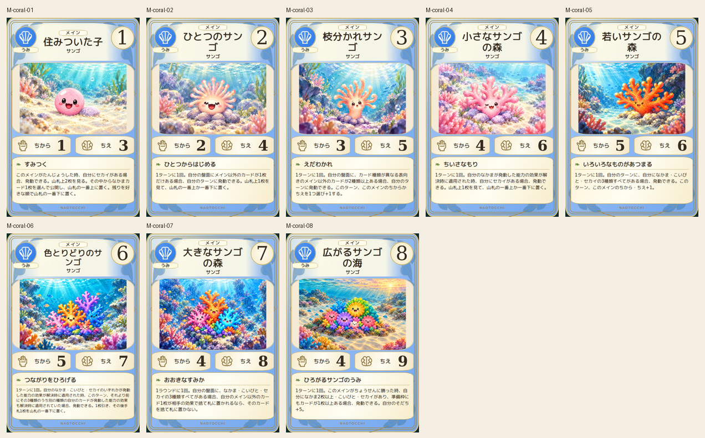
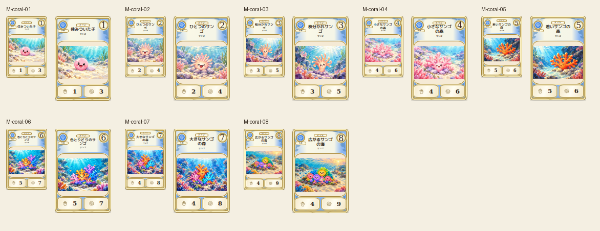

# coral — 8段階

Eight canonical coral stages visually compared: sphere, single polyp, tapering branching body, pink thicket, orange forest, multicolor cluster, taller forest and rounded broad reef. Color/shape/face maintained and scenery changes in distance and underwater lighting. No anatomical limbs added.

Chromium幅320/390/430、本文・数値、4サイズPNG検証済み。iPhone実機未確認。
