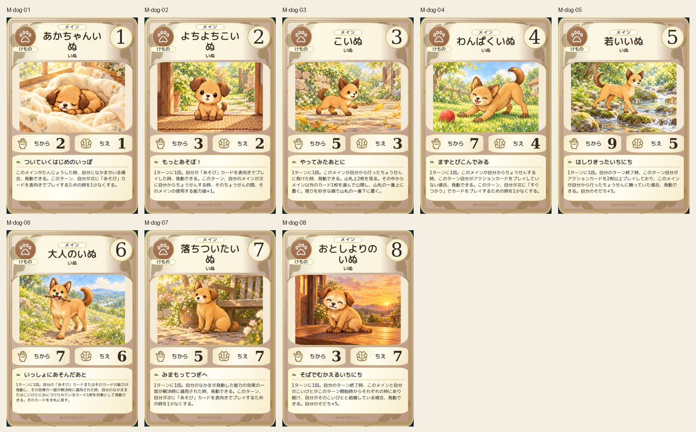
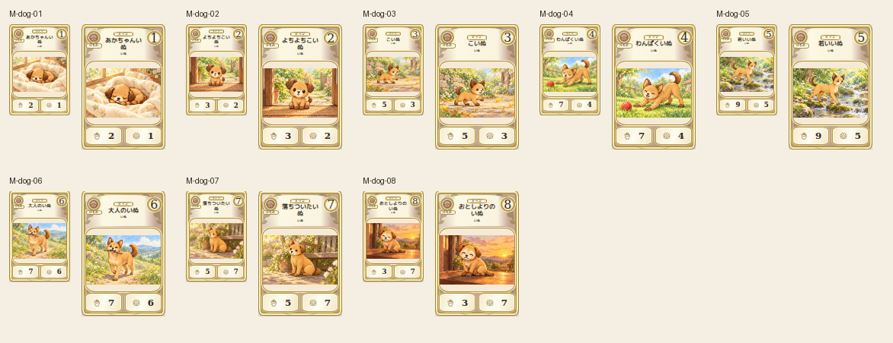

# dog — 8段階

All eight dog stages compared to canonical2D. Floppy infant ears, erect young/adult ears, one floppy middle-age ear and both floppy older ears preserved; puppy-to-adult body proportions and pale aging muzzle are distinguishable. Sleeping, sitting, trotting, playbow, stream crossing, fetching and restful poses reviewed.

Chromium幅320/390/430、本文・数値、4サイズPNG検証済み。iPhone実機未確認。
