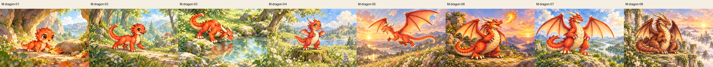
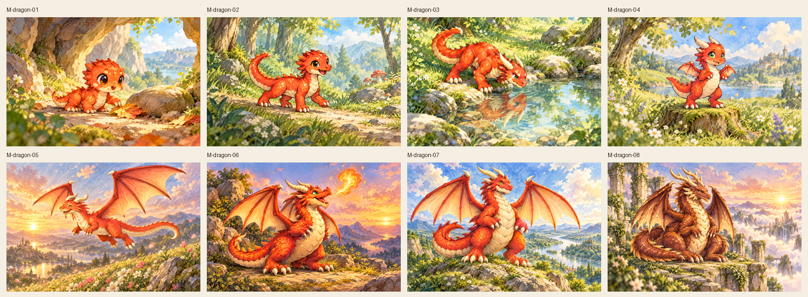
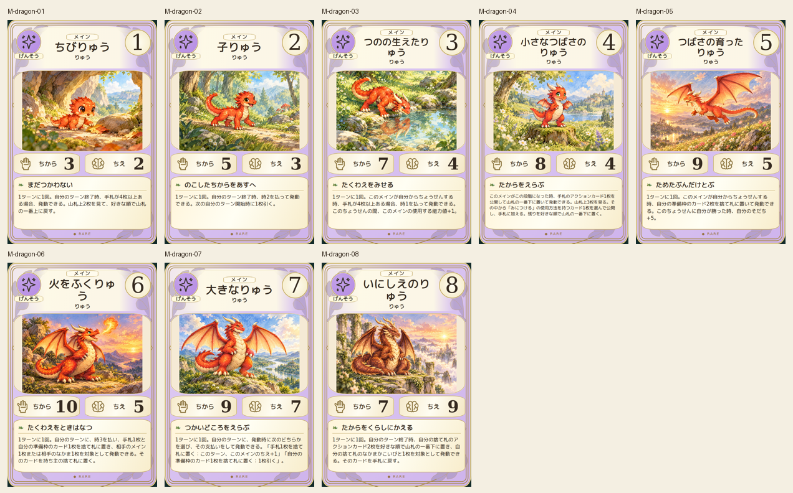
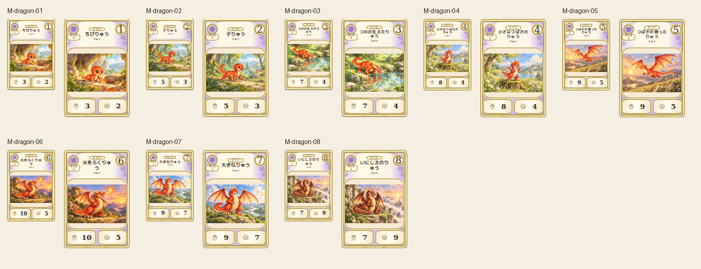

# main-dragon-20261019

Eight canonical dragon forms compared. Stage1-2 invented horns removed by precise imagegen edits and rejected originals retained. Stage3 horns/no wings, stage4 tiny wings, stage5 full wings, stage6 fire, stage7 broad adult and stage8 ancient bronze coiled dragon verified. Fire directed to empty air; welcoming scenery.

完成ID: M-dragon-01, M-dragon-02, M-dragon-03, M-dragon-04, M-dragon-05, M-dragon-06, M-dragon-07, M-dragon-08

Chromium幅320/390/430、本文・数値、4サイズPNG検証済み。iPhone実機Safari未確認。既存46枚の184ファイル変更なし。ゲーム本体への組み込み・mainマージ未実施。
