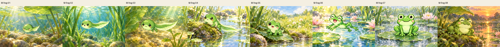
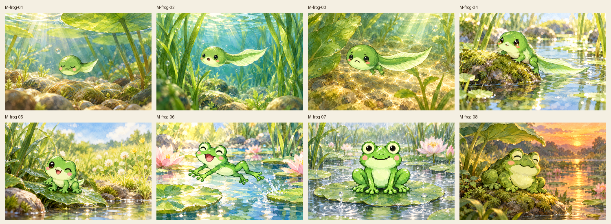
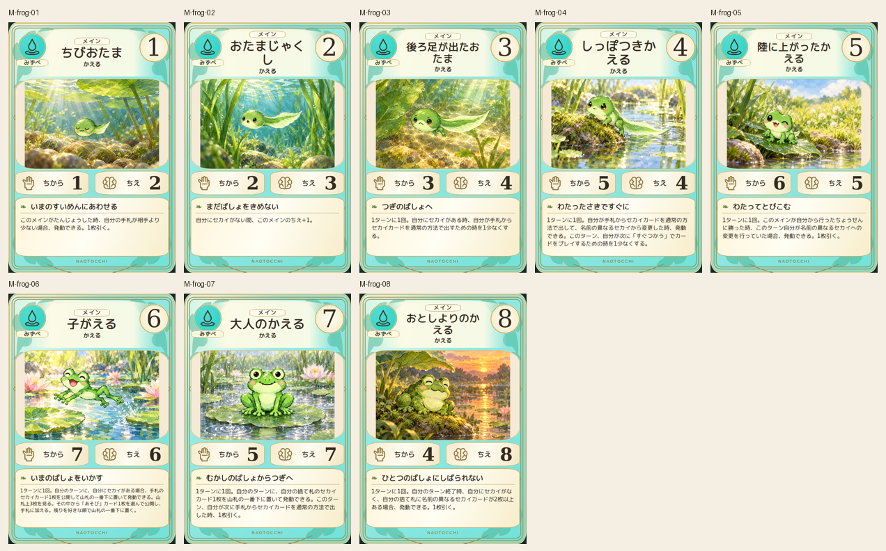
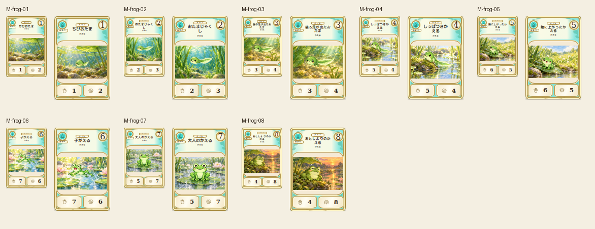

# main-frog-20261019

Eight forms visually compared with exact2D: no legs in1-2, only hindlegs3, fourlegs and longtail4, shorttail5, no tail6-8; adult broad belly and mottled older body preserved. Water-to-land-to-jumping story and natural pond scenes reviewed.

完成ID: M-frog-01, M-frog-02, M-frog-03, M-frog-04, M-frog-05, M-frog-06, M-frog-07, M-frog-08

Chromium幅320/390/430、本文・数値、4サイズPNG検証済み。iPhone実機Safari未確認。既存46枚の184ファイル変更なし。ゲーム本体への組み込み・mainマージ未実施。
