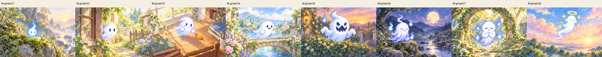
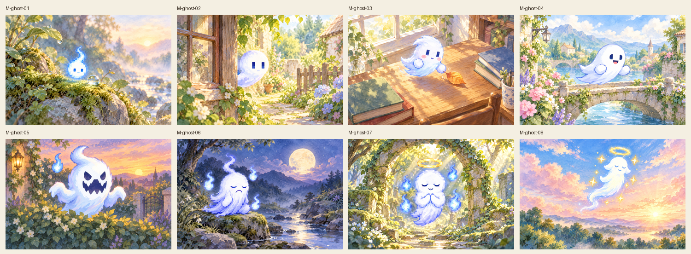
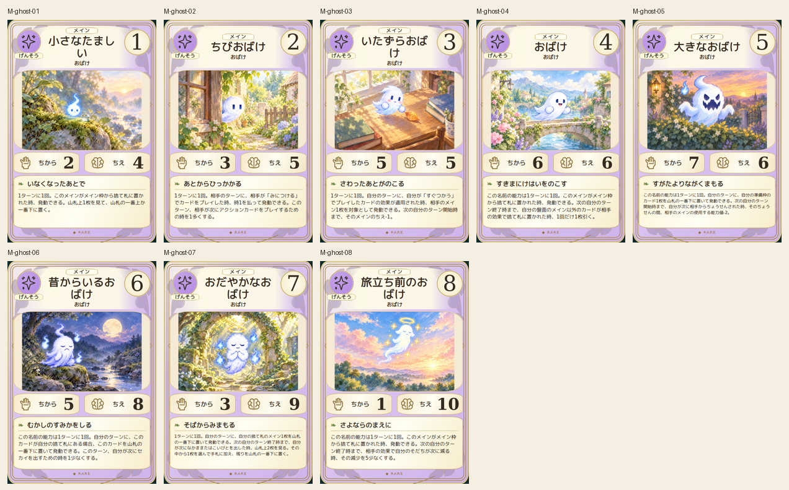
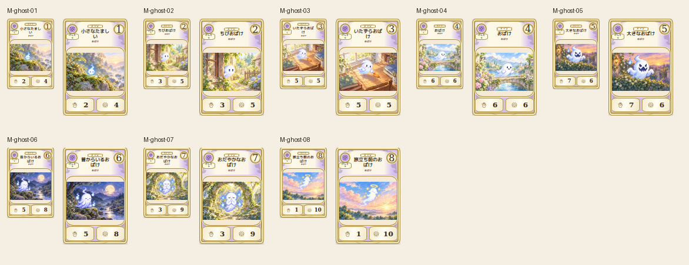

# main-ghost-20261019

Eight canonical spirit forms visually compared. Simple flame, handless young spirit, playful hands, larger body, zigzag-face form, elder beard, peaceful gold halo and airy departing spirit are distinguishable. Gentle garden/stream/dawn scenes retain lightblue-white identity without horror imagery.

完成ID: M-ghost-01, M-ghost-02, M-ghost-03, M-ghost-04, M-ghost-05, M-ghost-06, M-ghost-07, M-ghost-08

Chromium幅320/390/430、本文・数値、4サイズPNG検証済み。iPhone実機Safari未確認。既存46枚の184ファイル変更なし。ゲーム本体への組み込み・mainマージ未実施。
