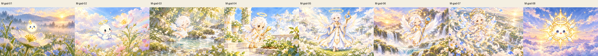
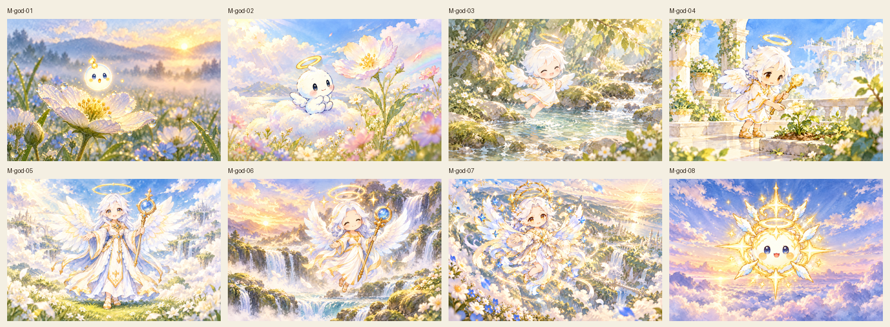
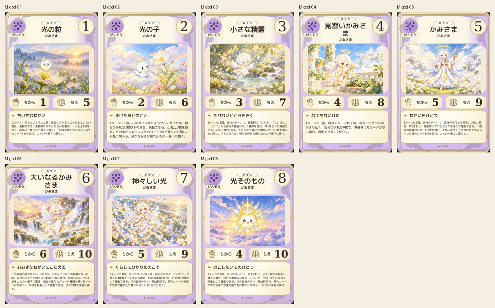
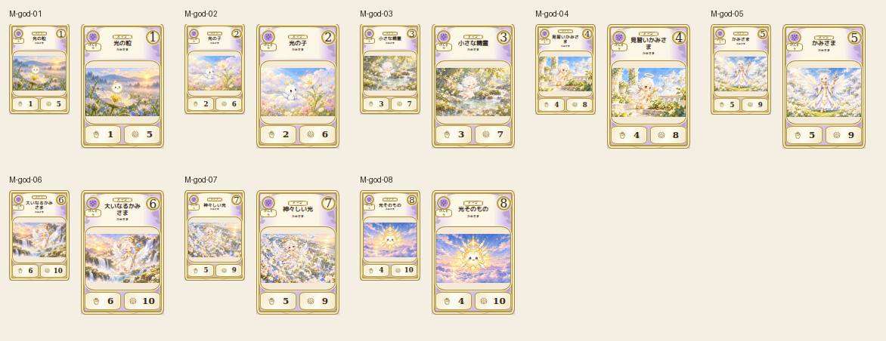

# main-god-20261019

Eight canonical deity forms visually compared: round lightseed, small halochild, winged spirit, apprentice with goldstaff, large-wing deity with bluestafforb, doublehalo, radiant figure and round starburst lightbeing. White/gold costume and staff/halo development preserved. Hands and facial clarity reviewed.

完成ID: M-god-01, M-god-02, M-god-03, M-god-04, M-god-05, M-god-06, M-god-07, M-god-08

Chromium幅320/390/430、本文・数値、4サイズPNG検証済み。iPhone実機Safari未確認。既存46枚の184ファイル変更なし。ゲーム本体への組み込み・mainマージ未実施。
