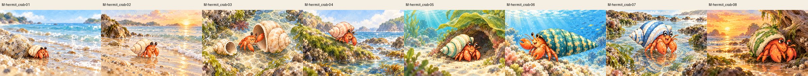
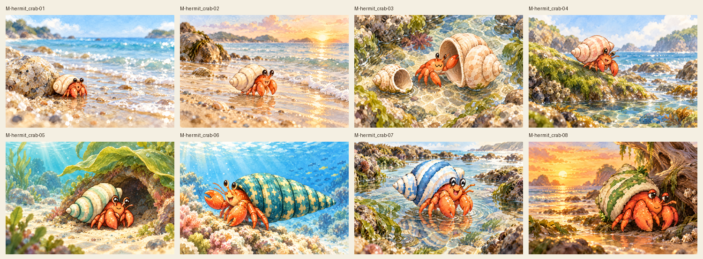
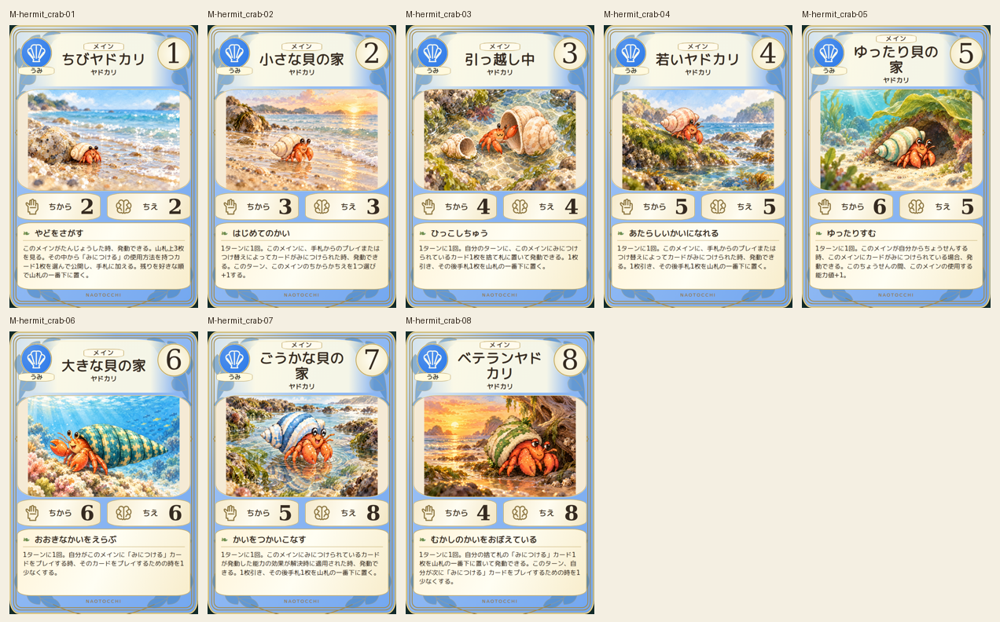
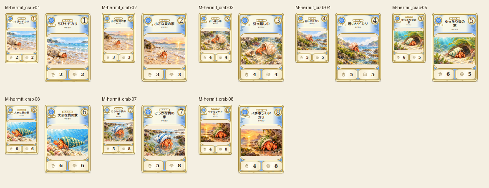

# main-hermit_crab-20261019

Eight canonical shell stages compared. Stage03 extra pincer removed; original retained. Shell colors, eye stalks, two pincers and changing seaside habitats verified. Tiny pebble shelter, cream conical shell, shell exchange, pink shell, mint stripes, teal shell, blue white shell and weathered old shell remain distinct.

完成ID: M-hermit_crab-01, M-hermit_crab-02, M-hermit_crab-03, M-hermit_crab-04, M-hermit_crab-05, M-hermit_crab-06, M-hermit_crab-07, M-hermit_crab-08

Chromium幅320/390/430、本文・数値、4サイズPNG検証済み。iPhone実機Safari未確認。既存46枚の184ファイル変更なし。ゲーム本体への組み込み・mainマージ未実施。
