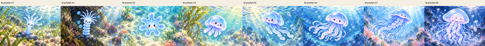
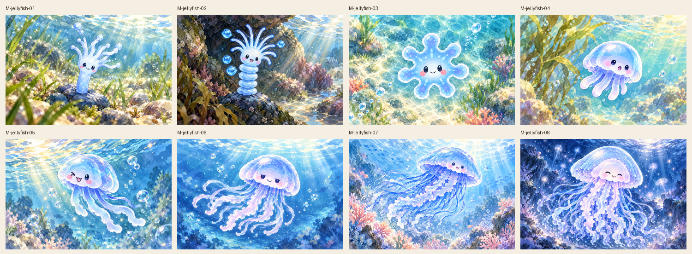
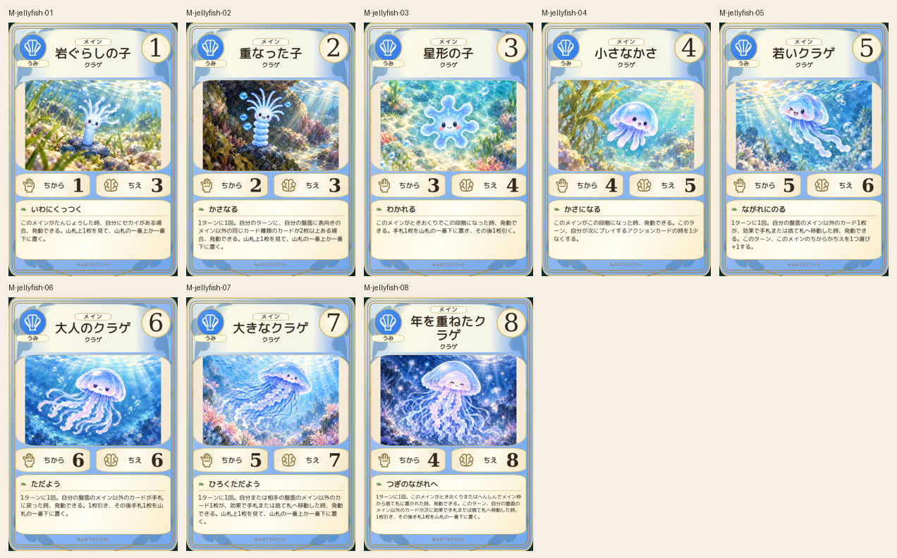
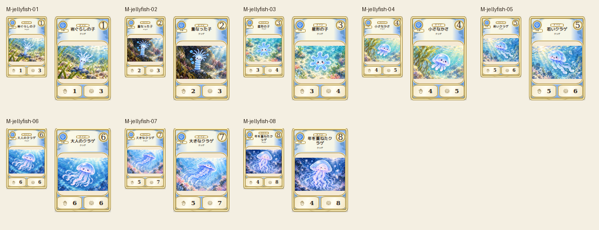

# main-jellyfish-20261019

Canonical polyp, stacked polyp, flat ephyra and five bell stages visually compared. Ephyra follows seven lobes visible in canonical sprite despite preliminary prose saying eight. Face, tentacle growth and alternating drift directions retained. No anatomy or text contradictions observed.

完成ID: M-jellyfish-01, M-jellyfish-02, M-jellyfish-03, M-jellyfish-04, M-jellyfish-05, M-jellyfish-06, M-jellyfish-07, M-jellyfish-08

Chromium幅320/390/430、本文・数値、4サイズPNG検証済み。iPhone実機Safari未確認。既存46枚の184ファイル変更なし。ゲーム本体への組み込み・mainマージ未実施。
