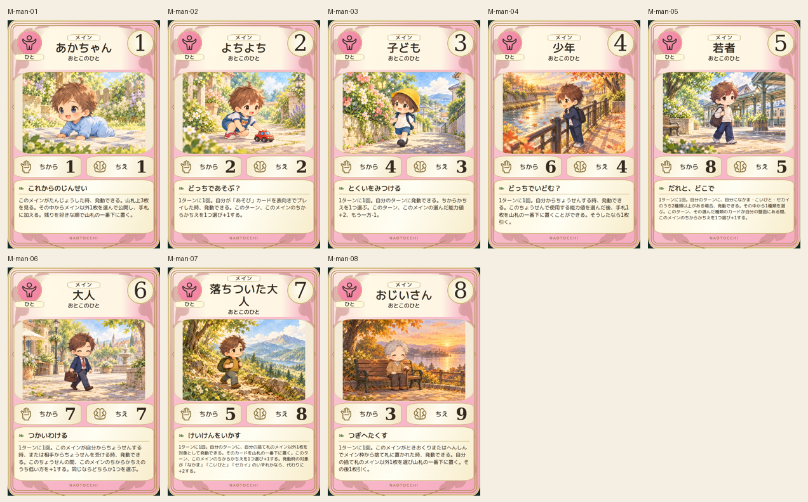
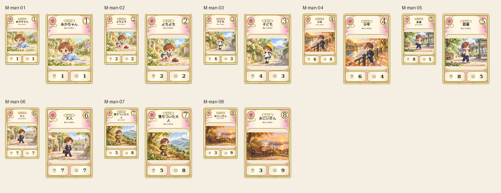

# main-man-20261019

Eight ages visually compared against canonical 2D. Crawling infant, car-playing toddler, child outing, school commute, young adult departure, working adult, middle-age hike and elderly park rest use different poses and places. Toddler extra shoe corrected and original retained. Faces, clothes, accessories and limb counts verified.

完成ID: M-man-01, M-man-02, M-man-03, M-man-04, M-man-05, M-man-06, M-man-07, M-man-08

Chromium幅320/390/430、本文・数値、4サイズPNG検証済み。iPhone実機Safari未確認。既存46枚の184ファイル変更なし。ゲーム本体への組み込み・mainマージ未実施。
