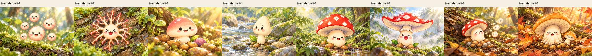
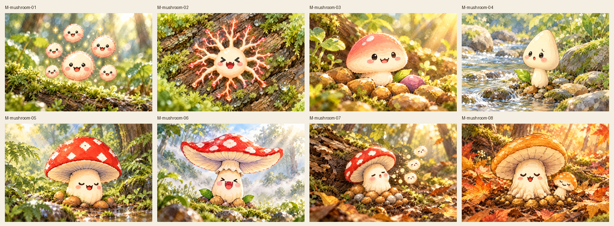
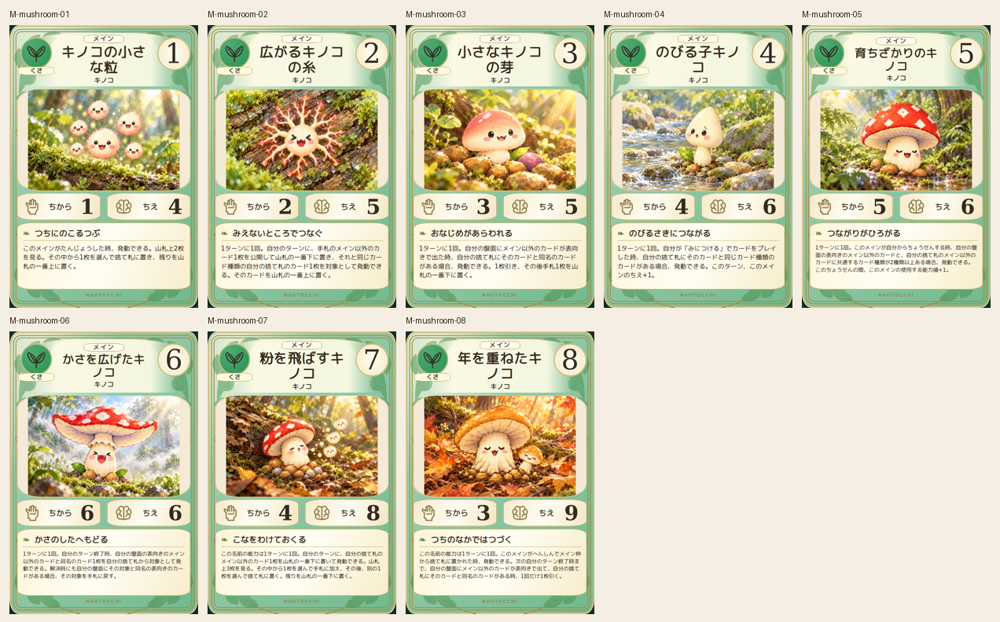
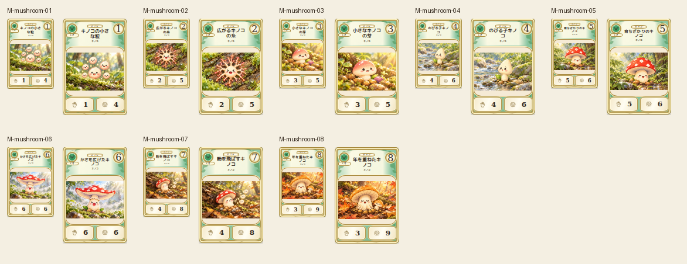

# main-mushroom-20261019

Spore cluster, branching mycelium, pink sprout, pale narrow child, red growing cap, broad upturned cap, releasing spores and golden elderly mushroom compared with canonical 2D. Face placement, gills, cap shapes and age colors preserved; distinct scale and habitats verified.

完成ID: M-mushroom-01, M-mushroom-02, M-mushroom-03, M-mushroom-04, M-mushroom-05, M-mushroom-06, M-mushroom-07, M-mushroom-08

Chromium幅320/390/430、本文・数値、4サイズPNG検証済み。iPhone実機Safari未確認。既存46枚の184ファイル変更なし。ゲーム本体への組み込み・mainマージ未実施。
