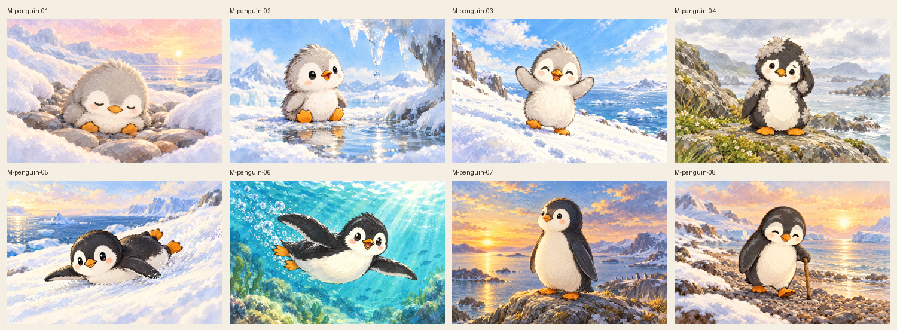
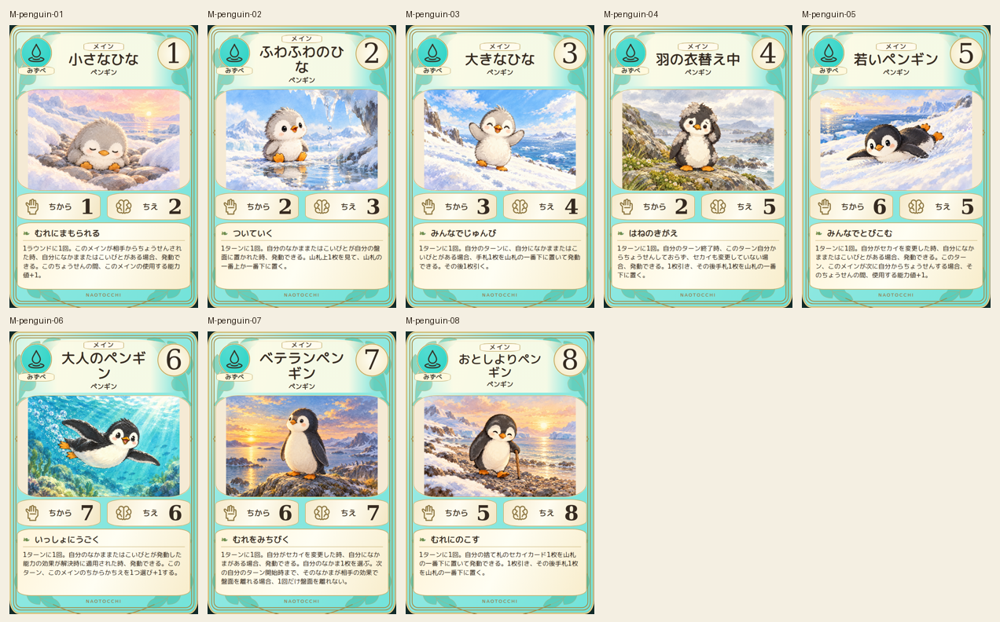
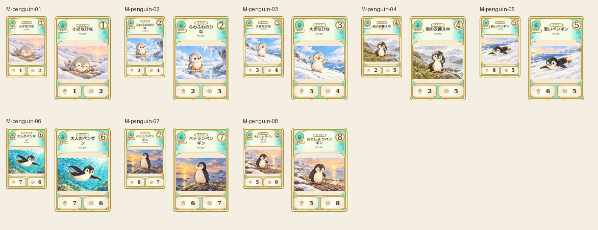

# main-penguin-20261019

Eight canonical stages compared: sleeping small chick, curious fluffy chick, upright large chick, patchy molt, slim sliding juvenile, swimming adult, sturdy lookout and cane-using elder. Exactly two flippers and feet where visible. Missing local stage02 artifact recovered by same-scene regeneration before acceptance. Viewpoint, action and stage plumage differentiated.

完成ID: M-penguin-01, M-penguin-02, M-penguin-03, M-penguin-04, M-penguin-05, M-penguin-06, M-penguin-07, M-penguin-08

Chromium幅320/390/430、本文・数値、4サイズPNG検証済み。iPhone実機Safari未確認。既存46枚の184ファイル変更なし。ゲーム本体への組み込み・mainマージ未実施。
